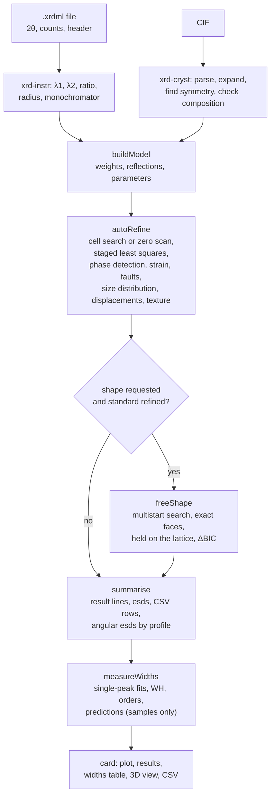

# How the Rietveld refinement works

The *Rietveld* card of the XRPD module refines powder patterns against crystal structures read from CIF files. It runs in the browser: nothing is sent to a server. This document describes the method as it is implemented. It covers:

- the model of the pattern;
- the least-squares solver;
- the staged strategy that takes a pattern from a CIF cell to a converged fit;
- the instrumental standard;
- the size, strain and fault broadening, by Lorentzian widths or by Whole Powder Pattern Modelling;
- the displacement parameters and the site occupancies;
- preferred orientation and the crystallite-shape model;
- the single-peak width tests;
- what is reported, and with which uncertainties.

Each choice comes with its reason, and with the evidence it rests on where there is some. Most of that evidence is in the code's own comments and in the commit messages from v418 to v425.

The document follows the code as of v425. Functions are named with their file, e.g. `autoRefine` (`xrd-rietveld.js`), so that the references survive edits better than line numbers.

## Contents

1. [Overview](#1-overview)
2. [Inputs: the pattern, the instrument, the phases](#2-inputs-the-pattern-the-instrument-the-phases)
3. [The calculated pattern](#3-the-calculated-pattern)
4. [The parameters](#4-the-parameters)
5. [Least squares](#5-least-squares)
6. [The refinement strategy](#6-the-refinement-strategy)
7. [Instrument, size and strain](#7-instrument-size-and-strain)
8. [Displacement parameters and site occupancies](#8-displacement-parameters-and-site-occupancies)
9. [Preferred orientation](#9-preferred-orientation)
10. [The free crystallite shape](#10-the-free-crystallite-shape)
11. [Weight fractions, cell volume, displacement](#11-weight-fractions-cell-volume-displacement)
12. [Peak widths and the tests that use them](#12-peak-widths-and-the-tests-that-use-them)
13. [The worker, the card and the exports](#13-the-worker-the-card-and-the-exports)
14. [Validation](#14-validation)
15. [Limits, and what could come next](#15-limits-and-what-could-come-next)
16. [Known issues](#16-known-issues)
17. [References](#17-references)

---

## 1. Overview

### 1.1 Using it

1. Load the patterns in the XRPD module (`.xrdml`), and mark the measurement of the instrumental standard (NIST SRM 660c LaB₆) as the standard.
2. Add each phase from a CIF (**+ CIF**). The standard's LaB₆ is built in.
3. Optionally, in **Settings…** (beside Refine; §13.5), switch on or off, per phase, each fitting mode, and choose its depth:
   - the crystallite size (isotropic, or one of five solids);
   - WPPM, the size's profile (one size; a log-normal distribution of sizes; off: the Lorentzian);
   - the microstrain (isotropic, or anisotropic after Stephens);
   - planar faults (one of six kinds);
   - the displacement parameters (one ΔB; B per site; Uⁱʲ per site; off: the CIF's);
   - the occupancy of one of the phase's sites (off: the CIF's);
   - a preferred orientation (*best axis*, or a plane).

   The standard's LaB₆ has its B and texture there too. The same modal sets where **Refine** starts: from the CIF, or from each pattern's last result with chosen groups of parameters held there (§6.8).
4. **Refine all** refines the standard first, then every sample with the standard's instrumental profile.
5. Read the results:
   - the result lines (with esds in brackets) and the warnings;
   - the pattern plot (observed, calculated, background, difference, ticks);
   - for samples, the peak-width table, the Williamson–Hall plot and the tests;
   - with a shape, the 3D view of the solid.

   Three CSV files export everything.

### 1.2 The modules

| File | Lines | Role |
|---|---|---|
| `xrd-data.js` | 450 | Reference tables: X-ray form factors (Waasmaier–Kirfel), anomalous dispersion (Chantler; Cromer–Liberman for Np–Cf), atomic masses; the species of a site label. |
| `xrd-cryst.js` | 1063 | CIF reading, symmetry from the atoms, conventional cells, reflection lists with multiplicities and absences, structure factors, the sites and the displacement parameters their symmetry allows. |
| `xrd-instr.js` | 328 | The instrument as the `.xrdml` header describes it; the scan itself (2θ, intensities, their variance) and the file's encoding. |
| `xrd-rietveld.js` | 2819 | The engine: the model, the profile, least squares, the staged strategy, preferred orientation, the free shape, sizes and weight fractions. |
| `xrd-broad.js` | 430 | Whole Powder Pattern Modelling (a line synthesised from its Fourier coefficients by FFT; the solids' common-volume functions; the log-normal average), Stephens' quartic invariants, the planar-fault table. |
| `xrd-rietveld.worker.js` | 400 | Runs a refinement off the main thread; formats the result lines and the CSV rows. |
| `xrd-widths.js` | 333 | Single-peak widths after the refinement; Williamson–Hall, order and prediction tests. |
| `xrd-rv.js` | 652 | The card: phases, options, runs, plots, results, state, exports. |
| `xrd-shape3d.js` | 1359 | The rotatable 3D view of a crystallite solid (2D canvas, no WebGL). |

The engine modules (`xrd-data`, `xrd-cryst`, `xrd-instr`, `xrd-broad`, `xrd-rietveld`, `xrd-widths`) are pure functions, with no DOM. The page, the worker and Node all import them, so they can be tested under Node (§14).

### 1.3 What happens on Refine



The standard's refinement produces the instrumental resolution function (*irf*): Caglioti U, V, W; Lorentzian X, Y; the axial divergence (through the Soller slits, the sample's and receiver's axial length L; without Sollers in the file, FCJ's asymmetry A); the zero and the sin 2θ shift. Every sample refined afterwards takes it as its instrument.

### 1.4 Conventions

- **Angles.**
  - The data, the peak positions and all widths are in degrees 2θ.
  - θ in the formulas is the Bragg angle of the line, in radians where the code needs it.
  - All profile widths are **FWHM** unless a section says integral breadth (β).
- **Size and strain conventions.** Both are read on the Lorentzian FWHM (§7.2): the Scherrer size with K = 0.9, and the microstrain ε with H = 4ε·tanθ. Stokes and Wilson read the strain on the integral breadth β, which for a Lorentzian is π/2 times the FWHM: their e = β/(4 tanθ) is 1.571× this ε (and their apparent strain η = β·cotθ = 4e is 2π× it). GSAS-II's isotropic microstrain μ (in 10⁻⁶; a Lorentzian FWHM of μ·10⁻⁶·tanθ in radians) is 4ε·10⁶. Literature values need these factors.
- **Reciprocal length.** s = sinθ/λ = 1/(2d), in Å⁻¹ (the variable of form factors and Debye–Waller factors). Where the profile theory needs it, d\* = 1/d = 2sinθ/λ.
- **Units.**
  - Cell lengths in Å; crystallite sizes in nm.
  - B in Ų (B = 8π²U).
  - The specimen displacement is reported in mm.
- **Indices.**
  - (hkl) is a plane and its reflection; {hkl} is its family.
  - [uvw] is a lattice direction; ⟨uvw⟩ is its family.
  - All are given in the **conventional** cell, even when the CIF holds a primitive one.
- **Esds** are written as 3.9151(8): the esd rounded to one significant digit (two when that digit is 1), the value rounded to the same last digit, and the esd in units of that digit (`fmtEsd`, worker; `fmtE`, card). An esd that rounds up to the next leading digit keeps one digit (0.0096 gives 1.50(1)); one of 10 or more in the units rounds the value to its tens or hundreds (125 ± 314 gives 100(300)). An esd under 10⁻¹⁵ of the value, below what a double holds, gives the value alone (an esd under 10⁻¹⁰⁰ had thrown, and lost the whole summary).

## 2. Inputs: the pattern, the instrument, the phases

### 2.1 The pattern and its weights

The XRPD module (`xrd.js`) reads each `.xrdml` file through `readXrdmlScan` (`xrd-instr.js`), which also gives the reason when it refuses one. A scan recorded downwards (start above end) is turned round, with its variances: the module's plots, its peak search and the Rietveld card take 2θ ascending (up to v425 the card kept no tick before a refinement and drew the range reversed).

**Encoding.** The text is decoded from the file's bytes as the XML specification's appendix F says: a byte-order mark (UTF-8, UTF-16 LE or BE), else UTF-16 by the zero byte beside each of the first two characters, else the declaration's `encoding="…"`, else UTF-8 (`decodeXml`). Bytes that read as ASCII cannot be UTF-16, so a declared UTF-16 is then ignored (a UTF-8 file written from a .NET string declares it). `Blob.text()`, which v425 used, decodes UTF-8 alone, so a UTF-16 file was reported invalid. The card's header reader gets the same bytes.

**2θ** comes from the `2Theta` `<positions>` of the first scan:
- start and end: an evenly spaced grid over the points;
- `<listPositions>`: one per point;
- a `<commonPosition>` alone means 2θ stood still (an ω or rocking scan): refused;
- a missing or invalid start or end: refused. Up to v425 the test used the global `isFinite`, for which null is finite, and such a file loaded with every 2θ at 0.

**The intensities.**
- **`<intensities>`** (XRDML 1.x) are already on the unattenuated scale: the instrument multiplied the points counted through the automatic attenuator by its factor when it wrote the file (GSAS-II, xrayutilities and GenX read them so). Up to v424 the `beamAttenuationFactors` were applied a second time, which put an attenuated peak top 10–200× too high.
- **`<counts>`** (XRDML 2.x) are the raw counts: they are multiplied by the attenuation factors here, as xrayutilities does. Up to v425 such a file was reported invalid.
- **An attenuation list that cannot be used** (another length than the points, a factor that is not a positive number) refuses raw `<counts>`, whose attenuated points would stay uncorrected; with `<intensities>` it is ignored with a note, since only their variance needs it (v425 dropped it silently).
- **Counting times** are read with their unit (s, ms, µs, min).
- **A rate** is recognised from the intensities' unit: per second ('cps', 'counts/s', 'counts per second', 's-1', 'Hz'). Up to v426 any '/s' or 'per' counted, so 'counts/step' or 'percent' made counts a rate. Read either way wrongly, one count is taken as t or 1/t of itself: on synthetic corundum and ZnO with a 2-count background that moved the background by 0.7–1.8 counts and B by 0.6–4.6 esd (t 0.5–10 s, the most at 10 s); on a 20-count background, 0.5–1 count and under 0.1 esd. buildModel's noise check (below) corrects a count taken over twice too large, not one taken too small.
- **Unequal counting times** (`<countingTimes>`, one per point: a pre-set-counts scan, whose counts sit about the preset everywhere, or a variable-time scan) make a pattern only as rates: the counts are divided by their times, and the loader says so. A pre-set-counts scan in counts without its times is refused; v425 loaded it as a nearly flat pattern. One in cps without its times is loaded with a note: its pattern is right, but its weights take every point as counted for the same time.
- **A rate with no counting time** gets its time from the noise, with a note. For Poisson counts the second difference d = y₋ − 2y + y₊ has variance m·(μ₋ + 4μ + μ₊) ≈ 6m·ȳ, m = 1/t, so d²/(6ȳ) is m times a χ²₁ variable, whose median is 0.4549; the median over the points ignores the peaks while they hold fewer than half of them. On synthetic patterns (10–250 peaks, backgrounds of 3–300 counts, 0.5–100 s) it finds t within 10 % with 10 peaks in 100°, 18 % with 60 and 37 % with 250 (on 300 counts). t sets the one-count floor, the target's shift (below: a t 37 % short moves the background about 0.6 count) and the χ² scale; the esds do not depend on it, being scaled by χ²_ν. v425 took 1 s: χ²_ν then read about 1/t (0.04 at 12 s), and the free shape's ΔBIC, which weighs a χ² difference against max(1, χ²_ν), took the evidence as t times weaker.

**Variance multiplier.** Each point carries `varMul`, so that var(y) = y·varMul: the factor that turns one count into the units of y, that is the attenuation factor, divided by the counting time when y is a rate. `varMul` is attached when it is not 1 throughout.

**What `buildModel` (`xrd-rietveld.js`) does with them:**
- **Descending scans.** A descending scan is held ascending internally: peak windows are found by bisection. Results are returned in the caller's order.
- **Bad 2θ.** A 2θ that is not a number throws, naming the point. A NaN would otherwise enter the background basis and every sum.
- **Missing counts.** A missing or non-finite count, or a non-positive `varMul`, gives the point zero weight.
- **Weights: Mighell's χ²_γ** (*ApJ* 518 (1999) 380). With m_i = varMul_i (one count in the units of y; scaled when the noise says otherwise, below) and the counts N_i = y_i/m_i, the fit's target and variance are N + min(N, 1) and N + 1; in the units of y,

  ```math
  T_i = y_i + \min(y_i^+, m_i),\qquad \sigma_i^2 = (y_i^+ + m_i)\, m_i ,\qquad w_i = 1/\sigma_i^2 ,\qquad y^+ = \max(y, 0)
  ```

  and the fit minimises Σ w_i (T_i − y_c,i)².
  - *The floor is one count in any unit.* v425's σ² = max(y, 1)·varMul floored a rate file at 1 cps, that is t counts: with t = 12 s, points under 13 counts were under-weighted by up to 12×, and χ²_ν of a 5-count background was 0.43 read as cps against 1.29 read as counts (1.06 both now).
  - *No background bias.* At the true mean μ, (N + min(N, 1) − μ)/(N + 1) averages exactly 0 over Poisson N. Weighting by the observed counts, 1/max(y, 1), as GSAS and FullProf do, pulls the background 1.0–1.2 counts per point low (a point that fluctuates low weighs more): 22 esd on a 5-count pattern.
  - *The scales.* Monte Carlo of one peak on a flat background (4000 realisations): 1/max(y, 1) biases the scale +0.5 % at 10 counts per point, +1.4 % at 5 and −4.6 % at 2, χ²_γ +0.25 %, +0.6 % and +0.8 %; on whole two-phase patterns at 5 counts no bias is resolved (−0.1 % and +0.3 %, within 1.2 standard errors of 30 realisations, where 1/max(y, 1) gives +0.4 % and +1.0 %, the second at 4 standard errors). Weights from the model (iterated) remove the scale bias too, but a peak the model lacks then pulls the scale harder: 2× at 30 % of the modelled peak's area, 4–5× at 100 %; χ²_γ keeps the data's weights.
  - *χ²_ν.* Its expectation is within 14 % of 1 per point from one count up (exact sums over N); with 1/max(y, 1) it is 1.64 at 5 counts, 1.31 at 10.
  - *The count is checked against the noise.* The target's shift needs m right: with one count taken k times too large, the background moves about k − 1 counts wherever the counts exceed k (+11 at k = 12, a rate with no counting time; exact sums over N), where 1/max(y, 1) stays about a count low whatever k. So `buildModel` estimates one count from the noise of y/m as the loader does for a rate with no time (`noiseCountScale`). On Poisson counts the estimate is 0.82–13 over 225 synthetic patterns (five structure sets from cubic to triclinic, steps 0.01–0.05°, sizes 8–200 nm, backgrounds 0.2–100 counts; the high end from sharp peaks at coarse steps). Below 1/2 the data are not counts in the units given (a rate with no time, as a session saved by v425 holds one; averaged, rescaled or smoothed counts), and the noise's count is used, with a warning: on a 4-count rutile pattern given as cps with no time, the background goes from 7.6 counts (truth 4) and ΔB 15 esd off to the refinement of the same counts given as counts: every other parameter within 0.03 esd, the background within 0.12 count.

  The agreement indices (§3.10) are computed with T; the card plots y and y − y_c.
- **Too few points.** Fewer than 10 weighted points (`MIN_POINTS`) is an error. That floor only refuses a pattern no model can use; the bound that matters is the number of free parameters, which a refinement must stay below (§5.7).

### 2.2 The instrument from the `.xrdml` header (`xrd-instr.js`)

**Reading the file.**
- The header is read by a small tolerant XML reader. A stray end tag closes back to its element or is ignored ("a header half-read beats none").
- It stops at the end of the first `<xrdMeasurement>`.
- A DOM entry point and a text entry point share the field logic through a five-function accessor, so the two cannot drift apart. The card uses the text one.
- Values the file does not give are left `undefined`, so `??` and `isFinite` read them as missing.

**What is read.**

| Item | Read from | Used by the model |
|---|---|---|
| Kα1, Kα2, Kβ, Kα2/Kα1 ratio | `usedWavelength` (else the anode's table, else Cu) | λ1, λ2, ratio |
| Anode | `anodeMaterial`, else the tube name (`… Cu LFF`) | defaults only |
| Goniometer radius | incident (else diffracted) beam path | the displacement in mm |
| Divergence slit | `xsi:type`, name, angle, or height at a distance | warnings, display |
| Soller slits, incident and diffracted | `sollerSlit` opening (else its name: `Soller 0.04 rad.`) | the axial divergence: both given, the Soller model (§3.7.1), else FCJ; display |
| Tube focus | `xRayTube/focus/length` (a line focus) | the source's axial length in the Soller model (12 mm when none, §3.7.1) |
| Filter | element and name | display only |
| Anti-scatter slits, mask | elements and names | read, not used |
| Monochromator | any element named `*monochromator*` on each side: its crystal, reflection and number of reflections, from `<crystal>`, `<hkl>`, `<numberOfReflections>`, else from its name (`Hybrid 2xGe(220)`, `4xGe220`, `Ge(220) four-bounce`, `Bartels`, `Graphite (002)`) | polarisation K (LP, §3.4); Kα2 dropped behind a perfect crystal on the incident side |
| Sample mode, scan axis | `xrdMeasurement`, `scan` | warnings |
| Detector | `detector` | display (its name) |
| Scan mode, counting time | `scan` | read, not used (the scan reader of §2.1, `readScan`, reads them again for the weights) |

**Defaults, each with a warning shown on the card's instrument line.**

| Missing or invalid | Assumed |
|---|---|
| No wavelength | the anode's Kα1, Kα2, ratio 0.5. Cu's are as X'Pert Data Collector writes them (1.540598, 1.544426 Å); the other anodes' are Bearden's (*Rev. Mod. Phys.* 39 (1967) 78). Cu if the anode is unknown or has no table |
| λ1 but no Kα2 | a single wavelength (λ2 = λ1, ratio 0) |
| Ratio outside [0, 1] or missing | 0.5 |
| No radius | 240 mm (the displacement in mm depends on it, and the standard's radius is compared with it: §7.1) |
| A monochromator crystal not recognised | graphite (002), K = 0.800 at Cu |
| A recognised crystal with no reflection, or one that cannot diffract λ | its usual one: Ge and Si (111), LiF (200), quartz (10-11); graphite (002), its only one, without a warning |

**Geometries the model does not handle are warned about, not corrected:**
- a sample mode other than reflection;
- a scan axis other than the coupled θ–2θ (`Gonio`);
- an automatic divergence slit, whose intensities grow as sinθ against a fixed slit;
- a programmable slit with no irradiated length;
- an unknown or missing divergence slit, which is taken as fixed;
- an incident-beam crystal not recognised with a Kα2 ratio, which is kept but in doubt.

**Kα2 behind a perfect incident crystal.** A perfect crystal (Ge, Si, quartz) before the sample passes Kα1 alone: the Kα1–Kα2 separation is about eight of its Darwin widths (124″ against 16″ at Ge 111). The file's Kα2 ratio is then set to 0, with a warning (v425 kept the file's 0.5, a phantom Kα2).

**What the model uses:** λ1, λ2, the ratio, the monochromators' polarisation K (`monoK`, the product of both sides'), and the radius. The card's instrument line shows each crystal and K. A file whose header cannot be read gives Cu Kα1/Kα2 at ratio 0.5, R = 240 mm and no monochromator ([Known issues](#16-known-issues)).

### 2.3 Phases from CIF files (`xrd-cryst.js`, `prepPhase` in `xrd-rv.js`)

**The parser** reads a CIF 1.1 subset, and accepts DDLm tag spellings (`_atom_site.fract_x`). Throughout, it refuses what would give a wrong pattern without an error, and warns where it assumes.

*Block, cell and operations.*
- **Block.** The first data block with fractional coordinates is used. A file holding more structures says which one was taken. A file with only Cartesian coordinates is refused.
- **Cell.**
  - Lengths must be positive.
  - A missing or invalid angle is the one the symmetry operations require, when they leave a single choice among 90°, 120°, 60° and the angles given (every R must keep the metric, RᵀGR = G, within the tolerance of the lattice symmetry, §2.4: a hexagonal file whose a and b differ in their last digit still fixes γ); else 90°. Either way a warning says which. Up to v426 it was always 90°: a hexagonal file without γ was read with γ = 90°, and its 3- and 6-fold operations merged reflections of different d. Written as CIFs with their operations, the 530 settings with one angle left out are now read right whenever the operations fix it (the 52 hexagonal γ, the 7 rhombohedral α, β, γ; v426: none); a monoclinic file without its unique angle, or a triclinic one, still reads 90°.
  - Angles that form no cell are refused (V must exceed 10⁻⁶·abc): 120/120/120° gives V = 0, and 60/60/130° a negative metric determinant. The bound is relative, so it holds at any scale; valid cells close to the limit (α = β = γ = 119.9999°, V/abc = 2.6·10⁻³; β = 179.9999°, 1.7·10⁻⁶) are read.
  - **The rounding the written cell hides** goes with it to the symmetry search (§2.4): half a unit of the last decimal e_k of each written value p_k, kept as one term per value with the derivative of the metric, D_k = ∂G/∂p_k (∂G_ii/∂aᵢ = 2aᵢ, ∂G_ij/∂aᵢ = a_j cos θ_ij, ∂G_jk/∂θ_jk = −a_j a_k sin θ_jk). Any quantity linear in G, Q(G), is then known to Σ_k e_k |Q(D_k)|, in whatever basis (each D_k goes as MᵀD_kM): the first-order worst case, with each written value counted once. A length written with one decimal or none counts as exact, as for the coordinates, and so does an angle of 60°, 90° or 120°, or a whole number of degrees; an angle to 0.1° is a measurement (older structures write β = 104.5(2)°) and carries 0.05°.
- **Symmetry operations** come from `_space_group_symop_operation_xyz` or `_symmetry_equiv_pos_as_xyz`.
  - Each is parsed strictly. A misread operation would silently produce a wrong structure, so an operation with a non-integer rotation or |det R| ≠ 1 is dropped, with a warning. The file is read with the rest, and the group check then usually reports the list as incomplete.
  - A translation written as a decimal stands for a multiple of 1/24 when its digits are a rounding or a cut of one ('0.33', '0.333' and '0.3333' are ⅓, '0.66' and '0.6666' ⅔; '0.30' is no 7/24): a value v with d ≥ 2 decimals, unit u, stands for v − u/2 to v + u in magnitude. The file's translations are snapped onto the grid, so that the absence test h·t ∈ ℤ stays exact, only when every one of them is such a rounding (a standard origin); otherwise none is, and each keeps its value and its rounding (one unit of its last decimal), which the group check and the filling of the cell then allow. A shifted origin puts translations off the grid, and some of them fall within their digits of it by chance: snapping those one by one moved 3743 of 22164 translations beyond what was written over the 530 settings at random origins written with two decimals, and filled 379 cells with a wrong number of atoms (544 and 14 with three decimals); deciding for the whole list, 206 and 55 (2 and 1). Fractions, integers and values with one decimal snap within 1.5·10⁻³, as before. (The translations findSymmetry fits to the atoms are snapped by its own rule, §2.4 step 5: at random origins it caught a glide within 1.5·10⁻³ of the grid by chance in 3 of the 530 settings, the atoms then moved by up to 3.8 mÅ, the group the same.) Up to v426 every translation snapped within 1.5·10⁻³: two decimals were missed (over the 530 settings written with two-decimal translations, rounded or cut, 21 lost operations, among them P3₁'s screw and R3's centring, 4 were filled with the wrong number of atoms, 7 to 17 had wrong absences; none since), and a translation of a shifted origin within 1.5·10⁻³ of the grid was moved onto it (at random origins, written with three decimals 126 lists were called "not a group" and 44 cells filled wrong, with four to six decimals 39 settings got a special position multiplied, the atoms moved by up to 0.013 Å; none since).
  - A missing identity is added.
  - A list that is not a group is reported ("the list looks incomplete"). Two operations are one when their translations agree within the rounding of their digits (exact ones within 10⁻⁶), and a product carries its factors'. Up to v426 they were compared as keys rounded to 10⁻³, which split a translation and its rounded copy on either side of a step: of the 530 groups at random origins written with four, five and six decimals, 137, 64 and 52 were called "not a group"; none since.
  - So is a centred symbol whose centring translations are missing.
  - **A magnetic CIF** (MAGNDATA, ISODISTORT) gives `_space_group_symop_magn_operation.xyz` and `_space_group_symop_magn_centering.xyz`, each with a time reversal ±1. The space-group operations are every centring times every operation, time reversal dropped: it does not move the atoms, and the magnetic moments scatter X-rays negligibly. A warning says so. A magnetic group named without operations (its BNS or OG name or number, or its parent space group) counts as a named group for the refusals below, and a superspace (modulated) magnetic CIF is refused. Up to v425 such a file was read as its asymmetric unit in P1 without a word: LaMnO₃ in Pn′ma′ gave 4 atoms instead of 20.

*Sites.*
- Each site has a species, x, y, z and an occupancy.
  - Occupancy defaults to 1 (missing, '?' or '.', the dictionary's default); over 1 by more than 5·10⁻⁴ (a rounding at three decimals) is warned and kept. A negative one, a refined occupancy of an all but empty site (−0.02(3)), is taken as 0 with a warning; up to v426 it became 1, the site full.
  - Dummy atoms are skipped.
  - A species with no X-ray form factor is left out, with a warning.
  - An ion with no form factor of its own whose charge lies between two the element has (its neutral atom counted) is the mixture of those two with the same mean charge, which the phase's warnings name: 'Mn3.5+' is half Mn³⁺ and half Mn⁴⁺, exactly what a mixed-valence site is; 'Fe2.67+' a third Fe²⁺ and two thirds Fe³⁺; 'V4+' half V³⁺ and half V⁵⁺, the right electron count. Each of the 38 tabulated ions that has a tabulated charge on either side, left out of the table, is reproduced so within 0.45 electron at every s (Ti³⁺ from Ti²⁺ and Ti⁴⁺, Fe²⁺ from Fe and Fe³⁺, …). Up to v426 all of these were the neutral atom: on synthetic LiMn₂O₄ (Mn3.5+, 30 and 200 nm) that put B(O) 1.5 Ų low (3.5–6 esd), B(Mn) 0.95 Ų high (2–3 esd) and, beside corundum at 50 wt %, its weight fraction 1.9–2.2 wt % low (6.5–11 esd); the mixture recovers them within about 1 esd.
  - A charge beyond the element's tabulated ones takes the nearest of them, with a warning: 'Fe4+' (SrFeO₃) and 'Cr6+' are read as Fe³⁺ and Cr³⁺, 'Cu2.33+' as Cu²⁺. An element with no tabulated ion, or a charge of a sign it has no ion of, gives the neutral atom ('S6+', 'P5+', 'I5+'). The electron count so follows the written charge as far as the table goes and never jumps back. Up to v426 every charge without a fit of its own was the neutral atom, so 'Fe3+' scattered 23 electrons and 'Fe3.2+' 26. With the top ion hidden (rutile drawn with Ti⁴⁺ and hematite with Fe³⁺, 30 and 200 nm, alone and beside corundum, 3 seeds), the next ion below put rutile's B(O) 0.33 Ų and its weight fraction (50 wt %) 1.5–1.6 wt % low, the neutral atom 0.51 Ų and 2.6–2.7 wt %; for hematite the two did the same, 0.26–0.32 Ų and 1.1–1.4 wt % (neutral Fe and Fe²⁺ have the same 3d count). The charge is not extrapolated beyond the table, though a straight line through the two nearest charges reproduces a hidden top ion closer (its largest error over s a median 0.43 electron on 31 ions, the nearest charge's 1.0): a charge beyond the table is the formal one of a covalent compound (a chromate's Cr⁶⁺, SrFeO₃'s Fe⁴⁺), whose atom holds more electrons than it says.
- **The species** is read from `_atom_site_type_symbol`: the element, case-insensitively, and a charge in either order, spaces dropped and a site suffix after it allowed ('Ti4+', 'O-2', 'Fe++', 'Ti 4+', 'Sr2+1', 'O2-a'). A sign it cannot read is flagged as a fallback, not taken silently as the neutral atom (v425 read 'Ti 4+' and 'Sr2+1' as neutral).
- **Without a type symbol** (or with one that names no species) the label is read (`labelSpecies`). Its first two letters can be one element, or an element and the start of a site name: 'HO1' is Ho, or an H on O1; 'CO1' Co or C.
  - The formula's elements choose between the two readings.
  - Without a formula, two letters that spell an element win, as in a type symbol. When their case does not say so ('HO1', 'SR1' against 'Ho1', 'Sr1'), the site is named in a warning with its other reading.
  - Two letters with no form factor ('Cn1', 'NO1', 'Hs1') fall back to the one letter.
  - A label read as an element the formula lacks ('Wat' as W) is warned too.

  v425 read the two letters whatever their case, silently, and dropped 'Cn1' or 'NO1'.
- **B** is taken in this order:
  1. `B_iso_or_equiv`;
  2. 8π²·`U_iso_or_equiv`;
  3. the equivalent isotropic value of the anisotropic tensor (Fischer & Tillmanns), U_eq = ⅓ Σᵢⱼ Uⁱʲ a\*ᵢ a\*ⱼ (**a**ᵢ·**a**ⱼ);
  4. 0.5 Ų, with a warning that lists the sites, held unless *one ΔB* is chosen (§8.1): held, a B 0.3–1 Ų off goes into the strain and the size.

*Refusals.*
- **A named group whose operations are missing is refused.** Its sites are almost always the asymmetric unit only. Read as P1, they would fill the cell in part and give a wrong pattern with no error: rutile gives 2 atoms instead of 6, the cell found orthorhombic, and (211) the strongest line.
  - An operation list that holds the identity alone, x, y, z, counts as none.
  - With Z given, the test compares the atoms with the formula × Z.
  - Without Z, the formula is no evidence: Z would be inferred from the atoms, and an asymmetric unit that holds whole formula units would pass by construction. The atoms must then show by themselves the crystal system and the centring the symbol names, and, for a centrosymmetric group, a centre of symmetry (from the IT number, or from the symbol: a '/', −1 or −3, or an orthorhombic symbol of mirrors and glides; from a Hall symbol, its leading '−'). The lattice letter comes from the H-M symbol, else from the Hall symbol; with only an IT number, a centred group's number wants some centring (up to v424, a group named by its IT number or Hall symbol alone passed every test). So NaCl named Fm-3m, given as Na and Cl, is refused (no F centring), and so is an asymmetric unit of P-1 in general positions (no inversion).
  - A lone special position can still pass, since a site alone in its cell shows the lattice's full symmetry: Mg named P6₃/mmc, given as one Mg, is read with one atom instead of two. A file that passes is read as P1 with a warning that the cell is filled only if all its atoms are listed.

**Filling the cell.** `expandAtoms` applies the operations to every site.
- **The rounding a written value may hide** (`roundingOf`) is half a unit of its last decimal. A site's three coordinates were written alike, so a shorter one had its zeros dropped ('0.93' beside '0.866' is 0.930). A site written with one decimal or none ('0 0.5 0') is exact in a file that writes nothing longer, else it takes the file's longest; a fraction ('1/3') is exact.
- **A site's own operations** are those that take it onto itself within that rounding (on each axis, its own and its image's), or within 10⁻³ on every axis as up to v425 ("a special position written with three decimals, 0.333/0.667, yields images exactly 0.001 apart that are still one position").
- They are kept when some point they all fix rounds to the coordinates as written: the point of their fixed set nearest the site, on the scale of each axis's rounding, lies within it. A tie, a point at the edge, counts only on a coordinate that is a multiple of 1/24 (⅛ written '0.13'); a general position of Fd-3m written (0.95, 0.83, 0.41) lies at the edge of the mirror y + z = ¼ and stays general. Else the farthest operation is dropped and the test made again.
- The site is then moved onto that point, its exact special position, and its orbit is that point's.
- Up to v425 only images within 10⁻³ were one position: Mg in P6₃/mmc written (0.33, 0.67, ¼) gave 6 atoms instead of 2 (cell mass 145.8 instead of 48.6). Over the 530 settings with special positions written to two decimals, v425 multiplied 147 of 1856 and v426 none; the 16 read with too few atoms (14 in v425) are positions that two decimals put on a higher symmetry (z = 0.9957 written 0.00). At three to five decimals general positions are read as in v425. At two, 3 more of 3180 general positions are read as special (52 against 49 in v425), each within its digits of the special position taken: (0.93, 0.87, 0.84) in P6mm is (0.934, 0.868, 0.84) on the mirror y = 2x.
- Duplicates are removed per site only, so two species sharing a site (a mixed occupancy) both stay.

**Composition check.** `checkComposition` compares two things:
- the site multiplicities, with `_atom_site_symmetry_multiplicity` where the CIF gives it;
- the cell's contents, with the formula × Z.
  - An element's count may lie anywhere from Σ occ (as written) to the count with every partly occupied site full, so a refined vacancy (O 0.98 against a nominal SrTiO₃) is within. The bounds are widened by what the written occupancies and the formula's numbers may hide: half a unit of their last decimal. Up to v425 every element could be off by max(0.05, 2 %), so one O site missing passed in large cells (Si₄₈O₉₅ as SiO₂ × 48, Y₂₄Al₄₀O₉₅ as Y₃Al₅O₁₂ × 8).
  - A partly occupied site left out reads the same as a vacancy: Si₄₈ with one half of a split O site (96 positions at 0.5, 48 O) is within, since the 96 positions full give 96 (v425 flagged it, at 2 %). So when an element is within only by counting its partly occupied sites full, the card notes it: "the occupancies give O 48, the formula × Z 96: vacancies on sites the formula counts full, or a partly occupied site is missing". Telling the two apart needs the geometry of the split site, which is not used.
  - Without Z, Z is the whole number that every element of the formula allows. When none does, the nearest one is compared and the check fails; when the cell holds a fractional number of formula units, the message says so. Up to v425 Z came from the most abundant element alone, and when that element had no atom (every O site dropped) the check was skipped: "No formula (or Z) to compare with".

A mismatch is "the signature of coordinates written for one origin choice (or setting) read with the operations of another". For example, anatase I4₁/amd origin-1 coordinates with origin-2 operations give Ti₈O₁₆ instead of Ti₄O₈. When every element is off by the same factor, the message says so ("Z is wrong, or the coordinates belong to another origin choice"): that is, when one factor k ≠ 1 puts k × the formula × Z within every element's bounds above. Up to v426 every ratio had to lie within 2 % of the first, which called Y₂₄Al₄₀O₉₅ against Y₃Al₅O₁₂ × 4 "every element 2×", one O site missing. Counts are written to three decimals, or more where three would read as a whole number (O 95.9996 against 96; a dopant's 0.0004, which read 0). H atoms the CIF lists in the formula but not in the sites (X-rays rarely locate them) are left out of the check.

### 2.4 Symmetry from the atoms

Whatever operations the CIF has, the engine uses the symmetry it finds in the filled cell (`findSymmetry`). The CIF's operations only fill the cell.

**Lattice symmetry** (`holohedry`, `latticeSymmetry`).
- It collects every integer matrix with det ±1 and RᵀGR = G within 10⁻⁴ (relative) or, where the written cell's digits hide more, within their rounding (§2.3): each entry uᵀGv − G_ij to the larger of 10⁻⁴·√(G_ii G_jj) and Σ_k e_k |uᵀD_k v − (D_k)_ij|. At most 48. A cell in a standard setting writes its symmetric values alike, so the rounding matters in a non-standard basis: the 530 settings in a random unimodular basis (every other one tried), the cell written with four decimals and its angles with two (the usual precision), kept their whole point group in 96 of 265 cases under 10⁻⁴ alone, the rest falling to a lower system; with the rounding, all 265 (and all at three decimals, against 55). Angles written to 0.1° with lengths to three or four decimals: 134 and 26 of 265 counted exact, all 265 with their 0.05°. A cell written with eight decimals is searched as before.
  - Each written value is counted once. A first version bounded the entries instead (|M|ᵀ|δG||M|), which counts one angle several times in an oblique or centred basis: an I-centred tetragonal structure whose β was distorted to 90.1° or 90.2° and written to 0.1° passed for tetragonal.
  - The floor and the rounding are not added. The floor is the least tolerance, for cells computed or refined without their symmetry; the digits widen it only where they hide more. Added, as a second version had them, they let a cell in its standard basis pass for a system its digits rule out. On the cubic, tetragonal, hexagonal and orthorhombic settings with their cell distorted to a lower system (atoms kept, so the metric alone decides), written with four decimals and angles to 0.01° in the standard basis, a β written 90.01° passed for tetragonal in 11 of 14 structures and for cubic in 5 of 7, and a length 10⁻⁴ off in 3 of 14. With the larger of the two, the higher group is found there as in v426: for a length up to 10⁻⁴ off and an angle under 0.01°. With lengths to three decimals it is also found where two lengths differ by one unit of the last decimal (3 of 7 cubic structures) or an angle by 0.01° (5 of 5 hexagonal, 3 of 7 cubic). The second case is beyond the digits: each entry is bounded on its own, so the lengths' rounding can stand in for the angle's. The card then reports more operations than the file lists. An angle written to 0.1° passes up to 0.05° off, its rounding. The random bases above keep their whole point group in 265 of 265 cases at every precision tried (lengths/angles 8/6 to 2/1), as with the sum. In a random oblique basis the digits fix the metric less well (a 0.05° rounding on 13 Å axes is 6·10⁻³ of a 5 Å cell's metric), and distortions up to that much can pass.
- The checks that a cell is in a standard setting, and that the conventional cell is what the symmetry implies (`classify`, `conventionalBasis`: lengths within 10⁻⁴, angles within 0.01°), add the same rounding to their own floors: looser than the search, so a cell it accepts is not refused there. A length set to the mean of others (a = b of a tetragonal cell) is compared with that mean within its own rounding and theirs. The angles the symmetry fixes are then set exactly in the refined cell (`cellFrom`: 90°, and 120° or 60° for a hexagonal γ), so a file's 89.99°, accepted within its digits, does not stay in the metric.
- It is searched in a reduced basis of the lattice (`reduceBasis`). Each column is a lattice vector as long as its axis; such a vector's indices are bounded, |nⱼ| ≤ |a\*ⱼ||aᵢ|, so none is missed in any cell. Up to v425 the entries were limited to {−1, 0, 1}, which suffices only for reduced and conventional cells: the 530 settings given in random primitive bases (spglib's structures) were found in a lower system 419 times and with fewer operations 22 times more; none since.
- It is the holohedry of the structure's own lattice (step 3 below), expressed in the cell's basis.

**Space-group operations.**
1. Atoms are grouped by species and occupancy (to three decimals). Empty sites are ignored, because they would lower the symmetry found.
2. An operation is kept if every atom of every group lands on an atom of its own group within 0.01 Å beyond the rounding both may hide, axis by axis: the target's own, and the image's turned by R (|R|·ε, from the written digits). A P1 file at three decimals hides up to 0.0065 Å per axis on c = 13 Å. With 0.01 Å alone, corundum at three decimals gave 28 of its 36 operations and centring P instead of R, and the same cell named R -3 c without operations was refused.
   - Axis by axis, not as a sphere: a polar P4mm structure written with two decimals (Ti at z = 0.51, c = 3 Å) is not made P4/mmm, since 0.51 excludes ½; a sphere of the box's half-diagonal took in the mirror.
   - Only a file without operations (P1) is allowed its rounding. With operations, the atoms are exact images of each other under them and the file names its group: that group is found exactly, and more only within 0.01 Å, as up to v425.
3. **The pure translations** come first: R = 1, candidates t = xⱼ − x₀ for the atoms xⱼ of the group with the fewest atoms (x₀ its first). They are closed into a group T, and each is made exact, k/m with m = |T|. With them comes the structure's lattice, ℤ³ + Σ ℤt, finer than the cell's for a centred cell or a supercell.
4. **One translation for each matrix** of that lattice's holohedry that is integer in the cell (t = xⱼ − R·x₀); the others are it times T. Taken from one atom pair, t carries that pair's rounding: the atoms are matched allowing it too, then t is fitted to all of them (on each axis the middle of the offsets that every atom's rounding allows, else their median); when the fitted t does not map the structure (an atom took a near twin), the atoms are matched again from it. A matrix that is not integer in the cell cannot act on it: it is counted as lost, and the structure is then refined in its own cell (below).
5. **Snapping.** Translations go to the nearest multiple of 1/24 when the snapped one still maps the structure, so that the absence test h·t ∈ ℤ stays exact. Pure translations are snapped within 1.5·10⁻³. The others are snapped within 1.5·10⁻³ only when all of them lie that near (a standard origin, perhaps with noise), else within what the rounding of the fit allows: the part of a translation across its symmetry element is set by the origin, and v425 snapped it by coincidence (a P4₁ at a random origin came out not quite a group).
6. **A group.** Every product of two operations must be among them up to T, or map the structure within twice the tolerance (what two operations within it may need; the rounding of the atom passed through cancels), and is then added. Where that fails, the tolerance is ambiguous for the structure: the search is made again with it, and the rounding allowed, halved, at most three times. The card warns if it still fails.
7. **The atoms** are moved to the mean of their images under the group: exactly symmetric, and moved at most by the tolerance and the rounding allowed. An exact file is left as it is. The card refines these atoms. Their B is made the mean over their orbit too: the groups of step 1 have no B, so atoms the group maps onto each other may differ in it (sites of a lower group, a P1 file with a B per atom), and the reflections it merges would be wrong. On 176 random structures of the 530 settings, a B spread of ±0.1 Ų within orbits put single lines off by 4 % (median; up to 11 %), ±0.5 Ų by 21 % (up to 79 %); with the mean, 10⁻¹⁵. The card notes it when a B moved by more than 0.01 Ų.
8. The distinct R form the point group. The pure translations give the centring: P, I, F, A, B, C, R, or X for anything else (a supercell).

**Cost.** Atoms are looked up in a grid of their positions, and products are checked through the matchings already found. The mean of step 7 is taken over T, then over one operation for each R, which gives the same mean, since T is normal in the group and the operations are affine. The cost grows as N·(|T| + |R|) rather than N²·|group|. It runs on the page when a CIF is added. A YAG P1 supercell of 1280 atoms (768 operations) took 6.5 s in v425 on an idle machine, the page frozen. In CPU time, measured side by side: v425 7.4–8.6 s, v426 0.08–0.12 s (0.35–0.43 s against 0.02–0.03 s at 640 atoms; a NaCl 4×4×4 P1 cell, 12288 operations, 22–29 s against 0.1 s). The card's whole path, `structureCell` below, which also goes back to the 160-atom cell, takes 0.2–0.4 s.

**Tests.** The 530 settings, each with two or three general sites, written as P1 files exact, at four, three and two decimals (also with the cell doubled), at random origins, and under random unimodular changes of basis. The group's order and the system are found in every case, and the operations form a group. v425 lost operations in 32 of the doubled cells at three decimals, in 36 cells at two, and in 528 of the changed bases, and its operations were not a group in 65 cells at random origins (28 at four decimals).

**The structure's own cell** (`structureCell`). When the structure's lattice is finer than the cell given, the structure is re-expressed in a cell of its own.
1. The cell given divided along its own axes, a/n₁, b/n₂, c/n₃, with nᵢ the lattice translations along axis i, when it holds the whole symmetry in a standard setting. The file's axes and setting are then kept: a C2/m cell doubled along b goes back to the same C2/m cell.
2. Else the reduced primitive cell of that lattice, then the conventional cell of the symmetry found there (`conventionalBasis`). That cell is kept when it holds symmetry the cell given lost, or is smaller than it. Without a conventional cell, the primitive one is used.
- A centred cell given in its conventional setting stays as it is, and so does the primitive cell of a centred lattice (refined through its conventional cell, below).
- hcp Mg in its C-centred orthohexagonal cell (a, √3a, c) was orthorhombic up to v425, with b/a free; it is refined in its hexagonal cell (a, c).
- A P1 file of 2×1×1 YAG cells was tetragonal, with c/a free; it is refined in the cubic Ia-3d cell (160 atoms). Supercells of corundum, quartz, NaCl and rutile likewise go back to their own cells.
- Over the 530 settings written as P1 supercells (2×1×1, 1×1×2, 1×3×1), each goes back to the tabulated cell with its whole point group; the 52 with hexagonal axes, given in their C-centred orthohexagonal cell, go back to a hexagonal cell. v425 found 182, 49 and 182 of the supercells, and all 52 orthohexagonal cells, in a lower point group.
- The pattern is the same. The card notes the new cell; the indices and the refined lengths are its. A result refined before in the file's cell is not drawn on the new one.

**Crystal system.** It follows from the rotation orders:

| Rotations | System |
|---|---|
| ≥ 8 threefold | cubic |
| a sixfold | hexagonal |
| a threefold | trigonal |
| a fourfold | tetragonal |
| ≥ 3 twofold | orthorhombic |
| a twofold | monoclinic |
| none | triclinic |

**The constraint** decides how the cell is refined.
- In a standard setting, the usual free parameters are refined:

  | System | Free parameters |
  |---|---|
  | cubic | a |
  | hexagonal, trigonal (hexagonal axes) | a, c |
  | rhombohedral axes | a, α |
  | tetragonal | a, c |
  | orthorhombic | a, b, c |
  | monoclinic | a, b, c and the unique angle |
  | triclinic | all six |

- **A non-standard cell is refined through its conventional cell** (`conventionalBasis`).
  - This is the primitive cell of a centred lattice, as the Materials Project serves its P1 files.
  - Lattice vectors along the symmetry axes (indices up to ±3) become the columns of an integer matrix M. Then G_conv = MᵀGM and h_conv = h·M.
  - The atoms, operations and reflection list stay in the file's cell. Only the way its six parameters follow the refined conventional a, c (or a, b, c, β) changes.
  - Why: with one scale factor, a primitive cell "freezes c/a (and b/a, β) at the file's values: a DFT cell's wrong c/a then goes into the displacement and the widths". For a cubic phase, the refined a and V are those of the cube the tables quote.
  - Example: NaCl given as its primitive rhombohedral cell (a = 3.988 Å, 60°) is refined by the conventional a = 5.64 Å; M has |det| = 4.
- **Fallback.** If no conventional basis is found, the lengths are refined by one common scale factor (`isotropic`), which is always consistent with the symmetry, only less free.

**Reflections and ticks.** The reflections are listed in the cell the phase is refined in (the file's, or the structure's own, above), but their labels (the ticks, the tables) are given in conventional indices (`tickLabels`). Anatase's first line is then (101), not the primitive cell's (100).

### 2.5 The instrumental standard

The standard is built in: NIST SRM 660c LaB₆.

| Item | Value | Source |
|---|---|---|
| Space group | Pm-3m | |
| a | 4.156826 Å at 22.5 °C | the certificate |
| B on 6f (x, ½, ½) | x = 0.1992 | Eliseev et al., *Acta Cryst.* C42 (1986) 1263 |
| B_iso | La 0.25 Ų, B 0.35 Ų, with one ΔB refined | typical values, as the start |

The standard's refinement gives the instrument's profile and zero, not its intensities, but held B's are not neutral: the profile takes up the fall of the intensities with angle that a wrong B gives. On synthetic standards (40 000 counts, 15–145°) drawn with B's 0.1 Ų below these, X moved by −10 esd and Y by +8, and the FWHM at 80° by +0.7 %; 0.2 Ų above, X by +21 esd and the FWHM by −1.4 %. So one ΔB is refined with them (from v427): the profile then comes out within 1 esd of the truth and the FWHM within 0.1 % whatever the B's, at the cost of esds 10 % wider. It also takes up an intensity fall that no B models: with a surface roughness (Suortti's form) the held B's, right or 0.1 Ų high, moved X by −23 to −28 esd and the FWHM at 80° by +1.6 to +2.1 %; the refined ΔB (−0.23 and −0.32 Ų) left X within 0.5 esd and the FWHM within 0.2 %. On a short scan (20–80°, 5000 counts) it costs 18 % on the esd of X and moves nothing in range. The card shows it in the standard's results. Its x(B) matters less: 0.1975 in place of 0.1992 moves the profile by under 0.2 esd.

- It is written in P1, only to be short. The symmetry found is cubic, order 48, and the composition check passes (LaB₆ × 1).
- Its cell is held at the certified value throughout. No thermal-expansion correction is applied to the laboratory's temperature.

## 3. The calculated pattern

### 3.1 The model

```math
y_c(2\theta_i) = b(2\theta_i) + \sum_{p} S_p \sum_{\mathbf h} \sum_{j\in\{\alpha_1,\alpha_2\}} w_j\, m_{\mathbf h}\, LP(\theta_{\mathbf h j})\, |F_{\mathbf h j}|^2\, e^{-2\,\Delta B_p\, s_{\mathbf h}^2}\; T_{\mathbf h}\; \Phi\!\left(2\theta_i - 2\theta_{\mathbf h j}\right)
```

| Symbol | Meaning |
|---|---|
| b | the background (§3.9) |
| S_p | the scale of phase p (linear); it absorbs every constant, 1/V² included |
| **h** | the phase's reflections, one per Laue orbit |
| m_**h** | the multiplicity |
| w_j | 1 for Kα1, the Kα2/Kα1 ratio for Kα2 |
| LP | the Lorentz–polarisation factor (§3.4) |
| \|F_**h**j\|² | the structure factor's squared modulus (§3.3) with line j's f′ and f″, the atoms' displacements in it (§8) |
| ΔB_p | the phase's overall shift of the atoms' B, when its displacements are *one ΔB* (§8); 0 otherwise |
| s = 1/(2d) | as in §1.4 |
| T_**h** | the preferred-orientation factor (§9); 1 without one |
| Φ | the area-normalised peak profile, centred at the line's position (§3.5): the pseudo-Voigt of §3.6–3.7, or by WPPM the Fourier transform of the line's coefficients (§7.3) |

With a crystallite shape (§10), Φ becomes a sum over the members of each reflection's family. Each member carries its own width and its own texture weight:

```math
T_{\mathbf h}\,\Phi \;\to\; \sum_{i=1}^{m'} \frac{t_i}{m'}\, \Phi_i
```

Here m′ counts the members with ±**h** taken as one, and t_i is member i's texture weight.

With an anisotropic strain (§7.5) or planar faults (§7.6), each reflection has its own strain and fault broadening, the same for all members of its family.

Each phase's pattern is computed at scale 1 (`phasePattern`), and then:

```text
y_c = b + Σ_p S_p · pattern_p        (assemble)
```

When only linear parameters change (scales, background), only this sum is redone.

### 3.2 The reflection list

The list is made once, in `buildModel`, with `reflections` in `xrd-cryst.js`.

- **Down to:**

  ```text
  d_min = min(0.9, 1/s_max) · λ_max / (2 sin θ_lim),    θ_lim = min(89.9°, (2θ_end + 2°)/2)
  ```

  A cell that grows brings lines from beyond the end into the range (one that shrinks only takes lines out), so the list must reach every d that a cell within the bounds can stretch to the end's. The lattice lengths are bounded to ±10 % of the file's (`LAT_RANGE`; ±2·range for a cell search range set over 5 %, §6.3), the angles to ±15° (`LAT_ANGLE`, inside 1–179°). s_max is the most any d can grow over those bounds (`latticeStretch`):
  - max over **h** of d/d₀ is max over real vectors **t** of |**t**|/|**t**|₀ in the direct metrics, √ of the largest eigenvalue of G relative to G₀ (L⁻¹GL⁻ᵀ, G₀ = LLᵀ);
  - **t**ᵀG**t** is a quadratic with a positive leading term in each length and linear in each angle's cosine, so over the bounds' box its largest value lies at a vertex, whatever **t**: the 2ⁿ vertices of the refined lattice parameters suffice.

  For a cell with right angles s_max = 1.1, and the list goes to d_full = 0.9·λ_max/(2 sin θ_lim), as before (lines just beyond the end reach in with their tails). An oblique cell needs more: β moved 15° from 105° stretches d(101) of a monoclinic cell by 16 %. With the 0.9 alone, three oblique test cells (two monoclinic, one triclinic; every vertex and 300 random cells of their box, pattern to 90°) had reflections in the range missing from the list in 35–176 of the 316–364 cells tried, up to 118–150 of them; with s_max (1.30, 1.28 and 1.48), none. Their lists grow from 375 to 599, 254 to 390 and 486 to 1131 reflections, all beyond the end.

  **Drawn once grown** (`growFade`). A reflection listed only for a growing cell (d below d_full at the file's cell) is drawn once the cell has grown it past d_full, faded in over the next 2 % of d (a smooth step, as the lines toward 180° below), so χ² stays smooth in the cell. At the file's cell the pattern is then the shorter list's to the last bit, and its cost too. Drawn at once, the lines of a monoclinic cell between 152° and 170° (pattern to 120°) reached into the range with their broad tails and made `autoRefine` 1.5 times as long (CPU time, the three oblique cells to 120°). Because the list is fixed, the hkl and their multiplicities do not change while the cell moves.
- **Laue group.** The rotation parts of the operations and their negatives, so Friedel pairs merge.
- **Multiplicity.** The size of each orbit.
- **Representative.** The member with the fewest negative indices, then the largest: (110), (210), (221) as in the tables.
- **Enumeration box.** |h| ≤ ⌊|**a**|/d_min⌋, and likewise for k and l. This bound holds for any cell, however oblique.
- **Systematic absences.** A reflection is absent if some operation (R, t) with h·R = h gives a phase h·t that is not an integer within 1/(4n), n the order of R (n = 2, 3, 4, 6: 0.125–0.042), or within 1/48 for a pure translation.
  - An operation of order n repeats as a pure translation of the group, so on a line the centring allows its phase is a multiple of 1/n: allowed phases are integers, forbidden ones at least 1/n away. On a line a centring forbids (kept only by a list that lacks the centring) the phase is a multiple of 1/(n·m), m = 2 or 3 the centring's order: 1/4 for a d-glide, 1/6 for a 2-fold of an R lattice. 1/(4n) lies below both. Over the 530 settings (|h| ≤ 8) the smallest forbidden phases were exactly these. Pure translations are exact (multiples of 1/24, or k/|T|).
  - Up to v426 the bound was 0.02 for all. A translation fitted to noisy atoms is off by up to the tolerance, 0.01 Å, so h·t by up to 0.01 Å/d: 0.036 at d = 0.28 Å (Ag Kα at 180°). On the 530 settings written as P1 files with 3 mÅ of noise, the largest phase left on an allowed line was 0.013–0.016 at d ≥ 0.25 Å (65–80 % of the old bound; with 2 mÅ, 0.008 at d ≥ 0.3 Å), and no list differed yet from the exact group's under either rule; the new bound covers the worst case the tolerance allows.
  - Because the operations are the ones found, centring, screw axes and glides are all covered.
  - Accidental and site-specific absences stay in the list with F² ≈ 0. For example, Si (222) is listed with multiplicity 8.
- **Lines beyond the pattern.** A line outside the range is computed when its window reaches into it (§3.6). Towards 2θ = 180°, though, its widths and the Lorentz factor grow as 1/cosθ. Such a line lays a broad level over the whole pattern, and that level vanished at once when the cell carried the line past 180° (λ/2d ≥ 1). On a synthetic ZnO pattern measured to 130°, the refinement stopped on that step: the cell 20 esd from the truth, χ² 1.16 where the truth gives 1.02.
  - So lines beyond the pattern fade out between 2θ = 170° and 175° (`backFade`), smoothly, and the pattern stays continuous in the cell. When the pattern itself reaches past 169°, the fade starts 1° beyond its end.

### 3.3 Structure factors

```math
F(\mathbf h) = \sum_{j} o_j\, e^{-B_j s^2}\,\bigl(f_{0,j}(s) + f'_j + i f''_j\bigr)\, e^{2\pi i\,\mathbf h\cdot\mathbf x_j},
\qquad |F_{\mathbf h}|^2 = \tfrac12\bigl(|F(\mathbf h)|^2 + |F(-\mathbf h)|^2\bigr)
```

- **The sum** runs over every atom of the filled cell (o_j is the occupancy: the CIF's, or the refined occupancy of the atom's site, §8.5).
- **Bijvoet average.** A powder line holds both h and −h, which f″ makes unequal in a non-centrosymmetric structure.
- **f₀** is Waasmaier & Kirfel's five Gaussians plus a constant, valid for s ≤ 6 Å⁻¹.
  - It covers the neutral atoms H–Cf and 111 common ions; a charge between two of an element's is their mixture, one beyond them the nearest (§2.3).
  - An unknown species gives NaN, so a bad site shows up instead of silently scattering nothing.
- **f′ and f″** are tabulated at the Kα1 and Kα2 lines of Cu, Co, Mo, Cr, Fe and Ag: Chantler's (NIST FFAST) for Z = 1–92, Cromer & Liberman's (*Acta Cryst.* A37 (1981) 267, from their orbital cross-sections as GSAS-II distributes them) for Np–Cf, the rest of f₀'s range. For Th–U the two agree within 0.6 e in f′ and 0.8 e in f″ at these lines. Up to v425 Np–Cf had none, silently: their |f|² was 9–10 % too high at Cu Kα.
  - Each line takes the tabulated line nearest its own λ within 0.002 Å; a Kα2 not tabulated takes Kα1's.
  - Kα2 has its own F² where its f′, f″ differ from Kα1's (`phaseF2`, `f2b`). An edge between the two lines, or just above both, changes them by up to 5 e from one line to the other (Ru K between Ag Kα1 and Kα2: f″ 3.59 against 0.56; Pu L2 just above both: f′ −12.9 against −8.0); v425 used Kα1's for both, which put Ho's Kα2 |f|² with Cu 6–12 % off.
  - Any other wavelength gets f′ = f″ = 0 rather than values for the wrong absorption edge, with a warning.
- **Debye–Waller.** It acts on the amplitude, so F² carries e^{−2Bs²}. B_j is the CIF's (0.5 Ų where it gives none), or the refined B of the atom's site. With anisotropic displacements, the factor is e^{−**h**ᵀβ_j**h**} instead (§8.3).

**Speed** (`phaseGeometry`, `phaseF2`).
- The positions never move. So for each scattering type (one species, occupancy and B; with refined displacements, also one site and one orientation of it; with a refined occupancy, its site) and each reflection, the geometric sum Σ e^{2πi h·x} is made once.
- A new cell then costs only the form factors at the new s: no trigonometry. On a 48-atom monoclinic cell, the trigonometry had been most of the time of a cell-search step.
- F² is cached for the last cell, displacement parameters and refined occupancies.

### 3.4 Lorentz–polarisation

```math
LP(\theta) = \frac{1 + K \cos^2 2\theta}{(1 + K)\,\sin^2\theta\,\cos\theta}
```

This is the Bragg–Brentano factor, divided by a constant (1 + K) that the scale absorbs. K = I_π/I_σ is the polarisation ratio of the monochromators, their diffraction planes taken parallel to the sample's (International Tables C §6.2.2).
- **One reflection at 2θ_M**: K = cos²2θ_M for a mosaic crystal (graphite, LiF: kinematic), |cos 2θ_M| for a perfect one (Ge, Si, quartz: the Darwin width, and with it the integrated reflectivity, scales with the polarisation factor). A bent Johansson crystal stays perfect: its planes turn by about 1 µm/0.4 m over an extinction depth, far below the Darwin width.
- **Several reflections**: a mosaic crystal's multiply; a perfect channel-cut repeats the same angle and keeps |cos 2θ_M|; a second channel-cut set the other way (4 reflections, Bartels) gives cos²2θ_M.
- **A crystal on each side**: the product of their K.
- **With Cu**: graphite (002) 0.800; Ge (111) 0.889; Si (111) 0.879; LiF (200) 0.500; hybrid 2×Ge (220) 0.703; 4×Ge (220) 0.495.
- **Without a monochromator**, K = 1. An instrument object that gives no K takes cos² of its `monoAngle`, else graphite (002) at λ1.

v425 used graphite (002) for every monochromator. With a hybrid 2×Ge(220) that put the 20°/80° intensity ratio 5 % off, which B absorbs (about 0.15 Ų over 10–80°). A real crystal can lie between the perfect and the mosaic value (strain, mosaic spread): for Ge (220), 0.703 against 0.495, 12 % in the same ratio; the card's instrument line shows the K used.

No absorption, surface-roughness or variable-slit correction is applied. A shift of the transparency's form is part of the peak positions (§3.5), refined on the standard; the transparency's broadening is not modelled.

### 3.5 Peak positions

```text
2θ = 2·asin(λ_j / 2d) + zero + disp · cos θ + transp · sin 2θ
```

- `zero` (bounds ±2°) is the goniometer zero. It is refined on the standard only (§6).
- `disp` (bounds ±3°) is the specimen displacement term: Δ2θ = −(2s/R)·cosθ for a displacement s and a goniometer radius R. It is reported in mm as s = −disp·(π/180)·R/2.
- `transp` (bounds ±1°, v432) is a shift of the form of the sample's transparency, Δ2θ = −sin 2θ/(2μR) for a linear absorption μ (−90/(π·μ·R) in degrees). It is refined on the standard with the zero and the displacement, and held at the standard's on a sample, as the zero is. The card reports it as "shift ∝ sin 2θ".
  - **Why.** On the user's LaB₆, with the Soller model (§3.7.1), each line's position against the model's (one shift per line, fitted to its residual with its scale) ran +4.5 m° at 21°, −2 to −3 m° at 50–90° and +11 m° at 142°. The zero and displacement left 3.0 m° rms; with a sin 2θ term, 0.5 m°. sin θ, or a linear and a quadratic term in 2θ, fit about as well (0.49, 0.47 m°); tan θ, a cell or a wavelength off, does not (1.9 m°). Of these forms sin 2θ is the conventional one (FullProf's SySin, GSAS-II's transparency), and the data do not tell them apart.
  - **What it is.** It refines to −0.0171(2)° on that LaB₆, where LaB₆'s own absorption (μ about 600–1100 cm⁻¹ as packed, Cu Kα) gives −0.001 to −0.002°: the rest is the instrument's, of the same form, and the samples share it. A sample of very different absorption would have its own transparency on top, which is not refined.
  - **Measured.** With FCJ alone it took the LaB₆'s χ²_ν from 4.37 to 3.43 (the (100)'s window from 185 to 76, the last line's from 24.5 to 10.9); with the Soller model, to 2.17. Synthetic standards drawn at −0.005 to −0.02° gave it back within 1.6 esd (12 fits, §3.7.1).
- Each line has its own θ, so Kα2 sits where its own wavelength puts it.

### 3.6 The peak profile

**Widths.** For a line at Bragg angle θ:

```math
H_G = \sqrt{\max\!\left(10^{-8},\; U\tan^2\theta + V\tan\theta + W\right)},\qquad
H_L = (X + X_s)\tan\theta + \frac{Y + Y_s}{\cos\theta}
```

- **H_G** (Caglioti) and **H_L** are FWHM in degrees 2θ. U, V, W are in deg² and X, Y in deg.
- **Per phase.** X_s and Y_s belong to the phase: its strain-like and size-like Lorentzian broadening (§7). Lorentzian widths add under convolution, so the phase's simply add to the instrument's.
- **The floor.** H_G² never reaches 0, whatever U, V and W do (`HG2_FLOOR`). On the floor their derivatives vanish (§5.4).

**Pseudo-Voigt** (Thompson, Cox & Hastings 1987, `tch`). The pseudo-Voigt that best matches the Voigt of H_G and H_L has:

```math
H = \left(H_G^5 + 2.69269 H_G^4 H_L + 2.42843 H_G^3 H_L^2 + 4.47163 H_G^2 H_L^3 + 0.07842 H_G H_L^4 + H_L^5\right)^{1/5}
```

```math
\eta = 1.36603\,q - 0.47719\,q^2 + 0.11116\,q^3,\qquad q = H_L/H
```

η is clamped to [0, 1]; the cubic reaches 1.00000 at q = 1. With H_G = H_L = h, H = 1.635h.

**Area-normalised profile** (`addPeak`):

```math
\Phi(\delta) = \eta\left[\frac{2}{\pi H}\,\frac{1}{1 + 4\delta^2/H^2} - L_{\text{edge}}\right] + (1-\eta)\,\frac{2\sqrt{\ln 2/\pi}}{H}\,e^{-4\ln 2\,\delta^2/H^2}
```

- **Window.** It is evaluated within ±max(40·H, 1.5°) of the line (`WIN_FWHM`, `WIN_MIN`), and, for a line whose tail is still above the noise there, as far as its Lorentzian part, ηA·H/(2πx²) at x from the line (A its area, the scale included), stays above a tenth of the pattern's typical noise σ₀, the median point's (`lineHalf`, `TAIL_NOISE`):

  ```math
  x_{\max} = \max\!\left(40H,\; 1.5^\circ,\; \sqrt{\frac{\eta A H}{2\pi\cdot 0.1\,\sigma_0}}\right)
  ```

  - **Why the noise.** What the window leaves out, the pedestal its lowered edge takes off inside and the tail beyond, goes to the background. That holds while it is smooth on the background's scale, or under the noise. 40 FWHM left a strong sharp line's cut tail above the noise: about 10 counts at the edge of a 2·10⁵-count line, where the noise is 10, over a few degrees the background cannot follow.
  - **Measured** on synthetic patterns drawn with their lines' whole tails (a window of 4000 FWHM), refined with the standard's profile, biases against the esd of a noisy pattern: a nanocrystalline phase beside a microcrystalline one (2·10⁴ counts), an 8 nm phase with B refined, two sharp phases (2·10⁵ counts, step 0.005°), two 40–60 nm phases (10⁵ counts), and two synchrotron-sharp phases (λ 0.4 Å, 10⁵ counts). With 40 FWHM and 1.5° alone, the sharp pattern's sizes came out 1.5 % (5.6 esd) and its strain 7 % (3.3 esd) off, χ²_ν 1.18; the 40–60 nm ones within 0.6 esd, the broad ones within 0.1. Drawn to a tenth of the noise, every size, strain, B and weight fraction is within 0.3 esd, and the sharp pattern's χ²_ν is 1.01. A third of the noise left up to 0.45 esd, a thirtieth 0.2. 20 FWHM alone had left a weight fraction 2.3 esd off on the broad pair. Four other cases (v427 review: YAG in Mo Kα at 5·10⁵ counts, quartz beside ZnO with B refined at 3·10⁵, a monoclinic cell at 2·10⁵, Si at 10⁶ counts on 5 counts of background): 40 FWHM alone left a size 3.6, 1.6, 0.6 and 22 esd off; with the rule every size, strain, B and weight fraction is within 0.5 esd.
  - **Cost.** Only strong lines are drawn further, and only over the cheap part of a line beyond its core: autoRefine's CPU time with and without it, in alternating runs on four patterns of 3·10³–2·10⁵ counts, differed by 2–10 %, within the scatter of repeated runs (the 3·10³-count one, where no window changes, by 8 %). A free cylinder, each member drawn, ×1.05 at 10⁵ counts. Under WPPM a wider window is a larger transform: ×1.13 on a log-normal ZnO and ×1.5 on Si spheres, both at 10⁶ counts.
  - **At most the pattern's span** (2θ_end − 2θ_start). A window that covers the whole pattern lowers the line by a constant there, which the background's constant takes. Without the bound, a 10⁷-count line on one count of background asked for 2230°.
  - **1.5°** matters for synchrotron-sharp lines: over 40·H alone (0.08° for H = 0.002°) their size width came out 0.8 % (3.8 esd) and their strain 44 % off, even with the tail rule up to 0.5 esd; with 1.5°, within 0.15 esd. On laboratory lines (H above 0.0375°) 40·H sets the window.
- **The Lorentzian is lowered by its own value at the window's edge** (L_edge), so it goes continuously to zero there. A Lorentzian still holds about 0.8 % of its area beyond 40 FWHM. Cut straight, it would leave a step at both ends of the window.
- **Not renormalised.** The intensity stays the area of the whole, untruncated peak, as a measured peak has it. What the window leaves out (1.6·η % at 40 FWHM, slow and almost flat) goes to the background, which follows it as it follows the data's own tails.
  - Renormalising inside the window instead had made the fitted intensities 1.6·η % low. Since η differs between phases, that biased their ratio.
- **The Gaussian part** is evaluated only where the exponent is under 40 (about ±3.8 H). It is zero long before the edge.

### 3.7 Axial divergence

**Why.** A Bragg–Brentano peak is not symmetric. Rays that leave the diffraction plane along the goniometer axis meet each Debye cone at a slightly lower 2θ below 90° (and higher above), so low-angle peaks carry a tail towards low angles. On the user's LaB₆ a symmetric profile gave:
- R_wp 11.97 % and χ² 11.4;
- worse, a misfit that the zero, the displacement and the widths absorbed, and that the samples then inherit. Refined as a sample, LaB₆ came out at a = 4.156409 Å against its certified 4.156826 Å.

**Two models (v432).** Where the file gives Soller slits on both sides (the `.xrdml` openings: 0.04 rad on the user's instrument), the full axial model through them (Cheary & Coelho 1998, §3.7.1); otherwise Finger, Cox & Jephcoat's (§3.7.2), as up to v431. A sample takes its standard's: from a standard refined with FCJ (its file without Sollers, or a result from before v432) a sample is drawn with that A, whatever its own file says.

#### 3.7.1 Through Soller slits (Cheary & Coelho 1998; v432)

**Why not FCJ.** FCJ's geometry has no Soller slits: the sample's and the slit's heights alone limit the rays, and its one parameter sets the tail's reach and its shape together. On the user's LaB₆ (Sollers of 0.04 rad on both sides, a 12 mm line focus, an X'Celerator) it left:
- χ²_ν 4.37 overall, and 185 and 114 in the windows of the (100) at 21.4° and the (110) at 30.4°, its strongest lines (5·10⁴ counts): the model's low-angle tail too strong near the peak (−4.6 % of the (100)'s area on its low side) and too weak far out;
- the last line, (510)/(431) at 141.8°, 15 % short at its top (χ²_ν 24.5 in its window). Refined from 90° on alone, that window came to 4.3: the zero, the displacement and the widths, which the whole pattern shares, are set by the strong low-angle lines, and the last line paid for their misfit.

**The geometry** (`sollerNodes`). A ray from the source at z_s (along the goniometer axis) to the sample at z_m leaves the diffraction plane by β1 = (z_m − z_s)/R; diffracted towards the receiver at z_r, by β2 = (z_r − z_m)/R. It meets the Debye cone of 2θ at

```text
cos 2φ = (cos 2θ − sin β1 sin β2)/(cos β1 cos β2)
```

To second order 2φ − 2θ = −(β1² + β2²)/2·cot 2θ + β1β2/sin 2θ: the first term is FCJ's tail (towards low angles below 90°, high above), the second a broadening on both sides that FCJ lacks, and all there is at 90°. The exact form is used: with Sollers of 0.04 rad the second order misplaces the widest rays by 0.9° of their 3.0° at 5°, 0.007° at 20°. The weight of (β1, β2):
- the Sollers' transmissions, triangular: 1 − |β|/ψ, ψ1 and ψ2 the file's openings;
- times the length of z_m that the sample, the source seen at β1 and the receiver seen at β2 have in common.

**One parameter, L.** The source's axial length Lx is the tube's focus (`xRayTube/focus/length` of a line focus: 12 mm on a long fine focus; 12 mm when the file gives none). The sample's and the receiver's axial lengths are taken equal, L, and refined (`axL`, mm), as FCJ takes S = H. On the user's LaB₆ (with the sin 2θ shift, §3.5; a brute-force quadrature):

| Variant | χ²_ν |
|---|---|
| L (sample = receiver) refined, Sollers the file's 0.04 rad | 2.19 |
| sample 15, 20, 25 mm, the receiver refined | 2.31, 2.23, 2.20 |
| sample 10 mm (the mask's), the receiver refined | 2.77 (the receiver on its bound) |
| source 8 mm instead of 12 | 2.185 against 2.189 |
| Sollers 0.05 rad, L refined | 2.06 |
| Sollers 0.03 rad, L refined | 5.3 |

The sample's and the receiver's lengths trade off; the source's does not matter. The Sollers' acceptance is the file's, not refined: 0.05 rad would gain 6 % of χ², with a second parameter that trades off with L.

**L is determined while the Sollers do not cut the rays.** Beyond about 2Rψ (19 mm here) the Sollers stop the rays the lengths would pass, and L matters less. Synthetic LaB₆ (the real file's grid and instrument, Poisson noise) drawn at L = 8, 12, 20 and 30 mm came back within 2 esd (12 fits, mean z² 0.92: 7.98(3), 11.9–12.1(7), 19.6–20.3(2) and 30.3–30.6(7) mm), the sin 2θ shift, the zero, the displacement, X and Y within 1.8 esd. Drawn at 40 mm, L ran to its 80 mm bound (no esd) at χ²_ν 1.02, the other parameters within 0.3 esd: the profile is then the same whatever L. The user's LaB₆ gives 30.7(1.0) mm (correlations −0.63 with the zero, 0.61 with the displacement).

**On a sample** L is the standard's (with its irf). A sample refined without a standard holds it at 15 mm (`AX_START`): its broad lines do not determine it (freed with U, V and X, the user's 33A took it to its 0.5 mm bound, χ²_ν unchanged).

**The nodes** (`sollerGrid`, `sollerCells`, `sollerNodes`).
- The grid: 64 × 64 cells over β1/ψ1, β2/ψ2 ∈ [−1, 1], each weighed by 4 × 4 points.
- A cell's shift from its corners, exactly: their mean with the centre's curvature from the second order (exact for a quadratic: within 5·10⁻⁵° of the exact centre from 10°), and their variance (linear across the cell).
- A line's cells depend on θ and the geometry alone: they are gathered into 400 sub-bins and kept for the last 512 lines, so a refinement computes them again only where θ or L moved.
- A line's nodes, by the spread S of its shifts (σ their standard deviation) against its width H, and the error allowed (`sollerTol`): a tenth of the pattern's noise at the line's top, the window's rule for the tails (§3.6), and never under 0.04 % of the peak. Measured against the dense profile, one node errs by 3.5–3.9·(σ/H)² of the peak and two by 32–62·(σ/H)⁴, taken as 4 and 70:
  - S under 5 % of H, or 4·(σ/H)² within the tolerance: one node at the mean;
  - up to 24 nodes: the distribution's own Gauss quadrature (`gaussN`: Lanczos' recurrence, then the Jacobi matrix's eigenvalues, Golub–Welsch): 2 nodes while 70·(σ/H)⁴ is within the tolerance, 3 up to S = H, 3 more for each H beyond; the rule depends on n alone, and is kept with the cells;
  - beyond: bins H/6 wide, each giving two nodes that keep its weight, mean and variance. (Shared as point weights, the bins had added their own spread, h²/6, to every line: 3 % on its width at h = H/4.)

**Accuracy**, against 300 × 300 points with the exact shift (Sollers of 0.04 rad, L 10 and 30 mm, Lx 12 mm, R 240 mm; H 0.01–1.5°, η 0.5–0.97):

| Regime | Largest error, of the peak |
|---|---|
| Gauss's rule (21–142°, spreads 0.2–5 H) | 0.03 % |
| Bins, from 10° | 0.08 % |
| Bins at 5° (a line 0.03° wide spread over 3°) | 0.66 % |

48 cells and bins of H/4 had left 0.11–0.17 %; 96 and H/8, 0.025 % for twice the time. Gauss's rule beyond 24 nodes loses the recurrence's orthogonality (0.1–0.25 % at 38–150 nodes). One node with the distribution's variance in the Gaussian width, tried for broad lines, came out 10–30× worse than three Gauss nodes: the distribution's tails are heavy.

**Cost.** The user's LaB₆ refines in 6–8 s (FCJ: 1–2 s); a sample in about 1 s (the same); the widths of §12 in 0.4 s (the same: their nodes are drawn at the fit's starting centre, which at each trial centre had cost 8×). With a free ellipsoid, the occupancy and ΔB, 33A's search takes 32 s and its angular esds 13 s (FCJ: 38 and 12 s), 37D's 20 and 16 s (26 s); the card's *Refine all* of the standard and both, 104 s (86 s). With the tolerance at 0.04 % for every line the search had taken 58–73 s and the esds 24–26 s: the Sollers' spread on both sides needs two or three nodes on every line, where FCJ's one-sided tail collapsed to one on a sample's broad lines (one pattern 8.1 ms against FCJ's 5.3; with the tolerance, 3.7). A sample's sizes moved by 0.01–0.02 nm (under 0.1 esd) with it.

**Held during a refinement** as FCJ's counts are (§5.6): a line's count (one, n, or the bins) is fixed at its first use in a pass, and the audit compares it with the count needed at the end.

**On the user's patterns,** with the sin 2θ shift (§3.5):

| | v431 (FCJ) | v432 |
|---|---|---|
| LaB₆: χ²_ν, R_wp | 4.37, 7.41 % | 2.17, 5.22 % |
| (100), (110), last line: χ²_ν in its window | 185, 114, 24.5 | 37, 24, 6.2 |
| the last line's top | 15 % short | 10 % short |
| 33A, 36D, 37D (the card's defaults): D | 7.74, 5.55, 5.86 nm | 7.72, 5.52, 5.83 nm (0.1–0.2 esd) |
| their a | 3.9166, 3.9219, 3.9216 Å | 3.9162, 3.9215, 3.9212 Å (0.6 esd) |
| their χ²_ν | 1.50, 1.41, 1.42 | the same |

*Refine all* (the three and the standard) took 12 s instead of 6. The samples' lines are 10–30× wider than the standard's: the instrument's shape hardly reaches their sizes, and their cells move with the zero and the shift. What the LaB₆ still leaves (the (100)'s window at 37, the last line's top 10 % short), and five other corrections tried and not kept: BACKLOG.md.

#### 3.7.2 Without Sollers (Finger, Cox & Jephcoat 1994)

**The model** (`fcjNodes`).
- The sample's and the receiving slit's half-heights are taken equal. That leaves one parameter, A = (S + H)/L, as GSAS-II's SH/L. A two-parameter version (S ≠ H) refined its second parameter to zero on the standard.
  - **What it costs where they differ** (v427). Standards drawn with FCJ's own two-parameter weight, W = (S + H)/L − max(h, |H − S|/L), with their lines' whole tails (LaB₆, 5·10⁴ counts, A = 0.05), refined with one parameter, their profile passed to samples of SrTiO₃, ZnO and a monoclinic cell (2·10⁴ counts):

    | S/H | standard's χ²_ν | samples' cells | sizes, strains |
    |---|---|---|---|
    | 1 | 1.01 | within 0.7 esd | within 0.7 esd |
    | 0.82 | 1.26 | cubic and hexagonal within 1.7 esd; monoclinic 1.1 ppm off (3.4 esd) | within 1 esd |
    | 0.5 | 33 | cubic 1 ppm (5 esd); monoclinic 15 ppm (28 esd) | sizes +0.06–0.09 % (4–5 esd), strains −0.3 to −0.65 % (2 esd) |
    | 0.25 | 480 | monoclinic 45 ppm (37 esd) | sizes +0.3–0.4 % (10–13 esd), strains −1.5 to −3 % (5–7 esd) |

    A standard that fits badly at its low angles, with χ²_ν far above 1, can be such an instrument. The second parameter is not modelled (§15.6).
- A ray leaving the plane by h·L meets the cone of 2θ at 2φ, where:

  ```text
  cos 2φ = cos 2θ · √(1 + h²)
  ```

- **Weight.** FCJ's weight, per unit of the axial offset h ∈ [0, A], is

  ```text
  W(h) ∝ (A − h) / ((1 + h²) · sin 2φ)
  ```

  This is finite at h = 0: in 2φ the same weight has an integrable singularity at the peak. So Gauss–Legendre quadrature in h converges fast.
- **The cut cone.** Below 2θ = atan A (and above 180° − atan A), the cone's tail ends at h_max = |tan 2θ| < A. There the weight has a 1/√(h_max − h) singularity, which the change of variable h = h_max(1 − u²) removes.
- **Size of the shift.** It goes as h², up to about −A²/2·cot 2θ. The centroid is at −A²/12·cot 2θ (radians).

**Nodes.** The profile is the weighted sum of the symmetric profile at the shifts d_k of the quadrature nodes.

| Case | Nodes used |
|---|---|
| The whole tail under 5 % of H (broad peaks, or near 90°) | 1 node at the mean shift. Its error grows as 15.6·(\|d_max\|/H)² % of the peak (0.0015 % at 1 %, 0.039 % at 5 %, 0.056 % at 6 %, 0.15 % at 10 %; η 0, ½, 1): 5 % is the largest that keeps the 0.04 % of the full count |
| The tail under H/2 | 3 nodes: the Gauss quadrature of the discrete distribution of shifts (Stieltjes recurrence, then Golub–Welsch), exact for its first six moments; the profile is then within 0.01 % of the peak of the exact one (0.0095 % for a pure Lorentzian at the threshold) |
| Otherwise | n = ⌈4·\|d_max\|/H⌉ + 2 Gauss–Legendre nodes, at most 4000. The nodes are Gauss–Legendre's in h and the shift goes as h², so neighbouring shifts are H/4 apart on average and at most about H/2 (0.51·H measured); the profile is within about 0.04 % of the peak of the exact one (0.043 % at worst) |

**The cap** (`FCJ_MAX_NODES` = 4000) is for cost alone: a line's cost grows with its nodes (2.7 → 20 ms for 300 → 2358 nodes, at a step of H/3), and a WPPM line's nodes enter its Fourier coefficients one by one. Below the cap the profile holds its accuracy. Against a dense quadrature (40 000 midpoint nodes), the earlier cap of 300 drew lab lines up to 1 % of the peak off (2θ = 5°, H = 0.02°, A = 0.1; 3.8 % at 8° with A = 0.15) and synchrotron-sharp ones 2–4.5 % (H = 0.003–0.005° at 4°, A = 0.058); 4000 hold all fourteen lines tested (2θ 3–176°, H 0.003–0.03°, A 0.058–0.15) within 0.015 %. Only a tail over 1000 H long needs more, which neither a laboratory line (H ≥ 0.015°) nor a synchrotron one (A far below a laboratory's) has. Such a tail ripples, against 80 000 midpoint nodes (six tails of 750–3000 H, 2θ 3–177°, A 0.058–0.15): by up to 0.013 % of the peak with 1.25 times too few nodes, 0.035 % at 1.5, 0.15 % at 2, 0.8 % at 3 and 2.7 % at 5. `lineNodes` keeps the largest shortfall (`model.fcjShort`); past 1.5, where the ripple passes the profile's own 0.04 %, `autoRefine` warns with it and the ripple it means.

**Summing over the nodes** (`addPeakFCJ`).
- Each node is summed only over the peak's core, R = 1.5·spread + 6·H. Beyond that, one peak at the mean shift stands for them, blended in over 2·H so the profile stays continuous in the parameters.
- Out there, the shifted Lorentzians differ from the mean one by ½·var(d)·L″. That is under 2 % of a wing that is itself under 0.2 % of the peak; the profile stays within 0.005 % of the peak of the full node sum.
- A node per point over the whole window had made a large sharp cell refine 4.5× slower.

**Node counts are held during a refinement** (`lineNodes`, `fcjFreeze`). So χ² is a smooth function of the parameters: a count that changed with the widths or the asymmetry moved χ² in steps, and a derivative by up to 10×. See §5.6 for the audit that re-runs when the counts have been outgrown.

**The cell search** uses one node per line at the FCJ centroid. That is a quarter of the cost on a large sharp cell, and puts the minimum where the full profile puts it.

**Refined values.** A is refined where no instrumental profile is given, on the standard or on a sample refined without one (§6), from 0.05 (`ASYM_START`): at 0 its derivative vanishes, since its effect goes as A². The same makes a start far below the truth unsafe: a Gauss–Newton step from A₀ aims at about (A₀² + A²)/(2A₀), so from above it comes down to A, from far below it overshoots. 0.05, a quarter of the bound (0.2), keeps every value the bound allows at most 4× above the start; values below it are reached from above. On synthetic LaB₆, Si and corundum standards (A 0.005–0.2, two profiles, patterns from 10° and from 20°), starts of 0.05 and 0.08 ended at the same A (within 10⁻⁵) and χ² in all 38 cases, in the same time as from 0.02. From 0.02, the earlier start, A fell to 0 on Si at A = 0.2, the zero and the displacement taking up the shift (χ²_ν 96–104); from 0.005 also at 0.15. On NaCl and Si in Mo Kα and on LaB₆ and YAG in Cu Kα, all from 5° (A 0.01–0.2), 0.05 found every value; 0.02 lost A = 0.2 on both Cu patterns (χ²_ν 151 and 144). (The user's LaB₆ refined from 40° only, a regression check, had stopped from 0.02 at χ² 3.62 with its zero 0.045° from the full fit's; from 0.05 it reaches χ² 2.97.) Samples take the standard's value through the irf. On the user's LaB₆:
- R_wp 7.62 %, χ² 4.62, (S+H)/L = 0.0583(1);
- refined as a sample, LaB₆ reproduces its certified cell to 1.5·10⁻⁵ Å.

### 3.8 Kα2

Kα1 and Kα2 are computed independently, each with its own:
- position;
- width (at its own θ);
- axial-divergence nodes;
- LP.

**The sample's widths.** A size broadens both lines alike in d\*. So Y_s (read as D = Kλ₁/Y_s), a free shape's widths and the faults' term are given to Kα2 times λ2/λ1, before its own 1/cosθ, as WPPM's synthesis in d\* gives them. The strain term 4ε·tanθ is the same for both lines at their own θ. The instrument's U … Y are the standard's, applied as refined, alike to both lines; so without an irf, where Y carries the whole size (§7.2), Kα2 keeps Kα1's reading, which the instrument's share in that size outweighs anyway. (Kα1's size width for both lines, as GSAS and FullProf have it, leaves Kα2's narrow in d\* by 1 − λ1/λ2: 0.25 % for Cu, 0.6 % for Mo, 0.8 % for Ag; Y_s about 0.09 % off for Cu.)

Kα2 is weighted by the file's ratio, and its F² has its own f′ and f″ (§3.3). The ticks and the reported peak data are Kα1's.

### 3.9 Background

```math
b(2\theta) = \sum_{k=0}^{6} c_k\, T_k(u) \;+\; \frac{c_{\text{inv}}}{2\theta},\qquad u = 2\,\frac{2\theta - 2\theta_0}{2\theta_1 - 2\theta_0} - 1
```

- **Chebyshev terms.** T₀ … T₆ over the whole pattern mapped to [−1, 1]. The degree is a Refinement setting (`bgDegree`, 0–20, default 6: T₀ … Tₙ, §6.6).
- **The 1/2θ term** (2θ in degrees; it takes up air scatter) is used by default when the pattern starts below 20°. A setting (`bgInv`) turns it on or off; "automatic" is that rule.
- **Linear.** All terms are linear parameters. c₀ starts at the 10th percentile of the counts.
- **Collinearity.** The 1/2θ term and the Chebyshev terms are nearly collinear. §5.3 says how the solver deals with that.

There is no separate amorphous term, and the degree is not chosen from the data (6 unless the setting changes it). An amorphous hump is therefore left partly to the phases, and the difference curve shows it: on synthetic patterns (Cu, 15–120°, a hump of FWHM 12° at 26°), sizes came out 1.6–10 % off (up to 23 esd at 30000 counts), cells up to 6 esd off, at χ²_ν 1.45–2.5, and a rutile at 5 wt % beside SrTiO₃ read 44 % too small. A degree chosen from the data (by BIC) takes such a hump, but was tried in v427 and not adopted: it also takes the lines' own tails wherever their shape is not fully modelled (a size distribution, two populations refined as one size), which every real nanocrystalline pattern has, and moved sizes by 5–11 % from 3000 counts at the peak, by a choice that at 3000 counts depended on the noise draw (RIETVELD-REVIEW.md §3.2.6). Six terms take up a smooth background and leave the lines' tails to the lines (the true background is then met within 1–1.4 % of the peak on those patterns).

### 3.10 Agreement indices (`rStats`)

The sums run over the weighted points: N points, with P free parameters. y stands for the fit's target T = y + min(y⁺, m) of §2.1, which differs from the counts by at most one count per point.

| Index | Formula |
|---|---|
| R_p | Σ\|y − y_c\| / Σ\|y\| |
| R_wp | √( Σw(y − y_c)² / Σw y² ) |
| R_exp | √( (N − P) / Σw y² ) |
| χ² (reduced) | Σw(y − y_c)² / (N − P) = (R_wp/R_exp)² |
| cR_wp | √( Σw(y − y_c)² / Σw(y − b)² ) |

cR_wp is R_wp with the background taken out of the denominator, which a high background otherwise flatters. The card shows R_wp, R_exp and χ². The others are recorded per stage.

## 4. The parameters

Every parameter has:
- a name;
- a start value;
- box bounds;
- a difference step for its Jacobian column;
- a flag for whether it is linear.

Which ones are free at each stage is decided by the strategy (§6).

**Global parameters**

| Name | Meaning | Start | Bounds | Linear |
|---|---|---|---|---|
| `zero` | goniometer zero, ° | 0 (the irf's for a sample) | ±2 (wider with a zero range over 1°: ±(range + 1), and to hold the irf's) | no |
| `disp` | displacement term, Δ2θ = disp·cosθ, ° | 0 | ±3 | no |
| `transp` | shift Δ2θ = transp·sin 2θ, ° (v432) | 0 on the standard; on a sample the irf's (held), else 0 | ±1 | no |
| `U`, `V`, `W` | Caglioti H_G² = U tan²θ + V tanθ + W, °² | 0, 0, (H_est/1.635)²; on a sample with an irf, the irf's (held) | U, W ∈ [0, 20]; V ∈ [−20, 20], and V's floor (§5.4) | no |
| `X`, `Y` | Lorentzian H_L = X tanθ + Y/cosθ, ° | 0, h·cosθ_E; on a sample with an irf, the irf's (held) | [0, 10] | no |
| `asym` | axial divergence A = (S+H)/L (FCJ: a file without Sollers on both sides, or a sample whose standard used it) | 0.05 without an irf (the standard, or a sample refined without one) when its reflections stand at ≥ 3 places in range (else 0, held); with one, the irf's | [0, 0.2] | no |
| `axL` | the Soller model's axial length of the sample and receiver, mm (v432; only where the file gives both Sollers) | 15 on the standard; on a sample the irf's (held), or 15 (held) without one | [0.5, 80] | no |
| `bg0`…`bg6` | Chebyshev coefficients (`bgDegree` + 1 of them: 7 by default) | 10th percentile; 0 | free | yes |
| `bgInv` | coefficient of 1/2θ | 0 | free | yes |

**Per phase** (prefix `p<id>.`)

| Name | Meaning | Start | Bounds | Linear |
|---|---|---|---|---|
| `scale` | S | 10⁻³ | [0, ∞) | yes |
| `a`, `b`, `c`, `alpha`, `beta`, `gamma` (as the constraint names them) | the conventional cell | the file's (conventional) values | lengths ±10 % (± twice the cell search's range when that is over 5 %); angles ±15° (within 1–179°) | no |
| `B` | ΔB, Ų (displacements *one ΔB*) | 0 | [−2, 10] | no |
| `B_<site>` | the B of one site, Ų (*B per site*, §8.2) | the mean of the CIF's B over the site (0.5 without) | [−2, 20] | no |
| `U11_<site>` … `U23_<site>` | the Uⁱʲ the site's symmetry leaves free, Ų (*Uⁱʲ per site*, §8.3) | isotropic, from the CIF's B | ±0.5 | no |
| `occ_<site>` | the occupancy of every atom of one site (*Site occupancy*, §8.5) | the CIF's | [0, 2] | no |
| `Xs`, `Ys` | the phase's Lorentzian broadening, ° (with WPPM, Y_s is the sphere's size, §7.3) | 0 and the excess width (§6.1) | X_s [0, 10] (ε up to 4.4 %, whatever λ); Y_s [0, K·λ₁/0.8 nm]: 9.9° at Cu Kα₁, 4.6° at Mo, 14.8° at Cr | no |
| `S1`…`Sn` | Stephens' anisotropic parts of ε², 10⁻⁶ (§7.5) | 0 | ±10⁴ | no |
| `FA` | the planar faults' probability per plane (§7.6) | 0 | [0, 0.45] | no |
| `LS` | σ of ln D, the log-normal width (§7.4) | 0.3 and 0.6 (two starts) | [0, 1.5] | no |
| `PO` | March–Dollase r (only with a texture) | 1 | [0.2, 5] | no |
| shape widths `Ea Eb Ec`, `Wa Wc`, `Wd Wh`, `Wa Wb Wh`, `Wa Wb Wc` | the solid's dimensions as widths, ° (§10) | 0 | [0, K·λ₁/0.8 nm], as Y_s | no |
| `R1 R2 [R3]` | rotation vector of the solid, rad | 0 | ±4; largest step 0.4 per iteration | no |
| `Q0`…`Q3` | the reference orientation (a quaternion) | 1, 0, 0, 0 | never refined | — |
| `L11`…`L33` | the v420 ellipsoid (legacy) | 0 | ±10 | no |

**Housekeeping.**
- A start outside its bounds is clamped in (`clampInto`). A hand-typed or stale value could otherwise leave a parameter where it has no effect at all: Ys = −0.2 makes H_L = 0 everywhere, and the refinement would never bring it back.
- A NaN that went through JSON (a saved session, a worker message) comes back as null. Only finite numbers are taken from a parameter object.

## 5. Least squares

The solver is `refine` / `refineHeld` (`xrd-rietveld.js`): Levenberg–Marquardt, with a handful of additions that came from failures on real and synthetic data.

### 5.1 The normal equations

```math
\chi^2 = \sum_i w_i\,(y_i - y_{c,i})^2,\qquad A = J^\top W J,\qquad g = J^\top W (y - y_c)
```

**Jacobian columns.**
- **Linear parameters: exact.** A scale's column is its phase's pattern at scale 1. A background term's column is its basis function.
- **The others: central differences** with step h = max(step, 10⁻⁷·|v|).
  - U, V and W take 10⁻⁶ deg², or less where H_G² is small: at most 10⁻³ of the smallest H_G² over the pattern's tanθ range (divided by tan²θ for U, tanθ for V). On a high-resolution beamline (H about 0.001°, W = 3·10⁻⁷ deg²) the fixed 10⁻⁶ was three times W: W's column was 46 % off a Richardson reference and V's 4 %; now within 10⁻⁵. Laboratory profiles keep 10⁻⁶ (their columns were within 4·10⁻⁵ already). Points where H_G² is on its floor (§5.4) do not count; with all of them there (U = V = W = 0, a sample refined without the standard's profile whose W went to 0) the step stays 10⁻⁶, which steps off the floor, as before: a smaller step would give W a zero column, drop it from the covariance and keep it from leaving 0.
  - The others' steps were checked the same way, on cells from 3 to 12 Å, Cu, Mo and synchrotron lines from H = 0.001° to 1°, Lorentzian and WPPM profiles: every column within 4·10⁻⁵ of the reference on laboratory patterns (the asymmetry's 1.3·10⁻⁴, where the reference itself is that uncertain); at worst 5·10⁻⁴ (the cell, lines 0.002° wide) and 0.4–1 % (the asymmetry at A = 0.001–0.002) on the sharpest synchrotron lines, which moves an esd by as much and a converged value not at all.
  - The difference is one-sided at a bound, so the model is never evaluated outside its box.
  - A column touches only the phases the parameter acts on. A phase whose scale is 0 contributes nothing.

**Scaling.** Each step is solved on the correlation-scaled matrix:

```text
A_s = D⁻¹ A D⁻¹,   D = √diag(A)
```

Every pivot is then relative to its own column's size, and parameters in Å, degrees and counts mix without trouble.

**Damping.**

```math
(A_s + \lambda I)\,\delta_s = g_s,\qquad \delta = D^{-1}\delta_s
```

This is Marquardt's diagonal damping. λ starts at 10⁻³ (the Refinement setting `lambda`, 10⁻⁸–10³).

A start above 10⁻³ must not end a refinement by itself. A step damped by λ is about 1/(1 + λ) of the Gauss–Newton step on the correlation-scaled matrix, so from 10³ the first step was a short one down the gradient and passed the shift test at once: 30 esd short of the minimum on a synthetic SrTiO₃ (χ²_ν 1.24 against 1.01). The shifts of a step taken at λ are therefore tested at (1 + min(λ, λ₀))/(1 + 10⁻³) times their size, when that is over 1: the damping the start added beyond the default's, not the damping that rejections add, which is tested as before. Any start up to 10⁻³ is the earlier test exactly. From 10⁻⁸ to 10³ the refinements then reach the same minimum (within 0.001 esd on that SrTiO₃ and on the user's LaB₆), in 13–42 and 33–59 iterations against 22 and 36 from 10⁻³.

- **Accepted step** (any decrease of χ²): λ → max(λ/10, 10⁻¹¹).
- **Rejected step:** λ → 10λ.
- 12 tries per iteration, and on until λ reaches 10k for k parameters moving (at most 30). A correlation-scaled matrix has no eigenvalue above k, so from there the step is a short one down the gradient, which lowers χ² unless the gradient is rounding.
- The Cholesky factorisation drops a pivot below 10⁻¹⁰ of its diagonal: that parameter is numerically a combination of the others. Its step is then 0 and its variance NaN. Exactly collinear parameters give pivots of 0 (X with a phase's X_s); the smallest seen among determined ones were 2·10⁻⁸ (Y with Y_s, told apart only by Kα₂'s λ₂/λ₁) and 6·10⁻⁶ (the zero of a LaB₆ pattern to 60° with the cell and displacement free).
- **The floor of λ is a tenth of that tolerance,** so a direction the factorisation keeps takes at least 9/10 of its Gauss–Newton step. With a floor of 10⁻⁹ (to v426), a direction with a pivot between 10⁻¹¹ and 10⁻⁹ took 1–50 % of it per iteration: the 1/2θ term beside T₀…T₁₆ (a `bgDegree` of 16; pivot 2·10⁻¹¹ over 15–120°) crawled to the cap of 80 iterations unconverged (χ²_ν 1.039 in its last iterations, 1.036696 after the final linear re-solve), where 10⁻¹¹ converges in 12 (1.036659). Refinements without such a direction are unchanged.

**Convergence.** The refinement stops when any of these holds:
- every applied shift is under 1 % of its esd (the setting `shiftTol`, 10⁻⁴–1, default 0.01);
- χ² falls by less than 10⁻⁹ (relative);
- no step lowers χ²;
- nothing can move;
- `maxIter` is reached (40 per stage, in each of its axial-divergence passes, §5.6; 60 for the shape's full refinements; 8 for its brief trials; 4 inside the angular profiles). The 40 is the Refinement setting `maxIter` (1–1000): it goes to every refinement of `autoRefine`, the σ and texture trials included; the shape's full refinements take 1.5 times it, its brief trials 8 or it when fewer. The angular profiles (§10.11), part of the results, keep their 4. A refinement stopped by it is reported (§13.2).

### 5.2 Bounds

**Box bounds.**
- A step is clamped component by component into the box.
- A parameter on a bound whose gradient points outwards is held for that iteration and re-tested at the next.
- The step is only clamped into the box (and, with V free, projected onto V's floor, §5.4). It is not recomputed on the parameters left free, and there is no line search: a trial step is accepted or rejected on χ² alone.

### 5.3 Linear parameters

**Inside Levenberg–Marquardt,** the scales and background terms are ordinary free parameters, with exact columns.

**When the iterations stop,** the free linear parameters are also solved exactly with the others held (`linSolve`, up to 3 times). If that lowers χ² by more than 1 % of χ²_ν, the iterations resume, with λ back at its start (`lambda`, 10⁻³ by default). After "no step lowers χ²", twelve rejections had left λ at 10³ or more: the next step was a thousandth of a Gauss–Newton step, passed the shift test at once, and the refinement stopped 5–10 esd short of the minimum (forced failures on synthetic SrTiO₃, rutile and ZnO).

Why: the 1/2θ term and the Chebyshev terms are nearly collinear. Along that direction a damped step is cut to almost nothing, while its shift is still far under 1 % of its (large) esd. The refinement then stopped with χ² up to 17 above its minimum on synthetic plates, all of it in the background. That gap had made the shape's starts seem to reach different minima.

**`solveLinear`** solves the scales and background by weighted linear least squares, the scales kept ≥ 0. When none comes out negative that is one solve. Otherwise it is Lawson and Hanson's active-set method (NNLS, 1974): a scale that would go negative stops at 0 along the step, and a scale at 0 comes back when the gradient there favours it. Up to v425 the negative scales were set to 0 and the rest solved again, a scale never readmitted: on six copies of SrTiO₃ with cells 0.2–0.8 % apart, χ² ended up to 0.4 % above the optimum. It now matches an exhaustive search over the scales' active sets to 10⁻¹⁴. It also serves:
- every point of the cell and zero scans (§6.2–6.3);
- the linear start of every refinement.

### 5.4 The Gaussian-width floor and V

**The problem.** H_G² = U tan²θ + V tanθ + W can be pushed to 0 at some reflection by a negative V. There the width sits on its floor (H_G ≥ 10⁻⁴°), where the U, V, W derivatives vanish. That is a plateau the refinement cannot leave. From moderate starts, a third of the LaB₆ runs ended there, reported as converged at a χ² 12 % too high.

**The fix.** When V is free, its lower bound follows U and W (`vFloor`): the lowest V that keeps the quadratic ≥ 0 over the pattern's tanθ range. That is −min(U t + W/t) over the range, or −2√(UW) where the minimum lies inside it. Every trial step is projected onto it.

**At the end,** H_G² may be on its floor at a reflection in range of a phase present, or the lower difference point of a free U, V or W may take it there (H_G² less that parameter's step times tan²θ, tanθ or 1; one-sided at a bound, as the Jacobian is). Then their derivatives follow the floor, not the data, and each free one of U, V and W is listed `atBound` with esd NaN. Up to v426 a fixed margin flagged them (H_G² within 100× the floor, H_G ≤ 10⁻³°), whatever the steps: on synthetic Si at λ = 0.4 Å with a 0.0002° step, Gaussian widths of 0.0006° and 0.0009° came back within 2 % yet with U, V and W on a bound and no esd. They now have their esds; a pure-Lorentzian instrument (H_G = 0) is still flagged, and widths of 0.0012–0.002° are as before. The width those esds describe is right: H_G² at 2θ 10° and 30° came within 1.3 esd of the truth (H_G = 0.0006°, 0.0009°). U, V and W one by one, strongly correlated and with the truth U = V = 0 on or next to their bounds, read 2–13 esd off with the fixed 10⁻⁶ deg² difference step (2.8× W itself at 0.0006°), about 3 with a step scaled to H_G². The floor itself, 10⁻⁴° in H_G, lies below any instrument's (the sharpest synchrotron lines are about 10⁻³° wide).

### 5.5 Steps that a symmetric orientation makes unbounded

The crystallite solid's orientation is a rotation vector (§10.4).

**The problem.** Where a turn has no first-order effect (an axis on a symmetric direction, where the members' changes cancel over a family), the Gauss–Newton step is unbounded. A first step of 4 rad threw a disc's axis anywhere.

**What did not work.** Shortening the whole step instead froze every other parameter with a turn whose column was numerical noise: a sphere's sizes stopped 30 % off.

**What the solver does.**
- **Clamp per component.** Each turn component has a largest step, 0.4 rad (`maxStep`), applied to that component alone.
- **Retry without it.** When a trial with a clamped turn does not lower χ², the same step is tried again without the clamped turns.
  - At a kink of χ² (a faceted body exactly on a symmetric orientation), the turn's column is noise, and its step stays over the limit however large λ grows. Every trial carried it, and the refinement stopped with every other parameter frozen. A cylinder's sizes were 30 % off, and the angular profiles of held solids 3–5× too narrow.

### 5.6 Holding the FCJ node counts

**Held during a pass.** `refine` holds every line's FCJ node count fixed for the whole of a pass (§3.7), so χ² is smooth in the parameters. The Soller model's (§3.7.1) is held the same way: one node, n Gauss nodes, or the bins.

**The audit.** At the end of a pass, it checks whether any line has outgrown its count:
- a count of 1–3 nodes now needing more;
- a larger count now needing over 1.13× as many.

If so, it refines again with fresh counts, until no line has outgrown its count. On synthetic LaB₆ and Si standards ((S + H)/L 0.01–0.2, two profiles, from starts of 0.005, 0.02 and 0.08) that took at most 6 passes, 5 from 0.02 and 4 from 0.05, the start since v427. The cap of 4 (from the user's LaB₆, which needed 3) stopped one pass short from 0.005 at 0.15: the asymmetry 3 esd off on LaB₆ and 8.6 esd on Si, χ²_ν 0.3 % high. Now a cap of 10 (`FCJ_PASSES`) only stops a cycle; a refinement whose last pass is still behind returns `fcjBehind`, and `autoRefine` warns. A count down to 1/1.13 of the one needed leaves the profile within 0.1 % of the peak, so a line that moved by a node or two is no reason to start again. Measured against a dense quadrature on 4064 lines (2θ 6–174° every 3°, H 0.005–0.3°, (S+H)/L 0.01–0.15; a Lorentzian, the worst η), the worst is 0.091 %, and 0.043 % at the full count. The ratio is the largest under 0.1 %: 1.14 left 0.097 %, 1.15 0.106 %, the earlier 1.25 0.17 %. On the real LaB₆ and 33A patterns and on synthetic cubic, tetragonal, hexagonal, monoclinic and sharp Si ones, 1.13 ran the same passes as 1.25, with the same results; 1.12 ran one more on the monoclinic one.

**Why.** The asymmetry, freed from 0.02 (the start until v427), went to 0.058 on the user's standard. Its tails were then 8× longer than the counts were made for, and χ² was 8 % off at the end.

**Exception.** The free shape's brief trials (which only rank starting shapes) and the angular profiles run a single pass.

**Reported.** `refine` returns the iterations and the time over all its passes, and `passes`, how many; the stop reason (`why`) and `converged` are the last pass's. (Up to v425 the iterations were the last pass's alone: LaB6_real's full-profile stage ran 27 + 11 + 4 and reported 4.)

### 5.7 Esds, covariance, correlations

At the solution, the solver recomputes the Jacobian:

```math
C = (J^\top W J)^{-1}\,\chi^2_\nu,\qquad \sigma_j = \sqrt{C_{jj}},\qquad \rho_{jk} = \frac{C_{jk}}{\sqrt{C_{jj}C_{kk}}}
```

χ²_ν = χ²/(N − P), counting every free parameter. It multiplies the covariance unconditionally, so it also shrinks the esds when χ²_ν < 1. The angular esds of a free shape, found by a profile of χ², follow the same convention (§10.11).

**Parameters on a bound are kept in the covariance.** Held there, such a parameter would make the esds of the ones correlated with it conditional, and too small. In synthetic tests, the sizes of runs whose strain sat at 0 missed the truth by up to 3.8 of those esds. Kept, it makes them somewhat large instead: in Monte Carlo runs where the strain sat on 0 in about half the realisations, the size's esd was 1.3× its true scatter, the safe side. Its own esd is the curvature's, as if the bound were not there. It is listed in `atBound`, for the reader to take the value as a limit.

**No more points than parameters.** With N ≤ P the model can pass through every point and χ²_ν (then about 0) says nothing of the scatter: with N = P the esds came out 10⁻¹⁴–10⁻¹⁶ of the values (11 points, a cell given to 7·10⁻¹⁶ Å), with N < P NaN. Every esd is then NaN, the conditional ones of tied parameters (`esdHeld`, below) too, since the detection test reads them, and `autoRefine` says why. Up to v426 a 10-point pattern refined with 14 parameters came back with its phase detected, its cell 1.2 % off and no warning.

**A parameter with no effect on the pattern,** or numerically a combination of others, gets esd NaN and is listed as `undetermined`.

**So do the others of that combination.** With X and a phase's X_s both free (the profile has X + X_s), the factorisation drops whichever comes later in the free list. The inverse then gives the other the esd it has with that one held: the esd of the sum, not its own (0.0146 for X in the order [X, X_s] and for X_s in the order [X_s, X], on a synthetic SrTiO₃). The partners are the kept parameters whose coefficient in the dropped column's combination exceeds √10⁻¹⁰, the column's residual off their span (a smaller one cannot be told from it). They get esd NaN too, their covariance rows NaN; `tied` lists each set and `esdHeld` keeps the conditional esds. The worker's warning says that only a combination of them is determined. `autoRefine` never frees X with an X_s. Two copies of a CIF at one cell and width do give two tied scales (the pattern sees their sum): the detection test (§6.4) reads the first by its esd with the other held, and the second, undetermined, goes.

**What the esds are.** They are those of linear least squares at the minimum, with the residuals taken as independent:
- They do not include the serial correlation that a systematic misfit gives the residuals (no Bérar–Lelann or Durbin–Watson correction). See §15.
- They do not include the uncertainty of anything held: the instrument from the standard, the atoms' positions and B, the wavelength.

## 6. The refinement strategy

`autoRefine` takes a pattern from the CIF's cell to a converged fit in stages. Each stage frees more parameters than the last, and each starts from where the previous one ended.

### 6.1 Starting values

**Width estimate** (`widthEstimate`). The Kα₁ FWHM of the most prominent peak:
- the peak: the local maximum of the counts smoothed over 3 points that stands highest above the higher of the lowest counts within ±4° on either side. (The highest count had been the 1/2θ rise at 5° on a strong air-scatter background.)
- its FWHM above a local background, the 10th percentile within ±4°, with the half-maximum crossings interpolated linearly;
- less the smoothing's widening: a 3-point boxcar adds 16 ln2·s²/3 to a Gaussian's FWHM², s the step;
- less the Kα₂ shoulder: the doublet of two pseudo-Voigts of the starting mixing (H_G = H_L), Kα₂ at the file's ratio and separation, read the same way, is solved for the line width that gives the reading;
- at least two steps.

On synthetic lines (six structures, steps 0.0084–0.05°, peaks of 50–20000 counts, flat and 1/2θ backgrounds) it reads the Kα₁ line's own FWHM, its axial-divergence tail included, at a median 1.03 (10–90 %: 0.90–1.79; the high end is the two-step floor, for lines narrower than that). The full width of the smoothed doublet, up to v425, read 1.22 (0.95–2.45), 3× on sharp lines at coarse steps, and took a background maximum in 9 of the 270 patterns. It sets the starting widths, and through them the steps of the zero scan and the cell search; the refinement then frees the widths.

θ_E is that peak's angle.

**Without an irf** (the standard, or a sample before any standard is refined):
- h = H_est/1.635 (H_G = H_L = h gives H = 1.635h under TCH);
- W = h², Y = h·cosθ_E;
- U = V = X = 0.

**With the standard's irf:**
- U, V, W, X, Y, the axial divergence (L, or FCJ's A), the zero and the sin 2θ shift are the standard's.
- Each phase starts with X_s = 0 and the Y_s that gives the profile (the instrument's with Y + Y_s, TCH) the width H_est at θ_E: the sample's width above the instrument's, all of it Lorentzian to start with. (Up to v425 Y_s = max(0, H_est − H_inst(θ_E))·cosθ_E, which starts the width up to 7 % narrow, since widths do not add linearly.) With several phases, each phase the cell search places then gets its own start (§6.3).
- By WPPM, Y_s starts 1.23× lower: a sphere's own profile is 1.23× as wide as the Lorentzian of the same Y_s (§7.3).

**Asymmetry.** With the standard's irf, a sample takes the irf's A or L. Without one (the standard itself, or a sample refined before any standard), A starts at 0.05 (`ASYM_START`, §3.7.2) when the reflections in range stand at three or more places (§6.2); otherwise it is held at 0. The Soller model's L starts at 15 mm, refined on the standard and held on a sample without one (§3.7.1).

### 6.2 The standard: a zero scan

**The zero scan.**
1. The zero is scanned over ±1°, both ends on the grid, in steps of at most max(H_est, 0.02°)/4, and one step beyond each end (as the cell search, §6.3). Stepping from −0.3° by H/4, up to v425, had stopped short of +0.3°: at +0.2° for H = 0.5°. At each point the scales and background are solved exactly, with the axial divergence collapsed to its centroid.

   The range is a Refinement setting (`zeroRange`, 0.05–5°, default 1°: `ZERO_RANGE`). The zero's bounds, ±2°, widen to ±(range + 1°) beyond a range of 1°, and on a sample to hold the standard's zero it takes; the grid's points grow with the range (about 8·range/H).

   **Why ±1°.** The scan holds the displacement at 0, so it sees the zero and the standard's displacement together: 2s·cosθ/R is 0.48° at low angles for a standard 1 mm off the focusing circle of a 240 mm goniometer, 0.57° at 200 mm. ±1° covers a zero of ±0.3° with that. Over ±0.3° (up to v426), LaB₆, Si and corundum standards (sharp, laboratory and broad profiles) whose lines stood 0.37–0.68° off were not found, or found at a false minimum near the edge, in 20 of 45 tests, the sharp ones all, and the refinement ended at χ²_ν 19–153; over ±1° all 90 tests were found, none of the 45 within ±0.3° changed. On YAG (a = 12 Å, lines 0.2–1° apart at high angles), quartz, NaCl, LaB₆ under Mo and a Si on a synchrotron-like profile (FWHM 0.01–0.03°), zeros of 0 to ±0.8°: over ±0.3° 12 of the 16 beyond it failed, 4 of them at a false minimum inside the range; over ±1° all 40 were found within 0.0013°. The scan has 3.3× the points; the standard's refinement takes 1.05–1.5× as long.
2. A minimum inside the range is placed by a parabola through its three points (on χ², §6.3), so the value found does not carry the grid's step.
3. A minimum on the edge of the grid, one placed outside ±1° (the range), or a flat curve, leaves the zero where it was, with a warning.

**Then,** the cell is held at the certified value, and the stages free:
1. the scales and background;
2. the zero, the displacement and the sin 2θ shift (§3.5);
3. W and Y;
4. X, U, V and the asymmetry, A or L (the full profile) when the reflections in range stand at three or more places; otherwise X alone. Reflections closer than the FWHM there are one place (the cubic (300) and (221) are one line). The count is taken after stage 3, over the phases detected (a candidate left out, scale 0, has its ticks but no lines: up to v425 an absent SrTiO₃ candidate had doubled a 20–60° LaB₆ pattern's 6 to 12 and freed U, V and the asymmetry on those 6 lines), without reflections whose F² is a rounding error (under 10⁻¹⁰ of the strongest).

   **Why three.** The Gaussian width H_G² = U tan²θ + V tanθ + W is a quadratic in tanθ, which three angles determine; X and Y need two, the asymmetry one. Held at 0 instead, the other terms and the zero take up what U, V and A model. On LaB₆, Si and corundum standards cut to hold 3–7 places, under four instrumental profiles (Gaussian, Lorentzian, a laboratory one, a broad one; A = 0.02–0.08), the full profile gave the instrument's FWHM within 0.7–1 % in range (3–5 % over 10–140°) and the zero within 0.003°, χ²_ν 1.03; held, 17–23 % off in range (30 % over 10–140°), the zero 0.02–0.45° off along its valley with the displacement, χ²_ν 2–3.8. At every count from 3 to 56 places the held profile was the worse. Below three both fail (the full profile up to 7× off outside the range). Up to v426 the rule was 8 reflections.

5. the built-in LaB₆'s one ΔB, with all of the above (from v427, §2.5).

### 6.3 A sample: the cell search

A sample's cell may be a few per cent off the file's: a doped phase, a DFT cell, a different temperature. Its peaks must be found before least squares can refine anything: a peak that does not overlap its own model gives no gradient towards it.

**The scan** (`cellSearch`). All the phase's cell lengths are scaled by a common factor f (angles and axial ratios kept). R_wp is scanned over f ∈ [1 − 0.05, 1 + 0.05] (`CELL_RANGE`; the Refinement setting `cellRange`, 0.5–20 %). At each point:
- the other phases are held;
- the scales and background are solved exactly;
- the FCJ is collapsed to its centroid.

**The step.** Scaling the lengths by δf shifts a line by Δ2θ = 2tanθ·δf, so the step is

```text
δf = H(θ_max)·π/180 / (3 · 2 tanθ_max)        (H in degrees)
```

This keeps the shift of the last peak in the range below a third of its width, so the minimum cannot fall between grid points.

**The grid.**
- **Single pass.** When that needs at most 161 points, one pass of at least 41 points.
- **Two passes,** otherwise:
  - **Coarse pass.** 81 points. Every peak is widened (W raised by H_c², H_c being the width whose third the coarse step moves the last peak by). Windows shrink to ±10 FWHM: ±18° windows on a large cell had made this pass most of the search.
  - **Fine pass.** It runs around the coarse minimum, with the true profile.

  Examples:

  | 2θ_max | H(θ_max) | Grid |
  |---|---|---|
  | 80° | 0.1° | a single pass would need 175 points (> 161): two passes, 81 coarse (+ 2 beyond the ends) + 11 fine |
  | 130° | 0.5° | one pass of 91 points (+ 2 beyond the ends) |

- **Ties.** Points within 10⁻⁹ (relative) are a tie, broken towards f = 1. A phase whose scale solves to 0 everywhere leaves a flat curve, whose first point (the edge of the range) would otherwise win.
- **One step beyond each end.** The grid runs one step past each end of the range, and the minimum counts when it is placed within the range. On a grid ending at the range's ends, a true factor within half a step of them fell on the last point and counted as no minimum: with a step of 1.5·10⁻³, f = 1.0294–1.0299 were not found (up to v425).
- **Placing the minimum.** It is placed by a parabola through the least point and its two neighbours, fitted to χ² (∝ R_wp²), the quantity that is quadratic about its minimum. A parabola in R_wp = √χ², up to v425, put it nearer the grid point: on a step of 1.5·10⁻³, 5.5·10⁻⁵ off in f on average (at most 7·10⁻⁵), against 6.5·10⁻⁶.

**No minimum inside the range** (on the edge, or flat) leaves the phase's cell where that search started it, with a warning that says which: the file's cell, or the first-round cell for a phase found in the first round but not in the second. Its lattice is then held through the refinement. Why:
- An edge minimum only starts a walk to the lattice bounds. Most often it means a candidate phase that is not in the sample: an absent rutile, anatase or ZnO next to SrTiO₃ had taken up to 74 wt % that way.
- An absent LaB₆ had moved 5.7 % off its cell to sit under SrTiO₃'s peaks.

**Several phases** are searched in two rounds, each phase with the others held. A phase scanned while another still sits at its CIF cell can be drawn to that one's peaks. Only the phases found in the first round are searched again: twice round, an edge minimum compounded to 0.97² = 0.94.

**A lone phase not found** is searched once more over ±10 % (twice the range). With no other phase to be confused with, the search may go wider at no risk.

**A wider range** (the setting over 5 %) is held within the lattice bounds: the model is built for it (`buildModel`'s `cellRange`), its lengths' bounds ±2·range instead of ±10 % and its reflection list reaching the cells they allow (§3.2). So the lone phase's second search stays within them, and the result is drawn on a model built with the same setting (the worker returns the settings used, `fit`). A model built for a narrower range holds the search to its bounds, with a warning. The wider the range, the further an absent candidate can walk: the verdicts below are for ±5 %.

**Why ±5 %.** The range is what a file's cell may be off the sample's: a doped phase or a solid solution, a DFT cell (PBE's are 1–3 % long), another temperature. Over ±3 % (up to v426) a corundum 4 % off beside ZnO was not placed, its lattice held, and it was left out (2 runs of 2, sharp and broad lines). Over ±5 % it is placed; on the other 17 multi-phase searches (two and three phases, sharp and broad, cells 0–4 % off, absent candidates among them) and on 18 samples with an absent candidate beside a host the plain model cannot fit (a size distribution, anisotropic strain, two populations, a hump, texture) the verdicts are the same, and the search takes the same time (median ratio 0.96; the grid has 10–50 % more points, its coarse pass the same 81). Present phases 4–4.5 % off their files' cells (rutile at 20 wt % beside SrTiO₃, anatase at 60 wt % beside ZnO, quartz at 5 wt % beside Si) were lost in all 6 runs over ±3 %, the anatase's 60 % given to ZnO; over ±5 % they are found, within 0.12 wt %.

The price is a reach of 5 % for absent candidates. A copy of a present structure 4–4.5 % off (SrTiO₃, corundum, ZnO beside two populations, a size distribution or a clean host; NaCl, whose cell at 0.963 puts its (220), (311) and (400) on Si's) gave the same verdicts over ±5 % as over ±3 % in all 14 runs. Where a broad host already brought such a copy within reach over ±3 %, both ranges keep it (5 runs): in 4 beside the host, every line shared, with the warning that neither phase can be told from the other (§6.4); in 1 in the host's place.

**Each phase's own starting width** (`widthSearch`, with the standard's profile and several phases). The width estimate (§6.1) is one peak's, so one phase's. After the cell search, each phase it placed has its Y_s scanned, one phase at a time with the others held, the scales and background solved at each point:
- the grid: the profile's width at θ_E (the instrument's with Y + Y_s, TCH) from the instrument's own upwards, each point √2 wider than the last (a change of about a third of the width, as the cell search's step), up to the width of crystallites at the plausible limit of §6.4 (max(1 nm, two cells) across);
- the least R_wp is kept. A minimum at that upper end, or a flat curve, keeps the start; so does a phase the search did not place, which has no lines there to measure.

Why: a minority phase started at another phase's width can lose its lines in the first stages. A sharp perovskite (a = 4.00 Å, 80 nm) at 5 wt % beside 8 nm SrTiO₃, started at SrTiO₃'s width, had its cell pulled off by the broad profile in the lattice stage and came out of the widths stage at scale 0, then was left out: in 9 of 24 runs up to v425, 16 of 24 with a start 1 % wider. Started at its own width it is found in all 24, at 4.5–5.4 wt %. The search costs a few % of a two-phase refinement at most (CPU time over eight test refinements: 6.0 s with it, 6.0 s in v425; +4 % in another measurement); the final fits of the engine suites are unchanged.

**Then the stages free:**
1. the scales and background;
2. the lattice (angles included, except for phases not found) and the displacement. A sample's zero is never refined: it is the standard's (0 without one);
3. with an irf, each phase's Y_s; without one, W and Y;
4. with an irf, each phase's X_s ("size and strain"); without one, the whole profile as on the standard (§6.2): X, U, V and the asymmetry when the reflections in range stand at three or more places ("full profile"), else X alone. Without a standard the profile is the instrument's and the sample's in one; up to v426 its U, V and asymmetry were held at 0 (unless `instrumentalProfileFree`), and what they model went elsewhere:
   - the asymmetry into the cell and the displacement, since no other term shifts the low-angle lines as the axial divergence does;
   - U and V into the rest of the profile.

   Measured on SrTiO₃, corundum, ZnO and a monoclinic cell of 8, 30 and 200 nm under laboratory, high-resolution and broad instrumental profiles (A = 0.02–0.08), the zero exact (36 refinements): held (v426), the cell came out 0.2–10·10⁻⁴ off (relative), at 2–45 esd, χ²_ν up to 2.0 where the truth's profile gives 1.04; refined, 0.01–0.9·10⁻⁴ off, within 2.2 esd, χ²_ν 1.03–1.04, A within 0.02 of the truth. The cell's esd grows by 0.8–2.3× (median 1.2 on sharp lines, 1.8 on broad ones, where the asymmetry and the displacement are hardly told apart; 8× on a pattern of 60–120° alone), and the refinement takes about twice as long. From H_G = H_L every fit reaches the truth's χ² with U and V refined (16 of 16: Gaussian, Lorentzian, laboratory and broad profiles; no sample broadening and 20 nm); held, 10 of 16 stopped above it. On 3–6 nm lines, many-line cells (YAG, a triclinic one), Mo and Co, two phases, low counts and ranges holding 3 or 4 line positions, v426's cell was up to 50 esd off (Mo; 24–27 esd at 3–4 positions) and the whole profile's is within 2.2 esd (30 refinements).

   **What the card reports without a standard.** The size and the microstrain come from the Lorentzian Y and X, the instrument's included. With the whole profile free they are each the Lorentzian part of the width: within 0.89–1.10 (X) and 0.92–1.01 (Y) of the truth's instrument + sample (SrTiO₃, corundum, ZnO at 8 and 200 nm, X_s 0.1°), where with U and V held (v426) the instrument's Gaussian terms went into them, 0.72–1.31 and 0.80–1.23. A strain broadening of Gaussian shape goes into U, and is not in the microstrain shown. Freeing the asymmetry alone, U and V held, places the cell as well but leaves X and Y 1.06–1.43 and 0.70–0.96.

   A sample's zero stays held (0 without a standard). Freed as well, after the full profile, its esd is 0.06–0.11° and the cell's grows 10–12× (SrTiO₃, corundum, zeros 0–0.08°, displacements 0 and 0.2 mm): without a standard the zero, the displacement and the asymmetry are hardly told apart. Held, a zero 0.03° off moves the cell by 0.6–1.7·10⁻⁴ and one 0.08° off by 2.5·10⁻⁴, which the cell's esd does not include (v426: 1.1–10·10⁻⁴ at 0.03°, the asymmetry's bias added). The standard calibrates it.

### 6.4 Is each phase in the sample?

A candidate phase that is not in the sample still takes what misfit its peaks can reach, and bends the other results. Before the detection tests existed:
- an absent LaB₆, held at its cell with the starting widths, came out at 2.9 esd yet 35(8) wt %;
- a broad absent NaCl, its strong lines within 0.6° of SrTiO₃'s, took 40 wt % of a SrTiO₃ pattern by fitting the tails a single crystallite size leaves.

Three tests decide, and a phase that fails is **left out**: scale 0, its cell back to the file's (for its ticks), and nothing of it refined further.

1. **Its scale must stand above 3 esd.** This is tested after the first stage, and again after the last. A scale tied to another's (§5.7: two copies of a CIF at one cell and width, the pattern seeing only their sum) is read by its esd with the other held.

   **When the scale's esd is large.** Where a phase's scale correlates with its widths (very broad lines) or with another phase's (two populations of one phase), scale/esd understates the evidence. A phase that the test after the last stage leaves out is judged again by what leaving it out cost, read from the stages run again without it: the rise of χ² (divided by χ²_ν, as the shape's ΔBIC, §10.8) against its dP parameters.
   - **Above dP·ln N + 10** (a ΔBIC under −10, the shape's margin) it is put back and the stages run again with it, its 3-esd tests waived; a warning gives its esd and the rise. The other two tests still apply. Two populations of one SrTiO₃ (`t-detect`, a sharp one at 5 wt % beside a broad one): one of the two fell to 1.6–2.7 esd in all 8 runs, while leaving it out raised χ² by 47–91 for its 4 parameters (the bar: 43). Both are now kept, the broad one at 79–96 wt % (95), where up to v425 one population alone carried the whole pattern in 7 runs of 8. An absent NaCl that took up an unmodelled amorphous hump stood at 2.9 esd and leaving it out raised χ² by 212; put back, its cell ran to the ±10 % bound and it went as implausible.
   - **Below,** it stays out, and the warning gives the rise, dP, and whether the rise is within what fitting noise gives (χ² with dP degrees of freedom, up to dP + 3√(2dP)) or above it. 2 nm rutile at 8 wt % beside 80 nm SrTiO₃ (lines 9 counts high and 4° wide on 150) stood at 1.9–2.9 esd while leaving it out raised χ² by 24–48 for its 5 parameters: more than noise gives, short of 53. It reads "Leaving it out raises χ² by 25 for its 5 parameters (fitting noise gives about 5; a BIC would keep it above 53): more than noise gives, too little to tell".
   - **Why not a bar at what noise gives.** χ²(dP) is the gain of dP parameters at fixed places. A candidate's cell and width are searched to where they gain most, so an absent phase gains more: over 84 synthetic runs with an absent candidate (seven structures, SrTiO₃ at 7 and 80 nm, with and without an unmodelled hump), 15 stood at 2–3 esd at a test, against about 2 that a normal scale would give, and an absent NaCl beside a hump raised χ² by 14 for its 4 parameters (the noise bar 12.5). None of the 84 was kept.
2. **It must be plausible as a crystalline phase** (when several phases are present). Beside other phases, a candidate that only takes up a broad hump or the background is not, however significant:
   - its cell runs to a length's bound (±10 %, or ±2·range for a cell search range set over 5 %, §6.3);
   - with the standard's profile, its size or strain broadening runs to its upper bound, or its crystallites come out smaller than twice its longest cell edge, or than 1 nm, whichever is larger.

   An absent NaCl or quartz beside a SrTiO₃ with an unmodelled amorphous hump had come out at 46–48(6) wt %, 0.8 nm, its Ys on its bound, through both other tests.
3. **It must have intensity of its own** (`ownEvidence`, when several phases are present).
   - **Its clear lines.** Its lines above 2 % of its strongest that no line of another phase at least a tenth as high comes within 1.5 FWHM of (Kα₂ included).
   - **The fit there:** over the points within 1.5 FWHM of those lines, y − y_c + P = α·P + c₀ + c₁(2θ − 2θ̄), with P the phase's calculated pattern and a straight line for each stretch: the lines take up what the background and the other phases' tails could.
   - **Reading α.** A phase present gives α ≈ 1; one that is not has no clear line, or α ≈ 0 at them.
   - **The test.** At least 5 % of its intensity in clear lines, and α > 3 esd.
   - **Few points.** α is fitted whenever those points determine it (the factorisation keeps its pivot, and none of the lines' terms is a combination with it): a stretch of one or two points fixes only its own line. Up to v425 more than 10 points were required, a limit no derivation gave. Si at 1.3 wt % (200 nm) beside 10 nm SrTiO₃, scanned over 20–60° at 0.03–0.05°, holds 49 % of its intensity in clear lines over 5–10 points: it was left out in 6 runs of 6, as having no clear line; now it is found in all 6, at 1.23–1.36(6–9) wt %.
   - **Why clear lines, not a share of the intensity.** Up to v424 the region was the points where the phase holds at least 2/3 of the calculated Bragg intensity. Beside a broad phase's Lorentzian tails a minority phase rarely does, even at its own peaks: rutile at 2–5 wt % and 10–30 nm beside 7 nm SrTiO₃ was left out at 15–36 esd, and SrTiO₃ reported at 100 wt %. With clear lines (`t-detect`, 8 seeds each): rutile at 1 wt % found 6 times in 8 (0 before), at 2 wt % 8 in 8 (1 before), at 5 and 20 wt % 8 in 8, its fraction within 0.1–0.2 wt %. An absent broad NaCl, its lines within 0.6° of SrTiO₃'s, has none clear and still goes.
   - **When leaving it out more than doubles χ².** A phase this test leaves out is judged again by the pass run without it (nothing else left out since), as for the 3-esd test. It is put back, its own-intensity test waived and a warning given, when χ² without it is more than twice χ² with it and the rise is more than a quarter of Σ w·y_p², its calculated pattern's weight in χ² (what leaving it out would cost if the others took none of its intensity back). A candidate that is not there takes up only what the others' model leaves, and when it goes they take most of it back; a phase that is there carries intensity no other can take. On synthetic samples (v427):
     - absent candidates (NaCl, LaB₆, quartz, corundum, Mg beside hosts with a size distribution, anisotropic strain or two populations): χ² rose by 0.4–10 % when they went; where an absent Mg had held a whole second population of the isostructural ZnO (or the reverse), ×3.1–3.9, but with 87 % of its Σ w·y_p² taken up again by the host;
     - present phases in crowded patterns of broad lines (two or three phases of 6–15 nm, 5–50 wt %), none of whose lines stands clear: ×2.8–300, the others taking up 24–53 % of it.

     A quarter is the geometric middle of the 13 % the absent left and the 47 % the present did. The two tests do different work. The share leaves out the candidates that held an isostructural host's second population. The doubling leaves out those that took a small misfit, of which the others took back anything from 5 to 71 % (χ² 1.004–1.10 times its value with them at 6000 counts at the top, 1.006–1.16 at 60 000). The doubling is a ratio of χ² totals, so it does depend on the counts where noise makes up most of χ²: there a present phase must add more than the noise of the whole pattern. At 600 counts at the top, 2 of the 11 present phases it judged in the crowded samples stayed out (χ² 1.27 and 1.75 times its value with them: rutile at 10 wt % beside 8 nm anatase, corundum at 25 wt % beside 10 nm YAG and ZnO), as in v426; the other 9 came back (2.3–30 times). At 60 000 counts every absent candidate still went (34 of them, in 33 samples). Up to v426 such a phase stayed out: a present phase of 30–50 wt % was lost in all 7 runs of four crowded samples, χ²_ν 37–313. Now all of them, and 5 and 10 wt % minorities in the same patterns, are kept, at their fractions within 0.25 wt % (8 samples, 2 seeds each). Minorities of 2–3 wt % whose lines all lie within 1.5 FWHM of a host's (Mg beside ZnO, cells 1 % apart; a perovskite 2.3 % larger beside SrTiO₃) still go: χ² rose by 5–29 % without them, as much as some absent candidates gave.

**Restart.** A phase that fails a test at the end of a pass is left out, and the stages are run again from the cell search's result without it.
- Of the phases whose scale is not above 3 esd, the least significant goes, one per pass (backward elimination). Phases whose lines overlap have correlated scales, and leaving one out changes the others' esds. Up to v425 they all went at once: a broad and a sharp population of one SrTiO₃ (`t-detect`'s case, the sharp one at 1 and at 2 wt %) both fell under 3 esd and both went in 5 runs of 24 each, leaving no phase at all and χ²_ν at 20; one at a time, at least one of them stays in all 48 (χ²_ν ≈ 1).
- Only when none fails that test (and none is implausible) is the own-intensity test applied. Then one phase goes per pass: the one with the least intensity of its own. None goes when no phase has a region of its own.
- Phases that fail the 3-esd test after the first stage are dropped in that same pass, without a restart.

**Two copies of the same CIF** (the same lattice type and number of atoms in the cell, the cell mass within 0.1 %, and a, b, c each within 2 %) count as one phase in this test. That allows two size populations of one phase.

**Warnings** say why a phase was left out, e.g. "…93 % of its calculated intensity lies under SrTiO₃'s peaks, and none of its lines stands clear of theirs"; or "…its lines clear of theirs hold only 3.2 % of it (under 5 %)"; or "…at its lines clear of theirs (49 % of it) the pattern shows 66 ± 30 % of the intensity calculated: not told from none". When no phase has a clear line, none goes, and the warning says that the pattern tells neither whether each is there nor their fractions: on the user's 37D a NaCl candidate, its 3 nm lines covering SrTiO₃'s, stays at 62 wt % with that warning.

### 6.5 Optional stages

After the four stages, the phases' options add stages, in this order. Each frees its parameters on top of everything already free:
1. **Anisotropic strain** (§7.5): Stephens' S_j. ε² = ε₀² + 10⁻⁶ Σ S_j q_j has no derivative at ε₀ = 0 where it is clipped, so X_s is first raised to at least 0.02°.
2. **Planar faults** (§7.6): the fault probability, from 0.
3. **Size distribution** (§7.4): σ enters the profile to second order (a distribution and its mirror in ln D differ only beyond), so from σ = 0 it has no derivative. It is refined from 0.3 and from 0.6, and the lower χ² is kept.
4. **Displacement parameters** (§8): ΔB, the B per site or the Uⁱʲ per site.
5. **Site occupancy** (§8.5): the occupancy of the sites asked for, beside the displacements (both scale a site's scattering, the one alike at every angle, the other more at high angle).
6. **Preferred orientation** (§9).

Then, separately, the **free crystallite shape** (§10).

**Failures.** When every trial refinement of a stage fails (an exception, which none of the tests met), the warnings say so and the result reports what was used. A size distribution not refined is a single size (`models`: 'wppm', σ = 0); a preferred orientation not refined is not applied (no entry in `textures`; up to v425 its axis was listed at r = 1); a free shape none of whose trials refined "could not be refined" (up to v425, "not supported by the data, ΔBIC about +Infinity").

**The standard's profile is required** by WPPM, the anisotropic strain and the faults. Without it, the instrument's broadening and the sample's are one and the same. A phase that asks for them without it is refined without them, with a warning; the result's `models` says what each phase was refined with.

### 6.6 What a refinement returns

`autoRefine` returns:
- the parameters with their esds, covariance and correlations;
- the free list, `atBound` and `undetermined`, with `tied` and `esdHeld` (§5.7);
- the statistics;
- a record per stage (R_wp, R_exp, χ², R_p, cR_wp, free parameters, iterations over its FCJ passes and how many passes (§5.6), convergence, time);
- the cell-search curves;
- per phase: size and strain, weight fraction, detected or not;
- the warnings;
- the shapes kept, with their search record;
- the textures;
- the models each phase was refined with (`models`: size profile, strain, faults, displacements), from which the card draws the result again;
- the isotropic fit's parameters (when a shape was kept);
- the number of reflections in range (of the phases detected);
- the fit settings it used (`fit`, defaults filled in; `bgDegree` the model's).

**The fit settings** (`opts.fit`, the card's Refinement settings; `fitSettings` fills in the defaults and clamps each value into its range; a number or a numeric string is read, anything else, a blank or a boolean among them, is the default): `maxIter` (40, §5.1), `shiftTol` (0.01, §5.1), `lambda` (10⁻³, §5.1), `bgDegree` (6, §3.9), `bgInv` ('auto', §3.9), `cellRange` (0.05, §6.3), `zeroRange` (1°, §6.2), `shapeStarts` (10) and `shapeFull` (3) (§10.5). The engine's constants are the defaults: with none given, or each at its default, a refinement is the same as before they were settings. `maxIter`, `shiftTol` and `lambda` go to every refinement `autoRefine` makes, the σ and texture trials and the free shape's included. `bgDegree`, `bgInv` and `cellRange` shape the model (`buildModel`: its background terms, its lattice bounds and reflection list); the worker builds it with them.

### 6.7 Size or strain switched off

Each phase's crystallite size and microstrain can be switched off (`size: false`, `strain: 'off'` in the phase's data; the default is `size` true, `strain` 'iso'). Then its Y_s, or its X_s, is held at 0 in every stage: the phase's lines carry no broadening of that kind above the instrument's.

- **Its models.** The free shape and WPPM (one size or log-normal sizes) are models of the size. With the size off they are not set up, and a warning says that they were asked for and are ignored. Stephens' strain is a depth of the strain (`strain` is one of 'off', 'iso', 'aniso'), so it cannot be asked for with the strain off. Planar faults are a broadening of their own, and stay.
- **Without the standard's profile** (the standard itself, or a sample refined with none) Y_s and X_s are 0 anyway: the whole profile is refined, the sample's broadening with the instrument's (§6.1). A size or strain switched off then changes nothing in the refinement, only the report.
- **The report.** `models[id]` carries `size` (true or false) and `strain` 'off'. The worker writes no size line (no strain line) for such a phase, and no CSV row of it, but one line in their place: *not refined: crystallite size* (or *microstrain*, or *crystallite size and microstrain*). The peak-width table and its Williamson–Hall line are measured from the peaks, whatever the model, and stay.
- **Measured** (synthetic SrTiO₃, 15–130°, peak 20 000 counts, the standard's profile): a pattern with strain only (X_s 0.30°), refined with the size off, gives Y_s = 0, X_s 0.3005, χ²_ν 1.019; one with size only (20 nm), the strain off, gives 19.99(3) nm, X_s = 0, χ²_ν 1.018; both off, χ²_ν 1.019 on a pattern with neither.
- **The default** runs the code of v428 unchanged. On ten synthetic cases (an isotropic size; no standard's profile; the standard's path; log-normal sizes with Stephens' strain and ΔB; a texture on its best axis with B per site; planar faults; a free cylinder; a box asked for and rejected; a shape and WPPM asked for with no standard's profile; two phases) `autoRefine` of v429 returns what v428 returns bit for bit, its new keys aside (`held`, `models[id].size`, `models[id].shape`, `textures[id].spec`), and the engine suites (t-unit … t-twin) print the same.

### 6.8 From the last result

`autoRefine(model, { …, start, hold })` starts from a previous result of the same pattern instead of from the CIF. `start` is that result, as the worker returns it (`params`, `free`, `held`, `models`, `textures`, `shapes`, `isoParams`, `detected`, `irf`); `hold` lists the groups held at it. The point is to refine in steps: the shape first, say, then the B per site with the shape held, in seconds rather than the minute a free shape's search takes.

**The groups.**

| Group | Parameters |
|---|---|
| `linear` | the scales and the background |
| `cell` | the lattice and the displacement; on the standard, the zero, the displacement and the sin 2θ shift |
| `instrument` | U, V, W, X, Y and the axial divergence (A or L), where they are refined: the standard, or a sample without the standard's profile (with one, they are always its values) |
| `sizestrain` | per phase, Y_s, X_s, Stephens' S_j and the log-normal σ |
| `shape` | per phase, the free solid's widths and turns |
| `faults` | per phase, the fault probability |
| `adp` | per phase, ΔB, the B per site or the Uⁱʲ per site |
| `occ` | per phase, the refined site occupancies |
| `texture` | per phase, the March–Dollase r and its axis |

**The rule.** A group of a phase is *unchanged* when the phase is refined with the option the last result had: the same size toggle, strain and size profile (`sizestrain`, from `start.models`); the same solid, in use there (`shape`, read from the names of the parameters: each solid has its own), or asked for there and rejected by its ΔBIC (`start.models[id].shape`, the solid asked for and searched, kept or not); the same faults and displacements, and the same sites' occupancies (`start.models`, its `occ`); the same axis, or 'auto' again (`texture`, from `start.textures`, whose `spec` says which was asked). A parameter is held when its group is in `hold` and unchanged, and the last result refined it (`start.free`) or held it at the one before (`start.held`). One the last result does not have (a background term added since) is new, and never held. Everything else that a full refinement with these options would end with free is refined:
- from the last values, when its group is unchanged;
- from its usual start (§6.1, §6.5) when it is new or changed, but Y_s and X_s carry over. Y_s goes ÷1.23 from the Lorentzian to WPPM and ×1.23 back (§6.1); it comes from the last isotropic fit (`isoParams`) when the solid is dropped or changed, since a solid's Y_s is 0. X_s is raised to 0.02° for a new Stephens strain (§6.5).

So a group ticked in `hold` is still refined when its option changed: the B per site are refined when the displacements go from *the CIF's* to *per site*, whatever the tick.

**The order.**
1. The free scales and background, solved linearly (a stage *linear start*).
2. One refinement of everything free (*from the last result*).
3. For what is new only, the trials of the full path: the log-normal σ from 0.3 and from 0.6; the texture on its axes from r = 0.8 and from 1.25; the free-shape search, from the free list of step 2, so that what is held stays held (but Y_s, which a solid replaces).

There is no cell search, no zero scan and no detection pass. A phase left out of the last result stays out (scale 0, its cell the file's); for a result without `detected`, a scale of 0 means out.

**A shape carried over** (in use there, asked for again) is not searched again. Its record (`shapes[id]`, marked `carried`) and its isotropic fit (`isoParams`, which the peak widths are read with, §12.1) are the last result's. A note says that its ΔBIC is that search's.
- It needs that record and that fit. A result without them, one of v428 or older that a project kept, has its solid searched again: carried, the widths' isotropic model had been the shaped fit itself.
- It needs the same size profile. A body searched under the Lorentzian is searched again under WPPM, and the other way round, however `shape` is ticked (its Y_s start from the last isotropic fit, ÷1.23 or ×1.23). Carried instead, its widths rescaled as Y_s and refined, a synthetic WPPM disc (30 × 8 nm) whose Lorentzian search had ended on the wrong solid (χ²_ν 4.05: the Lorentzian does not draw an 8 nm WPPM line) stayed on it, χ²_ν 2.61; searched again, χ²_ν 0.997, the disc within 1 esd of the truth (0.2143(12)°, 0.8069(12)° for 0.2153°, 0.8073°), in 26 s (from the CIF: the same, 41 s). (The v420 ellipsoid is drawn Lorentzian under WPPM too, and stays carried.)

**A shape rejected there** (asked for, not supported by the data: the isotropic size kept) and asked for again is not searched again while `shape` is ticked: the isotropic size stays, with a note. Unticked, or with another solid asked for, the search runs.

**Refused or changed.**
- A result refined with other phases (a scale or a lattice parameter of the model missing from it, or a phase of it missing from the model): the refinement starts from the CIF, with a warning.
- A result refined with the standard's profile, now without it, or the other way round (`start.irf`): Y_s, X_s and the profile take their usual start; the instrument is refined.
- The standard refined again since, its profile changed (`start.irf` differs from the profile now in U … the axial divergence and the sin 2θ shift): the size, strain, shape and faults were fitted above the former profile, and are refined from their values rather than held, with a note.
- A sample's zero not the one the last result was refined at (the standard refined again, or its profile added or removed): the cell and displacement were fitted at that zero, and are refined rather than held, with a note. The broadening stays held when the profile is the same.
- A last result drawn with another model of the axial divergence (FCJ's A there, the Soller model's L here, or the reverse), or a standard's without the sin 2θ shift (both before v432): the profile, zero, displacement and cell were fitted to lines drawn otherwise, and are refined from its values rather than held, with a note (v433). Held, the user's LaB₆ refined from its v431 result with the default holds kept χ²_ν 3.79 (the shift −0.003° instead of −0.017°, the zero and displacement FCJ's); now 2.173, against 2.171 from the CIF.
- The background's terms (`bgDegree`, the 1/2θ term: §6.6) are compared with the last result's, read from its parameters: its highest Chebyshev term, and whether its 1/2θ term was refined (without `start.free`, whether it is not 0). When they differ, the scales and background are refined even with `linear` in `hold`: held, the terms kept would stay at values fitted beside the dropped ones (33A, degree 12 → 6: χ²_ν 135, the background up to 424 counts off; refined, 1.6985 against 1.6980 from the CIF; 6 → 12, 1.5291 against 1.5286). The card also leaves `linear` out of `hold` then, and says so (§13.5).

**Returned.** The full path's keys. `stages` has the rows *linear start* and *from the last result* (then *size distribution* and *preferred orientation* where they are new). `held` lists the names held (empty from the CIF). `models[id].shape` is the solid asked for and searched (false: none, or no standard's profile). A warning lists what was held, what was refined from its values, and what was new. A held value has no esd: it is the last refinement's.

**The worker** forwards `opts.start` and `opts.hold`. Its result also carries `free`, `held`, `detected`, `shapes` and `isoParams`: what the next start needs. A held value is shown bare (a held shape without its esds), and each phase with any gets a line *held at the last result* naming which (scale, cell, size, strain, shape, faults, displacements, texture). A ΔB or a B per site held at the last result is still shown. `start.held` matters when a start is made from a result that was itself started from another: without it, the groups held there are not "refined there" and are refined this time.

**Measured.**
- *Nothing changed, nothing held* (synthetic SrTiO₃; an isotropic size, and log-normal sizes with Stephens' strain, ΔB and a (111) texture): χ² equal to the start's within 7·10⁻⁷ relative, every parameter within 0.001 esd of it, the same free list. 0.4 s and 1.5 s, against 1.5 s and 30 s from the CIF.
- *Held*: every held parameter is bit-identical to the last result's, and so is every parameter not refined. Started again from that result with the same hold, the same ones are held, still at the first values.
- *The user's flow* on synthetic plates (a cylinder 30 nm across and 8 nm thick, ⟂ [001]; the true B per site lower than the CIF's: SrTiO₃ 0.35, 0.25, 0.55 Ų for the CIF's 0.6, 0.4, 0.8; ZnO 0.3, 0.8 for 0.5, 0.5):

  | Step | SrTiO₃: time, χ²_ν | B per site (z) | ZnO: time, χ²_ν | B per site (z) |
  |---|---|---|---|---|
  | 1. From the CIF, the shape, B the CIF's | 49 s, 1.267 | — | 47 s, 1.240 | — |
  | 2. From 1: size, strain, shape, texture held; B per site | 1.7 s, 1.042 | 0.400(6), 0.271(9), 0.624(17) (8.0, 2.3, 4.4) | 1.1 s, 1.063 | 0.348(5), 0.83(3) (8.9, 1.3) |
  | 3. From 2, nothing held | 3.8 s, 1.013 | 0.347(7), 0.253(9), 0.571(17) (−0.4, 0.3, 1.2) | 5.7 s, 1.011 | 0.294(6), 0.81(3) (−1.0, 0.2) |
  | From the CIF, the shape and B per site at once | 81 s, 1.013 | as step 3 | 58 s, 1.011 | 0.292(6), 0.81(3) (−1.2, 0.3) |
  | From the CIF, an isotropic size and B per site | 2.0 s, 2.615 | 0.391(12), 0.222(14), 0.66(3) (3.4, −1.9, 3.9) | 1.6 s, 16.84 | 0.19(3), 1.18(12) (−4.1, 3.2) |

  Step 2 gives the B per site in two seconds, with the shape untouched (its parameters bit-identical), but biased by up to 9 esd: the shape and the strain held there were fitted with the CIF's B, and took up part of its error (the plate's diameter 27.6 nm, for 29.5 nm once refined with the B). Step 3 removes it. Steps 1–3 take 54–55 s and end where the refinement from the CIF does (SrTiO₃: the same values; ZnO: χ²_ν 1.0113 for 1.0109, the B within 0.3 esd), which takes 58–81 s. With an isotropic size on these plates the B per site are biased as much (3–4 esd), the size's misfit going into them. Holding is for getting there in steps and for comparing; the values to report come from a last step with nothing held, and the warning of each held step says so.
- *Each new option*, in a start from a result refined without it, with the default hold (every group but `linear`), against the refinement from the CIF with it (synthetic, drawn with the option):

  | New | From the last result | From the CIF |
  |---|---|---|
  | texture, best axis (truth (111), r 0.8) | 2.6 s: (111), r 0.799(2), χ²_ν 0.9960 | 4.9 s: (111), 0.799(2), 0.9963 |
  | free cylinder (30 × 8 nm; widths 0.2648°, 0.993°), the search run | 35 s: 0.2649(12)°, 0.995(4)°, χ²_ν 0.9956 | 42 s: 0.2649(19)°, 0.995(4)°, 0.9961 |
  | log-normal σ, from one WPPM size (σ 0.45) | 5.7 s: σ 0.450(3), χ²_ν 0.9938 | 14.9 s: 0.450(3), 0.9942 |
  | WPPM, from the Lorentzian (Y_s ÷1.23) | 1.3 s: Y_s 0.9948(16)°, χ²_ν 0.9955 | 6.4 s: 0.9948(16)°, 0.9941 |
  | Stephens' strain (S₁ −3) | 0.5 s: S₁ −3.13(11), χ²_ν 0.9985 | 1.3 s: −3.13(11), 0.9982 |
  | planar faults (Pt, α 0.03 on {111}) | 0.1 s: α 0.0055(2), χ²_ν 5.10; 0.3 s with the size and strain not held: 0.0297(2), 0.9958 | 0.4 s: 0.0297(2), 0.9932 |

  Each ends where the refinement from the CIF does, but the faults with the size and strain held: in the last result the size had taken their broadening (D 8 nm for 40), and held there it leaves them only what it did not take. A warning says so when it happens.
- *The standard* (the card's LaB₆ on the user's LaB6_real): from its full refinement with one ΔB (5.2 s, χ²_ν 4.371), a start with the instrument and the cell held and B per site gives B(La) 0.135(4), B(B) 0.09(3) Ų in 0.7 s, the profile, zero and displacement bit-identical; from the CIF with B per site, 3.1 s and the same B.
- *Cases the review of this section added* (synthetic SrTiO₃, 15–130°, the standard's profile):
  - a box asked for on an isotropic sample, rejected (ΔBIC about +16, 42 s); from that result with the default hold, 0.1 s and the isotropic size held, where the search had run again and been rejected again (30 s); `shape` unticked, the search runs (30 s), and so it does for a cylinder asked for instead;
  - a WPPM disc: see *a shape carried over*;
  - a result of v428 (no `free`, `held`, `detected`, `shapes`, `isoParams`; `models` without `size`) with a kept cylinder: its solid searched again (44 s, χ²_ν 0.9953 for the CIF's 0.9960), where it had been carried with the shaped fit for its isotropic model and no ΔBIC;
  - the standard's zero moved by 0.01°, its profile not: the cell and displacement refined, the size and strain held, χ²_ν 1.031 as the start's; it had been the other way round, χ²_ν 1.27. Its Y moved by 10 %: the size and strain refined, the cell held;
  - a result refined with SrTiO₃ and rutile, refined now with SrTiO₃ alone: from the CIF, with the warning (it had been continued, rutile's intensity left to the rest);
  - the background raised from degree 6 to 8, from a v428 result with everything held: bg7 and bg8 refined (they had been held at 0).
- *The user's 33A* (the standard's profile from LaB6_real; the Materials Project CIF, B 0.5 Ų on every atom). With an isotropic size, B per site comes out at B(Sr) 2.85(16), B(Ti) −1.37(18), B(O) −2.00(14) Ų from the CIF, the last on its bound, and the same from the last result: 2.78(15), −1.33(15), −2.00(12) with the size, strain and cell held, 2.85(16), −1.37(18), −2.00(14) with nothing held. With a free box (ΔBIC −457), 2.73(15), −1.62(16), −2.00(13), from the CIF (73 s) as from the last result (69 s in three steps). The path does not change them: on these data B per site is not determined (§8.4), whatever the size model.

## 7. Instrument, size and strain

### 7.1 From the standard to the samples

**The irf.** The standard's refined U, V, W, X, Y, axial divergence (A, or L with the Sollers' openings), zero and sin 2θ shift are passed to every sample, with the standard's λ1 and goniometer radius from its file. That sample's U … axial divergence, zero and shift are then held at the standard's values. A sample whose file gives other Sollers than the standard's is drawn with its own and the standard's L, with a warning; one whose file gives none, from a standard refined with them, with no axial divergence, with a warning. The irf in use is stored with each sample's result.

**What it includes.** The standard's own broadening (LaB₆ SRM 660c is large-grained and nearly strain-free) is part of the irf. Its uncertainty is not propagated into the samples' sizes.

**What it assumes, and what is checked.**
- **The wavelength.** The profile is in degrees at the standard's λ1. A pattern of another λ1 (by more than 10⁻⁴ of it: one anode's λ1 as different tables give it agrees to 2·10⁻⁵, Cu 1.540562–1.540598 Å; the next anode's differs by over 10 %) is refined without it, as if there were no standard, and a warning says why: its widths, and the sizes from them, then include the instrument's, as the card and `rietveld_peaks.csv` note. Up to v425 such a profile was applied silently.
- **The goniometer.** A pattern on another radius (by more than 10⁻³) is refined with the irf, and a warning says that its profile and asymmetry may not be this instrument's. Not refused: a file that gives no radius reads 240 mm (§2.2), so a mismatch may be a file's silence rather than another goniometer.
- **The rest of the optics and the 2θ range** are not checked. Outside the standard's range, the Caglioti quadratic is extrapolated.
- **A standard refined again.** A sample's result keeps the irf it was refined with. When the standard's refinement is no longer that one (refined again, cleared, or another file chosen as the standard), the card says so under the sample's results, and `rietveld_results.csv` carries `standard_changed_since` = 1 for it, until the sample is refined again (*Refine all* refines the standard first).

### 7.2 Size and strain from the Lorentzian widths (`sizeStrain`)

With an irf, every phase's broadening above the instrument is Lorentzian:

```math
H_{L,\text{sample}} = X_s \tan\theta + \frac{Y_s}{\cos\theta}
```

The size term goes as 1/cosθ, the strain term as tanθ:

```math
D = \frac{K\lambda_1}{Y_s\,\pi/180},\quad K = 0.9;\qquad
\varepsilon = \frac{X_s\,\pi/180}{4}\quad\left(H_{L,\varepsilon} = 4\varepsilon\tan\theta\right)
```

- D is reported in nm, with λ1 the Kα1 wavelength.
- **The strain is defined on the FWHM.** H_L,ε = 4ε·tanθ is the Lorentzian's FWHM, the same convention as K = 0.9 for the size: WPPM's 2εd\* (§7.3), Stephens' ε (§7.5) and the Williamson–Hall slope (§12.4) use it too. Stokes and Wilson read it on the integral breadth, β = (π/2)·FWHM for a Lorentzian: their e = β/(4 tanθ) is 1.571× the ε reported here, their apparent strain η = β·cotθ = 4e. GSAS-II's isotropic microstrain μ (in 10⁻⁶, a Lorentzian FWHM μ·10⁻⁶·tanθ in radians) is 4ε·10⁶.
- **Esds.** σ_D = D·σ_Ys/Y_s, and σ_ε = σ_Xs·(π/180)/4. Both come from the refinement's covariance, without the irf's uncertainty.
- **No broadening.** Y_s = 0 gives "no measurable broadening" (D = ∞).
- **Without an irf,** the whole Lorentzian width Y is used, the instrument's included, and the card says so. All phases then share one profile.

**The calibration K = 0.9 applied to the Lorentzian FWHM** (on Scherrer's constant, Langford & Wilson 1978) matches the Scherrer sizes of the XRPD Analysis card, so the two can be compared. It is a convention, not the Stokes–Wilson size of a sphere:
- A sphere's volume-weighted column length is ⟨L⟩_V = 3D/4.
- For a Lorentzian, the integral breadth is β = (π/2)·FWHM.
- So that relation gives D = 8/(3π)·λ/(FWHM·cosθ) = 0.849·λ/(FWHM·cosθ).

The reported D would therefore be 6 % above a sphere's diameter if the fitted Lorentzian had the sphere's breadth. It does not. A crystallite's line is not a Lorentzian, and least squares fits the whole of it: the core, which ⟨L⟩_V sets, and the tails, which ⟨L⟩_A sets. Matching the breadth alone would read 1.06 D, matching the tails alone 1.89 D, and matching the FWHM (FWHM·D·cosθ = 1.107 λ, §7.3) 0.81 D. The ratio 1.107/0.9 = 1.23 relates the FWHM of a sphere's line and of the Lorentzian at equal Y_s; it is not a conversion of the refined D.

**What the Lorentzian D reads on true crystallites.** Measured on noise-free WPPM patterns (SrTiO₃, ZnO, rutile and a monoclinic cell; 2θ 15–120°; the user's instrument, one with every width ×¼ and one ×2), refined with the Lorentzian model:
- **Spheres of one size:** 1.07–1.12× the diameter at 5 nm, 1.20–1.21× at 10 nm, 1.26–1.29× at 20 nm and 1.47–1.70× at 50–100 nm, with a spurious microstrain of up to 9·10⁻⁴ (X_s free, as `autoRefine` has it; held at 0, 1.06–1.08, 1.16–1.18, 1.24–1.29 and 1.27–1.52×). The less of the line the size takes, the more its tails set the fit, and the reading moves from the breadth's towards the tails'. Lines overlapped throughout (the monoclinic cell) read lower: 0.95–1.04× at 5–10 nm, 1.15–1.18× at 20 nm.
- **Log-normal distributions** (§7.4), against the volume-weighted mean diameter D_V of 10 and 30 nm: 1.10–1.27× at σ = 0.3, 1.04–1.13× at 0.5, 0.94–0.98× at 0.76, 0.83–0.96× at 0.94 and 0.70–0.96× at 1.2 (the larger figures at 10 nm).

So the Lorentzian D is an apparent size, a Scherrer reading of the fitted profile comparable with the Analysis card's, and not a diameter. True dimensions need the crystallites' own profile: WPPM (§7.3).

**Sizes compared in the card.** The Lorentzian model's sizes (the isotropic D, a free shape's dimensions) and the single-peak table and Williamson–Hall sizes (§12) all apply K = 0.9 to a Lorentzian FWHM, so for a Lorentzian phase their ratios are free of K. WPPM's sizes are true dimensions, with no K, while the table and the Williamson–Hall line stay Scherrer readings: for spheres of one size they come out about 0.85–0.88× the diameter, for a log-normal distribution as σ has it (0.87–0.88× D_V at σ = 0.3, 1.10–1.19× at 0.94; noise-free SrTiO₃ and ZnO, 10 and 25 nm). For an isotropic WPPM phase the card reads its model's own peaks the same way and gives the size they read beside the refined one (§12.4), so the gap between the two kinds of size is shown as the reading's, not the sample's.

**No Gaussian sample broadening is modelled.** A sample can never come out narrower than the standard (Y_s, X_s ≥ 0).

**Other profiles.** The size can instead be modelled by WPPM (§7.3), with one size or a log-normal distribution (§7.4); the strain can depend on the direction (§7.5); planar faults add their own broadening (§7.6).

### 7.3 Whole Powder Pattern Modelling (`wppmLine`, `xrd-broad.js`)

**Why.** A Lorentzian of the right breadth is the profile of a broad, exponential distribution of column lengths (§7.2). A single solid's profile has another shape:

| Profile | FWHM/β | ⟨L⟩_A/⟨L⟩_V |
|---|---|---|
| Lorentzian | 0.637 | 0.5 |
| sphere | 0.830 | 0.89 |
| slab, all columns equal (profile T·sinc²) | 0.886 | 1 |

At equal breadth β, the slab's tails are half the Lorentzian's: they go as 1/(2π²s²⟨L⟩_A). With the Lorentzian model, that difference goes into Y_s, the background and the sizes. Whole Powder Pattern Modelling (Scardi & Leoni 2002) takes each cause of broadening by its Fourier coefficients instead. The profile is the transform of their product.

**The coefficients.** A line is synthesised in δ = d\* − d\*₀ (Å⁻¹), where a size profile is symmetric whatever the angle:

```math
A(L) = \Bigl[\eta\, e^{-\pi H L} + (1-\eta)\, e^{-(\pi H L)^2/(4\ln 2)}\Bigr]\; e^{-\pi W_L L}\; A_S(L)\; \sum_k w_k\, e^{-2\pi i L \delta_k}
```

| Factor | What it is |
|---|---|
| H, η | the instrument's pseudo-Voigt at the line, from the standard's U … Y (TCH, §3.6), H converted to d\* (×cosθ·(π/180)/λ) |
| W_L | the Lorentzian terms' FWHM in d\*: 2εd\* for the strain (4ε·tanθ in 2θ) and κ/π for the faults (§7.6) |
| A_S(L) | the crystallites' common-volume function: the fraction of a crystallite's volume that its copy shifted by L along the diffraction vector still overlaps |
| δ_k, w_k | the axial divergence's nodes (§3.7), as shifts in d\* |

**The size factor** (`covBase`, `addMemberCoef`). For the base bodies, with ℓ the shift in their units:
- ball (diameter 1): 1 − 3ℓ/2 + ℓ³/2;
- cube (edge 1): (1 − ℓa)(1 − ℓb)(1 − ℓc), with a, b, c the direction's absolute components;
- cylinder (diameter 1, height 1): (1 − ℓc)·(2/π)(acos ℓs − ℓs·√(1 − ℓ²s²)), with s the component across the axis and c along it.

Without a shape, the body is a sphere of diameter D. With a free shape (§10), each member of the family has its own: the base body along that member's direction, at ℓ = L·|**t**|·(π/180)/(Kλ₁), **t** = **W** ∘ (Rotᵀ**u**) as in §10.3. An ellipsoid, a spheroid and an elliptic cylinder are affine images of the ball and the cylinder, so their factors are exact too. The members are averaged with their texture weights.

**The parameter.** Y_s stays the parameter, read as D = Kλ₁/(Y_s·π/180): the same conversion as the Lorentzian model's, but here D is the sphere's diameter itself, not a Scherrer size. At equal Y_s, a sphere's own profile is 1.23× as wide as the Lorentzian (FWHM·D·cosθ = 1.107λ), so a WPPM refinement starts Y_s 1.23× lower (§6.1). A solid's widths likewise read as its true dimensions, with no calibration (§10.3).

**The synthesis.** The coefficients are laid on a grid and transformed by a radix-2 FFT:
- **The window** is ±max(40·H_est, 1.5°) about the line, or further for a strong line (as the pseudo-Voigt's, §3.6, with the line's pseudo-Voigt η at the estimate), plus the divergence's spread. One period of the transform is the window.
  - **No further than the grid holds** at its step: N_MAX points of an eighth of H_min. A step grown for the tail costs the line's top more than the tail gains: a single-size line with the divergence's nodes, on a step grown 4–5× for a 10⁷-count tail, went negative by 2·10⁻⁴ of its peak.
  - **Measured** on WPPM phases refined against a truth drawn with the whole tails (the window the span, a step twice as fine, no cap), laboratory profile: Si spheres of 150 nm at 10⁶ counts came out with the size 1.4 % (6.9 esd) and the strain 4.8 % (3.1 esd) off and χ²_ν 2.6 over 40·H_est alone; with the tail rule within 0.3 esd and χ²_ν 1.01 (at 10⁵ counts: 1.1 esd against 0.14). ZnO of 30 nm with σ = 1: over 40·H_est alone σ came out 3.2 esd low and the size 1.9 esd off at 10⁶ counts (0.9 and 0.5 esd at 10⁵); with the tail rule, held to the grid, within 0.26 esd at both. SrTiO₃ of 10 nm with σ = 0.5, whose lines are broad enough for 40·H_est: within 0.02 esd (at 10⁵ counts also without the rule).
  - **The estimate's tail.** The rule takes the line as a pseudo-Voigt of FWHM H_est. A sphere's own tail is lighter (0.43 of the estimate's, from the slope of its A(L) at 0; 0.42–0.47 measured), a log-normal one's heavier by e^{σ²}: equal near σ = 0.9, 3.5–4× at σ = 1.5. Above σ ≈ 1 the grid's limit soon binds instead (the largest crystallites set the step: at σ = 1.5 it allows no more than 40·H_est), and the rule never draws less than 40·H_est.
- **The grid step** Δδ is an eighth of the narrowest component's FWHM. With a size distribution, that is the largest crystallites' (e^{3σ − σ²/2} times the mean). N is a power of 2, between 64 and 16 384.
- **The cap.** A line whose members differ in width, a thin plate's sharp in-plane members in a broad line, can ask for more: its window follows the mean width and its step the sharpest. Its members are then drawn in groups (`wppmLineOf`): sorted by width, each joins the group before it while that group's own window and step still fit the cap, and each group is synthesised on its own grid. The profile is linear in the members' coefficients, so the groups add up to the line; each is lowered by its own edge value, as a line is. On whole patterns of plates, discs and needles 0.4–2 nm thick and 300–2000 nm across (boxes, cylinders, one size and log-normal, cubic, hexagonal and tetragonal cells, 2θ 15–120°, the user's instrument and one 4× sharper), against the same code with the cap raised to 2²², the groups draw every pattern within 0.10 % of its largest peak, and the area within 0.4 % (the windows' edges, set per group). One grid with its step grown, as before, had drawn them up to 42 % off (1.3 % for a 1 nm sheet 500 nm across). A pattern whose lines fit the cap is unchanged. A sphere, with or without a distribution, has one member and keeps one grid past the cap, its step grown: its largest crystallites hold little of the line (0.06 % at σ = 1.5).
  A sharp line can reach the cap through the 1.5° window: on a synchrotron profile (λ 0.4 Å) with H ≈ 0.0006° (3 µm crystallites) the window needs 40 000 points, the step grows 2.5×, and the line is 0.14–0.17 % of its peak off; at H ≈ 0.002° (0.5 µm) it is within 0.01 %. N_MIN never binds: the window holds at least 40 FWHM and the step is at most an eighth of one.
- **The coefficients** are computed out to where the instrument's and the Lorentzian terms' product falls under 10⁻⁸.
- **The edge.** Periodicity folds the tails beyond the window back in. So the profile is lowered by its value at the window's edge, the same point on both sides: it goes to zero there continuously, and what it leaves out goes to the background. This is the pseudo-Voigt's treatment (§3.6).
- **Reading it.** At each point of the pattern, δ(2θ) = 2(sinθ − sinθ₀)/λ. The profile is read by cubic (Catmull–Rom) interpolation and multiplied by the Jacobian cosθ·(π/180)/λ, so its area in 2θ is the line's intensity.

**Checks.**
- Against a direct quadrature of the same transform, the synthesised profile agrees to 0.03 % of the peak.
- Against the same synthesis with a 4× finer step, the largest crystallites taken at +6σ and no cap (v427; Si, spheres of 2–300 nm, σ 0–1.5, a laboratory and a synchrotron profile, whole patterns): within 0.016 % of the largest peak everywhere, the step's own error. The largest crystallites at +2σ instead left up to 0.43 % (σ = 1.5, 2 nm); at +4σ the error is the same as at +3σ. The window and step estimates take a sphere's FWHM as 1.23·Y_s whatever σ (1.1067/0.9, exact for one size: measured 0.50389° against 0.50388° on Si 111 at 20 nm), which over-estimates a log-normal line's and widens its window, never narrows it.
- A WPPM line of strain alone has the Lorentzian model's FWHM, 4ε·tanθ (to 2·10⁻⁴: 0.11614° against 0.11616° for Si 111 at ε = 2·10⁻³), and one of faults alone the same as the Lorentzian model's (to 3·10⁻⁵, Pt 111, 200, 311 at α = 0.03).
- On Lorentzian-like profiles, a WPPM line's area in the window is about 0.3 % below the pseudo-Voigt's at the same intensity. The periodic folding makes the pedestal taken off at the edge a little larger. Weight fractions between a WPPM phase and a Lorentzian one carry that bias.

**Cost.** On a synthetic SrTiO₃ pattern (2θ 15–120°, 5251 points), a sphere refines in about 3 s, a log-normal distribution in 8–16 s, and a free cylinder in 35–50 s. A free solid with log-normal sizes takes minutes: about 5 on the user's 33A. A broad distribution holds large crystallites whose narrow profiles set the grid, and every trial shape of the search pays for it. The log-normal average of a cylinder or a box is tabulated in ln ℓ₀ every σ/10 for each member and read by cubic interpolation (to 4·10⁻⁶); computed point by point, that case took 17–23 minutes.

**Needs the standard's profile** (§6.5). Without it, H and η would hold the sample's broadening too.

### 7.4 A log-normal distribution of sizes

**The model** (Scardi & Leoni 2001; Langford, Louër & Scardi 2000). Spheres (or the free solid scaled as a whole) with a log-normal distribution of sizes, of width σ in ln D (`LS`). A crystallite of relative size s diffracts as s³, so over the volume ln s is normal with mean 3σ² and variance σ² (relative to the median). The size factor is the average of the body's over that distribution (`lnAverage`):

```math
A_S(L) = \int a\!\left(\frac{L}{s D_m}\right)\, \phi_V(\ln s)\, d\ln s
```

**The quadrature.** In u = ln ℓ, the integrand is smooth on the body's support. Gauss–Legendre with 24 nodes over [μ − 7σ, min(ln T, μ + 7σ)] converges fast. The mass below μ − 7σ (about 10⁻¹²) is taken as a = 1. The average depends on L·scale alone. The sphere's is tabulated once per σ, every 0.01 in ln ℓ₀ from 10⁻⁴ to where it is under 10⁻⁹ (900–2500 nodes), and read by cubic (Catmull–Rom) interpolation. The nodes stay put when σ changes, so the interpolation's error changes smoothly with σ and the σ derivative (a central difference of 10⁻⁴) is clean: against the closed form, the values are within 3·10⁻⁷ and dA/dσ within 0.005 % from σ = 0.05. (2048 nodes spread over the range moved with σ; read linearly, dA/dσ was 11 % off at σ = 0.05 and 1 % at 0.3, and the esd of σ in a one-line fit 0.88× the exact one at σ = 0.05, D_V = 100 nm.) A cylinder's or a box's depends on the member's direction too: for a long line it is tabulated per member every σ/10 in ln ℓ over the line's reach, and read by cubic interpolation (to 4·10⁻⁶ of the value computed point by point).

**What the dimensions mean.** The parameter Y_s (or a solid's widths) gives the *volume-weighted mean* crystallite, ⟨D⁴⟩/⟨D³⟩ for spheres, which is e^{3.5σ²} times the median. The integral breadth, which ⟨L⟩_V sets, then stays with the size while σ changes the profile's shape. With the median as the parameter instead, σ and the size traded one for the other along the breadth.

**What is reported.**
- The volume-weighted mean diameter: what the breadth measures. The Lorentzian model's size reads 0.94–1.13× it at σ ≈ 0.5–0.8, more for a narrower distribution and less for a wider one (§7.2).
- The median, e^{−3.5σ²} times it.
- The number-weighted mean, e^{−3σ²} times it: what a count of crystallites (TEM) gives.
- σ itself.

**The profile's shape.** σ = 0 is one size: the tails fall fast. The two measures of §7.3 cross the Lorentzian's at different σ:
- **The tails.** ⟨L⟩_A/⟨L⟩_V = (8/9)·e^{−σ²} reaches the Lorentzian's 0.5 at σ = √ln(16/9) = 0.76: there the tails, which go as 1/⟨L⟩_A, are as heavy as a Lorentzian's of the same breadth.
- **The top.** FWHM/β reaches the Lorentzian's 2/π = 0.637 already at σ ≈ 0.66; at 0.76 it is 0.590, sharper-topped than a Lorentzian.

A larger σ is sharper at the top, with longer tails. σ rests on the profile's shape, so on how well the instrument's profile is known.

**A warning from σ = 0.76.** It rests on the tails' measure: for log-normal spheres ⟨L⟩_A/⟨L⟩_V = (8/9)·e^{−σ²}, under the Lorentzian's 0.5 from σ = √ln(16/9) = 0.7585 (the threshold, derived; 0.8 up to v426), where the tails are heavier than a Lorentzian's and most crystallites are far smaller than the mean: at σ near 1, the median is below a nanometre. The far tails set σ, and a background, a broad second phase or a strain with long tails can shape them as well. The volume-weighted mean stands; the median and the number mean rest on that tail, and the more so the wider: d ln(median)/dσ = −7σ. On synthetic SrTiO₃ (D_V 20 nm, 8000 counts, 2 seeds) an unmodelled amorphous hump (FWHM 12°, 40 % of the background) moved the median by −3 % at σ = 0.5, −8 % at 0.8 and −18 % at 1.1 (2.0, 3.1 and 3.8 esd), the volume-weighted mean by under 0.6 %; without the hump all came within 1.1 esd. On the user's 33A (SrTiO₃, to 80°), with the anisotropic strain, {100} faults and B per site also free, σ came out 0.94(3), the median 0.35 nm: under one cell.

**Refined** in its own stage from σ = 0.3 and 0.6 (§6.5). Bounds 0 … 1.5.

### 7.5 Anisotropic microstrain (Stephens 1999)

**The model.** The microstrain of a reflection depends on the direction **u** of its diffraction vector:

```math
\varepsilon(\mathbf u)^2 = \varepsilon_0^2 + 10^{-6}\sum_j S_j\, q_j(\mathbf u)
```

- ε₀ = X_s·(π/180)/4 is the isotropic part.
- The q_j are the quartic forms of **u** that the Laue group leaves unchanged, less their mean over the sphere, scaled to unit rms and orthogonal to each other. So ε₀² is the mean of ε² over directions, and ε₀ the strain's rms over them as long as no direction's ε² is held at 0 (below). Each S_j is an anisotropic part of ε², in 10⁻⁶, and √ΣS_j²·10⁻⁶ the rms of ε² − ε₀² over directions.
- The number of S_j is Stephens' count less the isotropic term: 1 for a cubic phase, 2 hexagonal, 3 for 4/mmm, −3m, 4 for 4/m, −3, 5 orthorhombic, 8 monoclinic, 14 triclinic.

**The forms** (`quarticInvariants`) are built numerically for any group, rather than from a table:
1. The Laue operations, as they act on Cartesian diffraction vectors: C = B·Rᵀ·B⁻¹, turned into the conventional cell's frame (below).
2. Each of the 15 quartic monomials x^a y^b z^c, averaged over the group.
3. Their span reduced by Gram–Schmidt in the sphere's inner product, against the constant (x² + y² + z²)² and against each other. The inner product is exact, from the sphere's moments: the mean of x^a y^b z^c is (a−1)!!(b−1)!!(c−1)!!/(a+b+c+1)!! when a, b and c are even, else 0. (On 600 points the means had been up to 5·10⁻⁴ and the cross terms 1.5·10⁻³, for a triclinic phase.) A monomial whose group average vanishes leaves only rounding, judged against the monomial's own size.

Each reflection's forms are evaluated once, at its direction in the starting cell, as the free shape's member directions are. On synthetic ZnO (3·10⁴ counts) a starting c/a 1 % off the truth moved S1 by 1.6 % (1.5 esd), S2 by 1.3 % and ε₀ by 0.7 %, in proportion to the offset; a change of scale has no effect.

**The starting cell as its symmetry has it** (`idealCell`). The lengths the constraint ties are made equal and the angles it fixes exactly 90° or 120° before anything is built on the cell; a hexagonal cell given with γ near 60° (b′ = a + b, a setting the symmetry search keeps as it is) gets exactly 60°. A file's digits may break them by their rounding (b 3.24981 beside a 3.2498, γ 119.99998), which the symmetry search accepts. The Cartesian Laue operations then missed orthogonality by as much, and from 10⁻⁷ on the forms gained a spurious one: a cubic phase 2 for 1, ZnO 3 for 2. With exact operations the forms kept have a norm of at least 0.175 of their monomial's and those dropped at most 2·10⁻¹⁵, so the rank threshold of 10⁻⁷ lies far from both.

**The frame** (`strainFrame`). The forms are built in the conventional cell's Cartesian frame (a\* along x, b\* in the x–y plane), u_conv = T·u with T = B_c·Mᵀ·B⁻¹ orthogonal, M the conventional axes in the file's fractions:
- classify's for a primitive file of a centred lattice or a non-standard setting (§2.4);
- the obverse hexagonal cell for rhombohedral axes, or for a reverse hexagonal cell (−a, −b);
- where the symmetry leaves the axes open, the reduced ones: an orthorhombic cell's in order of length (Pnma and Pbnm alike); a monoclinic cell's with the 2-fold along b, the a–c pair reduced (a the shorter, |a·c| ≤ a²/2: C2/c, I2/a and a primitive file alike) and β ≥ 90°; a triclinic cell's Buerger cell (the three shortest lattice vectors, the angles all acute or all obtuse).

One structure then gives the same S_j from any of these files. On synthetic tests the forms agree to 10⁻¹⁴: fcc, bcc, Ia-3d, I4₁/amd, C2/c, Cmmm and Immm primitive files, corundum and R-3 on rhombohedral axes and in the reverse cell, corundum in a primitive cell of the reverse lattice, rutile with its 4-fold along b, P2₁/c with unique axis a or c, β < 90° or a skewed a–c pair, C2/c as I2/a, Pnma and P-1 with their axes cycled, P-1 in a skewed cell. In v425 a primitive fcc file had given S1 the opposite sign, and the other cases other S_j altogether. Left open, as only the atoms' coordinates tell the settings apart: a turn the conventional cell allows but the Laue group does not hold. That is (b, a, −c) for 4/m and −3, and (−a, −b, c) for −3 and −3m on a primitive lattice (on a rhombohedral one the obverse cell fixes it); for a file on rhombohedral axes, the order of the axes. It changes the sign of one or two forms, also between an I4/m or R-3 file and its primitive cell. Lengths or angles equal to rounding would leave the reductions a choice as well. The S_j then mix by an orthogonal matrix, so √ΣS_j², the rms over directions and the per-plane strains stay the same.

**In the profile.**
- By the Lorentzian model, the reflection's own ε replaces the phase's: its H_L carries 4ε·tanθ.
- By WPPM, 2εd\* enters W_L (§7.3).
- Where the S_j take ε² to 0 or below, it is held at 0: no strain broadening there. The mean of ε² over directions is then above ε₀²: at X_s = 0.4°, S1 = −3 on a cubic phase a fifth of the directions are held and the rms is 5.6 % above ε₀; at X_s = 0.2°, 35 % and 51 %.

**Reported:**
- the microstrain's rms over directions: ε₀ when no direction is held at 0; otherwise √⟨max(0, ε²)⟩ over a 4000-point sphere (within 10⁻⁵ of a 400 000-point one), with ε₀ on its own line and the share of directions held in the tooltip;
- the anisotropy √ΣS_j²·10⁻⁶, the rms of ε² − ε₀² over directions, beside ε₀²;
- ε along the normals of the low-index planes (100), (010), (001), (110), (101), (011), (111), each family once. Where ε² ≤ 0, the line says so instead of giving 0 with an esd.

All with esds by propagation. The CSV gives `microstrain` (the rms), `microstrain_eps0`, `stephens_anisotropy_rms_1e-6` and the S_j.

**What it can and cannot do.** It is Laue-symmetric: all members of a family are broadened alike, so it cannot draw a plate, but it can mimic a dependence on hkl. It is Lorentzian only.

**Refined** in its own stage, from S_j = 0, with X_s first raised to at least 0.02° (§6.5). Bounds ±10⁴. The S_j's difference step moves ε² by 10⁻⁴ of its mean over the reflections (ε by 5·10⁻⁵ of itself), where the square root's curvature leaves the derivative within 10⁻⁹; a fixed step of 10⁻³ had been a third of ε² at the stage's start, the S1 column 1 % off.

### 7.6 Planar faults (after Warren)

**The model** (`faultTable`, `faultKappa`). Faults lie on the planes of a family {hkl}. Each displaces the crystal beyond it by a vector of a family f·⟨uvw⟩:
- The displacements are those of the family that lie in the plane (shears: a stacking fault, an antiphase boundary), or all of the family if none does.
- ±**R** count alike, so the faults broaden but do not shift.

Across a fault, reflection **h**'s phase jumps by 2π**h**·**R**. A column of length L along **h**'s direction **u** crosses L·|**u**·**n**_p|/d planes of orientation p, d their spacing. Each is a fault with probability α. So:

```math
A_F(L) = \prod_p \bigl(1 - \alpha\,(1 - c_p)\bigr)^{L\,|\mathbf u\cdot\mathbf n_p|/d} = e^{-\kappa L},\qquad
\kappa = -\frac{1}{d}\sum_p |\mathbf u\cdot\mathbf n_p|\,\ln\bigl(1 - \alpha(1 - c_p)\bigr)
```

with c_p the mean of cos 2π**h**·**R** over p's displacements.

- e^{−κL} is a Lorentzian of FWHM κ/π in d\*. By the Lorentzian model, the reflection's Y gains λκ/π·(180/π) (in °; divided by cosθ in H_L, like a size). By WPPM, κ/π enters W_L (§7.3).
- A reflection whose **h**·**R** is an integer for every displacement is not broadened. The broadening depends on **h**·**R** modulo 1: for ½-type displacements that is the indices' parity, for ⅓- and ⅙-type ones the indices modulo 3. So a higher order can be sharp where the first is broadened: for fcc {111} ⅙⟨112⟩ faults at α = 0.03, κ(111) = κ(222) = κ(444) = 2.03·10⁻² Å⁻¹ but κ(333) = 0, and κ(200) = κ(400) = 4.70·10⁻² Å⁻¹ but κ(600) = 0 (Warren: against a faulted plane (111), a component is sharp when h + k + l is a multiple of 3).
- **The spacing** d is the smallest non-zero projection of a lattice translation (the cell's and the centring's) on the planes' normal, (**h**·**t**)/|B**h**|. The values **h**·**t** are the integer combinations of h's components and of **h**·**c** for each centring **c**, rationals of small denominator, so their smallest positive one is their greatest common divisor, found exactly over the common denominator. (A search over translations with indices up to ±2 had missed it for planes such as (270), (380) or (570) of a primitive cell, which need ±3 or more: d doubled, κ halved and α doubled. Against a search to ±24, the gcd is right for all 1199 planes of indices up to 9 in seven lattices, P, I, F, R and C among them, where the ±2 search had 7–63 wrong.)
  The spacing follows the refined cell: κ is scaled by |B**h**| at the current cell over its value at the starting one. Held at the starting cell's, it made α come out a_start/a_true times the truth: on synthetic fcc Pt (3·10⁴ counts) 2.2 esd off for a starting cell 0.5 % off, 8 esd for 2 %. Now α is within 0.1 esd from all of them. The planes' orientations against the members stay the starting cell's, as the directions do (§7.5).
- **Refined:** α (`FA`), the probability per lattice plane of the family, from 0, in its own stage (§6.5). Bounds 0 … 0.45.
- **Per plane, not per layer.** Where a structure stacks several layers per lattice plane, α is that many times a probability per layer. Hexagonal close packings and wurtzite stack two close-packed layers per c, while the (001) planes are c apart: there Warren's α per layer is about α/2. For fcc {111} the lattice planes are the close-packed layers.

**The kinds offered** (`'hkl:f/g<uvw>'`):

| Faults | Typical of |
|---|---|
| {111}, ⅙⟨112⟩ | stacking faults of fcc metals (Shockley partials) |
| {001}, ⅓⟨1-10⟩ | basal stacking faults of hexagonal close packings (⅓⟨1-100⟩) |
| {100}, ½⟨111⟩ | Ruddlesden–Popper faults of perovskites |
| {100}, ½⟨110⟩ | antiphase boundaries on {100} |
| {111}, ½⟨110⟩ | antiphase boundaries on {111} |
| {110}, ½⟨110⟩ | antiphase boundaries on {110} |

**Faults that broaden nothing are refused.** When **h**·**R** is an integer for every reflection, the displacement is a translation of the lattice: ½⟨110⟩ in an fcc cell (offered for any phase), or f·⟨uvw⟩ with f·uvw whole, as 6/6. α would then be a parameter with no effect, so the phase is refined without faults and a warning says why. A specification that cannot be used (an unreadable form, f = 1/0) is refused with a warning too. Up to v425 both were accepted: α undetermined, and f = ∞ in the second case.

**Faults on every orientation at once.** Each crystallite is taken to hold faults on all the orientations of the family, independently, with probability α each. A line is then one Lorentzian, the same for all members of its family. Warren's treatment refers each member of a family to one faulted orientation. That splits a family into broadened and unbroadened members, whose mean broadening, at first order in α, equals this one's when Warren's α is N times this α (N the number of orientations: 4 for {111} of a cubic phase, 1 for a hexagonal basal plane, where the factor per layer above applies instead). The result line's tooltip says both.

**What is not modelled.** The peak shifts of fcc deformation faults and the asymmetry of twin faults (Warren; Velterop et al. 2000): with ±**R** alike, a shift goes into the cell.

**Validation.** Synthetic patterns with known faults (§14): fcc Pt with {111}, ⅙⟨112⟩ faults at α = 0.03, and ZnO with basal faults at α = 0.05, come back within their esds.

## 8. Displacement parameters and site occupancies

### 8.1 The choices

Each phase has a displacement option (`adp`):

| Choice | What is refined | How it enters |
|---|---|---|
| *from the CIF* (the default when the CIF gives B) | nothing: each atom's B is the CIF's, or 0.5 Ų when it gives none | e^{−B s²} on each atom's amplitude (§3.3) |
| *one ΔB* | one shift `B` added to every atom's B (bounds −2 … 10 Ų) | e^{−2ΔB s²} on F² |
| *B per site* | one isotropic B per crystallographic site (§8.2) | e^{−B s²} on the amplitudes of the site's atoms |
| *Uⁱʲ per site* | the Uⁱʲ each site's symmetry leaves free (§8.3) | e^{−**h**ᵀβ**h**} on the amplitudes of the site's atoms |

- The Materials Project's CIFs give no B, so all their atoms start at 0.5 Ų (`B_DEFAULT`). They are held there by default, as for any CIF; *one ΔB* refines them, since a B held wrong goes into the strain and the size. On synthetic patterns of SrTiO₃, rutile, ZnO and corundum (D 30 nm with a strain, 15–120°, Cu, the standard's profile), a true B of 0.3, 0.6, 1.0 or 1.5 Ų read with every atom held at 0.3–1.2 Ų gave D off by −13 to +89 % (5–27 esd) and X_s off by up to 4.6×: the strain takes up the slope in s². With ΔB refined, D comes within 0.1 % and B within 0.01 Ų of the truth on noise-free data, and the esd of D is unchanged (0.4–0.6 %). On broad lines (7 nm) measured to 80°, held at 0.5 Ų for a true 1.0: D +13 % (7 esd for SrTiO₃, 5 for rutile), X_s 5×; for a true 0.3, X_s went to 0; with ΔB, D within 0.4 % (SrTiO₃, esd 1.9 %) and 2.3 % (rutile, esd 2.9 %), B 1.01(6) and 0.96(10). In 50:50 mixtures whose phases' B differ by 0.7 Ų, the weight fractions were 2 % off (12 esd) held, 0.1 % (1 esd) refined; the ΔB of a 5 wt % phase is poorly determined (±0.7 Ų), but its weight fraction stays unbiased. No fixed value can be right: B at room temperature ranges from about 0.2 Ų (W, Mo, diamond) to 1.5 Ų and more (alkali halides, nanocrystals). v427 made *one ΔB* the default for such a CIF. On the user's nanocrystalline SrTiO₃, though, it came out at −0.6 to −0.7 Ų, which no displacement gives, and moved the microstrain and the shape readings with it. v428 therefore holds B by default again, and leaves *one ΔB* as a choice.
- The displacements are freed in their own stage, after the size, the strain, the faults and the size distribution, with everything else free (§6.5).
- The option is read when a run starts, so an undo during a run cannot change it between patterns.
- The built-in standard's displacement option is in the settings too (§13.5): one ΔB by default, as it was refined before v429. A project saved with the v419–v423 card-wide *ΔB per phase* button opens with *one ΔB* on every phase.

### 8.2 Sites

**The sites** (`atomOrbits`, `xrd-cryst.js`). The atoms of the filled cell are grouped into orbits by the operations found from the atoms (§2.4): two atoms are one site when an operation takes one onto the other within 0.01 Å, with the same species and occupancy. The atoms are those `findSymmetry` placed, exactly symmetric, so the 0.01 Å holds whatever the rounding of the file. Each orbit is one site, named after its first atom's CIF label (letters and digits only; a repeated label gets `_2`, `_3`…).

**B per site** starts at the mean of the CIF's B over the site's atoms (0.5 Ų without one). Bounds −2 … 20 Ų.

**Warnings.** A negative B is no vibration: it more likely takes up absorption, surface roughness, the background or a wrong occupancy.

### 8.3 Anisotropic displacements

**The convention** is the CIF's (Trueblood et al. 1996): Uⁱʲ in Ų, on the reciprocal axes. With N = diag(a\*, b\*, c\*):

```math
\beta = 2\pi^2\, N U N,\qquad T(\mathbf h) = e^{-\mathbf h^\top \beta\, \mathbf h}
```

**The site's constraints** (`siteAdpBasis`; Grosse-Kunstleve & Adams 2002 treat them the same way). The site's own operations, those that keep its position within 0.01 Å, must leave β unchanged: RβRᵀ = β. The constraints are rows on (β11, β22, β33, β12, β13, β23), with integer coefficients and no cell in them, so they hold whatever the refined cell. In U they read T U Tᵀ = U with T = N⁻¹RN, which moves with the axial ratios when R mixes axes of different a\*: up to v425 the basis was made in U at the starting cell, and in the primitive cell of a centred orthorhombic or tetragonal lattice, refined through its conventional cell, the site symmetry was broken once the cell had moved (by up to 0.5 % for moves of 0.5–1.5 %, on 48 of 205 such phases from spglib; none since). On synthetic I222 and Ic2m patterns refined through their primitive cells, the refined β broke it by 1.4 % and U_eq differed by 0.3–0.4 % from a refinement in the conventional cell; now the site symmetry holds to 10⁻¹⁵, and U_eq agrees within 0.001 %. The rows are reduced to echelon form with the columns taken from the last, so the free parameters are the first ones:
- a cubic site keeps U11 alone;
- a site on a tetragonal axis keeps U11 and U33;
- rutile's Ti and O (site symmetry mmm and m2m) keep U11, U33 and U12, with U22 = U11 and U13 = U23 = 0.

Each parameter is the Uⁱʲ of its own component on the current cell's axes; the others follow from it through β (`adpU`), with the current reciprocal lengths. The parameters are named `U11_<site>` and so on.

**The site's other atoms.** Each atom of the orbit takes the site's β turned by the operation R that put it there: β_k = RβRᵀ. Atoms with the same species, site and R form one scattering type (§3.3).

**Start and bounds.** The isotropic U of the CIF's B, Uⁱʲ = U·(**a**\*_i·**a**\*_j)/(a\*_i a\*_j), projected onto the site's free parameters (it lies in their span exactly). Bounds ±0.5 Ų.

**Reported.** Per site: the free Uⁱʲ, and B_eq = 8π²U_eq with U_eq = ⅓ Σ Uⁱʲ a\*_i a\*_j (**a**_i·**a**_j) (Fischer & Tillmanns 1988). The esd of B_eq comes by propagation through the covariance. A U that is not positive definite (some direction with ⟨u²⟩ ≤ 0) gets the same warning as a negative B.

**The axes** are the file's: for a primitive file of a centred lattice, the Uⁱʲ refer to its axes, not to the conventional cell's.

### 8.4 How well they are determined

**ΔB.** It is strongly correlated with the scale (and so with the weight fractions) and with the background. On the user's nanocrystalline SrTiO₃ (Cu, 2θ 10–80°, isotropic size), freeing it gives:

| Sample | ΔB (Ų) | ρ with the scale | ρ with X_s (strain) | ρ with Y_s (size) | ρ with background terms |
|---|---|---|---|---|---|
| 33A | 0.03(11) | 0.85 | −0.77 | 0.72 | ≤ 0.18 |
| 33A, (100) texture | 0.40(10) | 0.87 | −0.76 | 0.72 | ≤ 0.16 |
| 37D | −0.09(17) | 0.85 | −0.82 | 0.77 | ≤ 0.19 |
| 37D, (100) texture | −0.05(16) | 0.84 | −0.83 | 0.77 | ≤ 0.21 |

The value is statistically determined (±0.1–0.17 Ų) but not robust. Three reasons:

1. **A short lever arm.** With Cu up to 2θ = 80°, s² ≤ 0.174 Å⁻². A ΔB of 0.1 Ų changes the intensity by 3.4 % at 80° and by 0.65 % at the (110). The scale and ΔB differ only by that slope in s², hence ρ ≈ 0.85.
2. **Broad peaks.** In a nanocrystalline pattern, what is well measured is each peak's height (its area over its width), while the Lorentzian tails merge into the background. A higher B lowers the high-angle areas; narrower high-angle peaks (a lower X_s) keep their heights, and Y_s rebalances the low angles. Freeing ΔB therefore costs precision on the size and strain too.
3. **The esd sees only the noise.** Adding the texture moved ΔB on 33A by 0.37 Ų, 3.5 esd. Anything that changes the intensities with angle ends up in ΔB:
   - surface roughness (it lowers the low angles and mimics a negative B);
   - absorption and transparency;
   - texture;
   - the tails left to the background.

**B per site and Uⁱʲ.** Each site's B differs from the others' only through how the sites weigh in each reflection's F, on top of the same slope in s². On data like these, that is worse conditioned still. On 33A (to 80°, with the log-normal sizes, the anisotropic strain and {100} faults also free), B per site gave B(Sr) 1.32(18), B(Ti) −0.44(20) and B(O) −2.00(12) Ų, the last on its bound: values no vibration gives, each flagged by a warning. On synthetic rutile measured to 145° with good counting statistics, B per site and Uⁱʲ come back within their esds (§14).

**What B per site take up on the user's samples (measured in v429).** With the isotropic size, B per site come out B(Sr) 2.85(16), B(Ti) −1.37(18) and B(O) −2.00(14) Ų (on its bound) on 33A; 37D and 36D give the same pattern, B(Sr) 3.6–4.1 with Ti and O at −2.0. One free intensity factor per reflection, with B held at the CIF's, shows what they take up: (200) comes out 1.30(2), 1.49(2) and 1.44(2) times the model's on 33A, 37D and 36D, and (100) 0.06(10) on 33A, below 0 on the other two. No parameter of a site moves one reflection without its partner:
- (200) and (220) share F = Sr + Ti + 3O;
- (100) and (210) share F = Sr − Ti − O: one electron more on Ti or O multiplies |F(100)|² by 0.75 and |F(210)|² by 0.77.

In v429 (220) and (210) read 1.0 within their esds, and the per-site B reach (200) and (100) only through the different s of the partners (0.13 against 0.29 Å⁻¹ for (100) and (210)); on 33A they cost (210) all of its intensity (predicted 0.01 of the observed). v429 read two causes from this: a preferred orientation of {100} planes for (200), and a background too poorly fixed to read (100).

**Revised in v430.** Those per-reflection factors were read with one width law for every reflection (the isotropic size), and on these samples the widths do not follow one: the crystals are lamellae with {110} faces, aggregated in micro-flowers (as the user knows them), and in β·cosθ the (111) is 0.51–0.68 times as broad as the (110), the (200) 0.83–0.96 (a {110} lamella 3–8 times as wide as thick predicts 0.53–0.89 and 0.64–1.01). With each strong reflection's width its own (the weak ones' from a Williamson–Hall line through them) and the same background, on the twelve samples measured (an independent profile fit of free areas, outside the repository; the engine agrees where it can be compared):

| Family | F | read against the full-Sr CIF, ÷ (110) | {100} texture, r 0.77 | Sr site at 0.70 |
|---|---|---|---|---|
| (110), (211), (310) | Sr + Ti − O | 1, 0.87–1.03, not read (at the scan's end) | 1, 1.01, 1.14 | 1, 1, 1 |
| (200), (220) | Sr + Ti + 3O | 1.11–1.46, 1.06–1.27 | 1.24, **1.00** | 1.20, 1.18 |
| (111) | Sr − Ti + 3O | 0.60–0.91 | 0.96 | 0.82 |
| (100), (210), (300)+(221) | Sr − Ti − O | −0.3–0.7, −0.3–1.2, 0.1–1.3 | **1.24, 1.08, 1.03** | 0.20, 0.01, 0.05 |

A texture moves every member of a direction alike, so (220) keeps (110)'s factor, and a texture that raises (200) raises (100) with it; neither is what the samples show. One parameter moves all four families the way they are read: less scattering on the Sr site, the classes falling with the sign Sr takes in each F. It is now refined (§8.5): the Sr site scatters 0.63–0.74 of a full one on the twelve samples, and with it one ΔB gives B 0.9–1.1 Ų, the free shape finds the {110} lamellae the samples are made of, and a {100} texture is no longer needed (§9.3 compares the two). The weak (100), (210) and (300) remain the least determined: 2–3 % of (110) by the CIF, tens of counts on a background of 200, they read 0.4–1.2 times the model by the background's degree alone, as v429 found.

To 2θ = 80°, with nine reflections of which three are weak, B per site are still not determined: one ΔB, or B held, beside the occupancy, are the choices. The background degree (a setting since v429, §6.6) moves B more than its esd says.

**Thermal diffuse scattering** is not modelled. Its first-order part, from the acoustic phonons, peaks under every line: a cusp ∝ k_BT·G²/(C·q²), as wide as the Brillouin zone. Part of it is read as Bragg intensity, which lowers B. It is computed for SrTiO₃ at room temperature (C₁₁, C₁₂, C₄₄ = 317, 103, 124 GPa, Bell & Rupprecht 1963; elastic Θ_D 690 K):
- the acoustic phonons give B 0.11 Ų of about 0.5;
- the TDS is 0.4 % of the Bragg intensity at (100) and 3.6 % at (310);
- about 28 % of it falls within ±1 FWHM of 1.3° lines, and 2–3 % for LaB₆'s 0.04° lines.

Added to noise-free copies of the fitted patterns, which are then refitted without it, it lowers ΔB by 0.022–0.026 Ų on the three samples (their esd is 0.11–0.17) and by 0.006 Ų on LaB₆. Even five times as strong, it lowers ΔB by only 0.13 Ų. (v428's estimate of −0.35 Ų placed the damping of all phonons, the optical ones too, under the lines, within about 1.5 times the line width.) To first order the TDS has B's own s² dependence, so it cannot be refined beside B. It would be an option computed from the elastic constants and the temperature. It matters for:
- data to high angle;
- soft or light materials;
- high temperatures;
- B studied against T.

**What would determine them better:** data to 2θ = 120–140° (s² up to 0.32–0.37 Å⁻², twice the lever arm), counted longer at high angle. A roughness correction would be more physical, but on such data B and roughness are notoriously correlated (§15.3).

### 8.5 Site occupancies (v430)

**The option** (`occSetup`, `xrd-rietveld.js`). A phase's `occ` names a site (`phaseSites`: the orbits of §8.2 with their labels, the same names B per site uses), or a list of them through the API. Each gets one parameter, `occ_<site>`, the occupancy of every atom of the site, starting from the CIF's, bounds [0, 2]. In the structure factor (§3.3) it replaces the atoms' o_j: the site's atoms are a scattering type of their own, and F² is cached on the occupancies too. It is refined in its own stage after the displacement parameters (§6.5), its group `occ` in a start from the last result (§6.8), and the cell's mass for the weight fractions follows it (§11).
- **Every site at once** is the scale again, one common factor the pattern cannot tell from it, and is refused with a warning; so is a phase of one site (the card disables the row there). A name that is not one of the phase's sites is warned and ignored.
- **What it measures.** How strongly the site scatters against its species at full occupancy, alike at every angle. Under 1: atoms missing (vacancies, a depleted surface) or a lighter species beside them; over 1, a heavier one. The pattern cannot tell those apart, nor a depletion spread through the crystal from one confined to its surface: an integrated intensity sums |F|² over the cells, so a crystal whose outer planes lack the species reads as its average.
- **Correlations.** On the user's SrTiO₃, ρ(occupancy, scale) −0.73 to −0.83, ρ(occupancy, ΔB) −0.17 to −0.23, |ρ| ≤ 0.4 with the background terms, ≈ 0 with the size and strain: unlike a B, which falls with angle, it sets the families apart by the sign the site takes in each F, and is well determined beside one ΔB.
- **Reported:** `occupancy (<site>)` with its esd; in `rietveld_results.csv`, `occupancy_<site>`. Warned when on a bound, or over 1 by more than 3 esd. A start from the last result that changes the sites while holding the displacements warns that those were fitted beside the former occupancies (§6.8; on 33A, ΔB held at 0.63 Ų with the occupancy switched off: χ²_ν 1.73, refined together 1.70).

**Why it was added.** The user's SrTiO₃ samples (twelve: undoped, La-, Pr-, Ce-, Er-, Yb-doped, with and without N; micro-flowers of {110} lamellae) read, against the full-Sr CIF, with every refinement of v429 compensating: one ΔB at −0.3 to −0.8 Ų with a free disc, B per site of +2.5 to +4.1 (Sr) and −1.4 to −2.0 Ų (Ti, O), a {100} texture of r 0.71–0.77 (1.5 on 34A and 37D: needles), free solids normal to ⟨210⟩ or ⟨310⟩ on 36D and 37D. The relative intensities follow the four structure-factor classes of §8.4 as a Sr site at 0.7 makes them.

The instrument was ruled out first, on LaB6_real (the standard of these samples, measured to 145°): its lines' integrated intensities, read directly (sharp lines, a straight background beside each), follow the computed LP·|F|² within ±3 % from 30° to 142°, ln(obs/calc) against s² of slope 0.015 (ΔB −0.007 Ų); the Kβ line passed by the Ni filter is 0.07 % of Kα's, the filter's continuum between its K edge and Kα₁ 0.7 per Å of the line's (2–3 % of each line's area, on its low-angle side). Waasmaier–Kirfel's f₀ and Chantler's f′, f″ for Sr, Ti and O are the tables' (Sr −0.39, 1.80 at Cu Kα₁).

**On the twelve samples** (the engine, isotropic size and strain, one ΔB; `occ` Sr1):

| | Sr held at 1 | Sr refined |
|---|---|---|
| Sr occupancy | — | 0.632(9)–0.741(11) |
| ΔB | −0.24 … +0.03 | 0.40–0.63 Ų (B 0.9–1.1) |
| χ² | — | 590–1100 lower |

With a free disc (cylinder) and one ΔB, the Sr site at each sample's occupancy: the disc's axis on ⟨110⟩ on all twelve (with Sr at 1: ⟨110⟩ 4–9° off on ten, ⟨210⟩ and ⟨310⟩ on 36D and 37D), its thickness 1.6–2.6 nm (a Lorentzian reading, §10), its diameter 12–23 nm, ΔB 0.02–0.38 Ų, χ² 480–1020 lower. The Sr deficit goes with the inverse of the thickness (r 0.74 over the twelve; through the origin, 0.32 nm of Sr-free site per face, about one SrTiO plane of the (110) stacking, d₁₁₀ = 0.277 nm), as a Sr-poor {110} surface would make it; and a broad component under the pattern at 29–31° (FWHM 5–7°, 14–37 % of (110)'s area, not modelled: no amorphous term, §15.6) grows as the occupancy falls (r −0.89).

**Validation.** Synthetic SrTiO₃ drawn by the engine on 33A's grid and instrument (LaB6_real's profile, D ≈ 7 nm, the user's counts), Poisson noise, refined from the full-Sr CIF with `occ` Sr1 and one ΔB, six draws each:

| Truth (occupancy, B) | mean z | rms z | B read |
|---|---|---|---|
| 0.70, 0.8 Ų | −0.05 | 0.79 | 0.41–1.04 |
| 0.85, 0.5 Ų | −0.70 | 0.92 | 0.27–0.65 |
| 1.00, 0.5 Ų | −0.52 | 0.64 | 0.36–0.66 |
| 0.70, 0.3 Ų | −0.24 | 0.89 | 0.06–0.52 |

esd 0.010–0.017. Without the option every result is v429's: on 33A, 36D and 37D, with the defaults, one ΔB, B per site, one ΔB with *best axis*, Stephens' strain and {100} ½⟨111⟩ faults, every parameter identical (relative difference 0).

## 9. Preferred orientation

### 9.1 The model (March–Dollase)

A platy or needle-like powder packs with its crystallites oriented, which changes the relative intensities, not the widths. Each member **h**ᵢ of a reflection's family is weighted by

```math
t(\alpha) = \left(r^2\cos^2\alpha + \frac{\sin^2\alpha}{r}\right)^{-3/2}
```

- **α** is the angle between the member's plane normal and the texture axis: the normal of the chosen (hkl). The axis is given in the conventional cell and taken to Cartesian as the reciprocal vector B·h.
- **Reading r.** r < 1 means plates lying on those planes (their normal along the sample's normal); r > 1 means needles. r = 1 is no texture.
- **Normalisation.** t is normalised to a mean of 1 over the sphere.
- **Per reflection.** A reflection's factor is the mean of its members' weights. With a crystallite shape, each member keeps its own weight (§3.1).
- **Fixed directions.** The members' directions are computed once, from the starting cell.

### 9.2 Options and refinement

**Options.** The per-phase picker offers:
- none;
- *best axis* (`auto`);
- (100), (010), (001), (110) or (111).

Through the API the axis can also be given as [h, k, l], '110', '1 -1 0', '1,-1,0', '[1 1 0]', '(110)' or '{110}', with spaces around it or not. One that cannot be read leaves the phase without texture, with a warning that says so (up to v425 it was dropped silently: ' 1 1 0' and '[1 1 0]' gave no texture).

**Starting r.** For a cubic phase, r has no first-order effect at r = 1: the members of a family weigh out evenly to first order. So r is refined from 0.8 and from 1.25 (plates and needles), and the lower χ² is kept.

***Best axis*** does the same on each of (100), (010), (001), (110), (101), (011), (111), one per Laue family (three for a cubic phase), and on the planes of the phase's largest spacings in the pattern, up to three more families (lines with intensity, indices made coprime: (006) is (001)). The lowest χ² wins.

**Why the largest spacings.** By the Bravais–Friedel–Donnay–Harker rule, the faces a crystal shows most, on which its plates lie, are those of the largest spacing the extinctions leave: corundum's (012) and (104), calcite's (104), none of them among the seven. A corundum textured along (104) (r = 0.6 and 1.6), tried on the seven alone, took (101) or (111) at χ²_ν 2.2–3.8 where the truth's axis gives 1.04; with the three more it finds (104) and r within 0.2 esd. On ZnO (001), rutile (110), Si (111), SrTiO₃ (100), anatase (101) and a monoclinic (010), r 0.5–2, the axis and r found are the same as with the seven (|z| ≤ 1.4). A quartz textured along (102), a monoclinic cell along (10-2) (r 0.7) and a triclinic one along (1-10) (r 1.4): with the seven, (001) at χ²_ν 1.07–1.09, (111) at 11.8 and (001) at 15.9; with the three more, (102), (10-2) and (1-10), |z| ≤ 1.0. The extra families add up to six trial refinements.

***Best axis* is not a test.** The axis of least χ² is kept with its r whatever the gain. On patterns with no texture (SrTiO₃, quartz, corundum, ZnO, 8 runs) r came out up to 3.9 esd from 1, with the seven planes as with the ten: read r against its esd, and compare with the fit without texture.

**Where the stage runs.** It runs after the isotropic stages. r stays free in everything after it: the shape search, the held frames and the angular profiles.

**Reporting.**
- The result line gives r with its esd. Its tooltip says how many esd r lies from 1, and under 2 esd "not told from no texture".
- There is no automatic significance test: the texture is kept whatever r comes out.
- The CSV row is `texture_r_h_k_l`.

### 9.3 Why it matters for the shape: the user's 37D

On the user's 37D SrTiO₃, every free solid ended as plates ⟂ ⟨310⟩. The sample is known to be made of the same flower-like petals as 33A: plates ⟂ ⟨110⟩.

**The cause was the intensities, not the search.**
- Against the isotropic fit, the (111) measures 0.62 of its computed area and the (200) 1.29.
- With no other way to move them, the shape took this up through the widths: it widened the (111) to bring its top down, and narrowed the (200).
- That is the reverse of their single-peak widths, so the Williamson–Hall misfit got worse: the predicted widths' χ²_ν was 104 for the shape, against 46 for the isotropic size.

**With the texture:**

| | Without texture | With (100) texture |
|---|---|---|
| 37D, isotropic | χ²_ν 1.672 | χ²_ν 1.368, r = 1.551(13) |
| 33A, isotropic | χ²_ν 1.706 | χ²_ν 1.497, r = 0.752(4) |

With the texture, four of the five solids on 37D find plates ⟂ ⟨110⟩:

| Solid | Thickness | Plate normal |
|---|---|---|
| cylinder | 1.84(8) nm (a disc) | its axis 9.8° from [110] |
| box | 2.09(14) nm | 2.6° from [110] |
| ellipsoid | 2.6(2) nm | 6.1° from [110] |
| elliptic cylinder | 2.29(10) nm | along [1-10], 5.0° |

The spheroid's polar axis, 2.3(2) nm, lies 9.2° from [221], itself 19.5° from [110].

The widths the solids predict agree with the single-peak ones: χ²_ν 2.6–6.1, against 40.5 for the isotropic size.

**What else was tried on 37D:**

| Tried | Outcome |
|---|---|
| More random starts (40 more, 8 full refinements instead of 3) | the same minima |
| Starting from the solid that best fits the Williamson–Hall widths | six widths against five or six shape parameters are fitted exactly by extreme shapes (an ellipsoid 1.5 nm × ∞ × 8.6 nm), which the whole pattern then rejects |
| Refining each reflection's intensity freely | plates ⟂ ⟨110⟩, but a fit that frees the intensities is not a Rietveld refinement |
| Yb on the Sr site | worse |

In the perovskite:
- F(111) = f_Sr − f_Ti + 3f_O;
- F(200) = f_Sr + f_Ti + 3f_O.

More scattering on the Ti site lowers the (111) against the (200); more on the Sr site raises it. With an isotropic size and no texture, the fit gives:

| Model | χ²_ν |
|---|---|
| stoichiometric | 1.672 |
| Yb on Ti, 5 % | 1.642 |
| Yb on Sr, 5 % | 1.719 |
| Sr vacancies, 20 % (implausible) | 1.488 |
| the texture alone | 1.368 |

Occupancies and texture compete for the same information (the relative intensities). On these data the texture is the best one-parameter description, and it is present in the pure 33A too.

**Revised in v430.** The occupancy tried above was a fixed 20 % of vacancies; refined (§8.5), the Sr site reads 0.63–0.74, and the families the texture cannot move — (220) above (110), (100), (210) and (300) near zero (§8.4) — are what it predicts. With a free disc and one ΔB, the same number of parameters but for the disc held on the lattice:

| Sample | Occupancy alone | Texture alone | Both |
|---|---|---|---|
| 33A | χ² 5436, Sr 0.697, ΔB 0.25 | 5705, (100) r 0.74, ΔB 0.00 | 5296, Sr 0.88, (100) r 1.28 |
| 36D | 5461, Sr 0.656, ΔB 0.15 | 5578, (100) r 0.68, ΔB 0.05 | 5352, Sr 0.82, (100) r 0.73 |
| 37D | 5541, Sr 0.632, ΔB 0.39 | 5420, (100) r 1.51, ΔB −0.64 | 5291, Sr 0.83, (310) r 0.62 |

The disc lies on ⟨110⟩ in all nine (0–10°). Alone, the occupancy fits better on two of the three, and on the third the texture does so only with a ΔB no displacement gives. Together, the occupancy never returns to 1 (0.82–0.88), while the texture changes its axis and its sense from one sample to the next — plates on (100), needles along it, (310) — and with the size model (r 0.73–0.81 with the isotropic size, on the same data): no orientation the same lamellae in the same holder would keep. In a fit with each reflection's width its own (§8.4), the texture beside the occupancy goes to r 1.00–1.09. The samples are micro-flowers of lamellae, which pack with little orientation. Read on these data: the Sr site at 0.63–0.74 with no texture, or up to 0.88 if part of the intensities is a texture after all; data to higher angle, or the same powder packed again (side-loaded), would tell the two apart.

## 10. The free crystallite shape

### 10.1 Why each member of a family gets its own width

An isotropic size gives every reflection the same size broadening, H_L ∝ 1/cosθ.

The user's SrTiO₃ is made of flower-like particles whose petals are plates a few nm thick, normal to a ⟨110⟩. There the (111) and (200) are narrower than the (110), which no single size can draw.

**Why the usual anisotropic models cannot draw it.** The usual models (GSAS-II's, MAUD's) give each *family* one width, Laue-symmetric or from a representative hkl. A plate normal to one ⟨110⟩ breaks the cubic symmetry of the crystal: (110) and (1-10), members of one family, then have different column lengths. A width per family cannot describe such a shape at all.

**What the engine does.** It draws each member of each family with its own width, and the peak is their sum: a sharp part and a broad part.
- The members are the Laue-equivalent **h** (one of each ± pair).
- Their directions are Cartesian unit vectors computed once (`memberVectors`), from the starting cell as its symmetry has it (§7.5). A change of scale leaves them as they are; a change of the axial ratios turns them a little. Measured on synthetic ZnO cylinders (3·10⁴ counts, refined from a starting c/a off the truth): per 1 % of c/a the height reads 0.36 % off (1.9 esd), the diameter 0.04 %. A file's cell within a few tenths of a per cent of the sample's keeps this under an esd at such counts; in esds the bias grows as the square root of the counts, so on a strong pattern of a sample whose axial ratios differ from the file's (a solid solution, a doped phase) it can exceed the esd. Recomputing the directions at the refined cell is not done.
- Each member carries 1/m′ of the reflection's intensity (times its texture weight).

### 10.2 Column lengths of the solids

**The width of a member.** Stokes & Wilson: the integral breadth of the size profile along a diffraction vector of direction **u** is λ/(⟨L⟩_V(**u**)·cosθ). ⟨L⟩_V is the crystallite's volume-weighted mean column length along **u**:

```math
\langle L\rangle_V(\mathbf u) = \frac{2}{V}\int_0^{T} g(t\,\mathbf u)\,dt
```

- g is the covariogram: the volume common to the body and its copy shifted by t**u**.
- T is the shift at which the two no longer overlap.

**Affine images.** Every solid is the affine image of a unit base body: body = Rot·diag(D)·base. The base is a ball (diameter 1), a cylinder (diameter 1, height 1) or a cube (edge 1).

The covariogram of an affine image is the image's, so:

```math
\langle L\rangle_V(\mathbf u) = \frac{\langle L\rangle_{V,\text{base}}(\hat{\mathbf w})}{|\mathbf w|},\qquad \mathbf w = \mathrm{diag}(1/D)\,\mathrm{Rot}^\top\mathbf u
```

One function per base body (`columnLengthV`) therefore serves every proportion and orientation.

**The base bodies' closed forms** (in terms of the absolute values a, b, c of ŵ's components):

| Base body | ⟨L⟩_V |
|---|---|
| Ball | 3/4, in every direction |
| Cube | 2(T − (a+b+c)T²/2 + (ab+bc+ca)T³/3 − abc·T⁴/4), with T = 1/max(a, b, c) |
| Cylinder (axis z) | (8/(π s))·(F₀ − (c/s)·F₁), with s = √(a² + b²) |

- **Cube.** It gives 1 along [100], 1/1.0607 along [110] and 1/1.1547 along [111] (Langford & Louër's K_β).
- **Cylinder.** With D = min(1, s/c):
  - A(d) = ½(acos d − d√(1−d²)) is the overlap area of two unit-diameter discs d apart;
  - F₀ = ∫₀^D A(x) dx and F₁ = ∫₀^D x·A(x) dx, both in closed form.

  Close to the axis (s < 10⁻³c), where the closed form cancels, the series (1 − 4p/(3π) + p³/(15π))/c with p = s/c is used. The values are 1 along the axis and 8/(3π) across it.

**Checks.** An independent derivation agrees with these forms to 6·10⁻¹⁵. Ray casting of the solids agrees to 10⁻⁷, over rotated and scaled bodies of all five types.

**Kinks.** ⟨L⟩_V kinks (linear in the tilt) wherever ŵ lies in a face's plane, and along the cylinder's axis (the −4p/3π term). That is what §10.6 deals with.

### 10.3 Calibration and parameters

Every dimension is read as the isotropic size: a sphere's width gives the Scherrer D with K = 0.9 (§7.2). A solid's width along **u** is that of the sphere with the same ⟨L⟩_V:

```math
w(\mathbf u) = 0.75\,\frac{|\mathbf t|}{\langle L\rangle_{V,\text{base}}(\hat{\mathbf t})},\qquad \mathbf t = \mathbf W \circ (\mathrm{Rot}^\top \mathbf u)
```

- **W** holds the solid's parameters: the widths (°) of spheres of its diameters, edges or axes.
- **Dimensions.** D = Kλ/(W·π/180): an ellipsoid's full axes, a cylinder's diameter and height, a box's edges, each read as the isotropic size is. By the Lorentzian model that is a Scherrer reading, not a true dimension (§7.2: spheres of one size read 1.0–1.7× their diameter); by WPPM the true one (below).
- **In the profile.** The member's width enters the Lorentzian as (Y + w)/cosθ, Y being the instrument's (Kα2's w is λ2/λ1 times Kα1's, §3.8). The solid's widths are the whole size: the phase's isotropic Y_s is held at 0 during the shape fit, and while the shape is in use neither profile reads it (a Y_s set by hand changes nothing; refined, it is undetermined). The legacy ellipsoid (`ellipsoidL`, Lorentzian only) is the exception: its widths add to Y_s, and its reported sizes include it.
- **By WPPM** (§7.3), each member's line is instead the transform of the base body's common-volume function along it, at ℓ = L·|**t**|·(π/180)/(Kλ₁). The widths W then read as the solid's dimensions with no calibration: the sphere's 0.75 above does not enter.

| Solid | Base | Width parameters | Turns | Notes |
|---|---|---|---|---|
| ellipsoid | ball | Ea, Eb, Ec | 3 | three axes |
| spheroid | ball | Wa (equatorial), Wc (polar) | 2 | two axes equal |
| cylinder | cylinder | Wd (diameter), Wh (height) | 2 | |
| elliptic cylinder | cylinder | Wa, Wb (cross-section), Wh | 3 | an ellipse translated along its axis |
| box | cube | Wa, Wb, Wc | 3 | |

A body of revolution refines two turns: a turn about its own axis does nothing.

The v420 ellipsoid (`ellipsoidL`, width Y_s + |Lᵀ**u**| with S = LLᵀ, six parameters) is kept only to show projects saved with it.
- Its axes' esds came from a covariance of L that is near-singular wherever the axes lie on symmetric directions: the user's plate normal came out at ±109°.
- It could not be held on the lattice.

### 10.4 Orientation

```text
Rot = R(q₀) · exp([r]×)
```

- **q₀** is a reference orientation (a quaternion). It is held within each refinement and reset before each full refinement.
- **r** is a rotation vector refined from 0.

This chart has no gimbal lock. Its esds are small turns about the body's own axes. Since q₀ is re-set before each full refinement, r never nears its |r| = π edge. The largest step per turn component is 0.4 rad (§5.5).

### 10.5 The search

**Why it needs many starts.** A refinement started from a sphere goes nowhere. By the cubic symmetry, deforming a sphere has no first-order effect on the pattern: summed over a family, uᵀδS u is the trace alone. In a lower symmetry only the part of a deformation that the Laue group averages to has one: a tetragonal or hexagonal phase's c against its a, not its a against its b. Doubling a deformation of c against a doubles the change in the pattern of rutile and of ZnO (first order), and quadruples it for SrTiO₃ (second); one of a against b quadruples it for all three, and doubles it for a monoclinic phase. So the search runs from several starting shapes (`freeShape`).

**The starts:** 11 in total (`SHAPE_STARTS` = 10, plus one). `SHAPE_STARTS` is the Refinement setting `shapeStarts` (1–100), the starts besides the sphere-like one: the random shapes fill up to it, and a value below the number of plates and needles leaves none of them (the plates and needles are always run).
1. **The sphere-like start.** Every width is w₀ = Y_s,iso/κ, κ being the solid's mean width factor over 400 directions (1 for a ball, 0.896 for a cylinder, 0.837 for a cube). That start has the isotropic fit's width on average. For the ellipsoid and the spheroid it *is* the sphere, so their fit never ends above the isotropic one.
2. **Plates and needles.** For each low-index direction family (up to 5 of ⟨100⟩, ⟨110⟩, ⟨111⟩, …):
   - a plate (thin along it);
   - a needle (long along it).

   Each is tilted a few degrees (0.08 rad Gaussian noise on the axis), so that no symmetry holds the axes where they start.
3. **Random shapes and orientations** (widths w₀·e^{0.8g}, g a standard normal deviate; uniform random rotations) fill the rest. At the default, a cubic phase gets 4 (its 10 directions make 3 families), a hexagonal or trigonal one 2 (4 families), a tetragonal or lower one none (5 families or more, of which 5 are taken). The v420 ellipsoid draws its S's eigenvalues, squared widths, as y₀²·e^{1.6g}: the same spread of widths (up to v425 y₀²·e^{0.8g}, widths spread half as much).
   - The random generator has a fixed seed. The same data give the same result, whatever the phase's place in the list.

**The refinements.**
1. **Brief:** each start is refined briefly (8 iterations, or `maxIter` when that is fewer; one FCJ pass), with the shape and everything that was free in the isotropic fit, except the phase's Y_s (held at 0).
2. **Early rejection.** If the best brief result gains less than half of what ΔBIC < −10 needs by the cheaper route, the full refinements are not run. The cheaper route is a body held on the lattice (§10.7): its 2 or 3 turns fewer, it needs a gain over 10 + (dP − n_R)·ln N, against 10 + dP·ln N with the orientation free. The brief results already reach the converged gain within 0.2 χ²_ν on synthetic plates, needles and spheres. On isotropic samples the full refinements had been most of the time, for a shape then rejected: YAG went from 152 s to 99 s, SrTiO₃ with rutile from 35 s to 19 s.
   - Up to v425 the test took the free orientation's need. A body adds as many widths as turns and drops Y_s (dP = 2n_R − 1), so half of that need is the held need less 5 − 0.5·ln N: only 0.7 below it at N = 5251, and above it beyond N = e¹⁰ ≈ 22 000 (fine steps, synchrotron data), where a shape that the held route would keep could be rejected early. A 12 × 9 nm cylinder (N = 5251) had been rejected with "ΔBIC about +8", while its held fit gives −9.0.
   - The ΔBIC the warning gives is the held route's, (dP − n_R)·ln N − gain: the lowest the trial shapes allow.
3. **Full:** the best 3 (`SHAPE_FULL`, the setting `shapeFull`, 1–20) are refined to convergence (60 iterations: 1.5 × `maxIter`, as are the polish and the refinements of §10.6–10.7).
4. **Polish:** up to 2 more refinements from the best, turned by 0.02 rad about a random axis. The refinement can stop where the axes sit on a symmetric orientation: there the first-order effects of a turn cancel over a family, the esds blow up, and the shift test passes at once.

### 10.6 Flat faces: rounded for the search, exact for the result

**The problem.** A flat face makes the column length kink wherever a direction lies in it. Every member of a family lying in a face is then a V-shaped valley of χ² in the orientation, which least squares cannot settle into. A disc on the user's SrTiO₃ stopped anywhere between χ² 6364 and 6427, depending on its start.

**Rounding during the search.** The faces of the phase being searched are rounded off over 1° of the base body's direction: each component of **t** = **W**∘(Rotᵀ**u**) becomes √(t_i² + sin²1°·|**t**|²), and the vector is scaled back to |**t**|. This applies only to that phase; another phase's kept solid stays exact meanwhile.
- **Bounded.** Rounded after the dimensions scale it, a width changes by at most 1.1 % (the base body's own change over 1°), whatever the proportions: 1.000–1.011 over 200 random cylinders, elliptic cylinders and boxes with aspects up to 100, in 2000 directions each (1.000–1.022 over 2°).
- **Why 1°.** The rounding a search can bear falls with the aspect. On a synthetic SrTiO₃ disc of 100 × 1 nm, 2° ended in another valley at each of three seeds: 1500 χ²_ν above the minimum that a refinement from the truth reaches, and twice as a rod 2.6 nm across, 2700 χ²_ν above. 4° did so on a 50:1 disc (2700 χ²_ν), and missed an 11:1 disc's minimum by 1.2 χ²_ν. 1° reached the 100:1 disc's minimum at all three seeds. On every other case tried it reached the same minimum as 2°, within 0.4 χ²_ν either way: SrTiO₃ discs of 5:1 to 50:1 (the 11:1 one at three seeds), a 10:1 square plate, a 10:1 rod and a box; rutile discs of 10:1 and 50:1 and a needle; a ZnO disc of 10:1 and a rod of 20:1; a monoclinic plate; a triclinic elliptic cylinder. It took 0.7 to 1.6 times the pattern evaluations of 2°. It is untested beyond 100:1. (The 2° had been chosen on the user's SrTiO₃ disc, with the faces rounded before the dimensions scaled them.)
- **Up to v425** each component of Rotᵀ**u** was rounded, as √(x² + sin²2°), before the dimensions scaled it. A thin body's members in its plane then took sin 2° of the large width across its thin dimension, which is not small next to their own: their widths grew with the aspect, ×1.13 at 11:1 and ×1.95 at 50:1 for a disc, ×2.17 for a square plate at 50:1, and a rod's along its axis ×3.30 at 50:1 (up to ×3.28 over the random solids above). The brief, full and polished fits, and the early rejection, read a body up to that far from the one refined after. On synthetic discs (seed 1) the search had ended 2.7 χ²_ν (SrTiO₃ 11:1 on [110]), 19.7 χ²_ν (50:1) and 10.4 χ²_ν (100:1) above the minimum that a refinement from the truth reaches, and 0.24 and 0.62 χ²_ν for rutile discs of 10:1 and 50:1; rounded after, over 1°, 0.02, 0.02, 0.00, 0.02 and 0.00 χ²_ν. The other cases run with both reached the same minima; a ZnO disc came out held on [001] either way. The pattern evaluations went from 60 % fewer to 29 % more.

**Then the exact solid.** Rounding is not the solid: near a face it changes a width by up to 1.1 %. So the best shape is refined again with the exact solid, and every number reported for a shape that reached the full refinements is the exact solid's. An ellipsoid's or a spheroid's ball has no faces and is never rounded, so it is not refined again. An early rejection's approximate ΔBIC (§10.5) comes from the rounded trial shapes.

### 10.7 Held on the lattice

A crystallite's faces are lattice planes more often than not, and a held axis is two or three parameters fewer. So each solid is also refined with its axes held exactly on lattice directions (`snaps`).

**Choosing the frame.**
1. **The first axis** is chosen among the axes lying within 10° of a lattice direction: the one whose width (∝ 1/dimension) stands farthest from the other two (a plate's normal). For a body of revolution it is its own axis. It is snapped to its simplest lattice direction within 10°. Choosing merely the axis nearest a lattice direction had held a plate's whole frame on an in-plane axis 0.5° from [1-13].
2. **The second axis.** For a body with three axes, the second axis goes, in turn, on each of the lattice directions (indices ≤ 3) lying within 0.01° of normal to the first that are among the 3 simplest, or the simplest within 10° of one of the free fit's other two axes (the first axis's rule). Each placement is a candidate frame: the candidate goes to whichever of the two axes it is nearer, and the third axis completes the frame, right-handed. A body of revolution holds its axis alone. Up to v426 only the 3 simplest were tried: a synthetic 16 × 10 × 3 nm box with its edges on [120] and [-210] about [001] was tried on [100], [010] and [110] alone and stayed free (Δχ² 29–40 for the nearest of them); it is now held on [120] in 2 draws of 2 (Δχ² 2.7 and 4.1 for its three turns).

**Refinement.** Each candidate frame is refined with its orientation fully held.

**The free fit refined again.** The free orientation includes the held one, so at its minimum its χ² is at most the held fit's. When the best held fit comes out below the free fit, the free search ended in a worse valley, and the free fit is refined again from the held frame, turned 0.02 rad as in the polish (§10.5): from the frame itself, on lattice directions, the refinement stops at once. It replaces the free fit when lower. On a synthetic 16 × 12 × 2.4 nm plate the free fit refined from the held frame itself stayed on it, 0.2 χ²_ν above the one refined from it turned. Without the refit, the free fit's angles and sizes (below) would measure a worse fit: on the user's 33A, with the faces rounded after the dimensions over 2°, a box's free fit, its edges 45° off in its plate, had ended 35 χ²_ν above the held one, whose edges then took ±44° esds and lost their directions (with the v425 rounding, 1.9 χ²_ν above and 4.7° off, which set the edges' esds to ±4.7°, ±0.7° and ±4.6°). Refined again, it ended 0.2 χ²_ν below the held fit and 0.2° from it, and the edges' esds were their profiles', ±4.2° and ±0.6°. With the 1° rounding the free fit ends within 0.5° of the held one, the esds ±4.6° and ±0.6°.

**Keeping it.** The held frame is kept when its ΔBIC is lower and the free fit is not better than χ² allows by chance at 95 %: Δχ²/χ²_ν ≤ 5.99 for two turns, 7.81 for three. With ΔBIC alone, three turns' discount (25) had held boxes whose true faces were 8° off ⟨111⟩, and frames 10° off the truth were held with sizes 5–11 esd off.
- **Whose χ²_ν.** The free fit's own, floored at 1: the noise the two shapes are compared in. Up to v426 the test divided by the isotropic fit's χ²_ν, as the ΔBIC against the isotropic size does (§10.8), but that one is inflated by the very misfit the shape removes: 3.1–3.4 for a synthetic 16 × 12 × 2.4 nm box, 9–10 for a rutile rod and a 50:1 SrTiO₃ disc, 16 for a ZnO plate. The box with its faces 4° off the held frame was held in 3 draws of 3, at Δχ² 10–23 for its three turns (the free fit's χ²_ν 0.98–1.00). Now it stays free, at 4° and 8° alike, and all 29 refinements of on-lattice bodies tried are held as before (SrTiO₃ cylinders and boxes, thin and thick, rutile rods, ZnO plates, orthorhombic boxes, 50:1 discs on [111]: Δχ² up to 4.3); so are 29 more (SrTiO₃ boxes and ellipsoids, corundum and ZnO boxes on [001], three of them with the instrument's profile given wrong or a Gaussian strain left out of the model: Δχ² up to 5.5, 7.1 with those), and a corundum box 4° off stays free (Δχ² 15–36).
- At a symmetric orientation a turn has no first-order effect, so Δχ² there is not χ²-distributed with 2 or 3 degrees of freedom: on-lattice bodies gave 0–7.1 (58 fits, 54 under 4.4), under the quantiles; the test is then on the side of holding.

**What a held result reports:**
- the free fit's angle from each held axis;
- the free fit's differences in the esds of the angles (at least that angle) and of the sizes (in quadrature).

The free fit is about as likely, and the held refinement's own covariance lacks the orientation.

### 10.8 Kept or not: ΔBIC against the isotropic size

```math
\Delta\mathrm{BIC} = \frac{\chi^2_{\text{shape}} - \chi^2_{\text{iso}}}{\max(1,\chi^2_{\nu,\text{iso}})} + (P_{\text{shape}} - P_{\text{iso}})\ln N
```

- The χ² here are totals.
- **Kept** only at ΔBIC < −10; otherwise the isotropic size is kept, with a warning that gives the ΔBIC.
- **Why a threshold.** Five more parameters always lower χ² a little. Without the ΔBIC < −10 rule, the shape was kept on an isotropic synthetic sample in 7 of 12 noise draws, with ΔBIC near +40. With it, none of 22 synthetic spheres kept one.
- **Why the χ²_ν division.** χ² is divided by the isotropic fit's χ²_ν so that a misfit of the model is not taken for evidence.

**Comparing solids.** The ΔBIC of each solid against the same isotropic fit also compares the solids:

| \|ΔBIC\| between solids | Reading |
|---|---|
| under 10 | no preference |
| 10–30 | weak: within what the search itself varies on real data |
| over 30 | telling |

The lower band holds on synthetic data too (v427): SrTiO₃ drawn from a spheroid or a cylinder (30 × 8 nm, 8000 counts), each refined as both, gave the wrong solid a ΔBIC −1.0 to +7.6 from the right one's over four patterns, never 10. Kass and Raftery's "very strong" evidence also starts at 10.

The sizes depend on the solid chosen. A spheroid's polar axis reads 4/3 of a disc's thickness, because ⟨L⟩_V along the axis is 3c/4 for the spheroid and h for the cylinder.

### 10.9 Sizes, groups and kinds (`shapeOf`, `bodyShapeOf`)

**Each dimension.**
- D = Kλ/(W·π/180), with esd D·σ_W/W.
- **Unbounded.** A width on its bound 0 means no broadening along that dimension, so D is unbounded. It is reported as a lower limit, "over Dof(2σ_W) nm" when that is at least 1 nm, or "unbounded". On synthetic 4 nm discs with no broadening across, the diameter read "over 335–342 nm"; 200 nm discs read 151–225 nm, within 1.9 esd. A ball's axis or an elliptic section's on 0 has no meaningful esd there (below), and reads "unbounded" without a limit.

**Do two dimensions differ?** Two dimensions are told apart when their widths differ by more than 2σ, with σ from the full covariance: σ² = C_aa + C_bb − 2C_ab. The v420 ellipsoid's widths along its principal axes likewise, from the covariance of L: σ² = (g_a − g_b)ᵀ C_L (g_a − g_b), g the widths' gradients. Its near-equal axes are anticorrelated (ρ ≈ −0.9 on synthetic plates), and up to v425 it left the covariance out: z came out about 1.4× too large, and pairs within 2σ went ungrouped.
- **Against which quantile.** "2σ" is the 95.45 % level, and the test is set against the 95.45 % quantile of χ² with as many degrees of freedom as equal widths take away: the difference, and the turns it leaves without effect where the fit has them free. For a box's two edges that is the turn about the third edge, which equal edges leave only the square's fourfold to act through: the linear z² of equal edges had a mean of 1.9 over 62 draws of boxes 12 × 12 × 3 and 5 × 5 × 20 nm on rutile, ZnO, corundum and an orthorhombic (Pnma) phase, as two degrees of freedom give, and told 9 apart at z > 2; against the 2-degree quantile (z > √6.18 = 2.49), 3. For an ellipsoid's pair and an elliptic section, likewise the turn about the third axis (6.18); for a spheroid both turns, a sphere then (8.02); for a cylinder's two dimensions, and any body held on the lattice, none (4, z > 2). z is scaled so that 2 is the quantile. On SrTiO₃ the linear z is small whatever the quantile (mean z² 0.5 over 24 boxes 12 × 12 × 3 nm).
- **A ball's pair or an elliptic section: by a profile.** A ball's axes (an ellipsoid's, a spheroid's) and an elliptic cylinder's cross-section set a member's width as √(W_a²u_a² + W_b²u_b² + …). Two equal leave the turn between them without effect, and the linear z of their difference misreads the pattern there, by an amount that goes with the crystal. On synthetic plates and needles with two equal axes, refined from the truth, it told them apart in 13 of 62 draws on rutile and ZnO (8 of 28 rutile ellipsoids 10 × 10 × 3 nm, mean z² 3.0, where a 2σ test gives 4.55 % and a mean z² near 1), and in none of 40 on SrTiO₃ (mean z² 0.5). Near 0 such a width also acts to second order only, flat in W_a at W_a = 0: where its linear esd exceeds the width, its ±σ reaches that flat bound, and the esd means nothing (20–840° on synthetic ellipsoids and elliptic cylinders; ±0.9° for a 150 nm ellipsoid axis at 0.0005°, which set it only 2.2σ from a 4 nm thickness; ±14606° for a spheroid's unbounded equator in a test fit of 37D, which had made a plate 2.5 nm thick a near-sphere). For these pairs the pattern decides, by a profile:
  1. Both widths are set to one common width w, and every other parameter free in the fit is refined again there (4 iterations, as the angular esds' profile, §10.11; 20 moved z by 0.02 at most, on 7 rutile draws).
  2. This is done at three points h apart, h a tenth of w (at least 2 % of the larger width), and then at the vertex of the parabola through them; again around the vertex while it lies outside them, at most 4 times. The first point is the best common width with the rest held (a golden section over 0 to 1.5 times the larger width).
  3. Δχ² from the fit to the least χ² found is set against the quantile above: z = 2√(Δχ²/(χ²_ν·quantile)). (Against the 1-degree quantile, as first tried, an ellipsoid's or an elliptic section's z is √(6.18/4) = 1.24 times larger: the turn, free only when the widths differ, takes up noise.)
  4. A group's width and esd (below) are the linear ones where those hold, the smaller width's esd under the width itself: over the 28 rutile ellipsoids their mean (error/esd)² is 0.95, the profile's 1.7. Where they do not, the profile's: the least χ² found gives w, the parabola's curvature its esd.

  On the 62 draws above the profile told 6 apart (rutile ellipsoids 4 of 28, elliptic cylinders 1 of 12, ZnO ellipsoids 1 of 12, rutile needles 0 of 10), the linear z 13. It costs a few short refinements per pair, a few seconds; a pair already 10σ apart at the first point (a plate's thickness against its breadth) stops there.
- **A face's width** (a box's, a cylinder's, an elliptic cylinder's height) acts to first order, through the kink of the column length at the face, and its esd holds on 0: a box's is 0.03–0.05° beside 0.02° for its other edges, a cylinder's diameter 0.012°. The full covariance decides there, a width on 0 included. On synthetic boxes the profile had told equal edges apart at z 3.2 where the covariance gives 2.0, and put a pair's mean 3.3 esd off.
- **Up to v426** the linear z decided every pair, and the other width's own esd alone wherever one width was on 0. On synthetic 150 × 150 × 4 nm plates (two equal dimensions near the resolution, the third thin) as boxes, ellipsoids and elliptic cylinders, an in-plane width fell on 0 in 9 of 32 refinements from the truth, and all 9 were told apart from the other, equal one (z 2.6–5.7). Now 2 of 9 are, both among the five balls' and cross-sections' (z 2.1 and 2.8; 1.1, 0 and 1.6 for the others); the four boxes' are grouped by the full covariance (z 0.9–1.6 against the 2-degree quantile; 1.1–2.0 against z > 2). The six ellipsoids and elliptic cylinders of these plates with both in-plane widths above 0 read by the profile as by the linear z within 0.25 (one apart, z 2.1 against 2.3).
- **The profile's own tests.** With the rest held instead of refined again, the common width of the equal 150 nm axes had come out up to 14 esd from the truth's (its esd then from the curvature with the rest held), and z 0.5–0.6 higher; refined again, the 16 common widths of the ellipsoids and elliptic cylinders lie 0.97 esd from the truth's, rms. The thin dimension stays apart (z over 80), as does a spheroid plate 3 nm thick with an unbounded equator (its linear esd 837°, z 86).
- Over 43 pairs of equal widths both above 0 (boxes 12 × 12 × 3 and 150 × 150 × 4 nm, rutile boxes 120 × 120 × 4 nm, ZnO elliptic cylinders 15 × 15 × 4 nm, ellipsoids and elliptic cylinders 150 × 150 × 4 nm), the linear z told 3 apart at 2σ, against 2.0 expected; on 24 more SrTiO₃ boxes 12 × 12 × 3 nm, 1 (mean z² 0.5).

**Groups.** Two dimensions that the solid can swap, and that are not told apart, are reported by their mean, with its esd from their covariance (or the profile's common width and its esd, where the linear esds do not hold). Each alone is not measured. Such pairs are:
- an ellipsoid's axes;
- a box's edges;
- an elliptic cylinder's cross-section.

Why: swapping them has no first-order effect, so their widths are anticorrelated (−1.0000). A box 12 × 12 × 4 nm read 13 ± 107 and 13 ± 106 nm, where its mean is 12.80(42).
- **Order of grouping.** The closest pair is grouped first, and the third dimension is compared with the pair's mean, not with each. Against each alone, the pair's huge esds had grouped a 4 nm edge with them.

**Kinds.**

| Solids | Kind | Rule |
|---|---|---|
| ellipsoid, box, elliptic cylinder | plate | one dimension under half the other two |
| | needle | one over twice the other two |
| | triaxial | each under half the next |
| | isometric or equant | within 20 % |
| | anisotropic | none of these (e.g. 5 × 7 × 10 nm) |
| spheroid | oblate, prolate, near-sphere | |
| cylinder | disc, rod, equant | |

Dimensions in a group count as the group's mean, as the v420 ellipsoid's always did. Up to v426 a body's kind read each member's own value: of the 32 synthetic 150 × 150 × 4 nm plates above, 19 were called triaxial (edges not told apart that read 99 and 488 nm, or told apart through a width on 0); now 3 are, the 3 pairs still told apart (two ellipsoids, z 2.1 and 2.1, and an elliptic cylinder, 2.8; a fourth, a box at z 2.3 against z > 2, is grouped against the 2-degree quantile). The thresholds (½, 2, 20 %) are labels; the dimensions are given beside them. Zingg's classification of particle shapes puts its bounds at ⅔ instead; a body of revolution is a disc or a rod past 20 % (it has no "anisotropic" middle).

### 10.10 Directions

**Naming an axis** (`lattDirection`). Each resolved axis is given with:
- the simplest lattice direction within 10° (indices up to 4, in the conventional cell), its angle from it, and its angular esd;
- or, when none is within 10°, the nearest.

Without the 10° snap, noise was named ⟨433⟩, ⟨332⟩ or ⟨443⟩ for an axis 2–9° from [111]. A held axis is named by the direction it is held on: a cylinder held on [301] had read "held 8.1° off [201]".

**One frame.** All the axes' labels are given in one frame (`framedAxes`):
- the Laue operation that takes a reference axis to its family's first member is applied to all of them;
- each axis is labelled by its own [uvw].

A plate's [110] normal and its [1-10] width then read apart, though both are ⟨110⟩.

**No direction.** An axis has no direction when:
- its angular esd is over 30°;
- or it belongs to a group;
- or a spheroid's or cylinder's two dimensions are within 2σ (a sphere has no axis).

A box's edges always keep theirs: a turned square is another solid, and whether the data fix them is the angular esd's to say.

**Across a body of revolution** (a spheroid or a cylinder, and an ellipsoid or an elliptic cylinder whose other two dimensions are not told apart), two lattice directions (indices ≤ 3) within 5° of normal to its axis's lattice direction are given: the simplest, and the simplest that is also within 5° of normal to it. On a [111] axis these are [1-10] and [11-2]. The lattice direction is used, not the axis itself, because [1-10] of a disc 7° off [110] fell outside the 5°.

### 10.11 Angular esds by profile (`turnEsds`)

**Why not the covariance.** Linear esds from (JᵀWJ)⁻¹ gave 30° to 10⁹° for axes the data fix within a few degrees. On symmetric directions a turn has no first-order effect (the members' changes cancel over a family), and flat faces make χ² kink.

**The profile.**
1. The solid is turned about each of its axes (two for a body of revolution), in both senses, by 1, 2, 4, 8, 16, 32 and 60°.
2. At each trial, every parameter free in the fit is refined again (4 iterations), the turn itself apart:
   - the sizes;
   - the strain, its Stephens terms, a size distribution's σ, the fault probability, the ADPs;
   - the cell, the scale and background, the texture;
   - the turns about the other axes.
3. The esd is the turn that raises χ² by χ²_ν. √Δχ² is interpolated linearly between the last two trials (from 0 before the first): exact where χ² is a parabola in the turn, on the safe side where it rises as |θ|.
4. The two senses are averaged. An axis's esd combines the turns that tilt it: √((σ_j² + σ_k²)/2).

**The threshold, χ²_ν with no floor,** is the linear esds' own convention (§5.7). Where χ² is quadratic in the parameters, χ² = χ²_min + δᵀ(JᵀWJ)δ, the profile in one of them with the others refined again is Δχ² = δ_j²/[(JᵀWJ)⁻¹]_jj. At the linear esd, δ_j² = χ²_ν·[(JᵀWJ)⁻¹]_jj, it is χ²_ν exactly. So a profile esd and a linear esd agree wherever the linear one holds. Checked on the cell's a of synthetic SrTiO₃ and rutile patterns, whose profile is a parabola: the profile esd is 0.997–1.002 of the linear one at χ²_ν from 0.81 to 1.34, wherever the true σ falls between the trial turns. Up to v425 the threshold was max(1, χ²_ν): at χ²_ν 0.81–0.82 that floor alone made the angular esds 1.10–1.11× the linear convention, and v425's Δχ² interpolation (below), which made them small, brought them to 1.04–1.08×.

**What each choice was checked against:**

| Choice | Alternative | What the alternative gave |
|---|---|---|
| sizes refined again | sizes held | a turn was too dear: ±0.26° on a synthetic disc whose axis was really fixed to about 2° (the truth 15 σ away) |
| interpolate between the last two trials | from the first trial over alone | a broad valley read as the narrow notch at a lattice orientation: esds 1.7× too small |
| √Δχ² interpolated | Δχ² interpolated (to v425) | χ² is convex, so its chord crosses the threshold early: 0.943–1.000 of σ on a parabola, down to 0.940 of the linear esd of a cell parameter, and 2.5–8 % small on three synthetic 20 × 4 nm discs |
| every free parameter refined again | the sizes, X_s, scales, background and texture (to v425) | with the Stephens terms held, the tilt esds of three synthetic 20 × 4 nm SrTiO₃ discs were 4–29 % smaller (1.128°, 3.30° and 3.86° against 1.175°, 3.44° and 5.44°; with the Δχ² interpolation too, 1.100°, 3.10° and 3.76°), and a rutile disc's with S₁–S₃ 21 % (0.516° against 0.656°). The cell, the displacement and the rest changed them by 0.2 % at most. 4 iterations per trial suffice: 15 gave 5.437° against 5.436° |
| other turns refined again | other turns held | the valley runs obliquely between them; axes lay 1.6× further from the truth than their esds said |

**Coverage.** With the v425 rules (the threshold max(1, χ²_ν), Δχ² interpolated, the sizes, X_s, scales, background, texture and other turns refined again), over 28 axes of free fits of synthetic solids, the axes lay 1.15× their esds from the truth: mean (error/esd)² 2.65, against 2 for a tilt in two directions. The rest is a second valley of χ² nearly as deep, which a profile from the minimum does not see: 2 of 7 free fits of synthetic boxes ended 3–4 esd off. The tooltip says so. At χ²_ν ≥ 1 the v426 rules can only make the esds of a fit larger: √ is concave, so √Δχ² interpolated crosses the threshold at a larger turn than Δχ² interpolated, and more parameters refined again leave no higher a χ² at each turn. On the three discs above they were 7–45 % larger; the 28-axis test was not repeated.

**Cost and display.** A profile takes about 1.5–15 s; the status says it is running. Every free parameter refined again costs 1.3–2.3 times the pattern evaluations of the v425 set (9 fits of synthetic solids), when it took 1–7 s. Esds beyond 60° are not computed. An axis whose esd is over 30°, or has none, gets no direction: the card gives its size alone ("the data do not fix its direction within 30°"), and the 3D view draws it dashed along its nearest lattice direction, "not determined", with no cone. Up to v430 the view left it out, so a solid came with fewer arrows than axes, or none, and nothing on the view said why: the user's 37D as an elliptic cylinder, held on the lattice 43° from the free fit's axes, showed one direction of three. The v420 ellipsoid's directions, whose esds are linear, are dashed over 60° or with none; the directions across a body of revolution are dashed too, as "free about the axis" (§10.12).

### 10.12 The 3D view (`xrd-shape3d.js`)

The solid is drawn under the results by a small software renderer on a 2D canvas: no WebGL, no library.

**What it shows.**
- The solid in its true proportions, in the phase's colour.
- Up to three crystal directions as arrows. Each of the solid's axes has its uncertainty as a cone of half-angle its angular esd, about the axis itself: the arrow is the simplest lattice direction near it, and where it lies off the axis its label gives that angle with the esd ("axis 6.7° off, ±0.6°"). Up to v425 the cone was drawn about the arrow, so an axis 9.7° from [111] with an esd of 4.3° lay outside its own cone. The directions across a body of revolution are dashed, with no cone: its turn about the axis is free ("free about the axis"). An axis the data do not fix (§10.11) is dashed too, "not determined".
- The angular esds read as on the card: one significant figure under 0.095°, one decimal to 9.95°, whole degrees past it.
- The cell's a, b, c as a small triad in the top-right corner, turning with the solid. The triad is expressed in the same Laue setting as the direction labels; taken straight from the file, its c had pointed against the solid's "[001]".
- A scale bar.

**How it draws.**
- **Projection.** Orthographic, from a home view (38° azimuth, 24° elevation). The azimuth is adjusted so the directions' screen lines stay apart.
- **The solid.**
  - Meshed in quads: an ellipsoid 40 × 28; a cylinder with 56 sectors and caps; a box with its six faces.
  - Shaded by Lambert levels.
  - Drawn at 66 % opacity over what it hides, with its creases and silhouette.
- **Open extents.** A dimension that is unbounded, or over 20× the smallest other one, is drawn 20× that one and fades out towards its end: as long as the longest drawn to scale, so that the picture does not jump at the threshold (drawn 4× the largest closed one up to v426, a 21:1 disc showed as 4:1 beside a 19:1 one drawn 19:1). The caption gives the true sizes.
- **Lines and cones** are split exactly where they pass under the surface (bisection on the ray–solid test), so a line goes under the solid at the surface itself.
- **Labels** avoid the lines, the arrowheads, the scale bar, the triad and each other. They keep their side as the solid turns.
- **Interaction.** Drag, touch and the arrow keys turn it; double-click, double tap and Home reset it. The turn is kept when the results are redrawn.
- **Theme.** It follows the app's theme.

**PNG download.** It always has a transparent background, in the light theme's colours, whatever the app's theme.

## 11. Weight fractions, cell volume, displacement

**Weight fractions** (Hill & Howard 1987, `weightFractions`):

```math
W_p = \frac{S_p\,(ZMV)_p}{\sum_q S_q\,(ZMV)_q}
```

- **ZM** is the cell's mass: the occupancy-weighted sum of the atomic masses of the filled cell, in g/mol, with each refined site at its refined occupancy (`phaseMass`, §8.5): SrTiO₃ with its Sr site at 0.689 weighs 156.2 g/mol a cell, not 183.5.
- **V** is the refined cell's volume in the file's own basis, the cell whose atoms give ZM and F².
- **Esds.** They come from the scales' covariance, through ∂W_i/∂S_j = (δ_ij k_i − W_i k_j)/T, with k = ZMV and T = Σ S k. They do not include the cells' uncertainties.
- **When shown.** Only when more than one phase is detected. They are fractions of the crystalline phases: no amorphous content, no microabsorption correction (Brindley).

**Cell volume.**
- V is computed from the refined lattice parameters.
- Its esd is propagated numerically through their covariance (`propagate`, worker).
- For a primitive file of a centred lattice, V is the conventional cell's, labelled so: the one its a and c belong to, and the one tables quote.

**Displacement.** It is reported in mm, s = −disp·(π/180)·R/2, with R the goniometer radius from the file. Its esd is linear.

## 12. Peak widths and the tests that use them

After a sample's refinement, `measureWidths` (`xrd-widths.js`) fits every reflection of each detected phase alone. Three tests then read what the widths themselves say, before any model of the shape.

### 12.1 Isolating a peak

**Grouping.** Reflections closer than 0.2 FWHM are one peak, e.g. the (300) and (221) of a cubic cell, which share one d. The peak is fitted with each reflection at its own position, by its share of the model's intensity, and its 2θ is their centroid. One line shape at one position (to v426) had read two reflections 0.05–0.1 FWHM apart 1.2 % wide, and 0.15–0.2 FWHM apart 3.6 % (up to 6.9 %; noise-free, eight structures); now within 0.04 %. The 0.2 bounds what the model's intensities can do: with their ratio 2:1 off, a merged peak reads 0.9–1.6 % off at 0.2 FWHM, 3–4.5 % at 0.3. A group's indices are listed in one order, h, then k, then l descending ("411/330"): in 2θ order, reflections of one d swapped with the refined cell's last digits (330/411 in 20 of 200 refined states of SrTiO₃), and rows are matched across files by their label.

**The window.** It is ±max(2.5·H, 0.4°, 7.5 steps) around the model's position, H being the model's FWHM (the tick's), which also sets the grouping above, the overlap region and the fit's bounds. A peak that comes out more than twice as broad as H, or under half as broad, is fitted again on a window and bounds from the width found, up to three passes (a pass that finds no fit leaves the previous one's). Without the passes, one 4 times as broad as its model had read 2–5 % narrow, and one 6 times as broad 34 % narrow, held at the bound on a window a third of its width (single peaks); a whole SrTiO₃ pattern read with a model 8 times too narrow gives 29 rows of 40, 6.6 % low on average, where v426 gave 4 of 80, 51 % low. A width found past the first pass's bounds is this reflection's only with about its intensity (below). The model's H is the pseudo-Voigt's, or a WPPM line's measured on the line as synthesised, without the axial divergence's shifts (a solid's drawn in groups, on their sum). For an isotropic WPPM line the single sphere's 1.23·Y_s had been taken, 1.6× a log-normal line's FWHM at σ = 0.94 and 2.2× at 1.2 (its breadth stays with the mean while its top sharpens); for a solid, its members' mean width, 0.8–65× the line's (the measured H is within 0.2 % of the drawn line's FWHM in both). The 7.5 steps give the fit's six parameters 15 points: at ±0.4° alone, scans coarser than 0.055° left no peak 0.05° wide to read (synthetic SrTiO₃ with Y_s 0.05°: 3 rows of 19 at a step of 0.06°, none at 0.08–0.1°; none of rutile's at 0.1° or ZnO's at 0.08°). Now every row is read, and over 20 Poisson draws at steps of 0.06–0.1° (SrTiO₃, rutile, ZnO) the rows' z against the model's own widths have mean +0.13 to +0.25 and sd 0.92–1.06, the WH χ²_ν averages 0.88–1.12, and size and strain come out within 0.3 esd of the truth.

**The data fitted:** the pattern, less everything else the *isotropic* refinement puts there:
- the other reflections of every phase;
- the refined background.

Two choices behind this:
- **The isotropic fit, even when a shape was kept.** A test of the shape must not read the data through the shape. The (200) of the user's SrTiO₃ measured 1.08° or 0.83° depending on which model's neighbouring tails were taken away.
- **The refined background, removed exactly.** A straight line over ±2.5 FWHM left the curved background in, and read a broad (310) 3 % narrow. The fit's own straight line only corrects what is left.

### 12.2 Fitting it (`fitPeak`)

**The model.** One pseudo-Voigt per line (Kα1, and Kα2 at the file's ratio), with the instrument's axial divergence, on a straight background. The Soller model's nodes are drawn at the fit's starting centre: their shape moves with θ by far less than the profile does over a fit's range of centres.

**The free parameters** are the sample's own Lorentzian width h_L and Gaussian width h_G:
- the instrument's are added as the refinement adds them: H_L = h_L + H_L,inst, H_G = √(h_G² + H_G,inst²);
- TCH then combines them.

So the corrected FWHM is the sample's, a sample no broader than the instrument comes out about zero, and no pseudo-Voigt has to be inverted. A first version fitted a pseudo-Voigt and inverted it:
- its esds were 2–3× too large wherever η sat at 1;
- it biased near-instrument widths upwards.

**Not bounded at 0.** The sample's h_L and u = h_G² may go below 0, as far as the whole peak's widths do not (u + H_G,inst² ≥ 0, h_L + H_L,inst ≥ 0): the instrument's widths are a measurement too. Bounded at 0 (to v425), noise could only push them up, and a purely Lorentzian sample, the engine's own model, read 1–7 % wide (z +0.3 to +0.6, single peaks of 0.03–1° on the standard's profile) with esds 1.2–1.5× too large. The corrected FWHM of widths below 0 reflects the rise they give (for u < 0, 2h_L − TCH(√−u, h_L)): continuous and monotonic, so noise about 0 averages out. A peak sharper at the top and longer in the tails than a Lorentzian (the whole peak's Gaussian at 0, as a wide distribution of sizes gives) is read at that bound, as before.

**The sample's Gaussian part, as far as the data ask for it.** Two fits are made: with the sample's broadening Lorentzian (u = 0, as the engine models it) and with its Gaussian part free. The corrected FWHM is their mean by their Akaike weights (u is one parameter more, χ² read in units of χ²_ν), its variance with the spread between the two added (Burnham & Anderson's model averaging). Why not always both widths: the corrected FWHM bends as √u wherever |u| passes about h_L²/5, so where a sample has no Gaussian part its esds, read at the fit, missed its spread (z sd 1.2–1.4 on single peaks 0.03–0.05° wide, the instrument's 0.038°; on synthetic SrTiO₃ 0.02° wider than the instrument the Williamson–Hall test called 7 of 30 isotropic patterns anisotropic). Why not always Lorentzian: a Gaussian part would be read as a Lorentzian one (a purely Gaussian sample 0.1° wide read 49 % narrow, z −11; one with h_L 0.1° and h_G 0.2°, 24 % narrow). The models' curves (the predictions, §12.4) are read with the data's weight.

**Measured** (200 Poisson draws per case on the standard's profile; z against the truth): purely Lorentzian samples 0.03–1° wide, z mean −0.02 to +0.12 (v425 +0.31 to +0.63), sd 0.74–0.95, esds 1.0–1.2× the scatter (v425 1.15–1.53; on the safe side: the spread between the two fits), and on weak peaks (500 counts) +0.21 (v425 +0.55); purely Gaussian ones 0.03–0.3° wide, z mean −0.08 to +0.14, sd 0.98–1.07 (on weak peaks or at a step of 0.05°, sd 1.15–1.18; v425 0.71–0.94); no broadening at all, z mean +0.02 to +0.04, sd 0.76–0.99, and 95–96 % read as not broadened.

**Where the data cannot tell the shape**, a Gaussian sample part under about half the instrument's width reads low, the Lorentzian fit taking most of the weight: h_G 0.01° at 40° (the instrument's 0.038°) reads 39 % narrow, z −0.75, sd 1.22 (v425: 18 %, z −0.16, sd 0.62); 0.02° on a weak peak, or at 130°, 38–54 % (z −0.77 to −0.88). 30–77 % of such draws are flagged not broadened, and their upper limit then covers the truth (§12.3).

**Solving.**
- **Nelder–Mead** on (centre, h_L, h_G), with the amplitude and the line solved exactly at each point.
- **The peak stays itself.** The search keeps its centre within the expected width of the model's position and its total width within a factor 4 of it (the window then follows a width found far off, above). A peak whose centre comes out more than half its FWHM from the model's position is not this reflection's and is left unread. So is one found outside 0.25–4 times the expected width whose area is not within a factor 3 of the reflection's intensity in the model (`ID_INTENSITY`): a reflection keeps its intensity however broad it is. On isotropic patterns read with their truth the area found is 0.73–1.37 times the model's intensity (95 % within 0.83–1.18); on patterns 8 times broader than their model, 138 of the 148 rows past the bound keep it within the factor 3; an unmodelled texture (March–Dollase r 0.5–0.7) moves it to 0.2–34 but put no row past the width bounds. Without the check, on the window grown to it, an unmodelled hump (FWHM 3.5°, 7 % of the strongest peak) under a weak reflection had been read 4.4 times as broad as the model, its esd 5 %, with 12 times the reflection's intensity: z +15.5 against its true width, among four structures with humps of 1.5–4° (12 patterns) the one row past 5 esd. With the centre held within half the expected width (to v426), a peak off by more had been pinned at the bound, 1–13 % off in width, and on weak broad peaks (600 counts) noise spikes 4–6 times too narrow had been read as the peak (7 rows of 96 at area/esd 5–7, z −3 to −10); they are now unread.
- **Esds.** From the Jacobian at the optimum, in (centre, h_L, u = h_G²) with the amplitude and the line, scaled by the fit's χ²_ν. They are propagated to the corrected FWHM by secants over ± one esd of h_L and of u: the derivative with respect to u at u = 0 would be infinite.
- **Kα2.** Its line has the sample's widths times tanθ₂/tanθ₁ (squared for u), as any broadening of d* gives (Δ2θ = Δd*·2d·tanθ, size and strain alike), and the Lorentz–polarisation factor at its own θ beside the file's ratio, as the engine draws it. With Kα1's widths and the ratio alone (to v425), the model's own peaks read 0.26 % wide at 127° and 0.7 % at 146° (synthetic SrTiO₃, X_s 0.15°, Y_s 0.25°, noise-free); now within 0.2 % at every angle (SrTiO₃, rutile, ZnO, samples wider than the instrument, to 146°). A sample as narrow as the instrument (ZnO, X_s = Y_s = 0.05°) reads within 0.4 % (v425: 0.8 %): the shape places the Kα2 from the fitted centre, the zero and displacement in it, where the engine adds them to each line (within 0.12 % without them). Most of the v425 drift was the intensity: with the tangents' ratio but the file's ratio alone, 0.4 % at 127° and 1 % at 146°.

### 12.3 Flags

Rows are flagged, listed, and not used by the tests when the peak is:

| Flag | Rule |
|---|---|
| not read | fewer than 15 points in its window (masked, or past the pattern's end), no fit within its expected position and width, or a peak found more than half its FWHM from the model's position, or outside 0.25–4 times its width with an intensity more than 3 times off the model's: the row is kept, with the reason and no widths |
| overlapped | the other reflections together (of every phase, as the isotropic model draws them) hold more than 30 % of its own calculated intensity across its top (±H/2), less the straight line through them over the window, which the fit's own line takes up; or the reflections of a phase whose isotropic model does not predict its widths read (below), off as their widths were measured, could move its width by more than 2 of its esds (from half an esd to 2 the row is used, its esds widened by that much in quadrature) |
| at an edge | its top, between its half-maximum points (±H/2), is not all inside the pattern |
| weak | its amplitude is under 3 esd |
| not broadened | the whole width less the instrument's is under 2 of its esds; the corrected FWHM is then given as an upper limit ("< 0.012"): the widest sample, Lorentzian, Gaussian or any mix, whose whole peak is at most 2 esd wider than found (2 esd above the instrument's when it came out below), the whole width and its esd taken from the fit with the Gaussian part |

**Not broadened, by the whole width.** Where both of the sample's widths are about 0 the corrected FWHM goes as ±√|u|, and its linear esd is half its spread (with the Gaussian part free, a peak no broader than the instrument's read more than 3 esd from 0 in 15 % of draws): the whole width, smooth there, says whether the peak is broadened, and the upper limit says by how much at most. The data tell such a broadening's shape no better than its size, and a Gaussian adds to the instrument's in quadrature, so the limit is the Gaussian sample's, about four times the Lorentzian one's (at 40°, a whole width 5 % over the instrument's is a Gaussian sample 0.0096° wide, or a Lorentzian 0.0024°). Over 200 draws each of samples 0–0.02° wide (Lorentzian or Gaussian, 500–5000 counts, 40–130°), the limit lies under the truth in 0–6 draws, as a 2-esd bound should. Read along the covariance of h_L and u, it had lain under a Gaussian sample 0.01° wide in 59 of 200 draws, and under one 0.02° wide on a weak peak in 69.

**Overlapped, by what the model is worth.** A row's neighbours are taken off by the isotropic model, so their error is the model's. Where it is right, a row reads as well under others holding twice its own intensity: on isotropic synthetic patterns (five structures, 20 000 counts; three more with broad lines) the rows' z rms is 0.7–1.15 at every share. Past 30 % a row is left out whatever the model. Below, each phase's model is judged on its widths: their χ² against the widths read, on the rows it would use (up to 30 %), each row counting at most 3 esd so that one misread row does not decide, at p ≥ 10⁻³. On 80 isotropic patterns (six structures on a laboratory and a high-resolution profile, on Mo Kα, WPPM spheres and log-normal sizes, monoclinic and Pnma cells; 5000 and 100 000 counts) none is judged otherwise (p ≥ 0.014); without the cap one was, a YAG pattern through one weak row read on a noise spike 6.5 esd off. Every Stephens-strained one is (30 patterns: 20 000 counts, broad lines of 8 nm, 5000 counts), at p ≤ 8·10⁻⁷. Judged on the clear rows alone, broad lines had passed by default with fewer than three. The test is of the widths, not of the anisotropy alone: a line shape the model does not have fails it too once the counts tell it (log-normal sizes, σ 0.6, refined with the default Lorentzian: 11 of 12 isotropic patterns; an instrument 30 % broader in its Gaussian part than the standard says: 1 of 12). On real data, whose line shape no model has exactly, it is then the usual case at high counts.

Where the model is not right (an anisotropic broadening; or a kept shape, since the isotropic model still takes the neighbours off) the neighbours' error comes in, and what it can do to the row's width is measured (`biasOff`, v429):
- **How far off.** Each reflection of that phase is taken as off by its own misfit, e = (W − W_iso)/W_iso, where its row is read, with its sign and its esd s; else by the phase's misfit τ, its sign unknown: the spread of its rows' misfits beyond their esds, Σ e²/(s² + τ²) = n over the rows read (Paule and Mandel's estimate; n, not n − 1, as the model's widths are the expectation). Each row weighs there as its esd allows. The plain rms of e² − s² (v429 at first) is the weakest rows' noise: it read 0 for 4 of the 78 synthetic phases judged off (5000 counts, log-normal sizes), where τ reads 3–11 %, and 0 on the user's 33A without its (111) (τ 7 %). τ is positive wherever the model test failed, its capped χ² being above n. The row's own misfit is left out of τ: it says nothing of its neighbours' (the (111) of the user's 36D, 45 % narrower than the isotropic model, puts its phase's τ at 21 %, 8 % without it).
- **What that does.** The reflection's pseudo-Voigt (Kα1 and Kα2), widened by that much at its area, the sample's share of its width only (the instrument's is the standard's), is taken through the row's own fit to first order: the fit's Gauss–Newton step from its optimum, the fit's straight line included (`fitPeak`'s `resp`). A smooth far tail, which the line takes up, moves the width little; a neighbour under the top, much. Against the change found by fitting again with the error added (30 paired noisy draws, four widths and placements of the neighbours), the first order is exact to 1 % where one of the two fits (Lorentzian, or with the Gaussian part) carries the weight; where the Akaike weights share it (0.35) it overstates the change by 15–60 %, the weights' own change being left out: on the safe side. Past about one esd the change is no longer linear, which the limit stays below.
- **The limit.** The changes are summed, those of the rows read with their signs, the rest and the esds in quadrature (`biasOff`): under any phase's peaks (an isotropic phase beside a Stephens-strained one, judged on its own reflections alone, read z rms 1.3–1.6 under 5–30 % of the other's). Up to half an esd the row is used as it is; from half an esd to 2 it is used with its esds (width, size, Δd*) widened by the sum in quadrature, √(esd² + biasOff²) (`HsEsdFit` keeps the fit's own); past 2 esd it is left out. The phase's `misfit` is τ, `overlapShare` is 0.05 where it applies (0.3 elsewhere), a row's `shareOff` what those reflections hold of its top, and the card notes the rule with τ; a widened row says so on hover.
- **Why widened, not dropped.** The sum is a calibrated error: rows binned by it read, against the esd widened by it, z rms 0.96 under 0.25 esd, 0.93 at 0.25–0.5, 1.15 at 0.5–1, 0.98 at 1–2, 0.93 at 2–4 and 0.69 beyond (896 rows of the Stephens sets below; against the fit's own esd 0.97, 0.99, 1.43, 1.73, 2.87, 4.71), and on the other sets below (two-phase, log-normal, high-resolution, Mo, no standard; 1055 rows) 0.99, 0.98, 1.00, 0.93, 0.79 and 0.70 (against the fit's own esd 0.99, 1.05, 1.24, 1.66, 2.27, 3.54). Dropped past half an esd (v429 at first), rows went exactly where the anisotropy is largest: on a disc or spheroid 2 × 10 nm at 5000 counts (below) 3 and 1 rows a pattern were left, and Williamson–Hall, anisotropic in 8 of 8 with the 5 % share, read p 1.6·10⁻³–0.31 on the discs and could not be made on the spheroids. Widened, it is anisotropic in 8 of 8 again. Past 2 esd the first order is no longer reliable (above), and a row's width is more its neighbours' than its own; widening up to 4 esd or without limit read the same z rms (0.99, 0.96 on the Stephens sets) with 17 % and 29 % more rows.

**Why not a share.** Up to v428 those reflections were held to 5 % of the row's top (Stephens strain, 20 000 counts: rows under 5 % read z rms 1.0, 5–30 % 1.6–1.9). A share counts a far tail that the fit's line nearly takes up as it counts a neighbour under the top, and does not scale with the counts. On the user's 36D and 37D (SrTiO₃, lines 1.3° wide, the texture refined) the (111) holds 7.2–7.3 % of (110) and (200), 7.5° and 6.4° away: it was left out, and Williamson–Hall read p 0.014 and 0.024 (v426: 5·10⁻³⁸, 6·10⁻³¹), without the very reflection that carries the shape. What its neighbours can do to it is 0.26 and 0.18 esd: it is used again, p 5.8·10⁻³⁸ and 6.2·10⁻³¹, with the texture or without, isotropic or with a free cylinder. 33A, whose (111) holds 2.2 %, is unchanged (p 6.2·10⁻⁴³).

**Measured** (synthetic patterns, z against the truth's own-curve widths; the v427 sets and more):

| Patterns | v428: rows used, z rms, past 3 esd, Williamson–Hall | v429 |
|---|---|---|
| Stephens strain, five structures, 20 000 counts (15) | 159, 1.00, 4; 15 anisotropic | 306, 1.01, 3; 15 |
| the same, broad lines of 8 nm, three structures (9) | 36, 1.02, 0; 3 (6 with 2 rows) | 94, 0.96, 0; 9 |
| 5000 counts (6) | 85, 0.84, 0; 6 | 121, 0.92, 1; 6 |
| 200 000 counts (10) | 105, 1.36, 4; 10 | 166, 1.05, 0; 10 |
| 200 000 counts, broad lines (6) | 24, 1.10, 0; 2 | 39, 1.06, 0; 5 |
| high-resolution profile, Kα1 alone, three structures, 20 000 counts (6) | 75, 1.05, 1; 6 | 134, 0.95, 0; 6 |
| the same, 200 000 counts (6) | 75, 1.52, 5; 6 | 123, 0.94, 1; 6 |
| Mo Kα, three structures (6) | 61, 0.84, 0; 6 | 139, 0.91, 0; 6 |
| no standard (whole widths), three structures (6) | 70, 1.00, 1; 6 | 124, 1.05, 1; 6 |
| no standard, broad lines (6) | 24, 1.08, 0; 2 | 61, 0.99, 0; 6 |
| monoclinic and Pnma cells, 20 000 counts (4) | 34, 3.11, 3; 3 of 4 | 45, 2.70, 2; 4 (z rms from one Pnma pattern the model test passes: below) |
| an isotropic phase beside a Stephens-strained one, four pairs (12) | 145, 1.10, 2; p ≥ 1.9·10⁻³ | 242, 0.96, 0; p ≥ 0.18 |
| log-normal sizes refined Lorentzian, six structures (12) | 192, 1.06, 0; p ≥ 0.044 | 304, 1.04, 0; p ≥ 9.5·10⁻³ |
| isotropic controls (24, 8 two-phase, the 80 above) | unchanged: no phase judged off | |

The model test itself is unchanged, and can pass a strained phase of many overlapping reflections: a Pnma pattern of the low-symmetry row, each row capped at 3 esd, passed at p ≥ 10⁻³, and two of its rows, under 23 % and 9 % of others, read 8 and 15 esd wide of the truth under the 30 % limit (v428 the same).

Over the 46 Stephens-strained patterns of the first five rows the rows used go from 409 (z rms 1.08, 8 past 3 esd) to 726 (1.00, 4), and Williamson–Hall from 36 patterns to 45, all anisotropic. Dropping every row past half an esd (v429 at first) used 513 (0.97, 2), Williamson–Hall on 43. With that rule, each reflection's error counted at its worst sign kept 7 % fewer rows at the same z rms; all in quadrature, 4 % more, letting misread ones in (z rms 1.03 at 200 000 counts, against 0.99). A cubic perovskite of broad lines with the (111) between strong neighbours (SrTiO₃, 6 nm, a Stephens strain, a (100) texture r 0.7, refined as the card does; 4 seeds): the (111), under 5.0–5.9 % of others, is used in 4 of 4 at 600 and at 5000 counts (v428: 3 and 0), within 0.4 esd of its width read with the truth's neighbours.

**What it does not see: the neighbours' line shape.** The bias is that of the neighbours' widths. A solid whose members' widths spread far gives lines whose tails the isotropic pseudo-Voigts do not have: for a disc or an oblate spheroid 2 × 10 nm (SrTiO₃, axis ∥ [110], the (100) texture), their tails under the (111) fall 40–47 % short where their FWHMs are within 2–13 %. That error, a curvature over the window, raises the fit's line under the peak's wings, and every row reads narrow: the other rows used (under 4 % of others for the disc, 7 % for the spheroid) by 0.65 and 1.0 esd on average at 600 counts, 2.3 and 2.8 at 5000; the (111), under 5.5–12 % of others, by 1.8 and 3.7 esd at 600 counts (used: 0.2–0.4 esd predicted), 7.8 and 15 at 5000 (0.8–1.8 predicted: used with its esds widened, by 6 and 8 of those). The 5 % share left that (111) out at both counts, the other rows in. Williamson–Hall calls all 16 patterns anisotropic, rightly, under both rules. Read with the truth's neighbours instead, the same rows come within 1.4 esd of the truth (disc, 600 counts, 3 seeds): it is the isolation by the isotropic model (§12.1), not the overlap rule. On the user's platelets the (111) may then read narrower than it is: 36D's 0.88(5)°, where the kept cylinder predicts 1.06°. Read with the kept cylinder's neighbours instead (texture auto), it is 0.97(5)°, and (110), (200), (211) and (310) rise by 1.1–2.5 esd too: the (111) stays 40 % under the isotropic model's 1.62°, and Williamson–Hall reads p 8·10⁻³⁵ against 6·10⁻³⁸.

**At an edge, by the half-maximum points.** A peak cut by the pattern's end is still read within its esds as long as its centre is 0.3 FWHM inside (both ends, the background refined: z mean −0.46 to +0.33, the esd 2–3 times wider); the rule asks for both half-maximum points inside. With the centre on the end, 6–9 fits of 12 converged, z up to +0.9. Up to v426 the rule was ±1.2 FWHM.

**Relative intensity.** It is given only for peaks not cut by the pattern's end: a (212) cut at 80° had read 115 %.

### 12.4 The tests

**Williamson–Hall** (`williamsonHall`). H·cosθ against 4·sinθ, with H the corrected FWHM in radians, fitted by a weighted straight line. It is the FWHM, not the integral breadth β (§1.4): the size is read from the intercept with K = 0.9, Scherrer's constant for the FWHM, so D and ε are consistent with it (taken as integral breadths, the same numbers would read 1.06–1.57 times off). The card's plot starts at 4·sinθ = 0, where the line meets the axis at Kλ/D, and goes below 0 when an error bar or the line does (a negative intercept gives no size).
- **Reading the line.** An isotropic size gives a constant Kλ/D, a microstrain a slope ε. The points then lie on one line.
- **The test.** Its χ² and the probability of so large a χ² were the broadening isotropic (the regularized incomplete gamma).
- **On the card.** p < 10⁻³ reads "the broadening is anisotropic (the crystallites' shape, or faults)", and the line's D and ε are then marked as averages only. p is written with two significant digits, one below 10⁻³, and as "< 1e-300" below what a double holds (it had read 0.000 between 10⁻⁴ and 10⁻³, where the verdict turns, and 0e+0 past 10⁻³⁰⁶). On 120 isotropic synthetic patterns read with the truth (SrTiO₃, rutile, ZnO; Lorentzian size, strain or both, WPPM spheres, log-normal σ 0.5; 3000 and 100 000 counts; v427) none is called anisotropic, χ²_ν 0.77–1.26; read with a refined isotropic state, 1 of 80 (§12.3), through one weak row read on a noise spike at a third of its width. Every Stephens-strained one with three rows or more is, p ≤ 1.9·10⁻⁷.
- **Scherrer readings.** The table's sizes and the line's D apply K = 0.9 to the corrected FWHM. For a Lorentzian phase they read as the refined size does; a WPPM phase's sizes are true dimensions, which these readings put lower for spheres of one size (0.85–0.88×) and otherwise as σ has it (§7.2). For an isotropic WPPM phase the card therefore also gives the line through the model's own widths, read the same way, beside the refined size. It reads as the data's line does: 8.67 against 8.67 nm for spheres of 10 nm, 11.57 against 11.57 nm for D_V = 10 nm at σ = 0.94 (11.50 against 11.43(20) with Poisson noise).
- **Checks.** On synthetic isotropic patterns (SrTiO₃ with Y_s 0.02–0.15° and X_s 0–0.1°, weak or strong, at steps of 0.02–0.05°; rutile, ZnO, fcc Pt; 30 Poisson draws each, the refined state the truth) the rows' z against the model's own widths have mean −0.01 to +0.16 and sd 0.81–1.03, the WH χ²_ν averages 0.70–1.04 (none or one pattern in 30 called anisotropic), and size and strain come out within 0.65 esd of the truth on average (v425: z mean +0.17 to +0.59, the strain up to 0.78 esd high). On a monoclinic and a triclinic cell (10 draws, 212–235 peaks each, to 90° and 80°) the z mean is 0.00 and +0.05 and the size within 0.4 esd (v425: +0.20 and +0.30, the size 0.64 and 1.00 esd low, with 7–16 peaks a pattern dropped unread). A Gaussian width constant in 2θ is no size and no strain: its points bend off the line, and with the narrower esds the test says so in 8 patterns of 30 (v425: 0).

**Orders** (`orderTests`). For a direction measured at two orders, (h k l) and (nh nk nl), n any integer from 2 (to v426 n ≤ 4: with Mo or Ag radiation a cubic (100) reaches (600) and beyond):

```math
R = \Delta d^*(n\mathbf h)/\Delta d^*(\mathbf h),\qquad \Delta d^* = H\cos\theta/\lambda
```

| R | Verdict |
|---|---|
| ≈ 1 | size |
| ≈ n | strain |
| between, outside 2σ of both | size and strain |
| < 1 − 2σ | "below 1: the higher order sharper (planar faults)": faults broaden by **h**·**R** modulo 1 (§7.6), which can leave a higher order sharp |
| > n + 2σ | more than strain |

On the same patterns the ratio's z against the model's own ratio has mean −0.15 to +0.24 and rms 0.77–1.05, and at 100 000 counts the verdicts are right in 77–78 pairs of 80 (Lorentzian size, strain, log-normal sizes) and 60 of 60 (size and strain). At 3000 counts a strain or a size with strain is often "undetermined" or "size" (R within 2σ of 1): the data cannot tell. WPPM spheres of one size are a case apart: their line is not a Voigt, and its pseudo-Voigt reading differs between orders by a few per cent, so at 100 000 counts 9 pairs of 76 read "size and strain".

**Prediction.** The same measurement is made on each model's own noise-free curve, with the data's weights:
- the isotropic refinement's;
- the free shape's, where one was kept (a sum of members with different widths, fitted as one pseudo-Voigt pair).

The score is the mean of ((W_measured − W_model)/σ)² over the rows used: about 1 when a model predicts the widths it was not told.

**Evidence.**
- On a synthetic plate, the true shape predicts its widths at 0.8, against 108 for the isotropic size.
- On the user's 33A:
  - WH χ²_ν 43, p 6·10⁻⁴⁵ (v425: 57, p 2·10⁻⁴⁸);
  - (110)→(220) gives 1.11(4): size and strain (outside 2σ of 1; up to v425 this line said "a size", which the code's 2σ rule did not give);
  - the isotropic size predicts the widths at 48 (v425: 57.6);
  - with the (100) texture, the five solids predict them at 2.5–4.1, against 46.7 for the isotropic size (v425: 3.1–5.5 against 55.9).

## 13. The worker, the card and the exports

### 13.1 The worker

The card runs each refinement in a module worker. It sends:
- the pattern;
- the instrument;
- the phases (cell, constraint, operations, atoms, mass, and their options: shape, texture, size profile, strain, faults, displacements);
- the options (standard or not, the irf, the fit settings `fit`, §6.6).

The worker builds the model with the fit settings' background terms and cell range, and posts progress and then the result:
- the parameters, esds, statistics and stages;
- `atBound`, `undetermined` and whether the last refinement converged;
- the textures and the models each phase was refined with;
- the formatted result lines and warnings;
- the CSV rows;
- the peak widths and tests;
- the solids for the 3D view;
- the standard's profile as it was used (none when it did not apply, §7.1);
- the fit settings it used (`fit`), so that the result is drawn on a model built as it was (its background terms), not with the settings as they are now.

An exception gives an error message. A failure of the peak widths only adds a warning.

**Jobs.** They are serial. **Cancel** terminates the worker; the next job builds a new one.

### 13.2 The card

**Refine all** refines the standard first: the samples take their instrumental profile from it. An error stops the remaining patterns. A pattern's result is kept by file name, so moving, leaving out or reloading files never puts it on another pattern.

**Settings.** Each phase's fitting modes, the standard's, where Refine starts and the Refinement settings (the fit's hyperparameters, §6.6) are set in a modal, **Settings…** (§13.5); each phase's row says its settings in a line. They are read when a run starts (every pattern of a *Refine all* gets the phases, the standard's settings, the start, the hold and the Refinement settings as they were when it started) and apply to the next refinements; results already there keep theirs.

**The plot.**
- **Curves.** It shows observed, calculated, background, difference, and a row of ticks per phase. The curves are recomputed from the refined parameters (milliseconds) rather than stored: with the phases the result was refined with (a phase added since is not drawn in it; removing one of its phases removes the result), with the models it used (a size or strain switched off among them), and on a model built with the fit settings it was refined with (`fit`: its background terms and its reflection list; the defaults for a result of v428 or older), whatever the settings say now.
- **Ticks.** Before a refinement they come from the CIF's cell; after it, from the refined cell, zero and displacement.
- **A scan recorded downwards** (start above end) is turned round when the file is loaded, and when a project saved by an earlier version is restored, so the plots, ranges and ticks take 2θ ascending (§2.1).
- **The instrument line** gives the file's Kα₁, and its Kα₂ with the ratio only when there is one (a Kα₁-only beam reads λ₂ = λ₁, ratio 0).

**Results.**
- R_wp, R_exp and χ²;
- under them, the Refinement settings it was refined with that are not the defaults, in a line ("settings: max 80 iterations, background degree 12"; §13.5);
- one group per phase (or *Instrument* for the standard);
- the warnings, among them what the numbers rest on: a refinement stopped at its iteration limit, the parameters on a bound (to be read as limits), the parameters the data do not determine (no esd);
- a note when the widths are not corrected for the instrument (no standard refined, or refined after this pattern), or, on the standard, that the samples take its profile;
- a warning when the standard's refinement this sample was refined with is no longer there (refined again, cleared, or another standard chosen): its numbers rest on an earlier instrument (§7.1).

A phase not detected shows only "not detected". Quoting held values would read as a result.

**Peak widths** (§12). A row per peak, each value with its esd; the models' widths with three decimals, or three significant digits under 0.1° (a sharp peak's 0.0004° had read 0.000). A row the tests leave out says why on hover; for an overlapped one, the others' share of its top past 30 %, or the esds by which the reflections of a phase whose isotropic model does not predict its widths read could move its width (2 allowed), which a note under that phase's tests then says, with that model's misfit beyond the esds (τ, §12.3; a result of v427–v428 gives the 5 % limit it had). A row used with its esds widened by that (from half an esd to 2) says so on hover, with the fit's own esd.

**State.** The phases (with their CIF text and options) and the results are saved in the undo history and in project files. A project saved with the v420 free-shape button opens with the ellipsoid; one saved with the v419–v423 *ΔB per phase* button, with *one ΔB* on every phase. Each result records the cell each phase was refined in; a result whose phase is now refined in another cell (a supercell or an orthohexagonal cell, refined as given up to v425, §2.4) keeps its numbers but is not drawn.

### 13.3 Exports

| File | Content |
|---|---|
| `rietveld_pattern.csv` | per pattern: 2θ, observed, calculated, background, difference |
| `rietveld_results.csv` | `Pattern, Phase, Quantity, Value, Esd, Rwp, Rexp, chi2`: every reported quantity, under a fixed name |
| `rietveld_peaks.csv` | per peak: hkl, 2θ, relative intensity, FWHM and corrected FWHM with esds, η, size, Δd\*, the models' predicted widths, whether the tests use it and why not (a peak not read keeps its row, with the reason; for one not broadened the corrected FWHM is its upper limit, with no esd) |

Numbers are written at fixed decimals (2θ 5, counts 3, values and esds 8; the peaks' 2θ and widths 5, relative intensity 4, η 3, size 4, Δd* 6), except that a value too small for them keeps three significant digits or more (`fmtData`): an esd of 3·10⁻⁷ had read 0.00000030, a Δd* esd of 10⁻⁶ 0.000001, a rate of 4·10⁻⁴ cps 0.000.

The fixed names in `rietveld_results.csv` include:
- `a`, `V_A3`, `V_conventional_A3`;
- `crystallite_size_nm`, `microstrain`, `weight_fraction_pct`, `delta_B_A2`, `texture_r_1_0_0`;
- by WPPM, `sphere_diameter_nm`; with a log-normal distribution, `size_volume_mean_nm`, `size_median_nm`, `size_number_mean_nm`, `size_lognormal_sigma`;
- with the anisotropic strain, `microstrain` is the rms over directions, with `microstrain_eps0`, `stephens_anisotropy_rms_1e-6`, `microstrain_1_0_0` (one per low-index plane) and `stephens_S1_1e-6`… (the conventional cell's, §7.5);
- with faults, `fault_probability_1_1_1` (the planes' indices);
- per site, `B_A2_<site>`, or the free `U11_A2_<site>`… and `Beq_A2_<site>`;
- per refined site, `occupancy_<site>` (§8.5);
- `shape_…_nm`, `shape_…_deg_off`, `shape_dBIC`, `shape_held_on_lattice`;
- `WH_chi2nu`, `WH_size_nm`, `WH_strain`, `order_ratio_110_220` (the indices run together, e.g. `order_ratio_1-10_2-20`); for an isotropic WPPM phase, `WH_size_model_nm`, the line through the model's own widths read as `WH_size_nm` is (§12.4).
- `standard_changed_since` = 1 for a sample refined with an earlier refinement of the standard (§7.1);
- `fit_maxIter`, `fit_bgDegree`… for each Refinement setting the result was refined with that is not the default (§13.5), in the engine's units (`fit_cellRange` a fraction, `fit_zeroRange` in degrees, `fit_bgInv` 1 or 0).

Without a standard, `rietveld_peaks.csv` notes on every row that the corrected columns are not corrected.

### 13.4 Cost

| Pattern and options | Time |
|---|---|
| An isotropic SrTiO₃ pattern | about 1 s |
| With a free solid | 14–45 s per solid, plus 1–7 s for its angular esds |
| WPPM (synthetic SrTiO₃, 5251 points): one sphere / a log-normal distribution / a free cylinder | about 3 s / 8–16 s / 35–50 s |
| WPPM, a free cylinder with log-normal sizes (the user's 33A) | about 5 min |
| The user's 33A with the log-normal sizes, the anisotropic strain, {100} faults and B per site | 26 s |
| A large sharp monoclinic cell | 34 s with the asymmetry, 12.5 s without |
| The peak widths after a sample's refinement (§12: two fits a peak) | about 4 s for SrTiO₃'s 19 peaks, 25 s for a monoclinic cell's 235 (v425, one fit: 3 s and 20 s) |

### 13.5 The settings

The user asked (v429) for every fitting mode to be switched on or off and, when on, given its depth; for all of them to sit in one settings modal beside Refine, Refine all and Clear; for the standard to have them too ("the modal decides what Refine does"); for a Clear all; and for a way to refine in steps, holding what an earlier refinement fitted: the shape fitted, then held while B per site is refined.

**The buttons.** Under the results: *Refine*, *Refine all* (as before), then *Settings…*, *Clear* (this pattern's result) and *Clear all* (every pattern's, those of the files left out too), three of one width. While a run goes, all are disabled but *Refine*, which reads *Cancel*. *Clear* is disabled when the pattern has no result, *Clear all* when none has. Each clear is one step of the undo history.

**The modal.** One section per phase, colour key and name, the standard's LaB₆ last and only when a standard is chosen; then *Start*; then *Refinement*; then *Done*. Escape, a click outside the box and *Done* close it; *Settings…* stays lit while it is open. A change applies at once: it is a step of the undo history, and the phase's row follows (an undo with the modal open sets it back in place). Each row is a checkbox, a label and the depth:

| Row | Off | Depths (the first is the default) | Sent to the engine |
|---|---|---|---|
| Crystallite size | no size broadening (Y_s held at 0, §6.7) | isotropic; free shape: ellipsoid, spheroid, cylinder, elliptic cylinder, box | `size`, `shape` |
| WPPM (size profile) | the Lorentzian (Scherrer) | one size; log-normal sizes | `profile` |
| Microstrain | no strain broadening (X_s held at 0) | isotropic; anisotropic (Stephens) | `strain`: 'off', 'iso', 'aniso' |
| Planar faults | none | the six kinds of §7.6 | `faults` |
| Displacement parameters | the CIF's B, held | one ΔB; B per site; Uⁱʲ per site | `adp`: 'cif', 'overall', 'site', 'aniso' |
| Site occupancy (v430) | the CIF's occupancies, held | one of the phase's own sites, as the engine names them (`phaseSites`: Sr1 (Sr), Ti1 (Ti), O1 (O, ×3) for SrTiO₃) | `occ`: [the site] or null |
| Preferred orientation | none | best axis; (100), (010), (001), (110), (111) | `po` |

- **Defaults** of a phase added: the size and the strain on, isotropic; the rest off. This sends the engine what v428 sent, so the default refinement is v428's.
- **Disabled, not hidden.** A mode switched off keeps its depth, disabled, and finds it again when switched back on. A mode that does not apply has its checkbox and depth disabled, and says why on hover: WPPM with the size off (it is a profile of the size); on the standard, the size, WPPM, the strain and the faults, since its widths are the instrumental profile (U, V, W, X, Y and the asymmetry: autoRefine refines the standard without an irf, so a model of its own would be refused anyway); on the standard too, the site occupancy, since its structure is certified; and the site occupancy of a phase of one site, whose occupancy is the scale. The standard sends the engine what it always did for those (`size` true, `strain` 'iso', the Lorentzian, no shape or faults), and its B and texture from its settings: one ΔB and no texture by default, as before v429 (held, a B 0.1 Ų off had moved the profile's X by 10 esd: the row's hover says so). A texture asked for on the standard is reported with its results as a phase's is, r with its axis, and in `rietveld_results.csv` (`texture_r_h_k_l`): the worker's standard group had only the instrument and ΔB, so r was refined and not shown (LaB6_real with a (111) texture: r = 1.118(6), 4.9 s).
- **Without the standard's profile** (a sample refined with no standard) the engine refines WPPM, Stephens' strain, the faults and the free shape only with it, and says in a warning that they were dropped; a size or strain switched off changes only the report there, the whole profile being refined (§6.3, §6.7).

**Start.** Two chips, *From the CIF* (the default: the full staged refinement, §6) and *From the last result*, and the nine groups of §6.8 to hold, two to a row, disabled (not hidden) while the start is the CIF: scales and background, cell and displacement, instrument profile, size and strain, free shape, planar faults, displacement (B), occupancy (v430), texture. All but the scales and background are ticked by default. A note gives the rule in a line, and in full on hover: *each pattern starts from its own last refinement; a group ticked is held at its values there, but only the parameters that refinement refined with the same model: whatever is new or changed since (an option switched on, a depth changed, a shape type changed) is refined, from its usual start; everything not held is refined from the last values; a pattern with no last result, or one refined with other phases or another cell, is refined from the CIF.*

**What Refine sends** (`payloadFor`). Each phase's options as the table's last column says (`size` false and `strain` 'off' for a size or strain switched off). From the last result, for each pattern whose result is usable — refined in the same role (standard or sample), with the same phases, each in the same cell (a result of v425 or older, which kept no cells, counts as refined in the file's cell, as the curves read it: usable unless a phase is now refined in a cell of its own) — `opts.start` is that result's `params`, `free`, `held`, `models`, `textures`, `shapes`, `isoParams`, `detected` and `irf` (the standard's profile it was refined with, or none), and `opts.hold` the groups ticked, less *Scales, background* when the background's terms changed since that result (its degree, or whether it has the 1/2θ term on this pattern; a result of v428 or older had the defaults): the scales and background are then a changed group, refined, and the status says so when the run ends ("Scales and background refined, not held: the background's terms changed since the last result (33A_STO_WCL)"). The engine decides the rest (§6.8). A pattern without a usable result is refined from the CIF, and the status says which and why when the run ends ("From the CIF, no last result to start from: 33A_STO_WCL (not refined yet)"; "… (refined with other phases)"). A result keeps the worker's `free`, `held`, `detected`, `shapes` and `isoParams` for the next start.

**Refinement.** The user asked (v429) for the fit's hyperparameters in the settings too: "nelle settings metti anche iperparametri di fit (max iter, tol, etc)". The last section sets, card-wide, the settings of §6.6, a row each in the phases' columns (the label under theirs, the field under their depths, its range beside it), each saying on hover what it does, its default and its range:

| Row | Default | Range | Sent (`opts.fit`) |
|---|---|---|---|
| Max iterations | 40 | 1–1000, whole | `maxIter` |
| Shift tolerance (esd) | 0.01 | 0.0001–1 | `shiftTol` |
| Starting damping λ | 0.001 | 1e-8–1000 | `lambda` |
| Background degree | 6 | 0–20, whole | `bgDegree` |
| 1/2θ background term | automatic | on, off | `bgInv` |
| Cell search range (%) | 5 | 0.5–20 | `cellRange` (a fraction: 0.05) |
| Zero scan range (°) | 1 | 0.05–5 | `zeroRange` |
| Shape trial starts | 10 | 1–100, whole | `shapeStarts` |
| Shape full refinements | 3 | 1–20, whole | `shapeFull` |

- **The defaults and ranges are `fitSettings`' own,** read from it (it clamps ±∞ to the ends of each range), so the page refuses what the engine would clamp, and the two cannot drift apart.
- **A field** (`type="text"`, a decimal keypad on a phone) is read on Enter or on leaving it, not while typed in, and then shows the value taken ("1e2" becomes 100); a comma reads as the point. An entry that is not a decimal number ("0x10", "Infinity", "1e-3x"), is out of range, or is not whole where the engine rounds, is not taken, nor a whole number written with a separator ("1.000" and "1,000" may mean a thousand, and would read as 1; the note says so): the field shakes and goes back to its value, and the section's note says what is allowed, in the warning colour ("Max iterations: a whole number from 1 to 1000 — "0" not taken; kept 80."). A value typed and not yet confirmed is taken when the modal closes (Escape, *Done*, a click outside), as on leaving the field.
- **The 1/2θ term** is "automatic" explicitly: its value is a checkbox under the phases' checkboxes and *automatic* one under their depths, ticked by default. While it is, the value is locked and shows what automatic gives for the pattern on show (on when the scan starts below 20°, and above 0°: on for LaB6_real, from 5°, and 33A_STO_WCL, from 10°), and its hover says why. Unticked, the value is free, starting from what automatic gave.
- **Defaults**, in the section's head (disabled when every setting is at its default), sets them all back. Each change, and Defaults, is one step of the undo history.
- **Kept:** only the keys changed (`fit`; a value typed back to its default is dropped), saved with the project; a project of v428 or older has none, so the defaults. Read back, a key unknown, out of range, not whole, not a number, or at its default is dropped.
- **Sent** as `opts.fit` with every pattern (the keys changed only; the worker fills in the defaults with `fitSettings`), as the settings were when the run started.
- **A result is drawn with its own** (§13.2): the worker returns the settings it used (`fit`), and the page builds the model it draws with their background terms, 1/2θ term and cell range, whatever the settings are now. Under its statistics it says those that were not the defaults and acted on it — the cell range on a sample, the zero range on the standard, the shape's two with a free shape asked for, the others always —, and `rietveld_results.csv` has a row for each (`fit_<key>`, §13.3). A result of v428 or older has no `fit`: drawn with the defaults, nothing said.

**State.** Saved in the undo history and in project files: each phase's flags and depths (`on`, `dep`), and beside them its options as v428 named them (`shape`, `po`, `profile`, `strain`, `faults`, `adp`), which an older version opening the project reads; the standard's flags and depths (`std`); `start`; `hold`; `fit`. A project of v428 or older has only the options: its pickers' first choices (no faults, the CIF's B, no texture, the Lorentzian) give a mode off, any other choice the mode on at that depth; the standard gets one ΔB, the start the CIF, the hold its default. Settings read back are checked: a depth not offered takes the default, and the standard's size, WPPM, strain and faults stay off whatever a file says. An undo that takes every file away hides the card and closes the modal with it.

**Measured** (Chromium; the modal 460 px wide, 94 % of the screen below 480 px):
- every row 23 px high; the checkbox, the label (164 px; 158 px on a phone) and the depth (221 px; 150 px at 390 px) at the same x and width in every section, the hold boxes in the same two columns;
- at 390 px, no sideways scroll on the page or in the box, no label cut; the side column's three buttons 101 px each, on one line;
- light and dark themes from the same tokens (the chips as the plot chips, the checkboxes in the accent);
- three sections (two phases and the standard): all 18 rows at one x and width per column.
- the Refinement section: its nine rows 23 px high, each label at the modes' labels' x and width (164 px; 158 px at 390 px), each field (72 px, 23 px high) and the 1/2θ term's *automatic* at the depths' x, its value's box at their checkboxes'; the ranges beside the fields not cut at 390 px; its head, with *Defaults*, 23 px;
- a result of 33A refined at background degree 12 (and 80 iterations), the setting then back at 6: its background as `rietveld_pattern.csv` writes it within 0.017 count of the sum of its 13 terms (2θ written to 5 decimals), where 6 terms would be 297 counts off; the same after a reload; under its statistics "settings: max 80 iterations, background degree 12", and in `rietveld_results.csv` `fit_maxIter` 80 and `fit_bgDegree` 12 (the standard's result `fit_maxIter` alone);
- at 2 iterations, the refinement stops at its limit: the warning says so, and "settings: max 2 iterations".
- from the last result with *Scales, background* ticked, a result of degree 12 refined at 6: as v429's first card sent it (`linear` in `hold`), T₀…T₆ were held at the degree-12 values and the rest of the background dropped, χ²_ν 135.2 and R_wp 81 %, the background up to 424 counts off one refined from the CIF at 6 (33A's strongest line: 1124 counts); with `linear` left out, χ²_ν 1.6985 against 1.6980 from the CIF, the background within 1.2 counts (the engine in Node, the standard's profile from LaB6_real). In Chromium, the status says it; refined again at 6, the scales and background are held, nothing said.

**End to end** (the page with the engine of §6.8, Chromium, 4 CPUs shared; LaB6_real the standard, 33A_STO_WCL with the Materials Project's SrTiO₃):
- *The user's flow.* *Refine all* from the CIF with a free ellipsoid on SrTiO₃: 69 s, the ellipsoid kept, χ²_ν 1.518. Then *From the last result*, the default hold (the size and strain, the shape among it) and B per site on: 19 s, the ellipsoid's ten parameters (widths, turns and reference orientation) bit-identical to the last result's, those it refined held, X_s too; B per site refined with esds, χ²_ν 1.325; the phase's *held at the last result* line and the warning naming what was held. *Clear all* leaves no result; one undo brings both back as they were.
- *The B per site there* are B(Sr0) 2.51(13), B(Ti1) −1.60(13), B(O2) −2.00(11) Ų (on its bound), each negative one warned; with the isotropic size and no standard, 2.79(15), −1.33(15), −2.00(12). The path, the size model and the instrument's profile do not make them physical: on this pattern B per site is not determined (§6.8, §8.4).
- *No standard*, SrTiO₃ with a NaCl that is not there: from the CIF 7.6 s, NaCl *not detected*; from that result with B per site, 2.8 s: no irf sent (`start.irf` null), NaCl kept out (scale 0) with its note, the cell and the instrumental profile held (the default hold). The same result stripped to v428's keys (no `free`, `held`, `detected`, `shapes`, `isoParams`; models without `size`): continued, 2.2 s, NaCl out by its scale 0.

## 14. Validation

The engine suites (`t-unit`, `t-lab6`, `t-sto`, `t-sharp`, `t-synth`, `t-synth2`, `t-diag`) and the card's end-to-end tests are run before every version. They are kept outside the repository, with the user's data. The evidence quoted in this document comes from them and from the user's patterns.

**Profile and instrument**
- LaB₆ SRM 660c with FCJ: R_wp 7.62 %, χ² 4.62, (S+H)/L = 0.0583(1).
  - Refined as a sample, it reproduces its certified cell to 1.5·10⁻⁵ Å.
  - A ray-tracing Monte Carlo of the geometry confirms the FCJ weight, centroid and shape on both sides of 90°.
  - On synthetic standards, the refined asymmetry is unbiased, with the right esd.
- `addPeakFCJ` matches the direct node sum to 0.0004–0.006 % of the peak.
- LaB₆ SRM 660c with the Soller model and the sin 2θ shift (v432): R_wp 5.22 %, χ²_ν 2.17, L = 30.7(1.0) mm, shift −0.0171(2)°. The nodes within 0.03–0.08 % of the peak of a dense quadrature from 10°; synthetic standards give L and the shift back within 2 esd (§3.7.1).

**Phases**
- Rutile beside 7 nm SrTiO₃ (`t-detect`, 8 seeds each): found 6 times in 8 at 1 wt %, every time from 2 wt % up, its fraction within 0.2 wt %. Synthetic rutile at 2–5 wt % and 10–60 nm, which up to v424 was left out at 15–36 esd, is found with W 1.8–5.1 % (§6.4).
- A sharp second perovskite (a = 4.00 Å) at 5 wt % beside 8 nm SrTiO₃: found in 24 runs of 24 (15 up to v425), at 4.5–5.4 wt % (§6.3). Two size populations of one SrTiO₃, the sharp one at 5 wt %: both kept in 8 runs of 8 (1 up to v425, §6.4).
- Absent LaB₆, NaCl, rutile, anatase and ZnO are left out instead of taking 5–74 wt %; so are NaCl and quartz beside a SrTiO₃ with an unmodelled amorphous hump, which up to v424 took 46–48 wt % (§6.4). Over 84 synthetic runs with an absent candidate (seven structures, with and without a hump), none is kept.

**Shapes**
- The column lengths agree with an independent derivation to 6·10⁻¹⁵, and with ray casting to 10⁻⁷.
- **Synthetic recovery:**
  - needles ∥ [001] and plates ⟂ [111] come back as such;
  - thicknesses: 3.0(1) nm for 3 nm and 10.0(2) for 10;
  - a needle's cross-section: 5.0(1) for 5.
- None of 22 synthetic spheres keeps a shape.
- **Angular esds:** over 28 axes the errors are 1.15× the esds (1.6× with the other turns held); 2 of 7 boxes ended in a second valley 3–4 esd off.

**The user's 33A_STO_WCL (SrTiO₃, flower-like petals)**

| Model | Result | ΔBIC vs isotropic |
|---|---|---|
| isotropic | R_wp 9.13 %, a = 3.9160(8) Å, D = 6.73(15) nm | — |
| elliptic cylinder, held | a plate 2.7(2) nm thick along a ⟨110⟩, 14.2(7) nm along the ⟨110⟩ across it, 16(4) nm along ⟨100⟩ | −474 |
| box, held | a plate 2.40(7) nm thick along [110], edges 12(4) nm along [1-10] and 16(4) nm along [001] | −456 |
| ellipsoid, held | a plate 3.08(7) nm thick along [110], 16.4(10) nm along [1-10], 27(3) nm along [001] | −426 |
| cylinder | a disc 2.35(5) nm high and 24(5) nm across, its axis 6.7(6)° from [110] | −422 |
| spheroid | oblate, 3.01(7) nm along an axis 7.7(9)° from [110], 28(8) nm across | −406 |

All five agree on a plate 2.4–3.1 nm thick with a ⟨110⟩ normal, without texture. With the (100) texture the same plates come back (2.4–3.3 nm, ⟨110⟩ normals), at ΔBIC −369 to −416 against the textured isotropic fit.

**The user's 37D_STOYbN_WCL:** §9.3.

**Broadening and displacements (v424): synthetic recovery.** Patterns computed from known parameters, with Poisson noise, the user's instrument (Cu Kα₁/Kα₂, the standard's profile and asymmetry) and a background, were refined by `autoRefine` from the file's cell. z = (fit − truth)/esd:

| Case | Pattern | Truth | z values | rms z | max \|z\| |
|---|---|---|---|---|---|
| WPPM sphere, SrTiO₃ | 15–120°, peak 4000 counts | D = 8 nm, X_s = 0.12°, a | 18 | 0.61 | 1.6 |
| log-normal, SrTiO₃ | 15–120°, 8000 | D_V = 10 nm, σ = 0.45 | 24 | 0.70 | 1.7 |
| log-normal, rutile | 15–120°, 8000 | D_V = 15 nm, σ = 0.35 | 9 | 0.70 | 1.4 |
| WPPM cylinder, SrTiO₃ | 15–120°, 8000 | diameter 20 nm, height 4 nm, tilted 45° | 16 | 1.21 | 2.6 |
| the same with log-normal sizes | 15–120°, 8000 | as above, σ = 0.3 | 9 | 1.09 | 2.1 |
| Stephens, SrTiO₃ (cubic) | 15–130°, 6000 | X_s = 0.4°, S₁ = −3 | 12 | 1.01 | 2.3 |
| Stephens, rutile (tetragonal) | 15–130°, 6000 | X_s = 0.4°, S₁…S₃ = −2, 1.5, 1 | 32 | 0.84 | 1.8 |
| faults, Pt (fcc), {111} ⅙⟨112⟩ | 30–130°, 6000 | α = 0.03 | 18 | 0.75 | 1.7 |
| faults, ZnO, {001} ⅓⟨1-10⟩ | 25–130°, 6000 | α = 0.05 | 9 | 1.21 | 2.2 |
| B per site, rutile | 20–145°, 20 000 | B(Ti) 0.45, B(O) 0.75 Ų | 12 | 0.71 | 1.7 |
| Uⁱʲ per site, rutile | 20–145°, 40 000 | six Uⁱʲ | 48 | 1.08 | 2.6 |

Over all 207 values, rms z = 0.93, and 3.9 % lie beyond ±2 (4.6 % for a normal distribution). The ZnO case first stopped at χ² 1.16 on a step left by a line near 180°; §3.2 tells how that was fixed.

**Other checks.**
- The FFT synthesis agrees with a direct quadrature to 0.03 % of the peak (§7.3). The covariograms, and the log-normal average against the distribution's moments, were checked independently.
- The numbers of Stephens forms match his table (from 1 anisotropic term for a cubic class to 14 for the triclinic one, over the eleven Laue classes), and each form is invariant under its group.
- The site constraints on Uⁱʲ were checked against the site symmetries of many structures (cubic, tetragonal, hexagonal and lower).

## 15. Limits, and what could come next

### 15.1 The size profile

**Lorentzian by default.** The default size profile is a Lorentzian (§7.2), the profile of an exponential distribution of column lengths; its size is an apparent one, not a crystallite's dimension. WPPM (§7.3) gives a solid's own profile, and a log-normal distribution of sizes (§7.4), at a cost of seconds per pattern for a sphere, a minute for a free solid and several minutes for a free solid with distributed sizes.

**Below 2–3 nm.** For the smallest crystallites the Bragg approximation itself fails: the Debye scattering equation, summed over the atoms of a model crystallite, is then the rigorous method. It costs far more: a 2 × 17 × 17 nm plate holds about 48 000 atoms.

**Other distributions.** Only the log-normal is offered; a gamma distribution or a histogram of sizes would need only another average in `addMemberCoef`.

### 15.2 Esds and residual correlation

The esds treat the residuals as independent (§5.7). With a systematic misfit, neighbouring residuals are correlated, and Rietveld esds are then too small, often by 2–3×. A Durbin–Watson statistic and the Bérar–Lelann correction would scale them.

### 15.3 Structure

**What is refined:** the displacement parameters (§8) and, since v430, the occupancy of chosen sites (§8.5). Positions are not refined.

**What is not corrected:**
- absorption;
- surface roughness;
- transparency's broadening (a shift of its form is refined on the standard, §3.5);
- microabsorption;
- an automatic slit's sinθ.

**Surface roughness.** On a rough or porous flat sample, the low-angle beams graze the surface: part of what they would reach lies in the shadow of the bumps in front of it, and the irradiated volume holds less material. The intensity is lowered at low angles, less and less towards high angles. The usual corrections are Suortti's (1972), an exponential in 1/sinθ, and Pitschke, Hermann & Mattern's (1993), a polynomial in 1/sinθ; each has one or two parameters.
- **Why it matters.** The loss falls with angle, as a displacement factor's rises: a rough sample looks like one with a smaller B. A refinement that ignores it gives too low a B, even a negative one (§8).
- **Why it is not here.** On data like these, roughness and B are notoriously correlated: both act as smooth functions of angle on the same intensities. Refined together on data to 80°, neither would mean much. With B held at a physical value, or data to high angle, a roughness term would be worth adding.

**What constraints would allow:** occupancies linked by constraints (Sr/Yb on one site, summing to 1; a vacancy on one site tied to another's for charge balance). Each refined site is free on its own (§8.5). On data to 80° such links would be poorly conditioned, and they compete with the texture for the same information (§9.3).

### 15.4 Texture

March–Dollase works on one axis, chosen among seven low-index planes and up to three planes of the largest spacings. A spherical-harmonics texture would need no axis: for a cubic phase, order 4 has a single coefficient. Alternatively, the texture axis could be tied to the shape's plate normal.

### 15.5 Broadening

- **Strain.** Stephens' model (§7.5) is Lorentzian and Laue-symmetric. Dislocations broaden by contrast factors (Wilkens 1970; Ungár & Borbély 1996), which depend on the slip systems and on the elastic constants: a WPPM term, not yet one here. No Gaussian strain is modelled.
- **Faults** (§7.6) are one Lorentzian per family, from faults on all orientations at once. The peak shifts of fcc deformation faults and the asymmetry of twin faults are not modelled.
- **Anisotropic size** is the free solid's (§10); a size distribution scales the whole solid.
- **Directions.** The members' directions, Stephens' forms and the fault planes' orientations are the starting cell's (§7.5, §10.1); only the faults' layer spacing follows the refined cell. Per 1 % of an axial ratio between the file's cell and the sample's, a cylinder's height reads 0.36 % off and Stephens' S1 1.6 % (on synthetic ZnO). Recomputing them at the refined cell, between refine()'s passes, would remove it.

### 15.6 Instrument and inputs

- **Inputs.** Only `.xrdml` patterns, and only Bragg–Brentano reflection with a fixed slit.
- **Standard.** Only LaB₆ as the standard.
- **Monochromator.** The polarisation always assumes graphite (002).
- **Spectrum.** Kβ is not modelled; f′, f″ are taken at Kα1 only.
- **Axial divergence.** Through Soller slits (§3.7.1), one parameter, the sample's and receiver's axial length taken equal, the Sollers' openings the file's, not refined (0.05 rad would have fitted the user's LaB₆ 6 % better). Without Sollers (§3.7.2), one parameter, (S + H)/L, with the sample's and the slit's half-heights equal. An instrument whose S/H is outside about 0.8–1.25 needs FCJ's second parameter, |H − S|/L (FullProf's and GSAS's two): its weight has a kink at h = |H − S|/L, which one Gauss–Legendre rule draws only to 0.24 % of the peak, so the quadrature would have to be split there, smoothly in the parameter.
- **The standard's low-angle lines.** With the Soller model the (100) of the user's LaB₆ keeps χ²_ν 37 in its window and the last line's top 10 % short; corrections tried and not kept are in BACKLOG.md.
- **Pattern.** No excluded regions; no amorphous term in the background.
- **Weight fractions.** No internal-standard route to an amorphous fraction.
- **Display.** The card does not show the correlation matrix.

## 16. Known issues

**Fixed in v424.** The ten differences between the code and its intent that v423 listed here:
1. The weight fractions' esds with a texture came from the last texture trial: the covariance is now set back to the kept result's whatever the options.
2. Two tooltips gave a wrong formula: the crystallite size's (D = Kλ/Y_s), and the ΔBIC tooltip's 4/3 the wrong way round.
3. The ΔBIC line could read only "shape supported": it now says so with its threshold (under −10), the only case in which a shape is reported.
4. A shaped phase's ticks left out the texture and gave the first member's width: they carry the texture's weights and the members' mean width.
5. *Best axis* on a non-conventional file cell could leave a low-index plane untried: the candidates are now de-duplicated with the operations in the conventional basis.
6. A phase added after a refinement was drawn in that result's curve: a result is drawn with its own phases and models (§13.2).
7. Silent defaults: an unreadable `.xrdml` header, a wavelength outside the tabulated lines and the isotropic-scale fallback of the cell constraint now each say so.
8. The fit-quality flags reach the results: a refinement stopped at its iteration limit, the parameters on a bound, the undetermined ones.
9. A deuterated site weighs as D in the cell's mass (a species read as hydrogen whose symbol starts with D: DY3+ stays dysprosium).
10. A CIF that names its group but lists only `x, y, z`, or whose asymmetric unit holds whole formula units without a Z, is now refused as the other named groups without their operations are; so is the asymmetric unit of a centrosymmetric group that lacks its inversion (§2.3).

Found while testing v424 and fixed: a line near 2θ = 180°, beyond the pattern, could stop a refinement on a step (§3.2).

**Fixed in v425**, after a critical review of every module by eleven independent reviewers, each finding checked by another (RIETVELD-REVIEW.md lists them all, with the imprecisions, resolved in v426, and the catalogue of the calibrations):
1. The 3D view's cell triad was left-handed, and the labelled arrows pointed against it, about half the time: the Laue frames are now proper and each arrow points along its label's sense.
2. `solveLinear` on a subset solved as if the held linear terms were 0.
3. Phase detection kept an absent candidate that only took up a broad hump (46–48 wt %): the plausibility test (§6.4).
4. Phase detection dropped a present minority phase at 15–36 esd: the own-evidence test now reads the lines that stand clear of the others' (§6.4).
5. `findSymmetry` lost operations when the origin was off a symmetry element (§2.4).
6. `classify` crashed on a 6-fold without its 3-fold.
7. A named group without its operations was not refused when named by its IT number or Hall symbol alone (§2.3).
8. The attenuation factors were applied a second time to `.xrdml` intensities (§2.1).
9. The Williamson–Hall esds were not scaled by √χ²_ν.
10. The card lost the instrument read from the file after a saved state or a tab switch, and refined with the Cu defaults.
11. A result refined in one role (standard or sample) was used in the other after the standard changed: a sample fit of the standard's file had become the samples' instrument.

**Fixed in v426**: the 76 imprecisions RIETVELD-REVIEW.md §2 listed, 73 fixed and 3 mitigated; each item there says how, with its measurement. Those that change results:
1. The weights are Mighell's χ²_γ, with the one-count floor in any unit (§2.1): the background is no longer about one count per point low, and a cps file weighs as the same counts.
2. The monochromator is read from the file, crystal by crystal, and a perfect incident crystal drops Kα2 (§2.2, §3.4).
3. Kα2 has its own f′ and f″, and its size widths are λ2/λ1 times Kα1's (§3.3, §3.8).
4. UTF-16 files, XRDML 2.x `<counts>`, pre-set-count scans and descending scans load (§2.1).
5. Symmetry from the atoms allows the rounding of the written digits and is closed into a group; the lattice's symmetry is found in any basis, and a supercell is refined in its own cell (§2.3, §2.4).
6. The reflection list follows the lattice bounds (§3.2); the axial-divergence nodes go to 4000, and the audit re-runs at 1.13× (§3.7, §5.6).
7. The least squares: collinear sets reported whole, λ reset after a linear re-solve, an exact non-negative solve of the scales (§5).
8. Phase detection: one phase left out per pass, and a phase the 3-esd test leaves out put back when χ² rises past the BIC bar (§6.4).
9. The Stephens forms are exact and built in a frame of the conventional cell, so the S_j no longer depend on the file's setting (§7.5).
10. The free shape's faces are rounded after the widths scale, over 1°; the angular esds interpolate √Δχ², refine every other parameter again, and use χ²_ν as the linear esds do (§10).
11. The single-peak widths are no longer held at or above 0, a peak not broadened gets an upper limit, and a peak not read keeps its row (§12).
12. The instrumental profile carries the standard's λ1 and radius: a sample of another wavelength is refined without it, with a warning, and a sample refined with an earlier refinement of the standard is flagged (§7.1).
13. `findSymmetry` grows as N·(|T| + |R|) instead of N²·|group|: a 1280-atom YAG cell takes 0.1 s instead of 8 s (§2.4).

**Changed in v427**: every calibration of RIETVELD-REVIEW.md §3 was tested on synthetic data (254 rows: 183 kept, 30 changed, 17 derived, 6 made adaptive, 18 set by v426); its "v427 tests" give each test and decision. Those that change results:
1. The profile window reaches past 40 FWHM while a line's Lorentzian tail stands above a tenth of the noise (§3.6); WPPM's likewise, within what its grid holds.
2. The axial-divergence passes run until no line has outgrown its node count, the asymmetry starting from 0.05 (§3.7, §5.6).
3. The fault broadening follows the refined cell's layer spacing (§7.6).
4. A sample without a standard refines X, U, V and the asymmetry when its lines stand at three places or more (§6.2–6.5); the zero stays held.
5. The standard's zero scan covers ±1°, the cell search ±5 % (§6.2, §6.3).
6. A phase the own-evidence test leaves out goes back when leaving it out more than doubles χ² (§6.4).
7. The difference steps of U, V and W scale with H_G²; the Y_s and width bounds are crystallites of 0.8 nm at any wavelength; the damping goes on down to 10⁻¹¹ (§4, §5).
8. Two widths of a solid are told apart against the χ² quantile of the degrees of freedom equal widths remove; the held-on-lattice test reads the free fit's χ²_ν (§10).
9. The single-peak widths fit merged reflections at their own positions, set the overlap limit by how well the isotropic model reads the phase, and re-fit a width found far from the model's (§12).
10. A rate unit is a unit per second; with no more points than parameters there is no esd; a CIF's tolerances follow its written digits; the built-in LaB₆ refines one ΔB (§2). (v427 also made one ΔB the default for a CIF without B; v428 holds B again by default, §8.1.)

**Changed in v429**:
1. Each fitting mode of a phase can be switched on or off, and has a depth when on. The modes are the crystallite size (isotropic or a free solid), WPPM (one size or log-normal), the microstrain (isotropic or Stephens), the planar faults, the displacement parameters and the preferred orientation. They are set in a settings modal, which also holds the standard's own: its B and its texture. A size or strain switched off is held at 0 (§6.7).
2. A refinement can start from the pattern's last result instead of the CIF, with chosen groups of parameters held there. Whatever is new or changed since is refined (§6.8). On the default path, from the CIF, every result is identical to v428's.
3. The fit settings are a card-wide setting (§6.6, §13.5): iterations, shift tolerance, starting λ, background degree and its 1/2θ term, cell and zero ranges, the shape's starts. A result is drawn and reported with its own settings. A starting λ above 10⁻³ no longer ends a refinement at its first, damped step (§5.1).
4. The single-peak widths' overlap rule weighs the bias that the neighbours' model error can put on a width, not their share of the top (§12.3). The (111) of nanocrystalline SrTiO₃, which v427 had dropped for the far tails of (110) and (200), is used again, and Williamson–Hall reads the user's three samples as in v426 (p 6·10⁻⁴³ to 6·10⁻³¹).
5. The standard's texture, now a setting, is reported with its results.

**Changed in v430**: the occupancy of a site can be refined (§8.5), a mode of the settings (*Site occupancy*, one of the phase's sites; off by default, so every result without it is v429's, checked to the last digit on three samples and six option sets). It was added for the user's twelve SrTiO₃ samples, whose Sr site scatters 0.63–0.74 of a full one: the intensities that v429 read as a {100} texture, a negative ΔB and B per site of +4 and −2 Ų (§8.4, revised), and as free solids normal to ⟨210⟩ or ⟨310⟩ (§9.3), are mostly that, and with it the solids lie on ⟨110⟩ on all twelve, the lamellae the samples are made of. A texture refined beside it still lowers χ², but with an axis and a sense that change from sample to sample (§9.3).

**Changed in v432**: the instrument's axial divergence and peak positions, for the user's LaB₆, which fitted at χ²_ν 4.37 with its first lines (χ²_ν 185 and 114 in their windows) and its last (15 % short at its top) worst. Where the file gives Soller slits on both sides, the axial divergence is Cheary & Coelho's full axial model through them, one parameter L (§3.7.1); a shift of 2θ as sin 2θ is refined on the standard beside the zero and the displacement, and passed to the samples (§3.5). The LaB₆ fits at χ²_ν 2.17 (R_wp 5.22 % from 7.41 %), its (100) at 37, its last line at 6.2. The samples' χ²_ν are unchanged to the last digit shown and their sizes move by 0.02–0.03 nm (0.1–0.2 esd); their cells by −0.0004 Å (0.6 esd), with the zero and the shift. A file without both Sollers is refined with FCJ, as before, with the shift. Results refined before v432 keep their values; a standard refined again makes the samples' results stale (the card says so).

**Fixed in v433**: a standard refined *from the last result* made before v432 (with FCJ, without the sin 2θ shift) kept that result's profile, zero and displacement held under the default holds, and fitted at χ²_ν 3.79 instead of 2.17: they are now refined from its values (§6.8).

**Open.**
- The free shape's axes held on the lattice go to the simplest direction within 10° of the free fit's, not the nearest one. On 36D, with its Sr site held full, the free disc normals lay within 0–2° of [310] but were reported as "⟨210⟩ (8°)", and the held box and ellipsoid stayed on [210], 2–10 in χ² above the same solids held on [310]. Taking the nearest direction needs a preference for the simpler one when χ² is practically the same: on a synthetic [210] disc, the box would otherwise be held on [320], only 0.6 lower. Lattice-held candidates on the low-index directions (⟨100⟩, ⟨110⟩, ⟨111⟩), which the search builds only near its best free fit, change the result only with one ΔB free. With the Sr occupancy refined (v430), the case that showed it is gone: the disc's normal is ⟨110⟩ on all twelve samples, 0–3° off; the rule itself is unchanged.
- B per site on data to 80° (§8.4): what they take up is reported, not prevented.
- Three imprecisions are mitigated rather than fixed (RIETVELD-REVIEW.md §2): a single peak's scale is still +0.3 to +0.8 % high at 2–10 counts per point (model weights would remove it but let a missing peak pull 2–5× harder); a minority phase whose scale is under 3 esd and whose χ² rise is under the BIC bar stays out, with the rise stated; two settings of a 4/m, −3 or −3m phase that only the atoms tell apart can give S_j of opposite sign (the setting-free √ΣS_j² is reported beside).
- A WPPM line's area in the window is about 0.3 % below the pseudo-Voigt's at the same intensity (§7.3): weight fractions between a WPPM phase and a Lorentzian one carry that bias.

## 17. References

- Bell, R. O. & Rupprecht, G. (1963). *Phys. Rev.* 129, 90–94 (the elastic constants of SrTiO₃).
- Bérar, J.-F. & Lelann, P. (1991). *J. Appl. Cryst.* 24, 1–5.
- Brindley, G. W. (1945). *Phil. Mag.* 36, 347–369.
- Caglioti, G., Paoletti, A. & Ricci, F. P. (1958). *Nucl. Instrum.* 3, 223–228.
- Chantler, C. T. (2000). *J. Phys. Chem. Ref. Data* 29, 597–1048 (NIST FFAST).
- Cromer, D. T. & Liberman, D. A. (1981). *Acta Cryst.* A37, 267–268.
- Durbin, J. & Watson, G. S. (1950, 1951). *Biometrika* 37, 409–428; 38, 159–178.
- Eliseev, A. A. et al. (1986). *Acta Cryst.* C42, 1263 (LaB₆).
- Finger, L. W., Cox, D. E. & Jephcoat, A. P. (1994). *J. Appl. Cryst.* 27, 892–900.
- Fischer, R. X. & Tillmanns, E. (1988). *Acta Cryst.* C44, 775–776.
- Grosse-Kunstleve, R. W. & Adams, P. D. (2002). *J. Appl. Cryst.* 35, 477–480.
- Hill, R. J. & Howard, C. J. (1987). *J. Appl. Cryst.* 20, 467–474.
- *International Tables for Crystallography* (2004). Vol. C, 3rd ed., §6.2.2 (the polarisation factor). Kluwer.
- Langford, J. I. & Louër, D. (1996). *Rep. Prog. Phys.* 59, 131–234.
- Langford, J. I., Louër, D. & Scardi, P. (2000). *J. Appl. Cryst.* 33, 964–974.
- Langford, J. I. & Wilson, A. J. C. (1978). *J. Appl. Cryst.* 11, 102–113.
- March, A. (1932). *Z. Kristallogr.* 81, 285–297; Dollase, W. A. (1986). *J. Appl. Cryst.* 19, 267–272.
- Mighell, K. J. (1999). *Astrophys. J.* 518, 380–393.
- NIST SRM 660c, Line position and line shape standard for powder diffraction (LaB₆), certificate.
- Pitschke, W., Hermann, H. & Mattern, N. (1993). *Powder Diffr.* 8, 74–83.
- Rietveld, H. M. (1969). *J. Appl. Cryst.* 2, 65–71.
- Scardi, P. & Leoni, M. (2001). *Acta Cryst.* A57, 604–613.
- Scardi, P. & Leoni, M. (2002). *Acta Cryst.* A58, 190–200.
- Stephens, P. W. (1999). *J. Appl. Cryst.* 32, 281–289.
- Stokes, A. R. & Wilson, A. J. C. (1942). *Proc. Camb. Phil. Soc.* 38, 313–322.
- Stokes, A. R. & Wilson, A. J. C. (1944). *Proc. Phys. Soc.* 56, 174–181.
- Suortti, P. (1972). *J. Appl. Cryst.* 5, 325–331.
- Thompson, P., Cox, D. E. & Hastings, J. B. (1987). *J. Appl. Cryst.* 20, 79–83.
- Trueblood, K. N., Bürgi, H.-B., Burzlaff, H., Dunitz, J. D., Gramaccioli, C. M., Schulz, H. H., Shmueli, U. & Abrahams, S. C. (1996). *Acta Cryst.* A52, 770–781.
- Ungár, T. & Borbély, A. (1996). *Appl. Phys. Lett.* 69, 3173–3175.
- Velterop, L., Delhez, R., de Keijser, Th. H., Mittemeijer, E. J. & Reefman, D. (2000). *J. Appl. Cryst.* 33, 296–306.
- Waasmaier, D. & Kirfel, A. (1995). *Acta Cryst.* A51, 416–431.
- Warren, B. E. (1969). *X-ray Diffraction*. Addison-Wesley.
- Wilkens, M. (1970). In *Fundamental Aspects of Dislocation Theory*, NBS Spec. Publ. 317, vol. II, 1195–1221.
- Williamson, G. K. & Hall, W. H. (1953). *Acta Metall.* 1, 22–31.
- XrayDB 4.5.8, https://github.com/xraypy/XrayDB (the tables of `xrd-data.js`).
