# The free crystallite shape: a faster search, a uniqueness test, one result

Research on the free crystallite shape of the Rietveld engine (RIETVELD.md §10), done
outside the app. It covers three questions:

- how to find the shape with fewer pattern evaluations;
- how to tell whether the shape found is the only one the data allow;
- how to report one result that states its own resolution.

**Nothing here is implemented.** Every number comes from a frozen copy of the engine at
`bf228ee` (v521), run in Node 22 by the scripts in [`scripts/`](scripts/README.md) on
synthetic SrTiO₃ patterns. The user's samples (33A…38D, LaB6_real) were not on the
machine. Twelve sample-like proxies stand in for them (§3.2), and every statement about
the samples rests on those proxies.

## Contents

1. [Summary](#1-summary)
2. [The problem](#2-the-problem)
3. [Cases and figures of merit](#3-cases-and-figures-of-merit)
4. [Algorithms tried for the search](#4-algorithms-tried-for-the-search)
5. [Is the shape unique?](#5-is-the-shape-unique)
6. [One result with its resolution](#6-one-result-with-its-resolution)
7. [Recommendation and plan](#7-recommendation-and-plan)
8. [Open questions](#8-open-questions)
9. [Files](#9-files)

## 1. Summary

**What to do**, in order (§7 has the plan, the risks and the checks):

1. **Forward-difference Jacobians, and no covariance in the intermediate refinements.**
   This halves the cost of the search and loses nothing:
   - 0.51× the pattern evaluations (1813 against 3551 a search, mean of 110 runs);
   - 0.59× the wall time (15.0 s against 25.2 s, 6 runs timed in pairs);
   - the same outcome on 110 of 110 runs, and the same solid within 0.2 % at the 90th
     percentile;
   - it reaches the best χ² on 94 of 98 runs, against 93 for today's search.
2. **Report one solid with its resolution.** This costs no pattern evaluation on clean
   data:
   - each extent is a column length, with today's esd taken in the width and widened to
     the search's own refinement ends within Δ 6;
   - each direction takes today's angular esd, but only where its extent is told apart
     from the other two;
   - when the residuals flag a misfit, a delete-one-line jackknife widens both (about
     2100 evaluations).

   Scored on 80 synthetic runs and the 12 proxies, this calls 225 quantities determined,
   and all 225 lie within 25 % or 10° of the truth. Today's report calls 294 determined,
   of which 28 are wrong (16 of those on the proxies).
3. **When the misfit flag fires, choose the background degree together with the shape, by
   BIC** (about 1800 evaluations). On the proxies the median thickness error falls from
   17.6 % to 5.5 %. BIC never chose a higher degree on the synthetic truths, so on clean
   data the step would only cost time.
4. **Optional: successive halving of the brief trials.** It brings the search to 0.35× the
   evaluations and 0.39× the wall time. On one proxy, though, the search ends 11 χ²_ν
   above the best: halving needs a guard, which is untested.

**What the data allow.** This answers the user's point: if seven shapes share one χ², the
result is numerical rather than physical.
- **Most near-equivalent minima are one minimum seen many times.** The backlog's grouping
  (8°, e^0.25) gives 303 "morphologies within Δ 10" over the 90 synthetic runs. Refined
  and merged by each minimum's own esds, these come down to 32 over the 80 runs that keep a
  solid (§5.1).
- **A χ² barrier test splits the rest.** Of 19 near-equivalent minima, 9 lie in the best's
  own valley, along a length the data do not fix. The other 10 are distinct: another plate
  normal, or the axis on another extent, behind barriers of 1.2 to over 1000 χ²_ν. All 10
  are on proxies or elliptic cylinders (§5.2).
- **So the result is one solid.** A distinct alternative is named only when a parametric
  bootstrap gives it at least a 5 % chance of being the better one. That means
  Δ ≤ 12.5 χ²_ν (§5.3).
- **The thickness and the plate normal are well determined:**
  - thinnest dimension error median 1.5 %;
  - normal error median 0.0°, 8.0° at the 90th percentile.

  The long dimensions are not (largest dimension error median 7 %, 90th percentile 29 %).
  Nor is the solid's class: the truth's class ranks first by χ² in 11 of 26 runs.
- **On the proxies the search does reach the best χ²,** but the unmodelled signal biases
  that best: the thickness reads 6–28 % thin and the normal 5–9° off. No interval removes
  a bias. A model term (point 3) removes two thirds of it on the thickness.

| Headline (how measured in §3) | Today (bf228ee) | Recommended (points 1–3) |
|---|---|---|
| Pattern evaluations a search, 110 runs | 3551 | 1813 |
| Wall time a search, 6 runs timed in pairs | 25.2 s | 15.0 s |
| Runs reaching the best χ² (Δ ≤ 1), on one reference | 93/98 | 94/98 |
| Synthetic: truth inside the 95 % interval, thinnest / middle / longest (80 runs) | 89 / 79 / 88 % | 95 / 96 / 93 % |
| Quantities called determined: right / wrong (80 synthetic + 12 proxies) | 266 / 28 | 225 / 0 |
| Proxies: thickness inside its interval | 1/12 | 12/12 |
| Proxies: median thickness error | 17.6 % | 5.5 % (background picked) |

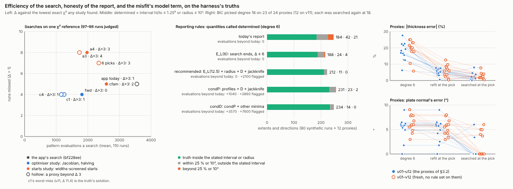

*Left: every full-set search's mean evaluations against the runs it misses (Δ > 1). A hollow
marker means a proxy lands beyond Δ 3. Right: quantities each reporting rule calls
determined, split into accurate and not. Produced by `scripts/writer/` from the studies'
results.*

## 2. The problem

### 2.1 The free shape

RIETVELD.md §10 has the details. In outline:
- **Each member gets its own width.** Every member of every reflection family takes a
  Lorentzian width from the solid's volume-weighted column length ⟨L⟩_V along it. A plate
  normal to one ⟨110⟩ therefore splits (110) into a sharp part and a broad part, which no
  per-family width can draw.
- **Six solids.** Ellipsoid, spheroid, cylinder, elliptic cylinder, box and square-based
  box. Each refines 2–3 widths and 2–3 turns.
- **Today's search** (`freeShapeRun`):
  - 11 starts: a sphere-like start, a plate and a needle on each low-index family, and
    random shapes;
  - each refined briefly (8 iterations);
  - early rejection when the best brief gains too little;
  - the best 3 refined fully, then a polish;
  - the exact (unrounded) solid with its orientation free;
  - every candidate lattice frame refined with the orientation held.
- **Kept or not.** The shape is kept only at ΔBIC < −10 against the isotropic size.
- **The report.** The card gives each dimension with a linear esd. The angular esds come
  from a profile, `turnEsds`: each turn stepped, everything else refined again.

**What it costs**, measured on the harness's 110 runs (§3), with a phase pattern of 5384
points at about 5.7 ms on this machine:

| Part | Evaluations (mean) | Wall time | Share |
|---|---|---|---|
| Isotropic fit before the shape | 353 | 1.0 s | — |
| Search: brief trials (11) | 2280 | | 64 % of the search |
| Search: full refinements and polish (3.5) | 669 | | 19 % |
| Search: exact solid, free | 92 | | 3 % |
| Search: held lattice frames (2.6) | 509 | | 14 % |
| **Search in all** | **3551** | **21.2 s** | |
| Report: esds and angular profiles (`bodyShapeOf`, `turnEsds`) | 2506 (synthetic), 1595 (proxies) | 14.3 s, 10.5 s | 0.7× the search |

### 2.2 What the backlog found (v472 prototype)

BACKLOG.md, "Free shape: starts chosen from the peak widths, and the near-equivalent
minima". The prototype ran on 20 cases: the user's 12 samples and 8 synthetic boxes. It
found:
- **The best minimum is usually reached.** The app's 11 starts reach it within Δ 1 on 18
  of 20, with about 4200 evaluations. Starts screened by the peak widths reach it on 20,
  with about 2900.
- **Near-equivalent minima are common:** 40 morphologies within Δ 10 over 16 cases.
- **Long dimensions are poorly fixed.** A 12 × 10 × 2 nm plate is found as about
  2 × 13–14 × 19–25 nm, and the plate turned 20° in its plane fits as well.

It proposed a 7-step plan: read the widths, build candidates, screen them, pick 6, refine,
and report the distinct alternatives within Δ 10. It left open points: the sphere-like
start, the other solids, more distinct starts, and boxes counted twice.

### 2.3 The tasks

The user asked for three things:
1. **Efficiency of the shape search:** speed, accuracy and precision.
2. **Whether the shape is unique.** Equal χ² across many shapes points to a numerical
   result, not a physical one. A true minimum is fine. Many minima close together mean the
   data do not resolve the shape.
3. **A presentation with physical sense:** a single result that accounts for that
   resolution, instead of a list of shapes.

Four studies, sharing one harness, took these on:
- *starts*: which starts to refine;
- *optimizer*: the least-squares step;
- *uniqueness*: how many minima there are, and how sure each quantity is;
- *presentation*: one result with intervals.

This write-up joins them. In places it rescores their results on a common basis
(`scripts/writer/`, results only, no pattern evaluated).

## 3. Cases and figures of merit

### 3.1 The harness

The harness lives in `scripts/harness/` and its API is in `README.md` there.
- **The engine copy.** A copy of `bf228ee` (`git archive`), changed only to count
  evaluations and log refinements (`eng.diff`):
  - `phasePattern` is counted: one phase pattern per call, which includes trial steps,
    both sides of every Jacobian column, and the FCJ audit;
  - every `refine()` of the search is logged: iterations, evaluations, χ² at its end, and
    the solid before and after;
  - `autoRefine` calls the search through a hook.
- **Arithmetic unchanged.** Re-run, the baseline matched 46 of 46 runs exactly, in
  evaluations and χ².
- **Synthetic patterns** come from the engine's own forward model:
  - grid: 10–80° in 5384 points;
  - Cu Kα1/Kα2, R 240 mm, Sollers 0.04 rad (the Soller model);
  - the profile of a LaB6 standard drawn and refined as the app refines a standard
    (χ²_ν 1.000);
  - sample state: a 3.916 Å, Sr1 site at 0.70, ΔB 0.2 Ų, X_s 0.02°, strongest line
    1100 counts on about 200 of background (33A's strongest: 1124);
  - Poisson noise.
- **Refined as the app refines.** Each pattern is refined from the CIF exactly as the app
  does (free shape, one ΔB, Sr1 occupancy) up to the shape stage. There, each method runs
  from the same isotropic fit.

### 3.2 Cases

46 cases and 110 runs (`node run.mjs --list`):

| Set | Cases | Runs | What |
|---|---|---|---|
| Synthetic truths | 30 | 90 (seeds 1–3) | box 8 (plates ⟂[110] on the lattice, turned 20° in plane, 8° off; ⟂[100]; ⟂[111] 30×25×2; a needle ∥[111]; a ribbon; a block at random), square-based box 5, ellipsoid 5, spheroid 4, cylinder 4 (one disc 8° off [111]), elliptic cylinder 4; 2–30 nm; each searched as its own solid |
| Isotropic controls | 2 | 6 | 7 nm searched as a box, 20 nm as a cylinder |
| Sample-like proxies u01–u12 | 12 | 12 | {110} box plates 1.6–2.6 nm thick, 10–23 nm across, turned 0–45° in plane (one 6° off); Sr site 1 − 0.64/t (0.60–0.75), ΔB 0.02–0.38; plus an **unmodelled hump** at 30° (FWHM 6°, 14–37 % of (110)'s area, BACKLOG's "broad component") |
| Fixture controls | 2 | 2 | `fx-s00`, `fx-s05`: the repository's test patterns (one width law, no anisotropy), s11 refined as their standard |
| *Added in review:* hold-out seeds | 30 | 60 (seeds 4–5) | the synthetic truths again, fresh noise; no rule or threshold was set on them |
| *Added in review:* fresh proxies v01–v12 | 12 | 12 | drawn once from the ranges of u01–u12 by a fixed generator (`fix/cases-extra.mjs`): {110} box plates 1.6–2.6 nm thick, 10–25 nm across, turned 0–45°, a quarter tilted 3–8°, hump 13–33 % of (110)'s area |
| *Added in review:* other misfits | 8 | 8 | four plates (box-plate110, cyl-disc110, ell-plate110, sqbox-plate001) with a misfit that is not a hump: *air*, a low-angle exponential 600·e^(−(2θ − 10°)/5°) outside the Chebyshev + 1/2θ family; *mix*, a second population of the same solid at half the dimensions with 30 % of the volume |
| *Added in review:* isotropic nulls | 2 | 46 (seeds 24–46) | iso-7 and iso-20 again, to test the null threshold of §5.5 on fresh draws |

The hump makes the proxies behave like the real data:
- χ²_ν is 1.37–2.54 at the isotropic fit and 1.04–1.42 with the box;
- the thickness reads thin and the normal 5–9° off [110];
- there are several near minima.

Whether the real samples' misfit has this form is the main thing the proxies cannot tell
(§8).

### 3.3 Figures of merit

| Measure | Definition | How measured |
|---|---|---|
| **Evaluations** | calls of `phasePattern` during the search (or the report part named) | exact; deterministic: the same run gives the same count |
| **Wall time** | seconds of the search in one Node process | under `nice -n 15`, 2 processes at a time, on a 4-vCPU machine shared with another job (load 4–7). Ratios are trustworthy only where both methods ran on the same runs in turn ("paired", both orders) |
| **Δ** | (χ²_best of the run − the lowest χ²_best any search found for that case and seed) / max(1, χ²_ν of that best fit) | χ² are totals Σw(y − y_c)² of the exact solid, free or held. Each study used its own reference. §4.5 recomputes every full-set search against the union of all records of all studies, the truth reference's included (`scripts/writer/common.mjs`) |
| **Reached** | Δ ≤ 1 | a search rejected early has no exact fit and is not judged |
| **Accuracy** | the reported solid against the truth | dimensions paired by size within the body's axis classes; orientation modulo the 24 proper rotations of m-3m and the body's symmetry. Reported as the largest dimension error, the thinnest dimension's, and the angle of the truth's most distinct axis (the plate normal, the needle axis) |
| **Precision** | spread over the 3 noise realisations of a case | sd of each dimension's relative error; mean pairwise misorientation |
| **Coverage** | the truth inside a stated 95 % interval or cone | per quantity: the thinnest, middle and longest extent, and the directions |
| **Determined / accurate** | a claim and whether it holds | determined: interval hi/lo ≤ 1.25² (±25 %) or angular radius ≤ 10°; accurate: estimate within 25 % (\|ln\| ≤ ln 1.25) or 10° of the truth. A claim "beyond tolerance" is determined, not accurate |
| **Holds as stated** | a determined claim against its own printed interval or radius | the truth inside the stated interval (extent) or within the stated radius (direction). A 95 % interval should hold about 95 % of the time; this is stricter than the 25 % / 10° tolerance |

### 3.4 The app's search on these cases

The baseline batch ran 110 runs in 23.2 min, at 2 processes:

| Set | Runs | Evaluations | s | Outcome |
|---|---|---|---|---|
| Synthetic | 90 | 3577 | 20.1 | 65 held on the lattice, 15 free, 10 rejected (5 early) |
| Proxies | 12 | 4367 | 28.6 | all kept |
| Isotropic controls | 6 | 2235 | 11.5 | all rejected early (ΔBIC +3 to +17) |
| Fixtures | 2 | 1405 | 4.3 | rejected early |

- **Reach.** 85 of 86 synthetic runs that reached a full refinement, and 12 of 12 proxies,
  against the baseline and truth reference. The one miss is box-plate110-off8 seed 2, held
  on [110] at Δ 2.0 while the minimum lies 8° off, as the truth does.
- **Accuracy** (80 synthetic runs with a solid):
  - largest dimension error median 7 %, 90th percentile 29 %;
  - thinnest dimension 1.5 % and 6 %;
  - most distinct axis 0.0° and 8.0° (worst 24.9°). That median reflects the case mix and
    the held-frame rule, not the resolution. The 61 runs whose truth has its most distinct
    axis on a lattice direction give 0.0° median and 0.0° at the 90th percentile, because 59
    of them are held there. The 19 runs whose truth is off the lattice (the rand and off8
    cases) give 3.4° median, 9.3° at the 90th percentile and 24.9° at worst: that is the
    resolution figure (`fix/tools/misc.mjs`).
- **Where it fails:**
  - long dimensions (the 30 × 25 × 2 plate 34 % off);
  - in-plane turns of plates (13° worst-axis error);
  - an elliptic cylinder that puts its axis on the thin extent at Δ 0.1 (ecyl-ribbon001 in
    2 of 3 seeds).
- **Precision:**
  - on-lattice plates and rods: 0° misorientation, 1–8 % sd of the dimensions;
  - in-plane turns and random orientations: 2–40°.
- **Proxies:**
  - thickness 6–28 % thin (median 17 %);
  - normal 4.9–9.0° off [110] on 10 of 12;
  - the longest dimension unbounded or 2–11× too long on 5 of 12.

  The search reaches its best; the best is not the truth.

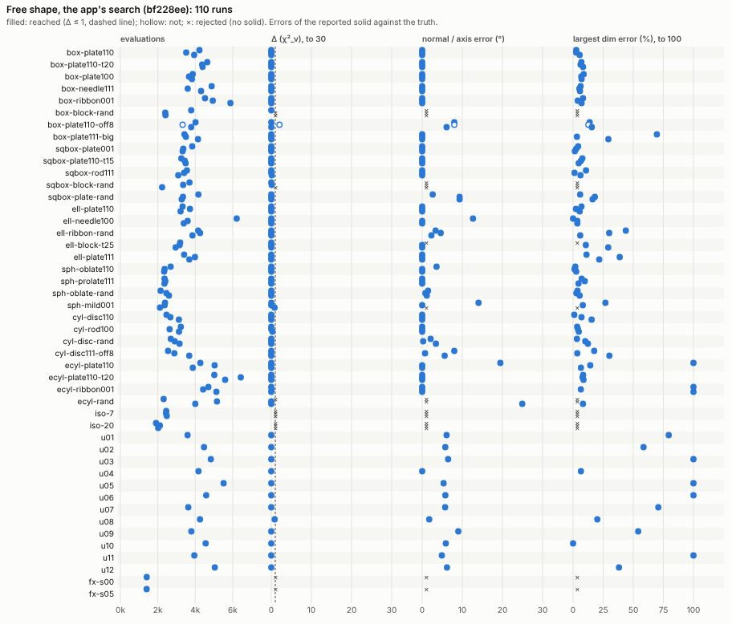

*Per case and realisation: evaluations, Δ, the normal's error, the largest dimension's
error. Filled: reached. ×: rejected. `scripts/harness/fig.mjs`.*

## 4. Algorithms tried for the search

### 4.1 Where the evaluations go

- **The brief trials take 64 % of the search** (§2.1). Each is about 7.7 iterations and
  209 evaluations.
- **Each iteration is mostly a Jacobian.** With central differences, 11 non-linear
  parameters cost 22 evaluations a Jacobian, plus trial steps.
- **Covariances nobody reads.** Every `refine()` also ends with an evaluation and a
  central-difference Jacobian for its covariance: in each of the 11 briefs, in each full
  refinement, and in the held ones. Only the returned fit's covariance is read.

Two routes cut this cost: a cheaper least-squares step (§4.2), and fewer or better starts
(§4.3). Each was tried with all else as the app has it.

### 4.2 The least-squares step (optimizer study)

The pilot was 18 runs: 14 synthetic of all six solids, u03, u09, u10 and iso-7. Costs are
in pattern-evaluation equivalents as a fraction of the app's on the same runs. "Same
outcome" means held, free or rejected as the app.

| Variant | Idea | Cost (× app) | Reached | Same outcome, same solid | Verdict |
|---|---|---|---|---|---|
| nocov | no covariance in intermediate refinements; the returned fit's once, central | 0.89 | 15/16 | 18/18, 18/18 | free 11 %: in every combination |
| **fwd** | forward differences, one displaced point a column, the pattern at v reused; final covariance central | **0.51** | 15/16 | 18/18, 18/18 | **kept** |
| member | Jacobian of the shape from one pass over the members' lines (∂w/∂θ analytic, ∂line/∂Y per member) | 0.39 (0.28 in evaluations) | 15/16 | 18/18, 18/18 | columns within 1.4·10⁻⁶ of central; saves only 15–20 % over fwd for much more code |
| broy3, c5, c8, c9 | Broyden rank-one updates between fresh Jacobians | 0.32–0.60 | 14–15/16 | lost u03 (Δ 2.5), or u10 and off8 | rejected: full refinements take 17 iterations instead of 8 and stop short |
| briefShape(Xs) | brief trials with cell, B, occupancy (and X_s) held | 0.79–0.80 | 13–14/16 | | rejected: the brief ranking changes on the proxies |
| brief4 | 4 brief iterations instead of 8 | 0.76 | 14/16 | | rejected |
| halving | all 11 starts 2 iterations, best 6 to 4, best 3 to 8 | 0.64 | 15/16 | 18/18, 17/18 | kept |
| **c1** | fwd + halving | **0.37** | 16/16 | 18/18, 17/18 | **best combination** |
| c4 | c1 + each lattice frame refined 6 iterations, only the best to convergence | 0.34 | 16/16 | 18/18, 17/18 | full set: changes u04 from held on the true [110] to free and worse |
| dedup | the 3 full refinements go to the best 3 *distinct* brief ends | 0.95 | 16/16 | 18/18, 18/18 | slightly more robust (finds off8's minimum) |
| logW | widths stepped in log | 1.07 | 13/16 | 15/18 same solid | rejected: an unbounded dimension is W = 0, which log cannot reach |
| stride2, c6 | brief trials on every 2nd point | 0.33–0.73 | 14–15/16 | | rejected: ranking changes |
| sur4, sur8 | starts first fitted to the peak widths (no pattern) | 0.67–0.95 | 13–14/16 | | rejected: 6 usable peaks for 7 parameters place a start worse than 2 pattern iterations |
| c7 | halving keeping 5 then 2, 2 full | 0.31 | 15/16 | 16/18 same solid | too aggressive (ecyl-ribbon001 axis on the wrong extent) |
| c10, c11, c12, c13 | savings spent on 21 starts; dedup at the cuts; ranking on the Gauss–Newton predicted minimum; gentler rungs | 0.37–0.48 | 21–23/25 (robust set) | | rejected: more starts do not buy reliability on the proxies; the miss moves from u11 to u05 or u10 |

**Forward differences**, column accuracy against central differences:
- 10⁻⁷ to 10⁻⁴ relative at a converged box and at a start;
- widths ≤ 10⁻⁶, occupancy 10⁻⁴, a 9·10⁻⁵.

**Benchmark on 4 cases × 2 points**, a Jacobian of the shape stage (11 non-linear
parameters):

| Jacobian | Cost, in units of one evaluation (2.5–4.4 ms) |
|---|---|
| central | 19–25 |
| forward | 9.4–13.9 |
| member + forward | 8.5–13.0 |

**Full set (110 runs).**

fwd:
- 1813 evaluations a run, 0.51×: synthetic 1812, proxies 2337, controls 1143, fixtures 740;
- outcome identical on 110 of 110;
- reported solids against the app's: largest-dimension difference 0.00 % median, 0.2 %
  at the 90th percentile;
- accuracy and precision unchanged (thinnest dimension 1.7 % median, normal 0.0° / 8.0°,
  precision 7.7 % and 7.3°);
- paired wall time 15.0 s against 25.2 s (0.59×): 6 runs, each in two processes in both
  orders;
- 7.5 ms an evaluation against 6.6 ms: the per-iteration linear algebra is spread over
  fewer evaluations.

c1:
- 1251 evaluations a run, 0.35×: synthetic 0.35×, proxies 0.38×, controls 0.26×,
  fixtures 0.49×;
- paired wall time 9.6 s against 24.6 s (0.39×);
- batch 11.0 min against 23.2;
- accuracy and precision as the app's (thinnest 1.7 %, normal 0.0° / 8.0° / 24.9°,
  precision 8.2 % and 7.4°);
- reported solids within 6.5 % of the app's at the 90th percentile;
- its one large χ² miss is u11 at Δ 11.4 (§4.5), and there the solid it reports is the
  accurate one.

**What c1 does on u11.** c1 reports u11 held on a ⟨110⟩ at 2.39 × 19.8 × 21.7 nm (held χ²
5582.5; its free fit, 2.3 × 30.6 × 24.7 nm, is at 5577.5). That is the truth's own solution:
the truth is 2.6 × 20 × 23 nm on [110], so the dimensions are 1–8 % off and the normal 0.0°.
The app, fwd and a4 reach a χ² 11.4 χ²_ν lower (fwd: 5566.1), with the plate free 4.9–5.2°
off [110] and the middle extent 101–161 % too long. That lower minimum is the one the
unmodelled hump pulls the fit into. c1 never reached it: the start that leads there under
fwd (the 6th of 11) ranked 7th after 2 iterations (χ² 7526, the 6th kept start at 7520) and
was cut. Halving after 2 iterations ranks starts by how fast they converge, not by where
they go. On u11 that loses the lowest χ² and gains accuracy.

**On the proxies the lowest χ² is not the most accurate.** Over the 12 proxies and the five
full-set searches (app, fwd, c1, a4, cfam), the search with the lowest Δ also has the
smallest normal error on 3 of 12, and the smallest largest-dimension error on 3 of 12
(`fix/tools/proxacc.mjs`). Reach is a fair target where the model fits. Under misfit it is
not, until the misfit is modelled (§6.3).

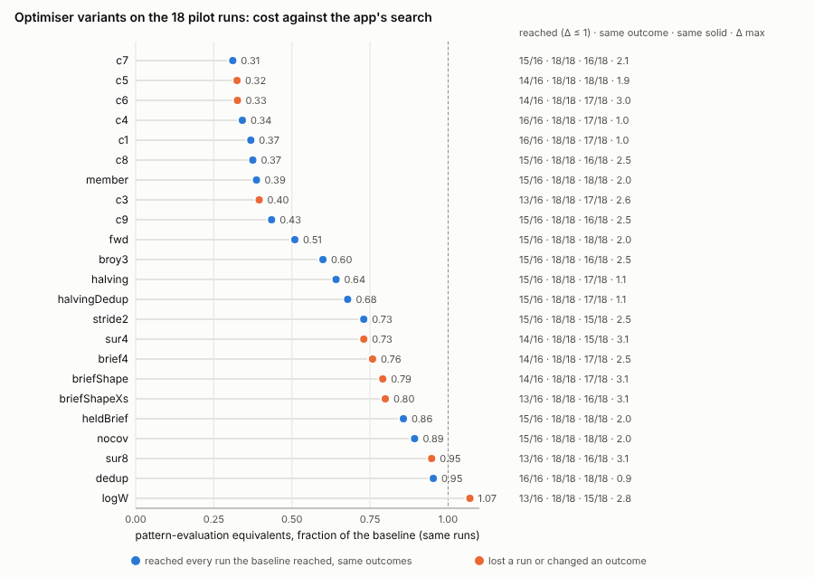

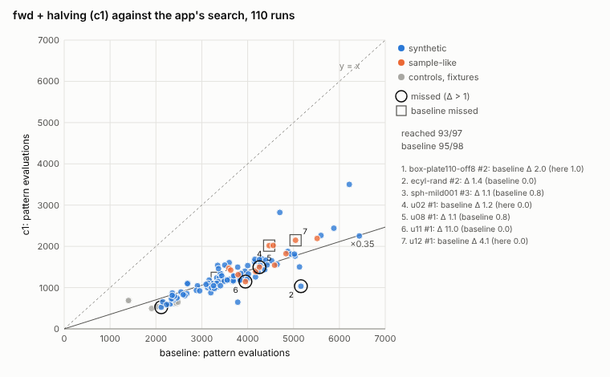

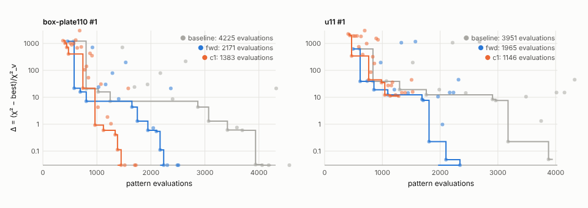

*Variants: cost against reach. c1: evaluations per run, misses numbered. Path: Δ against
evaluations spent; on u11 c1 stops in another basin, the truth's. `scripts/optimizer/fig-*.mjs`.*

### 4.3 Fewer, better starts (starts study)

The base of this study is the backlog's widths screen, done as a start generator:
1. Read the isotropic fit's peak widths with `measureWidths`, keeping clean rows only.
2. Build the candidates. Lattice frames: one normal per family with indices ≤ 2, and x on
   each of the 6 simplest directions across it. Also 3000 super-Fibonacci rotations, kept
   when 15° apart modulo the crystal's and the body's symmetry (33 for a box in m-3m).
   Each candidate gets plate, needle and ribbon templates: 243 for a box.
3. Fit each candidate's log widths and strain to the rows' FWHMs, as the FWHM of a sum of
   equal-area Lorentzians, by Nelder–Mead. No pattern is evaluated.

**Cost of the screen.** Reading the widths takes 0.9–1.3 s: 10 partial evaluations, and
98 % of the time is in `fitPeak`'s Nelder–Mead. The screen itself takes 0.4 s, after
storing KᵀC and running a two-stage Nelder–Mead; the first version took 5.3 s.

**Result of the screen.** On the 80 kept synthetic runs the screen's best is rough:
largest dimension error median 22 % and 257 % at the 90th percentile, normal 3.7° median.
It is a source of starts, not a result.

The variants were run in round 1, on 46 runs: seed 1 of every case, from one isotropic fit.

| Variant | Evaluations | Reached | Δ > 3 | Verdict |
|---|---|---|---|---|
| app's 11 starts | 3664 | 40/41 | 1 | reference |
| 6 screened picks | 2795 | 38/42 | 1 | |
| 4 / 3 / 2 picks | 2393 / 2241 / 1763 | 36 / 36 / 34 of 41 | 4 / 4 / 4, all proxies | 2–3 picks suffice where the model fits; on the proxies the screen ranks badly |
| 6 picks + sphere-like start | 2891 | 38/42 | 2 | no gain |
| one pick per normal family (≤ 7) | 2801 | 38/41 | 1 | best coverage of near-equivalent minima |
| budget stop (2 briefs without a better basin) | 2268 | 36/41 | 4 | = 3 fixed picks; not kept |
| lean brief (shape, X_s, linear only) | 2353 | 37/41 | 3 | full refinements pay back the saving |
| 5 brief iterations | 2227 | 33/40 | 5 | rejected: briefs no longer rank basins under misfit (proxies' mean Δ 4.8) |
| full refinements of distinct brief ends only | 2293 | | 3 | kept (u02 Δ 10.8 → 1.3) |
| first-brief rejection when the widths read isotropic (p ≥ 10⁻³) | controls 837 → 202 | | | kept: full set, 8 controls and fixtures 2027 → 201 evaluations, no kept run lost |
| best held frame only, ranked by one evaluation | 1991 | | | rejected: unrefined χ² ranks frames wrongly (2 outcomes changed) |
| held-frame dedupe (frames equal up to axis signs) | −88 a run | identical | | kept: 72 of 288 held refinements in the baseline repeat a frame |
| heldFirst (held frames, then one free fit from the best) | +7 % | identical | | rejected: the soft fit lay > 2° from the frame in 29 of 46 runs |
| 4 sphere-curvature starts (Hessian of the widths χ² at the sphere) | 1999 | 30/41 | 7 | rejected: a box's or cylinder's column length is not an ellipsoid's |
| widening signals: agreement of the first 3 briefs; screen misfit | | | | rejected: neither separates misfit data from clean |

**Adaptive widening (a3, a4).** This is the round that worked:
1. Refine 3 or 4 screened picks briefly.
2. Read the best brief's χ²_ν. Above 1 + 3√(2/ν) the model misfits, the widths carry what
   it lacks, and the landscape has several near minima. Then add picks 5–6, and the best
   pick of each normal family unlike any pick (at most 6 extra).
3. Refine fully only distinct ends, skip duplicate held frames, and apply the early
   rejection after the first brief.

Does the signal separate the sets?
- The best brief's χ²_ν was 0.97–1.04 on all 30 synthetic runs at seed 1 and 1.04–1.42 on
  the proxies. All 4 missed proxies lay above 1.11.
- On the full set the rule widened 9 of 12 proxies and 0 of 90 synthetic runs.

| Full set, 110 runs | Evaluations | Synthetic | Proxies | Controls, fixtures | Morphologies within Δ 3 reached on the proxies |
|---|---|---|---|---|---|
| app | 3551 | 3577 | 4367 | 2027 | 64 % |
| cfam (one pick per family + cuts) | 2587 | 2698 | 3353 | 201 | 82 % |
| a4 | 1976 | 1909 | 3663 | 201 | 84 % |
| a3 | 1734 | 1642 | 3443 | 201 | 78 % |

**Wall time.** a3 ran first and cold in the same processes as the app on 46 runs: 15.4 s
against 23.5 s (−34 %). a4 alone, first in its process on 64 runs, took 12.9 s, against
19.5 s for the app on those runs in another batch.

**Accuracy and precision** were the app's: largest dimension 7 % / 32 %, thinnest 1.7 %,
normal 0.0° / 8.1°.

**Cost by solid**, a4 against the app:

| Solid | a4 | App |
|---|---|---|
| box | 2082 | 3973 |
| cylinder | 2006 | 2927 |
| elliptic cylinder | 2415 | 4663 |
| ellipsoid | 2110 | 3741 |
| spheroid | 1293 | 2381 |
| square-based box | 1440 | 3389 |

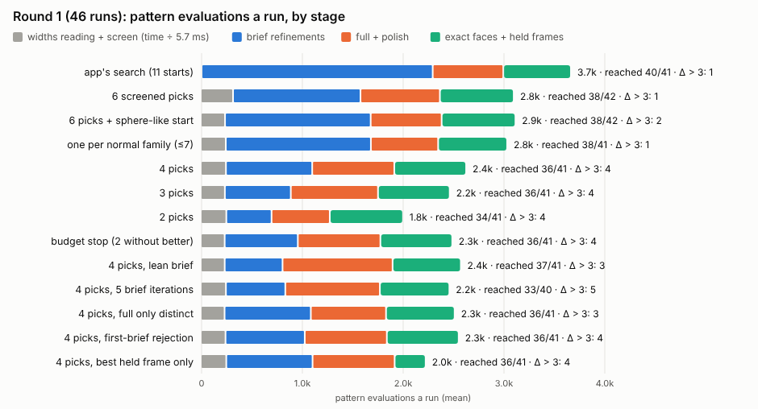

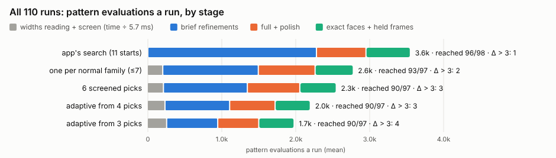

*Stacked by stage: widths reading and screen (time ÷ 5.7 ms), brief, full and polish,
exact and held. `scripts/starts/tools/fig.mjs`. The round-3 figure (curvature starts,
heldFirst) is `fig/starts-r3-cost.png`; a4 against the app per run is
`fig/starts-scatter-a4.png`.*

### 4.4 What else the studies settled

- **Restricting the random starts to the fundamental zone** was not tried. Symmetry served
  only as an identity test: for dedupe, for the barrier test, and for grouping.
- **Early rejection already holds.** No variant rejected a run that the app keeps. The
  widths' isotropy test (p ≥ 10⁻³) held on all 8 controls and fixtures, and on all 10
  synthetic runs the app rejects.

### 4.5 All full-set searches on one reference

The studies measured Δ against different references, so their "reached" counts are not
comparable as published. Here every full-set search is measured against the lowest exact
χ² that any record of any study found for each case and seed. 102 runs have an exact fit.
The reference came from 23 different searches: the truth reference on 14, the app on 14,
c1 on 12, fwd on 11 (`tables/common-reference.md`).

| Search | Evaluations (× app) | Synthetic | Proxies | Controls, fixtures | Reached Δ ≤ 1 | Δ > 3 (proxies) | Proxies reached, mean Δ | Outcome changed vs the app |
|---|---|---|---|---|---|---|---|---|
| app (bf228ee) | 3551 (1.00) | 3577 | 4367 | 2027 | 93/98 | 1 (1) | 8/12, 0.82 | — |
| **fwd** | **1813 (0.51)** | 1812 | 2337 | 1042 | **94/98** | **0 (0)** | 9/12, 0.64 | none |
| c1 = fwd + halving | 1251 (0.35) | 1253 | 1666 | 608 | 93/97 | 1 (1) | 10/12, 1.35 | sqbox-plate-rand#2 held→free; u11 free→held |
| c4 = c1 + frames screened | 1160 (0.33) | 1168 | 1475 | 608 | 93/97 | 1 (1) | 10/12, 1.35 | as c1, and u04 held→free |
| cfam | 2587 (0.73) | 2698 | 3353 | 201 | 92/97 | 2 (0) | 9/12, 0.80 | sqbox-plate-rand#2 held→free |
| 6 screened picks | 2348 (0.66) | 2416 | 3270 | 201 | 90/97 | 3 (1) | 9/12, 0.99 | none |
| a4 | 1976 (0.56) | 1909 | 3663 | 201 | 89/97 | 3 (0) | 9/12, 0.86 | none |
| a3 | 1734 (0.49) | 1642 | 3443 | 201 | 89/97 | 4 (1) | 9/12, 1.04 | sqbox-plate-rand#2 held→free |

(Rejections moved from late to early are not counted as changes: box-block-rand#1 under
c1 and c4, sqbox-block-rand#2 under the screened searches.)

The misses (Δ > 1):

| Search | Misses (run, Δ) |
|---|---|
| app | u12 4.2; box-plate110-off8#2 2.0; u02 1.3; u03 1.1; u06 1.0 |
| fwd | u12 2.8; off8#2 2.0; u02 1.3; u08 1.2 |
| c1 | u11 11.4; ecyl-rand#2 1.4; sph-mild001#3 1.1; u08 1.1 |
| a4 | sph-mild001#3 6.3; ecyl-plate110-t20#3 3.4; off8#2 3.1; u03 2.7; u08 2.2; u02 2.0; ell-needle100#2 1.8; sqbox-plate001#1 1.0 |

Three of these misses are not search failures:
- **box-plate110-off8#2:** every search holds the plate on [110], while the free minimum
  lies 8° off, as the truth does.
- **sph-mild001#3:** every search rejects it.
- **u11 under c1:** a χ² miss, but the solid reported is the truth's, within 8 % and on
  [110] (§4.2).

The reach of the app and of fwd differs by one run (93 and 94 of 98), and the runs that
differ sit at Δ 1.0–1.3 in flat valleys: the app misses u03 (1.1), u06 (1.0) and u02 (1.3),
fwd misses u08 (1.2) and u02 (1.3). Both miss u12 (4.2 and 2.8) and off8#2 (2.0). The
reach is equal.

Two of a4's misses are flat valleys along a long dimension rather than other morphologies:
- sqbox-plate001#1: square side 15.7 against 19.8 nm at Δ 1.0;
- ell-needle100#2: needle 27 against 38 nm at Δ 1.8.

**The ends feed the report.** The recommended report (§6) widens its intervals to the
search's own refinement ends within Δ 12.5, so a cheaper search also changes the report. It
was rebuilt from each search's ends around the app's reported solid, on the 80 kept
synthetic runs (`tables/ends-from-cheaper-searches.md`, `fix/src/ends-check.mjs --tau 12.5`):

| Ends from | Thinnest / middle / longest covered | Extents determined: accurate |
|---|---|---|
| app | 78 / 77 / 74 of 80 | 169/169 |
| fwd | 78 / 77 / 74 | 169/169 |
| c1 | 77 / 74 / 74 | 167/168 |
| a4 | 74 / 72 / 74 | 170/174 |

With c1 or a4 the report loses a little coverage and makes 1–4 claims beyond 25 %.

### 4.6 Verdict on the search

- **fwd is the efficient step:**
  - half the evaluations, 1.7× faster;
  - the same outcome (held, free or rejected) on 110 of 110 runs;
  - the same reach as the app's (94 and 93 of 98 on one reference);
  - the report built from its ends is as good (§4.5 table).
  - **Risk:** the reported solid differs from the app's by more than 5 % or 2° on 6 of 92
    kept runs (`fix/tools/fwdsame.mjs`). These are near-equivalent minima:
    ecyl-plate110#2 (the app 18.3 × 9.5 × 2.5 nm, normal on [110]; fwd 20.8 × 2.9 × 8.6 nm,
    the axis on another extent, 243 % and 27° apart, at Δ 0.45 against 0.00),
    ecyl-plate110-t20#2 (10 %, 19.5°), and four proxies on the long extent (u03 9 %, u06
    8 %, u08 12 %, u12 19 %). The median difference is 0.00 %, the 90th percentile 0.12 %
    on the synthetic runs and 12 % on the proxies.
- **Halving (c1) adds 31 % on top of fwd.** On clean data its ends cost the report 2 wrong
  claims (§4.5). On u11 it misses the lowest χ² by 11.4 χ²_ν but reports the truth's solid
  (§4.2): under misfit, χ² reach is not the target.
- **The widths-screened starts (a4)** cost 0.56× alone. They reach more of the
  near-equivalent minima on the proxies (84 % against 64 %). But they add a widths reading,
  an orientation grid and a screen (about 1 s, and much new code), and they reach the best
  less often than fwd.
- **fwd + a4 is untested.** If the two ratios multiplied it would be about 0.3×.
- **Nothing else pays.** No start strategy and no ranking key beat the plain search's
  reach once forward differences had removed half of its cost.

## 5. Is the shape unique?

### 5.1 How many minima there really are

**The backlog's count is inflated.** Its rule groups ends at 8° and e^0.25. On brief ends,
with rounded faces, that rule splits one valley along every poorly resolved length: a
25 nm needle read as 23–64 nm counts as several morphologies.

**The baseline's ends, grouped this way**, look like many shapes:
- synthetic: 990 starts in 556 groups; 65 of 90 runs have more than one morphology within
  Δ 10. That is 303 groups counting each run's best, 213 besides it; on the 80 runs that keep
  a solid, 164 besides the best;
- proxies: 11 of 12 runs have more than one (34 in all).

**Refined and merged by resolution** (uniqueness study), the count collapses:
1. Take the search's ends within Δ 30, plus 12 lattice-frame starts (plate, needle or
   ribbon on each family, turned 0° or 45°).
2. Refine up to 4 candidates fully, then exactly with the orientation free.
3. Merge a candidate into an existing minimum when every paired extent lies within
   max(0.1, 3σ) in ln and every axis within max(5°, 3σ), σ being that minimum's own esd,
   modulo m-3m and the body's symmetry.

The 80 kept synthetic runs then have 37 other minima within Δ 30 and 32 within Δ 10. Of
the 34 within the 5 % flip range (§5.3), only 22, in 14 runs, lie more than 25 % or 10°
from the reported solid. The proxies have 14 within Δ 30, of which 12 are far ones, in 9
runs.

**Like for like.** The 32 are not directly comparable with the 164: some come from the
analysis' extra starts, and the analysis refines at most 4 candidates a run besides the
converged ends (`uniq-core.mjs`, maxExtra 4), so an unrefined end never becomes a minimum.
Taking only the app's search's own ends within Δ 10 on the 80 runs (984 ends,
`fix/tools/merge-ends.mjs`, no pattern evaluated):
- 965 lie within the resolution of a refined minimum; besides each run's best, these fall
  into 24 minima;
- 19 (15 of them brief ends) lie within no refined minimum's resolution, because the cap
  stopped the analysis before them. Grouped among themselves at the rule's floors (0.1 in ln,
  5°) they make at most 17 more, in 12 runs.

So merging by resolution takes the 164 other morphologies down to between 24 and 41: a
factor of 4 to 7, not the 9.5 that 303 against 32 suggests.

**Cost:** 2529 evaluations and 14.7 s a synthetic run (70 % of the search), of which the
extra starts take 2030. Where the 37 came from:

| Source | Minima |
|---|---|
| extra starts | 17 |
| full ends | 7 |
| held ends | 6 |
| brief ends | 5 |
| free fit of a held result | 2 |

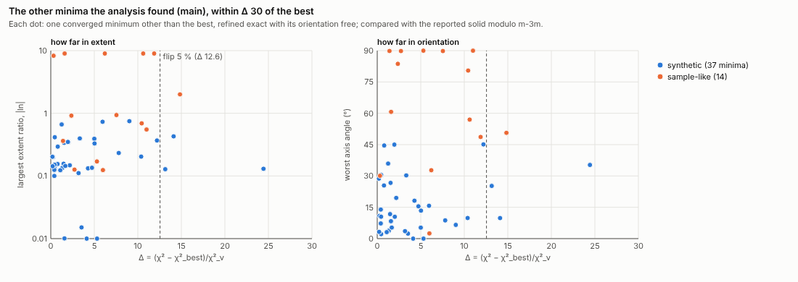

*Each minimum other than the best, refined exact: its Δ against how far it lies in extent
and in orientation; dashed, the 5 % flip line (Δ 12.55). `scripts/uniqueness/fig-landscape.mjs`.*

### 5.2 One valley or distinct: the barrier test

This test comes from the optimizer study, run after the c1 search on 27 runs: the pilot
and the 12 proxies.
1. Group every refinement end modulo symmetry.
2. Refine the best end of up to 6 groups.
3. For each minimum B within Δ 10 of the best A, take B's symmetry-equivalent nearest A.
4. Evaluate χ² at 5 points of the straight path between them (widths linear, frame by
   slerp, linear parameters solved).
5. The barrier is the highest χ² on the path above the higher end, in χ²_ν. At most 1
   means one valley. More than 1 means distinct minima (a straight path is an upper
   bound).

**Cost:** median 290 and mean 417 evaluations on top of the search (about 0.1× the app's).

**Result:** 19 minima within Δ 10, in 14 of the 27 runs.
- **9 have a barrier of 1 or less.** For 7 of them χ² falls all along the path: the
  refinement had stopped in a flat valley, up to 7.8 χ²_ν short of the bottom (u05; also
  u03 5.8, off8#2 4.8, u12 3.7, u08 1.9). They differ from the best only along a poorly
  resolved length:

  | Run | That length in the two minima | Δ |
  |---|---|---|
  | box-ribbon001 | 51 nm against 6536 nm | 0.97 |
  | u05 | 210 against 30 nm | 7.8 |
  | u06 | 62 against 131 nm | 0.43 |
  | u03 | 83 against 214 nm | 5.8 |

  One more (u08) is an in-plane turn of a near-square plate.
- **10 sit behind barriers of 1.2 to over 1000, 14–55° apart, in 7 runs:**
  - an elliptic cylinder's axis on the thin extent (ecyl-ribbon001, Δ 1.5 and 2.0,
    barrier over 2000);
  - the plate normal on another ⟨110⟩ or ⟨100⟩ (u02 Δ 2.2, u03 2.9, u04 5.6, u07 4.1);
  - the long edge turned (u09 Δ 0.15 with barrier 6.2; u10 Δ 0.27, 0.72 and 5.5).

  The cut at 1 χ²_ν is not calibrated against the noise: u10's first minimum is called
  distinct on a barrier of 1.2.

**Scope.** In this sample of 27 runs the distinct minima are all on proxies or elliptic
cylinders. On all 80 kept synthetic runs (§5.1's minima, no barrier test) the plausible
minima (Δ ≤ 12.55) that lie beyond 25 % or 10° of the reported solid number 22, in 14 runs:
15 on elliptic cylinders, 3 on ellipsoids (ell-ribbon-rand #2 at Δ 0.8 and 45°, #3 at 1.3
and 36°), 2 on spheroids (sph-mild001 #1 at Δ 3.3 and 30°, #2 at 2.0 and 45°), 1 on a box
(box-needle111 #2, Δ 0.5, 30°) and 1 on a cylinder (cyl-disc111-off8 #2, Δ 7.8)
(`fix/tools/misc.mjs`).

**This is the distinction the user drew.** A minimum in one valley along a length is not
another shape: it means that length is poorly bounded, and it belongs in that length's
interval. A minimum behind a barrier is a genuinely different morphology, and is named
only if the data cannot rule it out (§5.3).

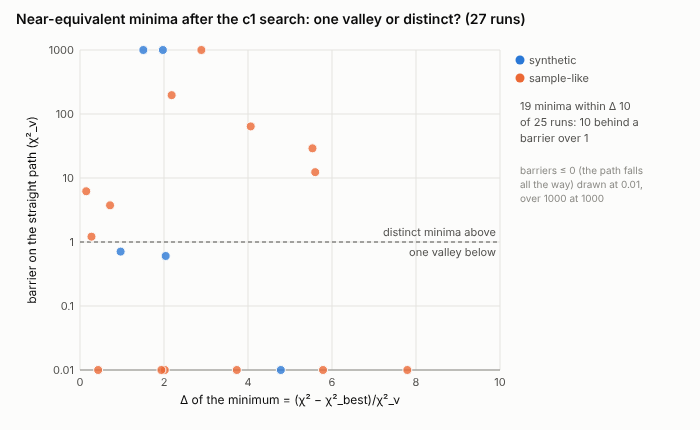

### 5.3 How large a Δχ² is significant: a parametric bootstrap

**Method.** Take 33 runs with at least 2 minima within Δ 30: 23 synthetic and 10 proxies,
51 pairs.
1. Draw Poisson replicas of the best fit's calculated pattern: 20 each, plus 10 of each
   competitor's.
2. Refit both minima from their own vectors.
3. Model the replicas' Δ* as N(δ, 4δ + c), δ being the Δ on the noise-free pattern.

**Cost:** 637 445 evaluations and 3854 s, or 117 s a run: about 5× the search. It is a
calibration, not something for the app.

**Result.** The least-squares c is 7.2 (mean) and 2.0 (median), and c = 8 is used. A
competitor then flips (wins on a replica) with probability Φ(−Δ/√(4Δ + 8)). That is 5 % at
Δ = 12.55, and 12.5 is used.

**Flip rates on the synthetic runs**, observed against predicted (740 replicas, 169
flips):

| Δ bin | Observed | Predicted |
|---|---|---|
| 0–1 | 0.40 | 0.45 |
| 1–3 | 0.28 | 0.34 |
| 3–6 | 0.14 | 0.20 |
| 6–12 | 0.05 | 0.09 |
| over 12 | 0.00 | 0.04 |

**Comparison with other rules.**
- Synthetic: none of 60 replicas flipped where the calibrated rule predicted under 5 %.
  The likelihood weight e^(−Δ/2) let 9 of 160 flip where it predicted under 5 %.
- Proxies (280 replicas, 48 flips): the likelihood weight predicts 0.01 in the 6–12 bin,
  against 0.15 observed.
- A fixed Δ 10 fits worst: log-likelihood −443.7 against −355.7.

**What the 5 % means.** The replicas are Poisson draws of the best fit's own calculated
pattern (`u-boot.mjs`: μ = y_c of the best fit), which has no hump. So the 5 % is the chance
that a competitor wins in χ² *if the fitted model were the truth*. On the proxies the
replicas carry no misfit either, and the 0.15 above describes the fitted model's landscape,
not the misfit. Whether the χ²-best is the closer to the truth is another question, which
§5.3b measures with replicas that carry the misfit.

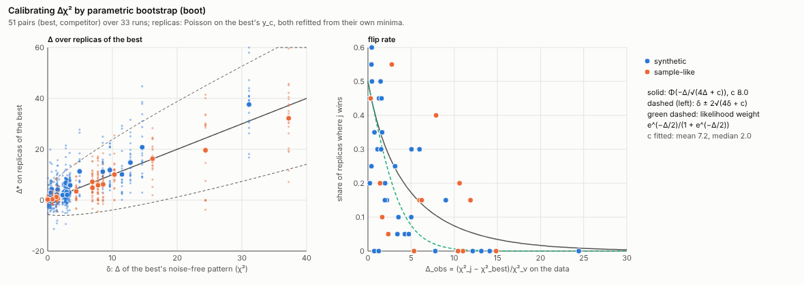

### 5.4 How well each quantity is determined

These are the methods tried for the reported fit's own intervals (uniqueness study). The
scores are at 10°, on 80 synthetic runs (240 extents, 194 directions) and 12 proxies.

| Method | What it is | Cost beyond today's report | Result |
|---|---|---|---|
| today's esds | linear esd of each dimension (held/free difference in quadrature); angular esd by profile (`turnEsds`), 2σ | 0 | synthetic: 172 extents called determined, 6 wrong; 65 directions, 4 wrong (box-plate110-off8 in-plane edges claimed within 8–13°, really 90° off). Proxies: 4 of 15 extents and 12 of 28 directions wrong. (Rescored with a spheroid's and a cylinder's diameter given its esd, which the first scoring had left at zero width: `fix/src/score.mjs`) |
| bootstrap check of those esds | claimed σ against the spread of the best over 20 replicas | (offline) | Fisher σ ln W 1.61× the spread (median); the app's Desd 0.98×; the app's angular esd 0.91×, but under half the spread in 21 of 81 axes |
| Fisher eigen-analysis | the shape block of the covariance in tolerance units; name the loose combinations | 0 | loose combinations over 91 runs: the in-plane turn 42, the long width 36, both 17. Names the truth's worst error in 17 of 30 runs where it exceeds tolerance. As intervals too conservative (102 extents determined) |
| profile likelihood of each width | ln W stepped, everything else refined (4 iterations), 2σ crossings | 943 (5.5 s) synthetic, 1755 (11.7 s) proxies | synthetic 198 determined, 2 wrong (long extents 24 % and 30 % off); proxies 25 determined, 8 wrong: overconfident under misfit |
| **D rule** | a direction counts only where its extent's interval is disjoint from the other two (no in-plane direction for a near-square plate) | 0 | app → appD: synthetic directions 61/65 → 43/43 accurate; proxies 16/28 → 9/11 |
| **misfit flag** | one 2θ segment per line; flag when the worst segment's χ²_ν > 1.25 | 0 | fires on 0 of 80 synthetic runs (max 1.207), 12 of 12 proxies (min 1.311, always (110) beside the hump). χ²_ν > 1.1 fires 0/80 and 9/12; Durbin–Watson < 1.8, 0/80 and 6/12 |
| **jackknife over reflections** | drop each line's segment in turn, refit 12 iterations; widen to D·e^(±2 sd) and 2·rms turn | 1372 (6.8 s) synthetic, 2103 (11.2 s) proxies | proxies: thickness errors (10–28 % thin) within 2 jackknife sd on 12 of 12; sd of ln thickness 0.159 against 0.028 on synthetic runs. Run on every run it is too conservative (146 extents determined); run on the flag it leaves synthetic claims as they were |
| noise-free δ | refit the best's noise-free pattern with each competitor | 179 / 419 | Spearman(Δ, δ) 0.85; same synthetic verdicts as Δ; not worth it |
| observable distance | rank-paired members' widths per d-spacing, to predict δ without refitting | 0 | Spearman 0.57; the groups δ < 4 and δ > 16 overlap: failed |

**The misfit is the key piece for real data.** The bootstrap and the curvature see only
noise. Dropping a line exposes model error.

### 5.5 Is there a shape at all?

The app keeps a shape at ΔBIC < −10. To test that threshold, the app's search was run on
isotropic truths: 7 nm searched as a box and 20 nm as a cylinder, 23 realisations each.

| Body | Null gain over the isotropic size, in χ²_ν (median / 95th / max) | What the app needs |
|---|---|---|
| box (three widths) | 2.5 / 6.4 / 7.6 | 27.2 held, 53 free |
| cylinder (two widths) | 1.6 / 5.1 / 6.1 | 18.6 held, 36 free |

- **The app is safe but strict.** It rejects all 46 nulls; AIC would keep 16 of them. Its
  ΔBIC is about 3.5× stricter than the nulls require.
- **Real shapes are lost.** Of the 10 anisotropic truths the app rejects, the truth's own
  refinement gains 9.6–21.4 on 7, above every null.
- **A null threshold** (a gain of about 8 for three-width bodies, about 6.5 for two) would
  keep those 7 and still reject every null. How those 7 would then be reported after a
  full search was not measured.

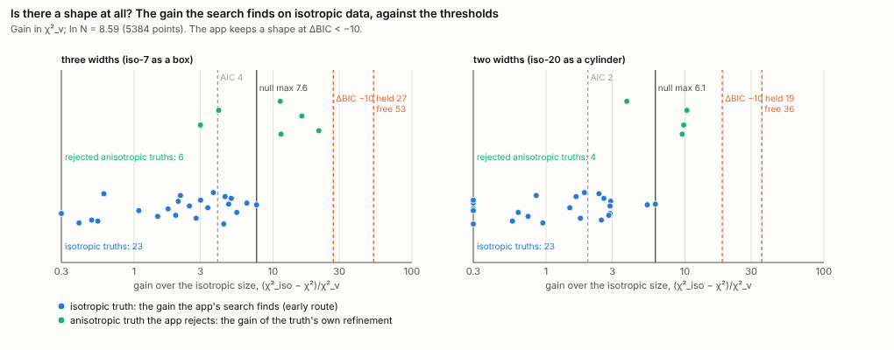

### 5.6 Which solid?

Every solid was searched on seed 1 of each case: 26 synthetic runs kept the truth's solid,
and every run had all six fits.
- **The class is rarely chosen right.** The truth's class ranks first by χ² in 11 of 26
  runs, by BIC in 11, by AIC in 11.
- **It is never ruled out.** It is always within the calibrated plausible set (Δ ≤ 12.55),
  where a median of 6 of the 6 solids lie.
- **Thresholds do not help.** The truth's ΔBIC to the best solid has median 0.6 and maximum
  23.7. A threshold that never excludes the truth (25) keeps all six in the median run.
- **On the proxies** (all boxes), the box ranks first by χ² in 5 of 12 runs (the elliptic
  cylinder also in 5), first by BIC in 2 of 12, and is in the 95 % BIC set
  in 3. Spheroids and elliptic cylinders fit the misfit better.
- **Occam fails too.** "The simplest solid within ΔBIC 10" picks the wrong class half the
  time, and its intervals cover 62–69 %.

**At these counts the data do not determine the solid's class.** The class is the user's
modelling choice. What the fits share are averaged column lengths (§6.2), not dimensions.

### 5.7 Verdict rules on the truths

The uniqueness study joined the pieces into two rules:
- **condP:** profile intervals, the D rule, today's angular radius, and the jackknife when
  flagged;
- **condD:** condP plus the refined minima of §5.1, unioned when their flip probability is
  at least 5 %.

A run is then "unique" (everything determined), "part" (the thinnest extent and the most
distinct direction determined), "none", or "isotropic". Scored at 10° (`tables/uniq-score10.md`):

| Rule | Synthetic extents determined: accurate | Synthetic directions | Runs unique: accurate in full | Proxies: claims, wrong | Cost beyond today's report |
|---|---|---|---|---|---|
| today's report | 172: 166 | 65: 61 | 16: 16 | 43, 16 | 0 |
| condP | 198: 196 | 51: 51 | 15: 15 | 7, 0 | +1040 clean, +3860 flagged |
| condD | 192: 192 | 49: 49 | 15: 15 | 7, 0 | +3570 clean, +7600 flagged |

**Both rules are conservative.** Of 49 synthetic runs accurate in full, 15 are called
unique. The plate normal is called determined in 34 of 72 runs, although 67 are within
10°.

**At 15°**, condD gives 18 unique, 43 part and 19 none, still with no wrong claim.

**Stability is moderate:** the same verdict on all 3 realisations in 14 of 32 cases.

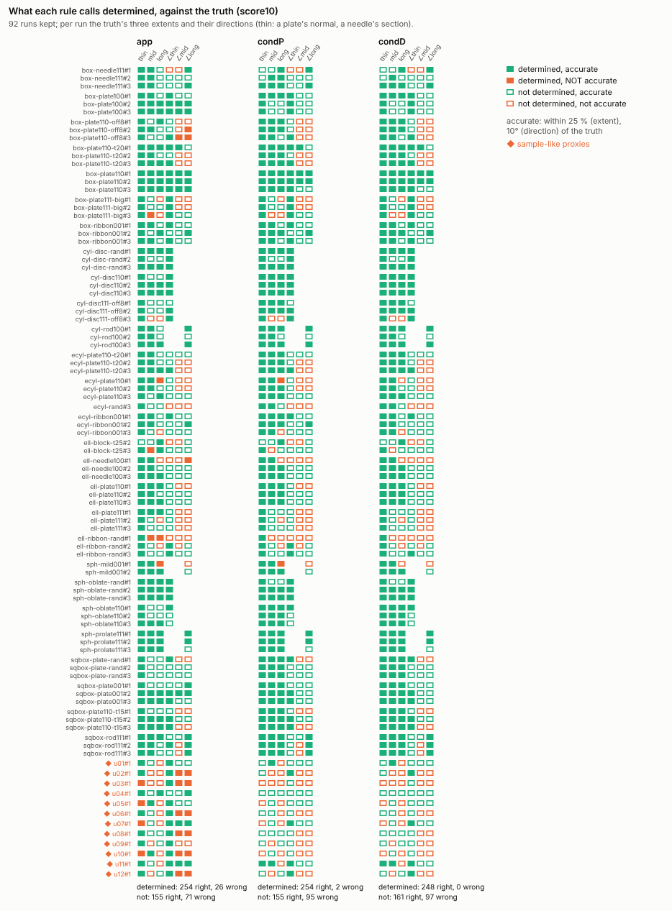

*Filled: called determined. Green: accurate. Orange: not. Totals at the foot: today 254
right and 26 wrong claims, condP 254 and 2, condD 248 and 0. `scripts/uniqueness/fig-matrix.mjs`
on the rescored `score.json` (`fix/src/score.mjs`: a round section's diameter with its esd). Interval half-width against the actual error per
quantity: `fig/uniq-intervals.png`.*

## 6. One result with its resolution

### 6.1 Intervals tried (presentation study)

All quantities are on the reported fit. Coverage is the share of the 80 synthetic runs
whose truth lies inside the stated 95 % interval. hi/lo is the median ratio of the closed
intervals (open ones counted separately). The cost is in evaluations beyond today's search
and report (`tables/pres-eval-synth.md`).

| Approach | Thinnest | Middle | Longest | hi/lo thin / mid / long (open) | Principal axis covered (of claimed), median cone | Extra cost |
|---|---|---|---|---|---|---|
| P0 today: D ± 2σ (held/free in quadrature), cones 2.45σ | 89 % | 79 % | 88 % | 1.09 / 1.28 / 1.51 (0 / 0 / 1 open; 4 intervals reach 0 nm) | 95 % of 78, 11.1° | 0 |
| P0w: today's esds taken in the width, W ± 2σ_W | 90 % | 81 % | 86 % | 1.09 / 1.25 / 1.48 (0 / 0 / 4) | as P0 | 0 |
| P1: width profiles | 88 % | 85 % | 86 % | 1.07 / 1.19 / 1.29 | as P0 | +942 |
| E_appW(6): P0w widened to the search's ends within Δ 6 | 95 % | 96 % | 93 % | 1.09 / 1.35 / 1.61 (1 / 0 / 9) | 99 %, 16.9° | 0 |
| E_L(6): the same in column lengths, ends paired by column length | 95 % | 96 % | 93 % | 1.09 / 1.33 / 1.60 (0 / 0 / 10) | 99 % of 79, 16.8° | 0 |
| E_L(2) / E_L(10) | 93 / 98 % | 94 / 96 % | 90 / 93 % | | | 0 |
| **E_L(12.5): ends within the bootstrap's 5 % flip range** | **98 %** | **96 %** | **93 %** | **1.10 / 1.34 / 1.63 (0 / 0 / 12)** | **100 % of 79, 16.8°** | **0** |
| E_prof(6): profiles widened to the ends | 91 % | 94 % | 94 % | 1.08 / 1.31 / 1.44 | | +942 |
| P2: union over refined minima, each ± 2σ, within Δ 2 | 99 % | 98 % | 95 % | 1.12 / 1.80 / 2.04 (2 / 14 / 35) | 96 % | +5601 |
| P3: credible set / mixture / points over the minima (weights e^(−Δ/2)) | 91–100 % | 91–99 % | 94–98 % | mixture's 90th percentile up to 40.9 | | +5601 |
| P4: BIC-weighted union over the six solids (26 runs) | 96 % | 69 % | 81 % | 1.17 / 1.24 / 1.41 | 88 % | +18 889 |
| P5: Occam, the simplest solid within ΔBIC 10 (26 runs) | 69 % | 62 % | 69 % | | 88 % | +18 889 |

**Why E_L wins.** The search's own ends carry the near-equivalent minima, for free. Adding
them closes today's gap on the middle length (79 % → 96 %). Two choices make it work:
- **Taking the esds in the width** avoids today's open or negative lower limits. A linear
  esd of 28 nm on 30 nm reads 2–58 nm.
- **Pairing ends by column length**, not by the solid's axis classes, keeps different
  labellings of one morphology from widening the interval. An elliptic cylinder with its
  axis on the thin extent or on the middle one says the same thing to the data.

**Which Δ for the ends.** The first version of this write-up took the ends within Δ 6, the
likelihood rule e^(−Δ/2) = 5 % that §5.3 finds overconfident, and chose 6 among 2, 4, 6 and
10 on the same 80 runs it was scored on. The calibrated value is 12.5 (§5.3). E_L(12.5)
gives the same claims as E_L(6) on these runs (169 extents determined against 170, all
within 25 %) and covers more of the thinnest extent (98 % against 95 %). It is the one
recommended, fixed before the hold-out runs of §6.4 were scored.

The refined minima (P2, P3) over-cover with intervals twice as wide, for +5601
evaluations (1.6× the search). Averaging across solids (P4) covers less, for 5× the
search.

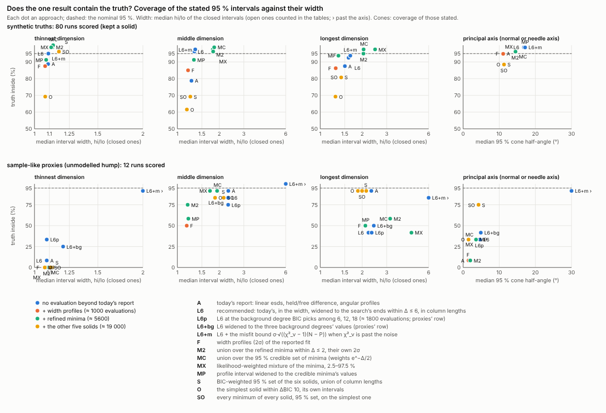

*Top: synthetic (80 runs). Bottom: the 12 proxies. Coloured by cost tier. No approach
covers the proxies' thickness without a model term (§6.3) or the jackknife (§6.4).
`scripts/presentation/fig-cover.mjs`.*

### 6.2 What the near-equivalent fits share

The question is what stays the same over every fit within Δ 6, of the same solid and of
the other solids. Below is the spread across those fits against the reported fit's error,
on 80 synthetic runs (median / 90th percentile):

| Quantity | Spread over the fits | Error from the truth |
|---|---|---|
| harmonic mean column length over all directions ("one size") | 0.8 % / 2.0 % | 1.0 % / 2.5 % |
| each family's mean column length | 0.9 % / 5.1 % | 1.5 % / 4.5 % |
| shortest member's column length (≈ thickness) | 2.8 % / 10.1 % | 1.5 % / 5.1 % |
| each member's column length, sorted in its family | 4.1 % / 16 % | 2.0 % / 8.8 % |
| the solid's principal column lengths (its dimensions) | 6.6 % / 33 % | 3.2 % / 13.9 % |

**The data fix averaged column lengths and the thickness.** The fits part on the long
dimensions. Hence the report states column lengths with labels, plus one size over all
directions. On the proxies the harmonic mean spreads 1.7 % but is 13.9 % off: that is the
misfit's bias.

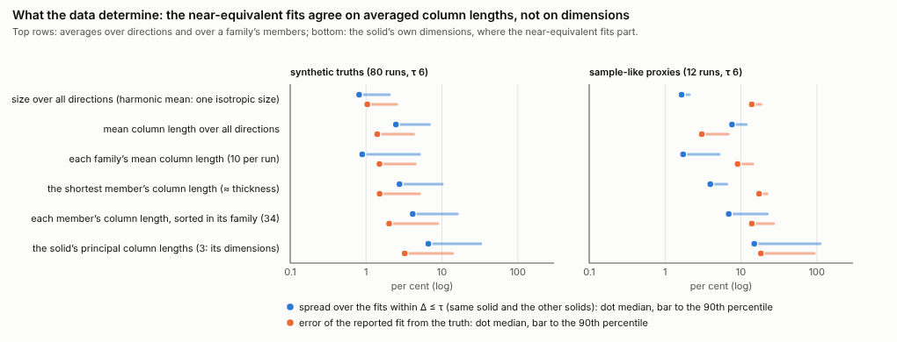

### 6.3 The model term: the background degree, chosen with the shape

**The bias is not noise.** On the proxies the unmodelled hump biases the χ²-best: the
thickness reads 6–28 % thin and the normal 5–9° off [110] (§3.4). No interval built from
the fit removes a bias; a model term can. The term tried is the Chebyshev background's
degree.

**Refit only (presentation study).** The kept solid was refined again from itself with a
background of degree 6 (the harness's), 12 and 18, and BIC (χ²/max(1, χ²_ν) + P ln N) picked
the degree: 18 on 12 of 12 proxies (χ²_ν 1.04–1.42 → 0.99–1.08), 6 on 26 of 26 synthetic
seed-1 runs. The median thickness error fell from 17.6 % to 5.5 %. The normal did not move,
but by construction: the refit starts from the degree-6 solid and stays in its basin, tries
no lattice frame and runs no search, and on 10 of 12 proxies it kept the solid held at the
degree-6 frame, 4.9–9.0° off [110].

**Searched again at the picked degree** (added in review; `fix/u-pipe.mjs` in `fix/root18`).
The whole refinement ran again from the CIF with a degree-18 background: the app's search,
its report, the misfit flag and the jackknife. It ran on the 12 proxies and on the 12 fresh
ones (v01–v12, drawn once from the same ranges; nothing was set on them).

| | u01–u12 | v01–v12 (fresh) |
|---|---|---|
| Degree 6, the app's search: thickness error, median | 18 % thin | 20 % thin |
| … normal error, median; held on the lattice | 5.8°; 1 of 12 | 6.0°; 1 of 12 |
| Misfit flag at degree 6 (worst segment > 1.25) | 12 of 12 | 10 of 12 (missed: v03 at 1.17, v11 at 1.24) |
| BIC pick over 6, 12, 18 (refits) | 18 on 12 | 18 on 11, 12 on 1 (v11) |
| BIC(12) − BIC(6) | −133 to −1220 | −165 to −803 |
| Refit at the pick, no search: thickness, normal (medians) | 6 %, 5.7° | 6 %, 5.6° |
| **Searched at degree 18: thickness error, median (worst)** | **2 % (8 %)** | **2 % (8 %)** |
| … largest dimension error, median | 7 % | 8 % |
| … normal error, median (worst); held on the lattice | 0.0° (6.0°); 11 of 12 | 0.0° (6.0°); 9 of 12 |
| … misfit flag at degree 18 | 2 of 12 (u05 1.27, u08 1.26) | 0 of 12 |
| Evaluations at degree 18, mean: isotropic fit, search, report, jackknife | 520, 4584, 2348, 1769 | 512, 4613, 2321, 2123 |

(v11 was searched at 18 although BIC picked 12; its refit at 12 gives the same thickness.)
The normals that stay off after the new search are those of truths that are themselves off
the lattice (u08 6°, v03 4°, v11 6°, all held on [110]; v08, 8° off, comes out free 3.7°
from it) and two free fits 5° off an on-lattice truth (v04, v07). The thickness errors over
5 % are u04 (+5 %), u08 (+8 %) and v04 (−8 %).

**What BIC does without a hump.** It keeps degree 6 on the 26 synthetic seed-1 runs, with
BIC(12) − BIC(6) between +38 and +50. That is expected and tests nothing: their background
(Chebyshev + 1/2θ) is in the model's own family. The two misfits outside it (§3.2, one run
each on four plates):
- *air*, a low-angle exponential: the flag never fires (worst segment ≤ 1.13) and BIC keeps
  degree 6 (+30 to +48). Three of the four solids come out as on clean data (thickness
  within 3 %, normal 0°). sqbox-plate001-air lands free, 7.7° off, with its side 48 % long,
  where its clean twin (seed 1) is held on [001] within 4 %. Whether the air term or the
  noise draw does that was not separated.
- *mix*, a second population at half the size with 30 % of the volume: the flag never fires (≤ 1.14)
  and BIC keeps degree 6 (+40 to +49). The thickness reads 12–21 % thin, near the
  volume-weighted thickness of the mixture (15 % below the larger population's), and two of
  the four normals come out 7–10° off. Neither the flag nor the pick sees a size
  distribution.

**One refit at degree 12 is a better misfit test than the segment flag.** BIC(12) − BIC(6)
separates all 24 proxies (−133 to −1220) from all 34 runs without a hump (+30 to +50),
including the two fresh proxies the flag missed (v03 −165, v11 −205). The refit costs
900–1300 evaluations (median per set) besides its isotropic fit (about 470). The flag stays
as the jackknife's trigger.

**The pipeline, in order** (§7 step 5):
1. the search at degree 6, and the misfit flag from the line segments at the best free fit;
2. the kept solid refitted at degree 12; when BIC prefers it, at 18 too, and BIC picks;
3. when the pick is above 6, the refinement again from the CIF at that degree: isotropic
   fit, search, report;
4. the jackknife on every run whose pick moved or whose flag fired;
5. the report's intervals (E_L(12.5), §6.1) from the new search's ends.

Its cost on a run whose pick moves, with today's search: about 4370 (degree 6) + 2970 (the
two refits with their isotropic fits) + 7450 (isotropic fit, search and report at 18) + 1950
(jackknife) ≈ 16 700 evaluations, against 5960 for today's search and report: 2.8×. With
forward differences in both searches, about 12 600 (2.1×). On a run whose pick stays at 6 it
adds the one refit, about 1470.

**When to choose it matters.** The degree must be chosen with the shape. Chosen at the
isotropic stage, BIC picks 18 on 19 of 30 synthetic truths, because the background soaks
up the shape's misfit. Once chosen with the shape, the second refinement uses it from the
start.

**A Cauchy–Schwarz bound** on what an unmodelled signal can do to each parameter
(σ_p·‖s‖_W, with ‖s‖² from the excess χ²) is too loose to be a number: u09 gets 39 % and
18°, u04 gets 90 % and 140°. Its test, χ²_ν > 1 + 2√(2/(N − P)), is still a usable flag.

**Limits.** A degree-18 Chebyshev absorbs this hump because the hump is smooth and 6° wide.
A narrower or structured misfit may not be absorbed, and a size distribution is not (the
*mix* runs). The backlog's amorphous-hump term, the direct model, was not tested.

### 6.4 The studies' rules scored alike, and the merged rule

The presentation study scored coverage, and the uniqueness study scored claims. Here both
are scored both ways on the same runs, with their own intervals
(`scripts/writer/cross.mjs`, `tables/rules-scored-alike.md`). The merged rule takes:
- E_L6's extents;
- today's angular radius, 2σ of `turnEsds` (no direction where the esd exceeds 30°);
- the D rule, on E_L6's extents;
- the jackknife when the worst segment flags.

| Rule (80 synthetic runs) | Thinnest / middle / longest covered | Extents determined: accurate | Directions covered | Directions determined: accurate | Runs resolved: accurate in full |
|---|---|---|---|---|---|
| today (P0, 2.45σ cones) | 71 / 63 / 70 | 146: 134 | 184/194 | 39: 36 | 3: 3 |
| today (2σ, as the uniqueness study takes it) | 66 / 46 / 57 | 186: 178 | 178/194 | 65: 61 | 21: 20 |
| E_L6 alone | 76 / 77 / 74 | 170: 170 | 186/189 | 21: 21 | 7: 7 |
| **merged rule** | **76 / 77 / 74** | **170: 170** | **190/194** | **48: 48** | **12: 12** |
| condP | 73 / 73 / 71 | 198: 196 | 190/194 | 51: 51 | 15: 15 |
| condD | 76 / 74 / 73 | 192: 192 | 192/194 | 49: 49 | 15: 15 |

| Rule (12 proxies, all flagged) | Thinnest / middle / longest covered | Extents determined: accurate | Directions covered | Directions determined: accurate | Thinnest hi/lo (median) |
|---|---|---|---|---|---|
| today (2σ) | 1 / 11 / 11 | 15: 11 | 9/36 | 28: 16 | 1.08 |
| E_L6 alone | 1 / 10 / 5 | 14: 10 | 28/36 | 11: 11 | 1.08 |
| **merged rule** | **12 / 11 / 11** | **1: 1** | **35/36** | **6: 6** | **1.91** |
| condP | 12 / 11 / 12 | 3: 3 | 35/36 | 4: 4 | 1.91 |
| condD | 12 / 12 / 12 | 3: 3 | 36/36 | 4: 4 | 1.91 |

The two "today" rows reconstruct the same report from the same recorded esds. They differ
in how fitted axes are paired with the truth's, in how grouped extents are handled, and in
the cone (2.45σ against 2σ). The comparison holds within each row.

**The merged rule makes no wrong claim on either set.** It has condP's coverage or better
on the synthetic runs, and it costs nothing beyond today's report unless the flag fires
(then about 2100 evaluations for the jackknife). It claims fewer extents than condP (170
against 198): it gives up the long extents that only a profile tightens, which is where
condP's 2 wrong claims were. condP's profile costs about +1040 evaluations a run; it buys
28 more determined extents and 3 more directions, with 2 of the extents wrong.

**Under misfit it says what the proxies allow and no more:**
- the thickness as a range (median hi/lo 1.91), which contains the truth on 12 of 12;
- the normal to within about 10° of [110];
- the lateral size as a lower bound or a wide range.

The jackknife was measured at background degree 6. After the background pick of §6.3
the misfit flag may not fire. Whether it does, and how wide the jackknife is then, is the
first thing to measure (§8).

### 6.5 The result card

**One card a run, one solid**, drawn at its values (held when the app holds it). The
proposal, joining both studies' vocabularies:

- **Headline:**
  - the habit, from the intervals: *plate* when the thinnest extent is at most half the
    middle one by its bounds; *needle* when the longest is at least twice the middle;
    *lath* when both hold; *block* otherwise;
  - the resolution: *resolved* (every extent and direction determined), *partly resolved*
    (the thickness and the normal, or a needle's section and axis), *not resolved*, or
    *one size* (no solid kept).
- **Each extent** is a column length ⟨L⟩_V along the solid's axis. These are
  class-independent and are what the data measure. Each comes with its interval and a
  word:
  - *measured* (hi/lo ≤ 1.25²);
  - *range* (closed, wider);
  - *lower bound* (open above).
- **Each direction** is given as the simplest lattice direction within its radius, with
  that radius:
  - *fixed* (≤ 10°);
  - *approximate* (≤ 30°);
  - none beyond 30°, or where its extent is not told apart from another ("free about the
    normal").
- **Size over all directions:** the harmonic mean column length as one sphere's diameter,
  ±3 %. It is the isotropic fit's reading, and within 3 % on 78 of 80 synthetic runs (1.0 %
  median error).
- **A discrete alternative** is named only when it is distinct (§5.2) and Δ ≤ 12.5. For
  example: *or along [1-1-1] (Δ 6.2, flip 14 %)*. This needs the minima stage of §5.1.
- **The model's part:**
  - the misfit flag;
  - the background degree picked, and the spread of the values over the degrees;
  - a sentence that the solid's class is not determined by the data, and that the lengths
    hold for every class within the plausible set.

**Example cards**, written by `fix/src/cards.mjs` from the runs' records (the merged rule with
E_L(12.5); the bracketed check against the truth is for this write-up, not for the card).
They include the cases where the rule fails.

At background degree 6, as the app refines today:

> **box-plate110#1** (truth: box 12.0 × 10.0 × 2.00 nm).
> *Plate, partly resolved.* Misfit not flagged (worst line segment χ²_ν 1.09).
> Thickness 1.99 nm (1.93–2.05), measured, along [110] ±5.6° (fixed).
> Middle 9.93 nm (8.96–11.1), measured, no direction (not told apart from another extent).
> Longest 11.7 nm (10.6–14.3), measured, no direction (not told apart from another extent).
> Size over all directions 4.57 nm ±3 % (one sphere's diameter).
> Drawn: the box 11.7 × 9.93 × 1.99 nm, held on the lattice.
> [Check against the truth: every stated interval and radius holds.]

> **u09#1** (truth: box 10.0 × 22.0 × 2.50 nm).
> *Block, not resolved.* Misfit flagged (worst line segment χ²_ν 1.39).
> Thickness 2.11 nm (1.36–3.29), a range, along [110] (9.0° from it) ±10.4° (approximate).
> Middle 15.4 nm (5.40–44.0), a range, no direction (not told apart from another extent).
> Longest 25.8 nm, over 17.5 nm, a lower bound, no direction (not told apart from another extent).
> Size over all directions 5.17 nm (one sphere's diameter).
> Drawn: the box 15.4 × 25.8 × 2.11 nm, orientation free.
> [Check against the truth: every stated interval and radius holds.]

> **u11#1** (truth: box 20.0 × 23.0 × 2.60 nm).
> *Plate, partly resolved.* Misfit flagged (worst line segment χ²_ν 1.35).
> Thickness 2.28 nm (1.89–2.74), measured, along [110] (4.9° from it) ±3.1° (fixed).
> Middle 19.9 nm (13.3–39.5), a range, no direction (not told apart from another extent).
> Longest 46.3 nm, over 20.2 nm, a lower bound, no direction (not told apart from another extent).
> Size over all directions 5.70 nm (one sphere's diameter).
> Drawn: the box 19.9 × 46.3 × 2.28 nm, orientation free.
> [Check against the truth: thickness direction 4.9° off, radius 3.1°.]

> **ecyl-ribbon001#1** (truth: ellcyl 4.00 × 12.0 × 30.0 nm).
> *Lath, partly resolved.* Misfit not flagged (worst line segment χ²_ν 1.02).
> Thickness 3.68 nm (3.49–3.84), measured, along [11̅0] ±4.1° (fixed).
> Middle 9.54 nm (8.72–10.5), measured, along [110] ±16.4° (approximate).
> Longest 31.8 nm (22.0–467), a range, along [001] ±16.4° (approximate).
> Size over all directions 8.00 nm ±3 % (one sphere's diameter).
> Drawn: the ellcyl 37.4 × 11.2 × 3.68 nm, held on the lattice.
> [Check against the truth: thickness 3.40 nm outside its interval.]

> **iso-7#1**. *One size:* 7.04 nm.
> No solid is supported at the app's threshold: the best shape found has ΔBIC +12 against one size, and −10 is needed.

> **ell-block-t25#1** (truth: ellipsoid 8.00 × 11.0 × 16.0 nm). *One size:* 10.7 nm.
> No solid is supported at the app's threshold: the best shape found has ΔBIC −4 against one size, and −10 is needed.
> [Check: the truth's own solid gains 21.4 χ²_ν over one size.]

After the background pick of §6.3 (degree 18, searched again):

> **u09#1** (truth: box 10.0 × 22.0 × 2.50 nm).
> *Plate, not resolved.* Misfit not flagged (worst line segment χ²_ν 1.04).
> Thickness 2.44 nm (2.27–2.63), measured, along [110] (3.4° from it) ±12.9° (approximate).
> Middle 11.4 nm (8.12–18.8), a range, no direction (not told apart from another extent).
> Longest 22.1 nm (15.1–36.6), a range, no direction (not told apart from another extent).
> Size over all directions 5.70 nm ±3 % (one sphere's diameter).
> Drawn: the box 22.1 × 11.4 × 2.44 nm, orientation free.
> [Check against the truth: every stated interval and radius holds.]

> **u11#1** (truth: box 20.0 × 23.0 × 2.60 nm).
> *Plate, partly resolved.* Misfit not flagged (worst line segment χ²_ν 1.09).
> Thickness 2.63 nm (2.47–2.82), measured, along [110] ±8.8° (fixed).
> Middle 21.1 nm (18.4–27.0), measured, no direction (not told apart from another extent).
> Longest 25.6 nm, over 12.0 nm, a lower bound, no direction (not told apart from another extent).
> Size over all directions 6.43 nm ±3 % (one sphere's diameter).
> Drawn: the box 21.1 × 25.6 × 2.63 nm, held on the lattice.
> [Check against the truth: every stated interval and radius holds.]

> **u08#1** (truth: box 16.0 × 20.0 × 2.30 nm).
> *Plate, partly resolved.* Misfit flagged (worst line segment χ²_ν 1.26).
> Thickness 2.48 nm (2.36–2.61), measured, along [101] ±8.7° (fixed).
> Middle 11.6 nm (8.97–15.9), a range, along [101̅] ±9.3° (fixed).
> Longest 20.5 nm (17.2–25.4), measured, along [010] ±4.4° (fixed).
> Size over all directions 5.78 nm (one sphere's diameter).
> Drawn: the box 11.6 × 2.48 × 20.5 nm, held on the lattice.
> [Check against the truth: thickness 2.30 nm outside its interval; middle 16.0 nm outside its range.]

**What the examples show.**
- **u09 at degree 6** is a *block* by the habit rule, not a plate: its own intervals
  (thickness up to 3.29 nm, middle from 5.40 nm) do not establish a plate. The first
  version of this write-up called it a plate in a card written by hand.
- **u11 at degree 6** states its normal 4.9° from [110] within 3.1°, and the truth lies on
  [110]: the radius describes the noise, not the misfit's bias. The jackknife does not
  widen it enough there. After the pick and a new search the plate is held on [110].
- **ecyl-ribbon001** states a thickness of 3.49–3.84 nm against 3.40: one of the 6 extents
  out of 169 whose truth lies outside the stated interval on the synthetic runs (§6.4).
- **u08 after the pick** is held on [110] while the truth is tilted 6° off; the thickness
  reads 8 % thick, outside its interval. A held frame next to the truth is the one
  weakness the pick does not remove (as box-plate110-off8 #2 on clean data).
- **One size.** On ell-block-t25 #1 the card says no solid is supported, while the truth's
  own solid gains 21.4 χ²_ν over one size, more than any isotropic null (§5.5). Of the 10
  synthetic runs the app rejects, 7 are such cases. The card therefore says "not supported
  at the app's threshold", not "no shape".

**What changes for u09.** Today the card gives its thickness as 2.11 nm with an esd of
0.04 nm, and its normal with an angular esd of 0.6°. The truth lies about 10 and 15 esd
away. At degree 6 the merged rule states a thickness range that holds. After the pick and a
new search the thickness reads 2.44 nm (2.27–2.63) against 2.50.

**The class line** of the presentation study ("not determined, 5 of 6 fit within ΔBIC
25") needs the other five solids searched, which is +19 000 evaluations. It is better as
an optional "compare solids" action than as a default.

**Precision over the 3 noise realisations** (presentation study, E_L6 cards):
- status the same in 27 of 30 cases;
- habit the same in 23 of 25 with a solid in all three;
- level the same in 25 of 25;
- the three lengths' intervals overlap in 24 of 25;
- the principal axis in the same family in 20 of 21;
- the sd of the thickness over seeds is 1.7 %, against a stated half-width of 4.1 %.

With the uniqueness study's verdicts (condD) the same verdict holds on all 3 realisations
in only 14 of 32 cases: verdicts at a threshold flip more often than labels.

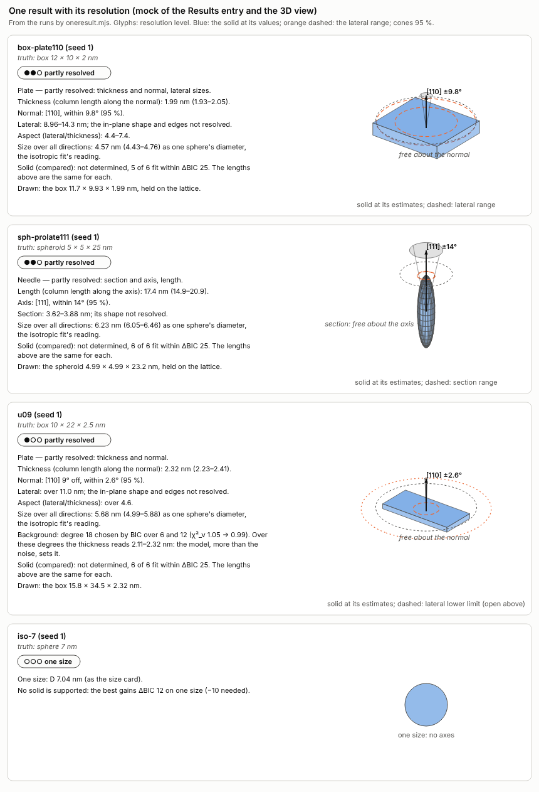

*The presentation study's mock, from four runs. It shows E_L6 without the jackknife: on
u09 the merged rule widens the thickness and the normal as in the card above.
`scripts/presentation/fig-mock.mjs`. Per-run intervals against the truth:
`fig/pres-forest.png`.*

## 7. Recommendation and plan

The steps are ordered by gain over risk. Each is independent of the ones after it.

| Step | What | Expected gain (measured on the harness) | Risk | Check before release |
|---|---|---|---|---|
| 1 | **Forward differences** in every refinement of the search (one displaced point a non-linear column, the pattern at v reused); **no covariance** in intermediate refinements; the returned fit's covariance once, central | evaluations 3551 → 1813 a search (0.51×); wall 25.2 → 15.0 s (paired); outcomes 110/110 unchanged | none seen: columns within 10⁻⁴ of central; outcomes, solids and the report unchanged | the engine suites; this harness's 110 runs, which must give the same outcomes |
| 2 | **Held-frame dedupe** (a frame equal to one already refined, up to axis signs) | −88 evaluations a run (2.5 %); identical results by construction | none | |
| 3 | **Keep the search's ends** (each refinement's solid and χ²) in `freeShape`'s result; report **E_L6**: today's esds in the width, widened to the ends within Δ 6, in column lengths, paired by column length | synthetic coverage 89/79/88 % → 95/96/93 %; no open or negative lower limits; 0 evaluations | brief ends have rounded faces (χ² within about 1 %); built on the app's search: a cheaper search's ends give slightly less (§4.5) | |
| 4 | **D rule** for directions; today's `turnEsds` radius (2σ) | wrong direction claims 4 → 0 on synthetic runs; 0 evaluations | fewer directions stated (48 against 65) | |
| 5 | **Misfit flag** (worst segment χ²_ν > 1.25, one segment a line) and **jackknife** over reflections when it fires | proxies: thickness covered 1/12 → 12/12, wrong claims 16 → 0; ~2100 evaluations (11 s) on flagged runs only | threshold set on one kind of misfit (a hump at 30°); unknown on real misfits | the user's 33A…38D: does it fire, and how wide is the thickness? |
| 6 | **Card**: habit, resolution level, labels per length and direction, size over all directions, the model's part | one result in physical terms (§6.5) | wording; the class line needs a decision | |
| 7 | **Background degree chosen with the shape** (6/12/18 by BIC, after the search), when the misfit flag fires | proxies' thickness error 17.6 % → 5.5 %; ~1800 evaluations (10–20 s) on flagged runs | interaction with step 5 untested; the rule of running it only on flagged runs is untested (BIC kept degree 6 on all 26 synthetic runs where it was tried) | flag and jackknife after the pick, on the proxies and the real files |
| 8 | Optional: **halving** of the brief trials (2 → 4 → 8 iterations, keep 6 then 3) **with a misfit guard** (do not halve when the best brief's χ²_ν exceeds 1 + 3√(2/ν)) | a further 0.35/0.51 → −31 % on clean data | u11 lands at Δ 11.4 without the guard; the guard is untested; 2 wrong report claims from its ends | the harness's 110 runs with the guard |
| 9 | Optional: **distinct alternatives** (the minima of §5.1, barrier or merge by resolution, flip ≥ 5 %) as a "check other morphologies" action | names the u02, u03, u04, u07, u09, u10 alternatives; removes condP's 2 wrong long extents | +2500–3800 evaluations (15–25 s) | |
| 10 | Later: **keep threshold from isotropic nulls** (a gain of about 8 χ²_ν, three widths; 6.5, two) instead of ΔBIC < −10 | keeps 7 of 10 real mild shapes the app now rejects; rejects all 46 nulls | nulls at one size per body and one noise level | nulls over sizes, counts and bodies; the 7 through the full search and card |

**Expected cost on clean data** after steps 1–7, synthetic means:

| Part | Today | After steps 1–7 |
|---|---|---|
| Search | 3577 | about 1800 |
| Report (unchanged) | 2506 | 2506 |
| Total | 6083 | about 4300 (−29 %) |

The report's own profiles (`turnEsds`, the ball-pair profiles) are 4-iteration refinements
too. Forward differences there would likely halve that 2506 as well, which is untested; if
so, the total would be about 3050 (−50 %).

**Expected cost on flagged data**, proxy means:

| Part | Today | After steps 1–7 |
|---|---|---|
| Search | 4367 | 2337 (fwd, measured) |
| Report | 1595 | 1595 |
| Jackknife | — | 2103 |
| Background pick | — | about 1800 |
| Total | 5962 | about 7800 (+31 %) |

For that, the thickness bias falls by two thirds and the report makes no wrong claims.

**Not to do:**
- Broyden updates;
- the member Jacobian (unless an analytic ∂pV/∂H comes with it);
- briefs on half the points;
- a widths-surrogate pre-fit;
- log widths;
- sphere-curvature starts;
- more random starts;
- the parametric bootstrap in the app (117 s a run);
- model averaging over minima or solids;
- Occam;
- choosing the solid's class by BIC or χ².

## 8. Open questions

- **The real samples.**
  - 33A…38D and LaB6_real were not available. The proxies' hump at 30° is an assumption
    taken from BACKLOG and RIETVELD.md, and the misfit flag's threshold (1.25) was set
    between 1.207 (the worst synthetic run) and 1.311 (the mildest proxy).
  - Real misfits are untested: size distributions, strain, stacking faults, a wrong
    background.
  - Run on the real files: steps 1, 5 and 7, the flag, the jackknife, and the background
    pick.
- **The background pick and the flag.** Does the flag still fire after the background
  degree is picked, and how wide is the jackknife then? Both were measured at degree 6.
  The backlog's amorphous-hump term, the direct fix, was not tried.
- **Halving's guard** (step 8) was not run. Its ranking after 2 iterations measures speed
  of convergence, not destination.
- **fwd with the widths-screened starts** was not combined. Forward differences in the
  report's profiles (`turnEsds`) were not tried.
- **The free minimum near a held frame.** box-plate110-off8 seed 2: every search holds the
  plate on [110] while the free minimum lies 8° off, 2–3 χ²_ν lower. This is a weakness of
  the free refinement near a held frame, not of the starts.
- **Flat valleys.** Along poorly bounded lengths the refinement's shift test stops early,
  and χ² keeps falling towards the best: up to 7.8 χ²_ν short on u05, 5.8 on u03, 4.8 on
  box-plate110-off8#2, 3.7 on u12, 1.9 on u08 (§5.2). This inflates "near-equivalent
  minima", the reach counts and the candidate alternatives, and makes Δ ≤ 1 noisy. The
  convergence test along widths that tend to 0 is an optimiser defect to fix before Δ is
  used for reach or for naming alternatives.
- **The barrier test** uses a straight path, an upper bound. A nudged elastic band could
  merge some "distinct" minima.
- **Calibration samples.**
  - c = 8 comes from 51 pairs in 33 runs.
  - The isotropic nulls cover one size per body and one count level.
  - The solid-class comparison used seed 1 only.
  - Verdicts rest on 3 noise seeds per case.
- **Strong patterns.** Level 3 ("in-plane shape resolved") never occurred at these counts
  (strongest line 1100). Stronger patterns were not run.
- **Other lattices.** All cases are cubic SrTiO₃. The symmetry code in the comparisons
  (`compareSolids`, `align`, `alignL`, the barrier's alignment, the orientation grid's
  distinctness test) assumes m-3m. Other Laue groups need their own rotations.
- **Other profiles.** WPPM and log-normal profiles were not tested. Forward differences
  apply to them unchanged; the member Jacobian does not.
- **The fixture controls** used fixture files whose noise draw differs from what
  `tests/fixtures.mjs` writes today. Only those two runs are affected.

## 9. Files

- `FREE-SHAPE.md`: this file.
- [`scripts/`](scripts/README.md): every script behind the numbers and figures, in the
  work folder's layout, with how to rebuild the frozen engine (`git archive bf228ee`) and
  rerun each study. A run from this copy gave 4225 (app), 1799 (a4) and 1383 (c1)
  evaluations on box-plate110 seed 1, as in the batches.
- `tables/`: the summary tables quoted here.

  | Tables | Study |
  |---|---|
  | `baseline-table.md` | the baseline, per case |
  | `starts-*.md` | starts |
  | `opt-*` | optimizer: pilot, accuracy, stages, timings, benchmark, barriers |
  | `uniq-*.md` | uniqueness: scores at 10° and 15°, verdicts, cards, classes |
  | `pres-eval-*.md` | every interval approach on synthetic runs and proxies |
  | `common-reference.md`, `rules-scored-alike.md`, `ends-from-cheaper-searches.md` | this write-up's rescoring |

- `fig/`: PNG with its SVG source.

  | Figures | Study |
  |---|---|
  | `baseline-cases` | the baseline |
  | `starts-r1-cost`, `starts-r3-cost`, `starts-final-cost`, `starts-scatter-a4` | starts |
  | `opt-variants`, `opt-full-fwd`, `opt-full-c1`, `opt-path`, `opt-barriers` | optimizer |
  | `uniq-minima`, `uniq-bootstrap`, `uniq-null`, `uniq-claims`, `uniq-intervals` | uniqueness |
  | `pres-coverage`, `pres-forest`, `pres-invariants`, `pres-mock` | presentation |
  | `synthesis` | this write-up |

- **Not in the repository:** the per-run results (about 75 MB of JSON), the engine copies,
  and any data file of the user's.
